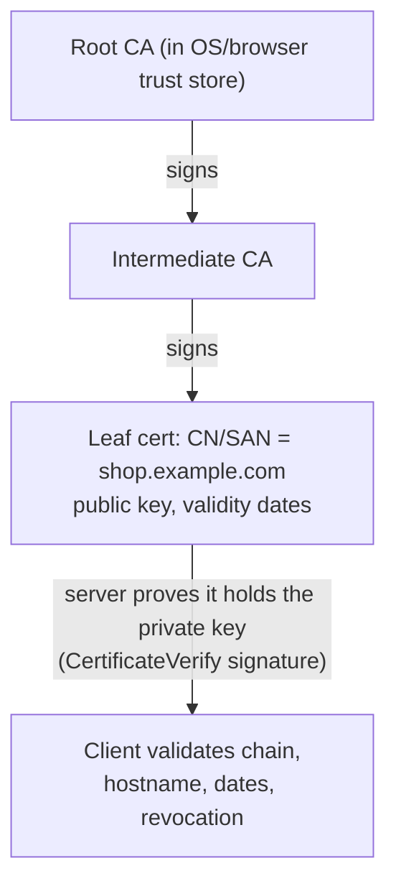

# Cryptography Basics for Engineers

> [!tldr] TL;DR
> Know which tool does what: **encoding** (Base64) is not security; **hashing** (SHA-256) is a one-way fingerprint for integrity; **password hashing** (Argon2id, bcrypt, scrypt) is deliberately slow and salted; **symmetric encryption** (AES-GCM, ChaCha20-Poly1305) protects data with one shared key; **asymmetric cryptography** (X25519, RSA, ECDSA/Ed25519) enables key exchange and **digital signatures**; **MACs** (HMAC) prove integrity with a shared key. TLS combines them, with **certificates** binding public keys to domain names. Big 2024–2026 shift: **post-quantum** key exchange (**ML-KEM**, FIPS 203) is now on by default in browsers and OpenSSL, and certificate lifetimes are shrinking toward 47 days. Never roll your own crypto; use vetted libraries (libsodium, platform APIs).

## Encoding vs hashing vs encryption vs signing
| | Reversible? | Key? | Purpose | Examples |
|---|---|---|---|---|
| **Encoding** | Yes, by anyone | No | Represent data | Base64, hex, UTF-8 ([[Encoding, Serialization & Character Sets]]) |
| **Hashing** | No | No | Fingerprint, integrity, dedupe | SHA-256, SHA-3, BLAKE3 |
| **Password hashing (KDF)** | No | Salt (not secret) | Store passwords | Argon2id, scrypt, bcrypt, PBKDF2 |
| **MAC** | No | Shared secret | Integrity + authenticity | HMAC-SHA256, Poly1305 |
| **Symmetric encryption** | Yes, with key | Shared secret | Confidentiality | AES-256-GCM, ChaCha20-Poly1305 |
| **Asymmetric encryption / KEM** | Yes, with private key | Key pair | Key exchange | X25519 (ECDH), ML-KEM, RSA-OAEP |
| **Digital signature** | Verify with public key | Key pair | Authenticity + integrity + non-repudiation | Ed25519, ECDSA P-256, RSA-PSS, ML-DSA |

## Hash functions
- Properties: deterministic, fixed-size output, **preimage resistance** (can't find input from hash), **collision resistance** (can't find two inputs with the same hash), avalanche effect.
- Use SHA-256/SHA-512, SHA-3, BLAKE2/3. **MD5 and SHA-1 are broken** for collisions (fine only for non-security checksums).
- Non-cryptographic hashes (xxHash, MurmurHash, CRC32) are for hash tables and checksums, not security ([[Consistent Hashing]]).

```bash
echo -n "hello" | sha256sum
# 2cf24dba5fb0a30e26e83b2ac5b9e29e1b161e5c1fa7425e73043362938b9824
```

## Password storage
```python
from argon2 import PasswordHasher          # pip install argon2-cffi
ph = PasswordHasher()                      # Argon2id, sensible defaults
stored = ph.hash("correct horse battery staple")   # includes salt + params
ph.verify(stored, attempt)                 # raises on mismatch
if ph.check_needs_rehash(stored): stored = ph.hash(attempt)   # upgrade params over time
```
- **Why not SHA-256?** It's fast: GPUs try billions/second. Password hashes are **slow and memory-hard** on purpose.
- **Salt**: unique random value per password (stored alongside) → identical passwords get different hashes, rainbow tables useless.
- **Pepper**: optional secret added from a separate store (HSM/KMS).
- OWASP guidance: **Argon2id** first choice (e.g. m=19 MiB, t=2, p=1 minimum), scrypt if unavailable, **bcrypt** (cost ≥ 10; note its 72-byte input limit) for legacy, PBKDF2 when FIPS is required.
- Also: rate-limit logins, MFA/passkeys, breached-password checks. See [[Authentication vs Authorization]], [[Authentication & Token Storage]].

## Symmetric encryption
- **AES** (block cipher) in an **AEAD** mode: **AES-GCM** or **ChaCha20-Poly1305**: encrypts *and* authenticates (tampering is detected).
- Never use ECB mode (patterns leak); never reuse a **nonce** with the same key in GCM (catastrophic).
- Keys come from a KMS/HSM; use **envelope encryption**: a data key encrypts data, a master key in KMS encrypts the data key; rotate master keys without re-encrypting everything.

```python
from cryptography.hazmat.primitives.ciphers.aead import AESGCM
import os
key = AESGCM.generate_key(bit_length=256)
nonce = os.urandom(12)                                 # unique per message
ct = AESGCM(key).encrypt(nonce, b"secret", b"header")  # associated data is authenticated
pt = AESGCM(key).decrypt(nonce, ct, b"header")
```

## Asymmetric cryptography
- Key pair: **public key** shared freely, **private key** secret.
- **Key exchange** (Diffie-Hellman / ECDH X25519): two parties derive a shared secret over an open channel; used in every TLS handshake. Ephemeral keys give **forward secrecy**.
- **KEM** (key encapsulation): sender encapsulates a random secret to the receiver's public key (how ML-KEM works).
- **Signatures**: sign a hash with the private key; anyone verifies with the public key. Used in TLS certificates, JWTs (RS256/ES256/EdDSA), code signing, Git commits, package signing ([[Supply Chain Security]]).
- Asymmetric ops are ~1000× slower than symmetric, so protocols use them to agree on a symmetric key (hybrid encryption).

## TLS and certificates (PKI)

- A certificate binds a **public key** to **domain names** (SAN), signed by a Certificate Authority. The browser validates the chain up to a trusted root, the hostname and validity.
- **Certificate Transparency** logs make mis-issuance publicly detectable.
- **ACME** (Let's Encrypt, cert-manager in Kubernetes) automates issuance and renewal; automation is now mandatory given shrinking lifetimes.
- **mTLS**: both sides present certificates; common for service-to-service auth in meshes.
- Handshake mechanics: [[Networking - OSI, TCP-IP & Protocols]].

## Post-quantum cryptography (PQC)
- A large quantum computer running Shor's algorithm would break RSA and elliptic-curve crypto (key exchange and signatures). Symmetric crypto and hashes only need larger sizes (AES-256 is fine).
- **Harvest now, decrypt later**: attackers can record TLS traffic today and decrypt it once quantum computers exist, which is why **key exchange** migrated first.
- **Hybrid key exchange**: combine classical X25519 with ML-KEM-768 (`X25519MLKEM768`); secure if either one holds.
- Signatures/certificates (ML-DSA, SLH-DSA) are larger and their rollout in the WebPKI is slower.

> [!info]+ 🆕 2025–2026: post-quantum and PKI changes (verified)
> - **2024-08-13: NIST published FIPS 203 (ML-KEM)**, FIPS 204 (ML-DSA) and FIPS 205 (SLH-DSA). On **2025-03-11** NIST selected **HQC** as a backup KEM based on different math (draft standard expected ~2026, final ~2027). NIST IR 8547 (draft, Nov 2024) proposes deprecating RSA/ECC at 112-bit security after **2030** and disallowing them after **2035**. ([NIST FIPS 203](https://csrc.nist.gov/pubs/fips/203/final), [NIST HQC news](https://www.nist.gov/news-events/news/2025/03/nist-selects-hqc-fifth-algorithm-post-quantum-encryption), [NIST IR 8547 ipd](https://nvlpubs.nist.gov/nistpubs/ir/2024/NIST.IR.8547.ipd.pdf))
> - **Chrome 131 (Nov 2024)** made hybrid **X25519MLKEM768** the default TLS key exchange on desktop, replacing the pre-standard Kyber codepoint. ([Bleeping Computer on Google's announcement](https://www.bleepingcomputer.com/news/security/chrome-switching-to-nist-approved-ml-kem-quantum-encryption/))
> - **OpenSSL 3.5 (2025-04-08, LTS to 2030)** added ML-KEM, ML-DSA and SLH-DSA and made **X25519MLKEM768** a default key share, so servers built on it negotiate PQ key exchange without config. ([OpenSSL 3.5 notes](https://openssl-library.org/news/openssl-3.5-notes/))
> - **Cloudflare Radar 2025**: post-quantum encrypted share of human traffic rose from 29% to **52%** during 2025, with a jump when Apple enabled it by default in its OS 26 releases (Sept 2025). ([Cloudflare](https://blog.cloudflare.com/radar-2025-year-in-review/))
> - **Certificate lifetimes**: CA/Browser Forum ballot **SC-081v3** (April 2025) cuts max TLS cert validity from 398 days to **200 days from 2026-03-15**, **100 days from 2027-03-15**, and **47 days from 2029-03-15**. ([CA/B Forum](https://cabforum.org/2025/04/11/ballot-sc081v3-introduce-schedule-of-reducing-validity-and-data-reuse-periods/))
> - **Let's Encrypt** shut down its **OCSP** service in 2025 (revocation via CRLs only) and made **6-day short-lived certificates** and IP-address certificates generally available in January 2026. ([OCSP end of life](https://letsencrypt.org/2025/08/06/ocsp-service-has-reached-end-of-life), [6-day GA](https://letsencrypt.org/2026/01/15/6day-and-ip-general-availability))

## Common mistakes
> [!warning] Don't
> - Invent algorithms or protocols; compose primitives yourself (use TLS, libsodium `secretbox`/`box`, JOSE libraries, platform keystores).
> - Use `Math.random()`/`rand()` for secrets; use a CSPRNG (`crypto.randomBytes`, `secrets`, `/dev/urandom`).
> - Compare MACs/tokens with `==`; use constant-time comparison to avoid timing attacks.
> - Store secrets in code, logs, or env files in repos; use a secrets manager.
> - Accept JWTs with `alg: none` or let the token choose the algorithm.
> - Encrypt without authentication (CBC without MAC → padding oracles).

## Senior perspective
- **Crypto agility**: be able to rotate keys and swap algorithms (PQC migration is the live example). Inventory where crypto is used (TLS termination points, JWT signing, data-at-rest, backups, SSH, code signing).
- Key management is the hard part: KMS/HSM, rotation, access auditing, separation of duties, backup of keys.
- Test that load balancers, proxies and firewalls handle larger PQ ClientHellos.
- Cert automation: with 200-day (2026) and eventually 47-day certs, manual renewal becomes an outage generator; monitor expiry anyway.
- Compliance (FIPS 140-3, PCI DSS) may dictate algorithms and modules.

## Interview questions
> [!question]- Hashing vs encryption vs encoding?
> Encoding transforms data for representation and is reversible by anyone. Encryption is reversible only with a key and provides confidentiality. Hashing is one-way, producing a fixed-size digest for integrity or lookup.

> [!question]- How should passwords be stored?
> With a slow, salted, memory-hard password hashing function: Argon2id (or scrypt, bcrypt for legacy), per-user random salt, parameters stored with the hash and upgraded over time. Never plain SHA-256 or reversible encryption.

> [!question]- Symmetric vs asymmetric encryption?
> Symmetric uses one shared key and is fast (AES-GCM) but needs a secure way to share the key. Asymmetric uses public/private key pairs, enabling key exchange and signatures without prior shared secrets, but is slow. TLS uses asymmetric to agree on a symmetric session key.

> [!question]- How does a digital signature work?
> The signer hashes the message and signs the hash with their private key; the verifier checks the signature with the public key. It proves the message came from the key holder and wasn't modified.

> [!question]- What is forward secrecy?
> Using ephemeral key exchange per session so that compromise of long-term keys doesn't reveal past session keys or recorded traffic.

> [!question]- Why migrate key exchange to post-quantum before signatures?
> Because of harvest-now-decrypt-later: recorded encrypted traffic can be decrypted in the future if the key exchange is broken. Signatures only need to be unforgeable at the time of verification, so they can migrate later. Hybrid X25519MLKEM768 is already the default in major browsers and OpenSSL 3.5.

> [!question]- HMAC vs signature?
> HMAC uses a shared secret: both parties can create and verify, so it proves integrity between parties who share the key. Signatures use a private key to sign and public key to verify, so anyone can verify and only the key holder can sign.

## Related
- [[CS Fundamentals Index]]
- [[Networking - OSI, TCP-IP & Protocols]] · [[How the Internet Works]] · [[Encoding, Serialization & Character Sets]]
- [[Authentication vs Authorization]] · [[JWT vs Cookies]] · [[Authentication & Token Storage]] · [[Frontend Security - XSS, CSRF, CSP & Trusted Types]] · [[Supply Chain Security]]

## Sources
- Jean-Philippe Aumasson, *Serious Cryptography* (2nd ed., No Starch, 2024)
- [OWASP: Password Storage Cheat Sheet](https://cheatsheetseries.owasp.org/cheatsheets/Password_Storage_Cheat_Sheet.html) · [Cryptographic Storage Cheat Sheet](https://cheatsheetseries.owasp.org/cheatsheets/Cryptographic_Storage_Cheat_Sheet.html)
- [RFC 9106: Argon2](https://www.rfc-editor.org/rfc/rfc9106) · [RFC 8446: TLS 1.3](https://www.rfc-editor.org/rfc/rfc8446)
- [NIST FIPS 203: ML-KEM](https://csrc.nist.gov/pubs/fips/203/final) · [NIST PQC project](https://csrc.nist.gov/projects/post-quantum-cryptography)
- [IETF draft: Hybrid ECDHE-MLKEM key agreement for TLS 1.3](https://datatracker.ietf.org/doc/draft-ietf-tls-ecdhe-mlkem/)
- [OpenSSL 3.5 release notes](https://openssl-library.org/news/openssl-3.5-notes/)
- [CA/Browser Forum Ballot SC-081v3](https://cabforum.org/2025/04/11/ballot-sc081v3-introduce-schedule-of-reducing-validity-and-data-reuse-periods/)
- [Let's Encrypt: 6-day and IP certificates GA](https://letsencrypt.org/2026/01/15/6day-and-ip-general-availability)
