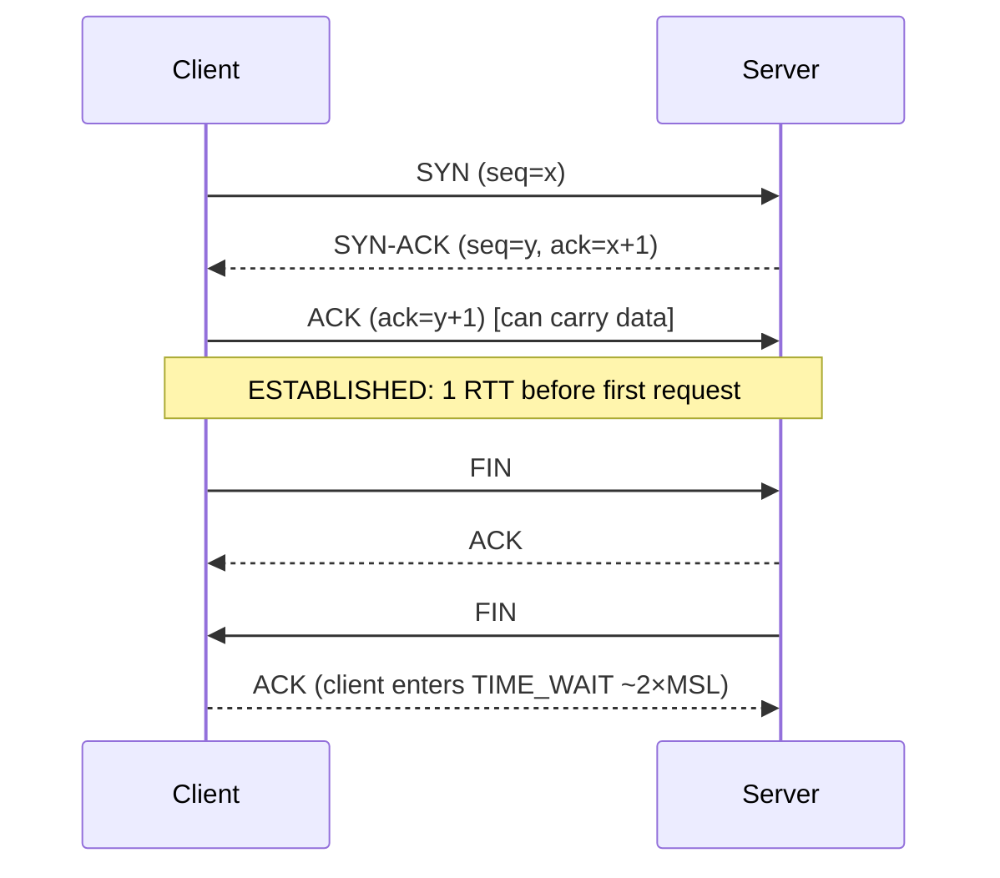

# Networking - OSI, TCP-IP & Protocols

> [!tldr] TL;DR
> The **OSI model** (7 layers) and the practical **TCP/IP model** (4 layers) describe how data is wrapped layer by layer: application → transport (TCP/UDP) → network (IP) → link (Ethernet/Wi-Fi). **TCP** opens connections with a **3-way handshake**, guarantees ordered delivery, and uses **congestion control** (slow start, CUBIC, BBR). **TLS 1.3** secures connections in **1 round trip**. **HTTP/1.1** → **HTTP/2** (multiplexing over one TCP connection) → **HTTP/3** (over **QUIC**, on UDP, no TCP head-of-line blocking, faster handshakes, connection migration). Browser-facing HTTP caching and real-time are in [[Networking - HTTP, Caching & Real-time]].

## Layer models
| OSI layer | TCP/IP layer | Unit | Examples | Devices |
|---|---|---|---|---|
| 7 Application | Application | Message | HTTP, DNS, SMTP, gRPC, WebSocket | L7 LB, API gateway |
| 6 Presentation | Application | | TLS (roughly), encoding, compression | |
| 5 Session | Application | | Sessions, RPC | |
| 4 Transport | Transport | Segment / datagram | TCP, UDP, QUIC | L4 LB, firewall |
| 3 Network | Internet | Packet | IP, ICMP, BGP routing | Router |
| 2 Data link | Link | Frame | Ethernet, Wi-Fi, ARP | Switch |
| 1 Physical | Link | Bits | Fiber, copper, radio | Hub, NIC |

**Encapsulation**: `[Ethernet [IP [TCP [TLS [HTTP data]]]]]`. Each layer adds a header; the receiver strips them in reverse. "L4 vs L7 load balancer" refers to these layers ([[Scalability Fundamentals]]).

## TCP in depth
### 3-way handshake and teardown

- Sequence numbers + acks → reliability and ordering; retransmit on timeout or 3 duplicate acks (fast retransmit).
- **Flow control**: receiver advertises a window (how much it can buffer).
- **Congestion control**: sender limits in-flight data (congestion window, cwnd) to avoid overwhelming the network.
- **TIME_WAIT** buildup on servers making many short outbound connections → use keep-alive/pooling.
- **Nagle's algorithm** + delayed ACK can add latency for small writes → `TCP_NODELAY` for interactive protocols.

### Congestion control
| Phase / algorithm | Behavior |
|---|---|
| **Slow start** | cwnd starts small (~10 segments) and doubles each RTT until loss or threshold |
| **Congestion avoidance** | Grow ~1 segment per RTT (additive increase) |
| **On loss** | Multiplicative decrease (Reno halves cwnd) |
| **CUBIC** | Default in Linux/Windows; cubic growth function, loss-based |
| **BBR** (Google) | Models bottleneck bandwidth and RTT instead of reacting to loss; better on lossy/long links |

Consequence: a new connection can't use full bandwidth immediately (slow start), which is why **connection reuse** and fewer round trips matter. Throughput ≤ window / RTT (bandwidth-delay product).

## TLS 1.3 handshake
```mermaid
sequenceDiagram
  participant C as Client
  participant S as Server
  C->>S: ClientHello (versions, cipher suites, key_share e.g. X25519MLKEM768, SNI, ALPN h2/h3)
  S-->>C: ServerHello (chosen key_share) + {EncryptedExtensions, Certificate, CertificateVerify, Finished}
  Note over C: verify cert chain + signature, derive keys
  C->>S: {Finished} + first HTTP request (encrypted)
  Note over C,S: 1 RTT total; 0-RTT possible on resumption (replayable! only idempotent requests)
```
- TLS 1.2 needed 2 RTTs; TLS 1.3 removed RSA key exchange and weak ciphers, always uses (EC)DHE → **forward secrecy**.
- Everything after ServerHello is encrypted, including the certificate.
- **SNI** tells the server which hostname (for multiple certs per IP); **ECH** (Encrypted Client Hello) hides it.
- **ALPN** negotiates the application protocol (h2, http/1.1).
- Certificates and PKI basics: [[Cryptography Basics for Engineers]].

## HTTP/1.1 vs HTTP/2 vs HTTP/3
| | HTTP/1.1 (1997) | HTTP/2 (2015) | HTTP/3 (2022) |
|---|---|---|---|
| Transport | TCP | TCP | **QUIC over UDP** |
| Format | Text | Binary frames | Binary frames |
| Multiplexing | No (one request at a time per connection; browsers open ~6) | Yes, many streams on one connection | Yes, independent streams |
| Head-of-line blocking | Application level | Solved at HTTP level, **still at TCP level** (one lost packet stalls all streams) | **Solved**: loss affects only its stream |
| Header compression | None | HPACK | QPACK |
| Handshake | TCP + TLS = 2 RTT | Same | **1 RTT** combined (0-RTT on resumption) |
| Connection migration | No | No | Yes (connection IDs survive Wi-Fi → 4G) |
| Server push | No | Yes (deprecated in browsers) | Spec'd, unused |

### QUIC
- Runs in user space over UDP; integrates TLS 1.3; encrypts almost all transport headers (prevents middlebox ossification).
- Per-stream reliability and ordering; its own congestion control (often CUBIC or BBR).
- Discovered via `Alt-Svc` header or DNS **HTTPS** records; falls back to TCP if UDP is blocked.
- Costs: more CPU than kernel TCP; some networks block or throttle UDP 443.

```bash
curl -v --http3 https://cloudflare.com      # needs curl built with HTTP/3
curl -sI https://www.google.com | grep -i alt-svc
openssl s_client -connect example.com:443 -tls1_3 -groups X25519MLKEM768   # OpenSSL 3.5+
```

## Other protocols worth knowing
| Protocol | Layer / transport | Use |
|---|---|---|
| DNS | App over UDP/TCP (53), DoH/DoT | Name resolution ([[How the Internet Works]]) |
| WebSocket | Upgraded HTTP/1.1 (or HTTP/2 extended CONNECT) | Full-duplex real-time |
| gRPC | HTTP/2 | Service-to-service RPC ([[gRPC vs REST]]) |
| SSH | TCP 22 | Remote shells, tunnels |
| SMTP/IMAP | TCP | Email |
| ICMP | Network | ping, traceroute, PMTU discovery |
| ARP | Link | IP → MAC on a LAN |
| DHCP | App over UDP | Assign IP addresses |

## Pitfalls
> [!warning] Pitfalls
> - Blaming HTTP/2 multiplexing for all latency: on lossy mobile networks TCP HOL blocking can make HTTP/2 worse than several HTTP/1.1 connections; HTTP/3 fixes it.
> - Using TLS 0-RTT for non-idempotent requests (replay attacks).
> - Ignoring connection reuse between services; new TLS connections per request burn CPU and RTTs.
> - Firewalls allowing TCP 443 but blocking UDP 443 → silent fallback, uneven performance.

## Senior perspective
- Latency is mostly **round trips**; count them per request (DNS, TCP, TLS, redirects, API chains).
- Tune keep-alive and idle timeouts consistently across client → LB → server to avoid resets (idle timeout of the LB shorter than the server's).
- Internal service mesh: mTLS everywhere, HTTP/2 or gRPC with connection pooling.
- For global users, terminate TLS/QUIC at the edge ([[CDN & Edge Computing]]).

> [!info]+ 🆕 2025–2026
> - **Post-quantum key exchange is now the default** in major TLS stacks: Chrome 131 (Nov 2024) switched to the standardized hybrid **X25519MLKEM768**; **OpenSSL 3.5 (2025-04-08, LTS)** offers X25519MLKEM768 as a default key share; Apple enabled it by default in its 2025 OS releases; Cloudflare saw **52% of human traffic** post-quantum encrypted by end of 2025. ([Chrome/Bleeping Computer](https://www.bleepingcomputer.com/news/security/chrome-switching-to-nist-approved-ml-kem-quantum-encryption/), [OpenSSL 3.5 notes](https://openssl-library.org/news/openssl-3.5-notes/), [Cloudflare Radar 2025](https://blog.cloudflare.com/radar-2025-year-in-review/))
> - **HTTP/3 share**: ~21% of requests to Cloudflare in 2025 (HTTP/2 ~50%, HTTP/1.x ~29%). ([Cloudflare Radar 2025](https://blog.cloudflare.com/radar-2025-year-in-review/))
> - Hybrid ML-KEM ClientHellos are ~1 KB larger, which can split the ClientHello across packets and break buggy middleboxes; test your load balancers and firewalls.

## Interview questions
> [!question]- Explain the TCP 3-way handshake.
> Client sends SYN with its initial sequence number; server replies SYN-ACK with its own and acknowledges the client's; client ACKs. Both sides now know each other's sequence numbers and the connection is established after one round trip.

> [!question]- What is head-of-line blocking and how does HTTP/3 fix it?
> In HTTP/2 all streams share one TCP byte stream, so a single lost packet stalls every stream until retransmitted. QUIC implements streams independently over UDP, so loss only blocks the affected stream.

> [!question]- Why is TLS 1.3 faster than TLS 1.2?
> The client sends its key share in the first message, so the server can respond with its share, certificate and Finished in one flight: 1 RTT instead of 2. Resumption allows 0-RTT data (with replay risk).

> [!question]- What is TCP slow start and why does it matter for web performance?
> New connections start with a small congestion window that grows each RTT, so they can't use full bandwidth immediately. Reusing connections and reducing bytes in the first round trips (e.g. ~14 KB initial window) improves load time.

> [!question]- L4 vs L7, in OSI terms?
> L4 (transport) sees TCP/UDP ports and connections; L7 (application) understands HTTP and can route by path, headers or cookies.

> [!question]- What does forward secrecy mean?
> Session keys come from ephemeral key exchange, so compromising the server's long-term private key later doesn't let an attacker decrypt past recorded traffic.

## Related
- [[CS Fundamentals Index]]
- [[How the Internet Works]] · [[Cryptography Basics for Engineers]] · [[Operating Systems Essentials]]
- [[Networking - HTTP, Caching & Real-time]] · [[gRPC vs REST]] · [[Nginx]] · [[CDN & Edge Computing]] · [[Scalability Fundamentals]]

## Sources
- Kurose & Ross, *Computer Networking: A Top-Down Approach*; Ilya Grigorik, [*High Performance Browser Networking*](https://hpbn.co/)
- [RFC 9293: TCP](https://www.rfc-editor.org/rfc/rfc9293) · [RFC 9438: CUBIC](https://www.rfc-editor.org/rfc/rfc9438)
- [RFC 8446: TLS 1.3](https://www.rfc-editor.org/rfc/rfc8446)
- [RFC 9000: QUIC](https://www.rfc-editor.org/rfc/rfc9000) · [RFC 9114: HTTP/3](https://www.rfc-editor.org/rfc/rfc9114) · [RFC 9113: HTTP/2](https://www.rfc-editor.org/rfc/rfc9113)
- [Google: BBR congestion control](https://research.google/pubs/bbr-congestion-based-congestion-control-2/)
- [OpenSSL 3.5 release notes](https://openssl-library.org/news/openssl-3.5-notes/)
- [Cloudflare Radar 2025 Year in Review](https://blog.cloudflare.com/radar-2025-year-in-review/)
