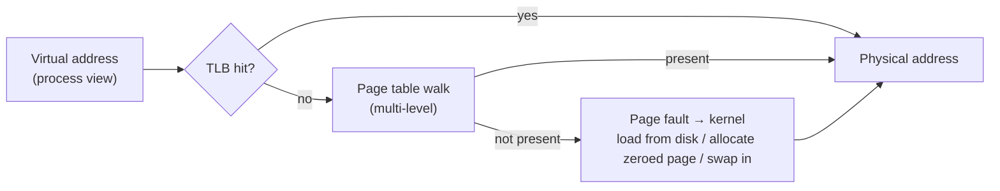

# Operating Systems Essentials

<Note>
**TL;DR**

The OS kernel shares the hardware among programs safely. A **process** is a running program with its own **virtual address space**; **threads** are execution units inside a process that share memory. The **scheduler** decides which thread runs on which core. **Virtual memory** maps each process's addresses to physical RAM in **pages**, enabling isolation, lazy loading and swapping. Programs ask the kernel for anything privileged through **system calls**. For servers, the **I/O model** matters most: blocking threads, non-blocking + **epoll/kqueue** event loops (Node.js, Nginx, Redis), or completion-based **io_uring**.
</Note>

## Kernel vs user space
- CPU runs in **user mode** (apps) or **kernel mode** (OS). Apps can't touch hardware or other processes' memory directly.
- **System call**: controlled entry into the kernel (`read`, `write`, `open`, `mmap`, `fork`, `socket`, `epoll_wait`). Each costs roughly 100 ns to a few µs (mode switch, cache effects).
- `strace -c ls` shows the syscalls a program makes.

## Processes vs threads
| | Process | Thread |
|---|---|---|
| Memory | Own virtual address space | Shares process memory (heap, globals), own stack + registers |
| Creation cost | Higher (`fork`, copy-on-write page tables) | Lower |
| Isolation | Crash/corruption contained | One bad thread can corrupt/crash all |
| Communication | IPC: pipes, sockets, shared memory, signals | Shared memory (needs synchronization: [Concurrency Primitives](/Software%20Engineering/CS%20Fundamentals/Concurrency%20Primitives)) |
| Context switch | More expensive (TLB flush without PCID) | Cheaper |

Variants: **green/virtual threads** and **coroutines** (Go goroutines, Java virtual threads, Kotlin coroutines, async/await) are scheduled in user space on top of a few OS threads: cheap to create (KBs instead of MBs of stack). See [Concurrency And Parallelism](/Software%20Engineering/Principles/Concurrency%20And%20Parallelism).

```bash
ps -eLf | head          # processes and their threads (LWP)
top -H -p <pid>         # per-thread CPU
cat /proc/<pid>/status  # memory, threads, context switches
```

### Process states and lifecycle
New → Ready → Running → (Blocked on I/O) → Ready → … → Terminated. `fork()` + `exec()` creates new programs on Unix; a parent must `wait()` or children become **zombies**; orphans are adopted by init/systemd. In containers, PID 1 must reap zombies ([Docker Basics](/Software%20Engineering/DevOps/Docker/Docker%20Basics)).

## Scheduling
- **Preemptive** multitasking: a timer interrupt lets the kernel switch threads after a time slice.
- Goals conflict: throughput, latency/responsiveness, fairness.
- Algorithms: FCFS, round robin, priority, multilevel feedback queues; Linux used **CFS** (fair share by virtual runtime) and since 6.6 uses **EEVDF** (earliest eligible virtual deadline first).
- **Context switch** cost: saving/restoring registers plus cache/TLB pollution, a few µs. Thousands of runnable threads = lots of switching.
- Container CPU limits use cgroups quotas; hitting the quota causes **throttling** (latency spikes) even when the node is idle.

## Virtual memory and paging

- Memory is split into **pages** (typically 4 KiB; huge pages 2 MiB/1 GiB). The **page table** maps virtual pages → physical frames; the **TLB** caches translations.
- Benefits: isolation, each process sees a large contiguous space, **lazy allocation** (memory committed on first touch), **copy-on-write** after `fork`, **memory-mapped files** (`mmap`), shared libraries loaded once.
- **Page fault**: minor (page in RAM, just not mapped) vs major (read from disk: ms).
- **Swapping** under memory pressure → thrashing; Linux **OOM killer** kills a process when out of memory (in Kubernetes: `OOMKilled` when exceeding the container limit).
- Page cache: the kernel caches file data in free RAM; why "free" memory looks low on healthy Linux servers and why databases rely on it.

## File systems and storage I/O
- A file = **inode** (metadata, block pointers) + directory entries (names → inodes). Hard links share an inode; symlinks point to a path.
- **File descriptors**: per-process integers referring to open files, sockets, pipes. `ulimit -n` caps them (servers with many connections need high limits).
- Writes go to the page cache; `fsync` forces them to disk. Databases call `fsync` on commit for durability ([Transactions & ACID](/Software%20Engineering/Databases/Database%20Round/Transactions%20%26%20ACID)).
- Journaling (ext4, XFS) and copy-on-write (ZFS, Btrfs) file systems protect metadata after crashes.
- Sequential I/O is far faster than random, especially on HDDs; SSDs narrowed but didn't close the gap ([Computer Architecture Basics](/Software%20Engineering/CS%20Fundamentals/Computer%20Architecture%20Basics)).

## I/O models (why Node.js, Nginx and Redis look the way they do)
| Model | How | Examples |
|---|---|---|
| **Blocking, thread per connection** | `read()` blocks the thread; one thread per client | Classic Apache prefork, JDBC, simple servers |
| **Non-blocking + readiness notification** | Sockets set non-blocking; `epoll` (Linux) / `kqueue` (BSD/macOS) reports which fds are ready; one thread handles thousands | Nginx, Node.js/libuv, Redis, Netty, Go runtime netpoller |
| **Asynchronous completion** | Submit operations; kernel reports when **done** | Windows IOCP, Linux **io_uring** |
| **Virtual threads** | Blocking-style code; runtime parks the virtual thread and uses epoll underneath | Go, Java 21+ virtual threads |

```c
// epoll event loop sketch
int ep = epoll_create1(0);
epoll_ctl(ep, EPOLL_CTL_ADD, listen_fd, &(struct epoll_event){.events=EPOLLIN, .data.fd=listen_fd});
for (;;) {
    int n = epoll_wait(ep, events, MAX, -1);          // sleep until something is ready
    for (int i = 0; i < n; i++) {
        if (events[i].data.fd == listen_fd) accept_and_register(ep);
        else handle_readable(events[i].data.fd);      // non-blocking read, never block here!
    }
}
```
- The **C10k problem**: thread-per-connection didn't scale to 10k connections (memory for stacks, context switches); event loops did.
- Rule for event loops: **never block the loop** (CPU-heavy work, sync file I/O) or every client stalls. Node.js offloads file I/O and DNS to a libuv thread pool. See [Event Loop - Microtasks & Macrotasks](/Software%20Engineering/Frontend/01%20JavaScript/Event%20Loop%20-%20Microtasks%20%26%20Macrotasks) and [Node JS Under the hood!](/Software%20Engineering/Backend/The%20Hard%20Parts%20of%20Servers%20%26%20Node.js/Node%20JS%20Under%20the%20hood!).
- **io_uring**: shared ring buffers between app and kernel for submissions and completions; batches many operations with few syscalls and supports true async file I/O.

## Senior perspective
- Most "mysterious" production issues are OS-level: fd exhaustion, OOM kills, CPU throttling in containers, noisy page cache eviction, ephemeral port exhaustion, TIME_WAIT buildup.
- Know `top/htop`, `vmstat`, `iostat`, `ss`, `lsof`, `strace`, `perf`, and eBPF tools (`bcc`, `bpftrace`) for tracing without restarts.
- Thread pools should be sized by workload: CPU-bound ≈ number of cores; I/O-bound larger, or use async/virtual threads.
- Memory limits in containers must include off-heap (JVM metaspace, direct buffers, native libs).

<Info>
**🆕 2025–2026**

- **PostgreSQL 18 (2025-09-25)** added an asynchronous I/O subsystem with `io_method = worker | io_uring | sync`, a high-profile adoption of io_uring for database reads. ([PostgreSQL 18 release](https://www.postgresql.org/about/news/postgresql-18-released-3142/))
- io_uring's attack surface is still a concern: Google restricted it on ChromeOS, Android apps and its production servers after many kernel exploits (2023), and container runtimes' default seccomp profiles block it. Check whether your platform allows it before depending on it. ([Google Security Blog](https://security.googleblog.com/2023/06/learnings-from-kctf-vrps-42-linux.html))
- Java 24 (March 2025, JEP 491) lets virtual threads block inside `synchronized` without pinning their carrier OS thread, removing a major obstacle to blocking-style code at high concurrency. ([JEP 491](https://openjdk.org/jeps/491))
</Info>

## Interview questions
<Accordion title="Process vs thread?">
A process has its own address space and resources; threads run within a process and share its memory but have their own stacks and registers. Threads are cheaper to create and switch and communicate via shared memory (needing synchronization); processes give isolation.
</Accordion>

<Accordion title="What is virtual memory and why is it useful?">
Each process gets its own virtual address space mapped to physical memory by page tables. It provides isolation, lets memory be allocated lazily and shared (libraries, copy-on-write), maps files into memory, and allows using disk as overflow.
</Accordion>

<Accordion title="What happens on a page fault?">
The CPU traps to the kernel because the page isn't mapped. The kernel finds or allocates a frame (zeroed page, file data from the page cache or disk, swap-in), updates the page table, and resumes the instruction. Major faults involve disk and cost milliseconds.
</Accordion>

<Accordion title="How can one Node.js thread handle 10k connections?">
Sockets are non-blocking and registered with epoll/kqueue; the event loop sleeps until the kernel reports ready sockets and runs short callbacks for them. Nothing blocks the thread while waiting for the network. CPU-heavy work must be offloaded.
</Accordion>

<Accordion title="epoll vs io_uring?">
epoll is readiness-based: it tells you a socket can be read, then you make the syscall. io_uring is completion-based: you submit operations to a ring and later reap completed results, batching many ops with few syscalls and supporting async file I/O.
</Accordion>

<Accordion title="What is a system call and why are they expensive?">
A request from user space to the kernel via a special instruction; the CPU switches privilege mode, the kernel validates and performs the operation, and returns. The cost is the mode switch plus cache/TLB effects and security mitigations, so hot paths batch syscalls.
</Accordion>

## Related
- [CS Fundamentals Index](/Software%20Engineering/CS%20Fundamentals/CS%20Fundamentals%20Index)
- [Concurrency Primitives](/Software%20Engineering/CS%20Fundamentals/Concurrency%20Primitives) · [Computer Architecture Basics](/Software%20Engineering/CS%20Fundamentals/Computer%20Architecture%20Basics) · [Concurrency And Parallelism](/Software%20Engineering/Principles/Concurrency%20And%20Parallelism)
- [Event Loop - Microtasks & Macrotasks](/Software%20Engineering/Frontend/01%20JavaScript/Event%20Loop%20-%20Microtasks%20%26%20Macrotasks) · [Node JS Under the hood!](/Software%20Engineering/Backend/The%20Hard%20Parts%20of%20Servers%20%26%20Node.js/Node%20JS%20Under%20the%20hood!) · [Docker Basics](/Software%20Engineering/DevOps/Docker/Docker%20Basics) · [Kubernetes Basics](/Software%20Engineering/DevOps/Kubernetes/Kubernetes%20Basics)

## Sources
- Arpaci-Dusseau, [*Operating Systems: Three Easy Pieces*](https://pages.cs.wisc.edu/~remzi/OSTEP/) (free online)
- Brendan Gregg, *Systems Performance* (2nd ed.) and [brendangregg.com](https://www.brendangregg.com/)
- [man7.org: epoll(7)](https://man7.org/linux/man-pages/man7/epoll.7.html) · [io_uring(7)](https://man7.org/linux/man-pages/man7/io_uring.7.html)
- [Dan Kegel: The C10K problem](http://www.kegel.com/c10k.html)
- [Linux kernel docs: EEVDF scheduler](https://docs.kernel.org/scheduler/sched-eevdf.html)
- [PostgreSQL 18 released](https://www.postgresql.org/about/news/postgresql-18-released-3142/)
- [JEP 491](https://openjdk.org/jeps/491)
