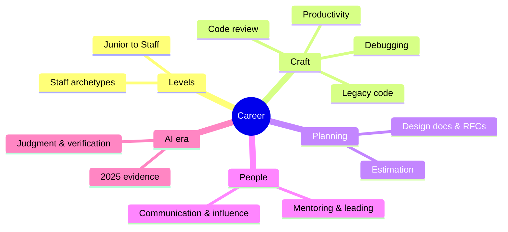

# Career Index

<Note>
**Start here**

What makes a senior engineer beyond technical knowledge: understanding the levels, reviewing code, writing design docs, estimating, communicating and influencing, mentoring, handling legacy code, debugging systematically, protecting focus, and working well with AI tools. Each note has worked examples, pitfalls, a senior perspective and interview questions (these topics come up in behavioral rounds).
</Note>

## 1. Beginner: the craft
- [Engineering Levels - Junior to Staff](/Software%20Engineering/Career/Engineering%20Levels%20-%20Junior%20to%20Staff): what each level means (scope, autonomy, influence) and how to grow
- [Debugging Methodology](/Software%20Engineering/Career/Debugging%20Methodology): the scientific method, bisecting, observability-driven debugging
- [Code Review Best Practices](/Software%20Engineering/Career/Code%20Review%20Best%20Practices): giving and receiving reviews, what to look for, reviewing AI-generated code
- [Productivity & Deep Work](/Software%20Engineering/Career/Productivity%20%26%20Deep%20Work): focus, priorities, team productivity, DORA/SPACE

## 2. Intermediate: owning work
- [Working With Legacy Code](/Software%20Engineering/Career/Working%20With%20Legacy%20Code): characterization tests, seams, strangler fig, tech debt
- [Estimation & Planning](/Software%20Engineering/Career/Estimation%20%26%20Planning): ranges, three-point estimates, risk-first planning
- [Technical Design Docs & RFCs](/Software%20Engineering/Career/Technical%20Design%20Docs%20%26%20RFCs): when to write, the process, a template, ADRs

## 3. Senior: multiplying others
- [Communication & Influence for Engineers](/Software%20Engineering/Career/Communication%20%26%20Influence%20for%20Engineers): bottom line first, audiences, writing, influence without authority
- [Mentoring & Leading Without Authority](/Software%20Engineering/Career/Mentoring%20%26%20Leading%20Without%20Authority): mentoring vs coaching vs sponsoring, tech lead responsibilities
- [Senior Engineer in the AI Era](/Software%20Engineering/Career/Senior%20Engineer%20in%20the%20AI%20Era): what changed in 2025–2026 and which skills matter more

<Info>
**🧭 Suggested study path**

1. [Engineering Levels - Junior to Staff](/Software%20Engineering/Career/Engineering%20Levels%20-%20Junior%20to%20Staff) to know where you are and what's next
2. Craft: [Debugging Methodology](/Software%20Engineering/Career/Debugging%20Methodology) → [Code Review Best Practices](/Software%20Engineering/Career/Code%20Review%20Best%20Practices) → [Working With Legacy Code](/Software%20Engineering/Career/Working%20With%20Legacy%20Code)
3. Ownership: [Technical Design Docs & RFCs](/Software%20Engineering/Career/Technical%20Design%20Docs%20%26%20RFCs) → [Estimation & Planning](/Software%20Engineering/Career/Estimation%20%26%20Planning)
4. Leadership: [Communication & Influence for Engineers](/Software%20Engineering/Career/Communication%20%26%20Influence%20for%20Engineers) → [Mentoring & Leading Without Authority](/Software%20Engineering/Career/Mentoring%20%26%20Leading%20Without%20Authority)
5. [Senior Engineer in the AI Era](/Software%20Engineering/Career/Senior%20Engineer%20in%20the%20AI%20Era) and [Productivity & Deep Work](/Software%20Engineering/Career/Productivity%20%26%20Deep%20Work)
6. Turn it into interview stories: [Behavioral Interviews & STAR Method](/Software%20Engineering/Interviews/Behavioral%20Interviews%20%26%20STAR%20Method)
</Info>

## 🆕 2025–2026 in this area
- 2025-04-04 | GitHub Copilot code review GA; AI first-pass reviews become common → [Code Review Best Practices](/Software%20Engineering/Career/Code%20Review%20Best%20Practices)
- 2025-07-10 | METR RCT: experienced OSS developers 19% slower with early-2025 AI tools despite feeling faster → [Senior Engineer in the AI Era](/Software%20Engineering/Career/Senior%20Engineer%20in%20the%20AI%20Era), [Productivity & Deep Work](/Software%20Engineering/Career/Productivity%20%26%20Deep%20Work), [Estimation & Planning](/Software%20Engineering/Career/Estimation%20%26%20Planning)
- 2025 | Stack Overflow Developer Survey 2025: 84% use/plan to use AI, trust in accuracy falls, 66% "almost right" frustration → [Senior Engineer in the AI Era](/Software%20Engineering/Career/Senior%20Engineer%20in%20the%20AI%20Era)
- 2025-09-24 | DORA 2025 *State of AI-assisted Software Development*: AI as amplifier, throughput up and instability up, AI Capabilities Model → [Senior Engineer in the AI Era](/Software%20Engineering/Career/Senior%20Engineer%20in%20the%20AI%20Era), [Code Review Best Practices](/Software%20Engineering/Career/Code%20Review%20Best%20Practices)
- 2025–2026 | AI-assisted interview rounds (Canva, Meta) and return of in-person rounds (Google) → [Interview Process & Preparation Plan](/Software%20Engineering/Interviews/Interview%20Process%20%26%20Preparation%20Plan)

## Related
- [Software Engineering](/Software%20Engineering/Software%20Engineering), the vault root
- [Interviews Index](/Software%20Engineering/Interviews/Interviews%20Index) · [Security Index](/Software%20Engineering/Security/Security%20Index) · [Frontend Home](/Software%20Engineering/Frontend/Frontend%20Home)
