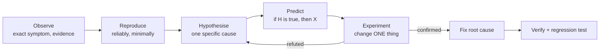

# Debugging Methodology

> [!tldr] TL;DR
> Debugging is the **scientific method** applied to code: observe, form a hypothesis, predict, test with an experiment, and repeat until the cause is proven. The most powerful moves are **reproducing reliably**, **shrinking the search space** (bisecting code, commits, inputs, or time), and **reading the evidence** (logs, metrics, traces, stack traces) instead of guessing. In production, **mitigate first** (rollback, flag off), then find the root cause, then prevent recurrence with a test and a blameless postmortem.

## The loop



Write hypotheses down (a debugging log). It stops you going in circles and helps whoever continues after you.

## Step by step
1. **Define the symptom precisely.** "Checkout fails" → "`POST /checkout` returns 500 for carts with >50 items since 14:05 UTC, EU region only".
2. **Reproduce.** Locally, in staging, or with a failing test. A reliable repro is half the fix. For flaky bugs, find what makes them more frequent (load, timing, specific data).
3. **Minimise.** Shrink the input, config and code until the smallest case still fails.
4. **Read the evidence.** Full stack trace (the *first* error, not the last), logs around the time, metrics, traces.
5. **Hypothesise and test one change at a time.**
6. **Fix the root cause**, not the symptom. Ask "why" until you reach something you can fix structurally (5 Whys).
7. **Add a regression test** that fails without the fix.
8. **Share** what you learned (PR description, postmortem, docs).

Agans' nine rules (from *Debugging*): understand the system; make it fail; quit thinking and look; divide and conquer; change one thing at a time; keep an audit trail; check the plug; get a fresh view; if you didn't fix it, it ain't fixed.

## Bisecting: divide and conquer
Halving the search space turns a hunt through 1000 possibilities into ~10 steps.

**Commits with `git bisect`:**
```bash
git bisect start
git bisect bad HEAD              # current version is broken
git bisect good v2.3.0           # this release was fine
# git checks out the midpoint; test it, then:
git bisect good    # or: git bisect bad
# ...repeat until git prints "<sha> is the first bad commit"
git bisect reset

# automate with a script that exits 0 (good) / 1 (bad):
git bisect run npm test -- tests/checkout.spec.ts
```
**Other things you can bisect:** input data (half the file), configuration (disable half the flags), code paths (comment out half, add a log in the middle), dependencies (roll back half the upgrades), time ranges in logs, and infrastructure (one host vs another).

## Tools
| Tool | Use it for |
|---|---|
| Debugger (breakpoints, conditional breakpoints, watch) | Stepping through logic, inspecting state |
| Logging / `print` | Quick state checks; timing issues where debuggers change behaviour |
| Stack traces and core dumps / heap dumps | Crashes, memory leaks |
| Profilers (CPU, memory, flame graphs) | Performance bugs |
| Network tools (DevTools, `curl -v`, Wireshark, `tcpdump`) | API, TLS, DNS problems |
| `strace` / `ltrace`, `lsof` | What a process is actually doing with the OS |
| Rubber duck | Explaining the problem aloud often reveals the gap |
| AI assistants | Explaining an error, suggesting hypotheses, writing a repro script. Treat suggestions as hypotheses to test, not answers |

## Observability-driven debugging (production)
In distributed systems you can't attach a debugger; you ask questions of telemetry.

| Signal | Question it answers |
|---|---|
| **Metrics** (RED: rate, errors, duration; USE: utilisation, saturation, errors) | *Is* something wrong, where, since when? |
| **Traces** (distributed tracing, OpenTelemetry) | *Which* service/call in the request path is slow or failing? |
| **Logs** (structured, with trace id) | *Why* did this specific request fail? |
| **Profiles** (continuous profiling) | *Which* code is using CPU/memory? |
| **Events/deploys/flags timeline** | *What changed* just before it started? |

Workflow: alert → dashboard (scope: which endpoints, regions, customers) → correlate with changes (deploys, flags, traffic) → exemplar traces for slow/failed requests → logs for those trace ids → hypothesis → confirm.

High-cardinality fields (user id, tenant, build version, feature flag) in events let you slice and find "it only happens for tenant X on version Y" (Charity Majors' "observability 2.0"/wide events idea).

> [!example] Example: p99 latency doubled at 14:05
> 1. Dashboard: only `/search`, all regions → not infra-wide.
> 2. Timeline: deploy of `search-api` at 14:03.
> 3. Traces: slow requests spend 800 ms in a new `SELECT ... FROM products WHERE lower(name) LIKE ...`.
> 4. Hypothesis: the new query can't use the index. `EXPLAIN ANALYZE` shows a sequential scan. Confirmed.
> 5. Mitigate: roll back. Fix: expression index or trigram index; add a query-plan check to the test suite.

## Production incidents
1. **Mitigate first**: rollback, disable the feature flag, scale up, fail over. Restore service before understanding everything.
2. Communicate: incident channel, a single incident commander, regular status updates.
3. Then diagnose root cause with the evidence you preserved (don't wipe the broken hosts immediately).
4. **Blameless postmortem**: timeline, impact, contributing factors, what went well, action items with owners.

## Common bug classes to suspect
- Off-by-one, null/undefined, wrong units (ms vs s), time zones and DST, floating-point money.
- Race conditions and shared mutable state; missing `await`.
- Caching (stale data, wrong cache key), environment differences (config, versions, feature flags).
- Encoding (UTF-8, URL encoding), locale differences.
- "It works on my machine": dependency versions, OS differences, data volume.

## Pitfalls
> [!warning] Common mistakes
> - Changing several things at once, then not knowing which fixed it.
> - Fixing the symptom (adding a null check) without asking why the value was null.
> - Ignoring the first error in a log and chasing the cascade.
> - Assuming ("that part can't be wrong") instead of checking ("check the plug").
> - Debugging for hours alone; ask for a fresh view after a timebox.
> - Accepting an AI-suggested fix that makes the symptom disappear without understanding why.

## Senior perspective
- Invest in debuggability before you need it: structured logs with ids, tracing, dashboards per service, feature flags, easy local repro, fast CI to bisect.
- Teach the method; juniors who learn to debug systematically become independent fast.
- Treat recurring bug classes as design problems (e.g. money as integers, time in UTC, idempotent handlers).
- After an incident, look for systemic fixes (guardrails, tests, alerts), not heroes or culprits.

## Interview questions
> [!question]- Walk me through how you debug a problem you've never seen before.
> Define the exact symptom, reproduce it (ideally as a failing test), minimise, gather evidence (stack trace, logs, metrics, recent changes), form one hypothesis at a time and test it, fix the root cause, add a regression test, share the learning.

> [!question]- How does `git bisect` work?
> It binary-searches the commit history between a known good and a known bad commit. At each step you (or a script via `git bisect run`) mark the checked-out commit good or bad, finding the first bad commit in about log₂(n) steps.

> [!question]- A bug only happens in production. How do you approach it?
> Mitigate if users are affected, then use observability: scope with metrics, find failing requests with traces, read logs by trace id, compare environment differences (config, data volume, versions, traffic), and try to reproduce with production-like data in staging.

> [!question]- How do you debug an intermittent (flaky) failure?
> Collect every occurrence with context, look for patterns (time, load, host, data), increase the failure rate (stress, loop the test, add delays), suspect shared state, ordering, timing and external dependencies, and add targeted logging.

> [!question]- What is a blameless postmortem?
> A review after an incident that focuses on how the system and process allowed the failure rather than who made a mistake: timeline, impact, contributing factors, and concrete action items. Blame makes people hide information.

## Related
- [[Career Index]]
- [[Working With Legacy Code]] · [[Productivity & Deep Work]] · [[Senior Engineer in the AI Era]]
- [[Backend Interview Questions]]

## Sources
- David J. Agans, *Debugging: The 9 Indispensable Rules* (AMACOM, 2002) and [debuggingrules.com](https://debuggingrules.com/)
- Andreas Zeller, *Why Programs Fail* (2nd ed., 2009) and [The Debugging Book](https://www.debuggingbook.org/)
- [Git documentation: git-bisect](https://git-scm.com/docs/git-bisect)
- Charity Majors, Liz Fong-Jones, George Miranda, *Observability Engineering* (O'Reilly, 2022)
- [OpenTelemetry documentation](https://opentelemetry.io/docs/)
- [Google SRE Book: Effective Troubleshooting](https://sre.google/sre-book/effective-troubleshooting/) and [Postmortem Culture](https://sre.google/sre-book/postmortem-culture/)
- Brendan Gregg, [The USE Method](https://www.brendangregg.com/usemethod.html)
