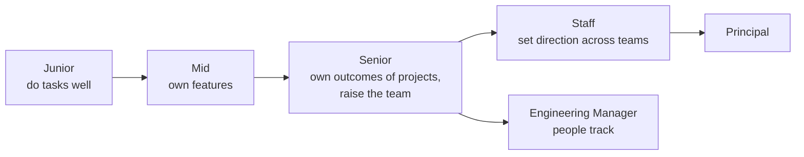

# Engineering Levels - Junior to Staff

<Note>
**TL;DR**

Engineering levels differ less by coding skill than by **scope** (task → feature → project → multiple teams), **autonomy** (told how → told what → told why → finds the why), and **influence** (self → team → group → organisation). A senior engineer reliably delivers ambiguous projects and makes the people around them better; a staff engineer sets technical direction across teams and does the work that nobody else sees. Public career ladders and the books by Tanya Reilly and Will Larson describe this in detail.
</Note>

## The idea
- Levels are a company's way to describe **expected impact**, and they drive pay, scope and who gets which problems.
- Titles are not portable: "Senior" at a startup may be "mid" at a big tech company. Compare **scope**, not titles.
- Promotions usually recognise that you're **already working at the next level** for a while.

## The levels at a glance

| | Junior (Engineer I) | Mid (Engineer II) | Senior | Staff | Principal |
|---|---|---|---|---|---|
| **Scope** | Well-defined tasks | Features end to end | Projects / a system; team's technical quality | Multiple teams, a domain or org-wide concern | Company-wide, multi-year |
| **Autonomy** | Told *how*; needs guidance | Told *what*; figures out how | Told *why* / the problem; defines the what | Finds the problems worth solving | Shapes strategy with leadership |
| **Ambiguity** | Low | Some | High, turns it into a plan | Very high, across orgs | Existential/strategic |
| **Influence** | Self | Team peers | Team + neighbouring teams | Group/org, often without authority | Company, industry |
| **Time horizon** | Days | Weeks | Quarter | Year | Multi-year |
| **Typical output** | Working, tested code | Shipped features, good reviews | Designs, delivered projects, mentored engineers, improved processes | Technical strategy, cross-team alignment, unblocked big initiatives | Direction for the whole engineering org |
| **Failure mode** | Stuck silently | Polishing low-impact work | Hero coding instead of multiplying | Ivory-tower architecture | Disconnected from reality |

Senior is often a **career level**: many engineers stay there long-term, and that's healthy. Staff is a different job, not "senior but better".

## What each level looks like in practice

### Junior
- Delivers well-scoped tickets with tests, asks good questions early, learns the codebase and tools.
- Signals of readiness for mid: needs less review rework, estimates small tasks reasonably, debugs independently.

### Mid-level
- Owns a feature from design sketch to production and monitoring; participates in on-call; gives useful code reviews.
- Signals for senior: handles ambiguity, sees trade-offs beyond their feature, other people seek their help.

### Senior
- Leads a project across several engineers: design doc, breakdown, risks, delivery, communication with product and other teams.
- Owns quality: reliability, observability, security of the team's systems.
- **Multiplier**: reviews, mentoring, onboarding docs, tooling that makes the team faster.
- Pushes back on product decisions with data; says no to low-value work.
- Signals for staff: their impact regularly crosses team boundaries; they spot org-level problems and fix them.

### Staff (and archetypes)
Will Larson's four staff archetypes:
| Archetype | What they do |
|---|---|
| **Tech Lead** | Guides the approach and execution of a team or a group of teams |
| **Architect** | Owns direction and quality of a critical technical area |
| **Solver** | Goes deep on the hardest problems, moves between them |
| **Right Hand** | Extends an executive's attention; handles organisational problems |

Tanya Reilly's three pillars of staff work: **big-picture thinking** (strategy, context), **execution of projects** (especially messy cross-team ones), and **levelling up** others. She also stresses "glue work" (coordination, documentation, onboarding) that is essential but often unrewarded unless it's made visible and tied to outcomes.

## How to grow to the next level
1. Read your company's ladder; if there isn't one, use a public one (see Sources) and agree on it with your manager.
2. Ask for work at the next level's scope, and make the impact visible.
3. Keep a **brag document**: projects, impact with numbers, people helped, decisions influenced. Share it before reviews.
4. Find a sponsor, not only a mentor: someone who puts your name forward for opportunities.
5. Get feedback specifically on the gap: "What would I need to show to be clearly at the next level?"

## Pitfalls
<Warning>
**Common mistakes**

- Believing seniority = years or = knowing more frameworks.
- Doing more of the same work faster instead of bigger-scope work.
- Invisible glue work with no recognition; tie it to outcomes and discuss it with your manager.
- Chasing the staff title by writing architecture docs nobody asked for.
- Title-shopping at small companies without the matching scope; it can hurt later interviews.
</Warning>

## Senior perspective
- Level expectations are the lens for performance reviews, interviews and promotion packets. Write your packet in terms of **scope, impact, and influence**, with evidence.
- A senior engineer's biggest lever is judgment: what to build, what not to build, where quality matters and where it doesn't.
- AI tools raise the floor for code output, which shifts differentiation further toward design, review, communication and ownership ([Senior Engineer in the AI Era](/Software%20Engineering/Career/Senior%20Engineer%20in%20the%20AI%20Era)).

## Interview questions
<Accordion title="What is the difference between a mid-level and a senior engineer?">
A mid-level engineer delivers well-defined features independently. A senior engineer takes an ambiguous problem, defines the solution, leads others to deliver it, owns the result in production, and makes the team better through reviews, mentoring and process improvements.
</Accordion>

<Accordion title="What does a staff engineer do that a senior doesn't?">
Works on problems spanning several teams or the whole org: technical strategy, cross-team projects, standards, and unblocking big initiatives, mostly by influence rather than authority. Less of their impact is their own code.
</Accordion>

<Accordion title="How do you demonstrate senior-level impact in an interview?">
Stories where you owned an ambiguous project, made explicit trade-offs, influenced others, handled failure, and multiplied the team, with measurable results. See [Behavioral Interviews & STAR Method](/Software%20Engineering/Interviews/Behavioral%20Interviews%20%26%20STAR%20Method).
</Accordion>

<Accordion title="IC track or management track?">
Management is a different job focused on people, hiring and team health. The staff+ IC track focuses on technical direction and complex execution. Choose by what energises you; many engineers swing between them (the "engineer/manager pendulum").
</Accordion>

## Related
- [Career Index](/Software%20Engineering/Career/Career%20Index)
- [Communication & Influence for Engineers](/Software%20Engineering/Career/Communication%20%26%20Influence%20for%20Engineers) · [Mentoring & Leading Without Authority](/Software%20Engineering/Career/Mentoring%20%26%20Leading%20Without%20Authority) · [Technical Design Docs & RFCs](/Software%20Engineering/Career/Technical%20Design%20Docs%20%26%20RFCs)
- [Senior Engineer in the AI Era](/Software%20Engineering/Career/Senior%20Engineer%20in%20the%20AI%20Era) · [Behavioral Interviews & STAR Method](/Software%20Engineering/Interviews/Behavioral%20Interviews%20%26%20STAR%20Method) · [Interview Process & Preparation Plan](/Software%20Engineering/Interviews/Interview%20Process%20%26%20Preparation%20Plan)

## Sources
- Tanya Reilly, *The Staff Engineer's Path* (O'Reilly, 2022)
- Will Larson, *Staff Engineer: Leadership Beyond the Management Track* (2021) and [staffeng.com](https://staffeng.com/guides/staff-archetypes/)
- Gergely Orosz, *The Software Engineer's Guidebook* (2023)
- Public ladders: [progression.fyi](https://progression.fyi/), [Dropbox Engineering Career Framework](https://dropbox.tech/culture/sharing-our-engineering-career-framework-with-the-world), [CircleCI engineering competency matrix](https://circleci.com/blog/why-we-re-designed-our-engineering-career-paths-at-circleci/)
- Tanya Reilly, [Being Glue](https://www.noidea.dog/glue)
- Charity Majors, [The Engineer/Manager Pendulum](https://charity.wtf/2017/05/11/the-engineer-manager-pendulum/)
- Julia Evans, [Get your work recognized: write a brag document](https://jvns.ca/blog/brag-documents/)
