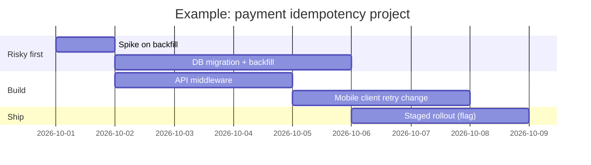

# Estimation & Planning

<Note>
**TL;DR**

Estimates are **forecasts with uncertainty**, not promises. Give **ranges** with a confidence level, break work down until pieces are small, base numbers on **past data** where you can, and re-estimate as you learn (the cone of uncertainty narrows over time). Planning is about **sequencing risk first**, cutting scope to hit dates, and communicating early when things change. Separate the *estimate* (what we think it takes) from the *target* (what the business wants) and the *commitment* (what we agree to deliver).
</Note>

## The idea
- Steve McConnell's distinction: an **estimate** is an analysis; a **target** is a business wish; a **commitment** is a promise. Mixing them causes most estimation fights.
- Uncertainty is highest at the start. Early estimates can be off by 4× either way (the **cone of uncertainty**); they narrow as requirements and design firm up.
- Most overruns come from **forgotten work** (testing, reviews, deployment, migrations, on-call, meetings), not from coding being slower.

| Phase | Typical range of the real effort vs. estimate |
|---|---|
| Initial idea | 0.25× to 4× |
| Requirements agreed | 0.5× to 2× |
| Design done | 0.67× to 1.5× |
| Mid-build | 0.8× to 1.25× |
| Done | 1× |

## Techniques

| Technique | How | Good for |
|---|---|---|
| **Decomposition (WBS)** | Break into tasks of ≤1–2 days, estimate each, sum, add integration/testing | Most engineering work |
| **Three-point (PERT)** | Optimistic O, most likely M, pessimistic P → expected = (O + 4M + P) / 6 | Communicating uncertainty |
| **Analogy / reference class** | "The last similar migration took 6 weeks" | Early, big-picture estimates |
| **Relative sizing (story points, T-shirt)** | Compare items to each other, not to hours | Backlog ordering, team velocity |
| **Throughput / cycle-time forecasting** | Count items finished per week; Monte Carlo over history | Teams with stable flow ("#NoEstimates") |
| **Spike** | Timeboxed investigation to reduce a big unknown | Unfamiliar tech or unclear requirements |

### Worked example: three-point estimate
| Task | O | M | P | Expected |
|---|---|---|---|---|
| API endpoint + validation | 1 | 2 | 4 | 2.2 |
| DB migration + backfill | 1 | 3 | 8 | 3.5 |
| Frontend form | 2 | 3 | 5 | 3.2 |
| Tests + review cycles | 1 | 2 | 3 | 2.0 |
| Deploy, flag, monitor | 0.5 | 1 | 2 | 1.1 |
| **Total (days)** | | | | **≈ 12** |

Communicate as a range: "**10–16 working days, most likely about 12**; the migration backfill is the biggest risk; we'll know more after a 1-day spike." Then add non-project time: if engineers spend 60% of their time on this project, 12 days of effort is ~4 calendar weeks.

## Planning a project
1. **Clarify the goal and the fixed constraint**: is the date, the scope, or the quality fixed? Usually date or scope, never all three.
2. **Break down** into milestones that each deliver something demoable (thin vertical slices).
3. **Risk first**: do the most uncertain parts early (integration with the unknown partner API, the migration), so bad news comes while there's time.
4. **Identify dependencies** on other teams and get commitments early.
5. **Buffer explicitly** for the unknown, rather than padding every task secretly.
6. **Track** progress against milestones weekly; update the forecast, not just the status.
7. **Cut scope** before cutting quality; have a "must/should/could" list ready.

## Communicating estimates and changes
- Give ranges and the assumptions behind them ("assuming the partner sandbox works").
- Report **early** when a forecast moves: "we found X; the range is now 3–5 weeks; options are A (cut feature Y) or B (move date)".
- Avoid anchoring: don't let the first number someone says in a meeting become the plan.
- When pressured for a smaller number, change **scope**, not the estimate.

## Pitfalls
<Warning>
**Common mistakes**

- Single-number estimates treated as commitments.
- Estimating only coding time.
- Ignoring past data ("this time it'll be different"): the **planning fallacy**.
- Hofstadter's law: it always takes longer than you expect, even when you take into account Hofstadter's law.
- Adding people to a late project (Brooks's law: it makes it later, at least at first).
- Padding in secret, which destroys trust when discovered.
- Story points converted to hours and used to compare teams.
</Warning>

## Senior perspective
- Your job is to make **uncertainty visible** and reduce it quickly (spikes, prototypes, early integration).
- Plan in milestones that each deliver value, so a cut project still ships something.
- Track estimate accuracy over time; calibrate yourself and the team.
- With AI tools, coding tasks may be faster but review, integration and verification don't shrink as much. Don't cut estimates proportionally to "AI speed-up" claims; the METR 2025 study found experienced developers were slower with AI on familiar codebases while believing they were faster ([Senior Engineer in the AI Era](/Software%20Engineering/Career/Senior%20Engineer%20in%20the%20AI%20Era)).
- For big initiatives, plan with **options and decision points**, not a fixed Gantt chart.

## Interview questions
<Accordion title="How do you estimate a project you've never done before?">
Break it into smaller known pieces, use analogies to similar past work, run a timeboxed spike on the biggest unknown, give a range with assumptions, and commit to re-estimating after the spike.
</Accordion>

<Accordion title="Your project is going to miss its deadline. What do you do?">
Tell stakeholders as soon as you know, with the reason, a new forecast and options: cut or phase scope, add time, or (rarely) add people with specific tasks. Never hide it until the last week.
</Accordion>

<Accordion title="Story points vs time estimates?">
Points measure relative size/complexity and, with velocity, forecast team throughput without arguing about hours. Time estimates are easier for stakeholders to understand. Both are only as good as their calibration; throughput-based forecasting is a data-driven alternative.
</Accordion>

<Accordion title="What is the cone of uncertainty?">
The idea that early estimates have a wide error range (up to ~4× either way) that narrows as requirements, design and implementation progress. So estimate in ranges and refine.
</Accordion>

## Related
- [Career Index](/Software%20Engineering/Career/Career%20Index)
- [Technical Design Docs & RFCs](/Software%20Engineering/Career/Technical%20Design%20Docs%20%26%20RFCs) · [Communication & Influence for Engineers](/Software%20Engineering/Career/Communication%20%26%20Influence%20for%20Engineers) · [Productivity & Deep Work](/Software%20Engineering/Career/Productivity%20%26%20Deep%20Work)
- [Engineering Levels - Junior to Staff](/Software%20Engineering/Career/Engineering%20Levels%20-%20Junior%20to%20Staff)

## Sources
- Steve McConnell, *Software Estimation: Demystifying the Black Art* (Microsoft Press, 2006)
- Frederick P. Brooks Jr., *The Mythical Man-Month* (1975, anniversary ed. 1995)
- Daniel Kahneman & Amos Tversky on the planning fallacy; Kahneman, *Thinking, Fast and Slow* (2011)
- Daniel Vacanti, *Actionable Agile Metrics for Predictability* (2015)
- [METR: Measuring the Impact of Early-2025 AI on Experienced Open-Source Developer Productivity (2025-07-10)](https://metr.org/blog/2025-07-10-early-2025-ai-experienced-os-dev-study/)
