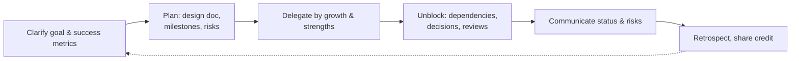

# Mentoring & Leading Without Authority

<Note>
**TL;DR**

Senior engineers lead through **influence, example and enabling others**, not through a reporting line. Mentoring means helping someone grow their own judgment (ask before you tell, give them stretch work, give specific feedback). Leading a project without authority means setting a clear goal, breaking down and delegating work, removing blockers, making decisions visible, and taking responsibility for the outcome while giving credit away. The measure of a senior is how much better the team gets, not how much code they write.
</Note>

## Mentoring

### Mentoring, coaching, sponsoring
| Role | What you do | Example |
|---|---|---|
| **Teaching** | Share knowledge directly | Explain how the deployment pipeline works |
| **Mentoring** | Share experience and advice | "When I've seen this before, I…" |
| **Coaching** | Ask questions so they find the answer | "What options do you see? What would you try first?" |
| **Sponsoring** | Use your influence to create opportunities | Recommending them to lead the next project |

Mix them by situation: coach when there's time and low risk, teach when it's urgent or they're totally new.

### Good mentoring practice
- Agree on **goals** ("be able to own a feature end to end by Q2").
- Give **stretch work** with a safety net, slightly beyond current ability.
- **Ask before telling**: "What do you think is causing it?" Let them struggle productively (a timebox helps: "try for an hour, then ping me").
- Give **specific, timely feedback** (SBI: situation, behaviour, impact). Praise specifically too.
- **Pair** on hard problems, alternating who drives.
- Code review as teaching: explain principles, link docs, don't just rewrite ([Code Review Best Practices](/Software%20Engineering/Career/Code%20Review%20Best%20Practices)).
- Share context juniors don't see: why decisions were made, how the org works.
- Protect their time from unnecessary interruptions; make it safe to ask "stupid" questions.

### Onboarding a new engineer
1. Week 1: environment set up, a tiny change shipped to production, a buddy assigned.
2. Weeks 2–4: small real tickets, reading docs and architecture, shadowing on-call.
3. Month 2–3: own a small feature, first on-call shift with backup, give a demo.
4. Ask them to improve the onboarding docs as they go; fresh eyes find gaps.

## Leading without authority (tech lead / project lead)

### Responsibilities
- **Direction**: everyone knows what we're building, why, and what "done" means.
- **Decisions**: make or facilitate them, record them (ADRs), revisit when facts change.
- **Delegation**: give meaningful pieces, not just leftovers; match work to people's growth goals; avoid taking all the interesting work yourself.
- **Unblocking**: chase dependencies, answer questions fast, review promptly. Your time is less valuable than the team's collective time.
- **Quality bar**: standards for tests, observability, reviews, and modelling them yourself.
- **Communication**: status, risks and decisions to stakeholders ([Communication & Influence for Engineers](/Software%20Engineering/Career/Communication%20%26%20Influence%20for%20Engineers)).
- **Team health**: notice overload, conflicts, people who are quiet or stuck; raise concerns with the manager.

### Tech lead vs engineering manager
| | Tech lead (IC) | Engineering manager |
|---|---|---|
| Focus | Technical direction and execution | People, hiring, team health, career growth |
| Authority | Influence | Formal (performance reviews, hiring) |
| Output | Designs, decisions, delivered projects | A healthy, effective team |
| Overlap | Mentoring, planning, stakeholder communication | Same |

Work closely together; clarify who owns what (e.g. TL owns technical decisions, EM owns staffing and priorities with product).

### Delegation levels
Be explicit about how much autonomy you're giving:
1. "Look into it and report back."
2. "Recommend an option; I'll decide."
3. "Decide, and tell me what you decided."
4. "Decide and act; no need to tell me."

## Pitfalls
<Warning>
**Common mistakes**

- The **hero tech lead**: writes the critical code, reviews everything, becomes the bottleneck and the single point of failure.
- Delegating only boring work.
- Giving answers instead of growing judgment.
- Feedback that is vague ("be more proactive") or only annual.
- Avoiding hard conversations until they become crises.
- Assuming your way is the only right way; letting others make (safe) mistakes is how they learn.
</Warning>

## Senior perspective
- Measure yourself by the team's output and growth: who got promoted, who can now handle on-call alone, what runs without you.
- Make yourself **replaceable** on purpose: docs, runbooks, pairing, rotating ownership.
- Sponsor people from under-represented groups and people doing glue work; visibility changes careers.
- In the AI era, mentoring matters more: juniors can produce code quickly but need help building **judgment**, debugging skills and understanding of the system ([Senior Engineer in the AI Era](/Software%20Engineering/Career/Senior%20Engineer%20in%20the%20AI%20Era)).

## Interview questions
<Accordion title="How do you mentor a junior engineer?">
Agree on goals, give stretch tasks with support, coach with questions before giving answers, pair on hard problems, give specific and frequent feedback, use code review to teach, and sponsor them for opportunities.
</Accordion>

<Accordion title="How do you lead a project when you're not anyone's manager?">
Clarify the goal and success criteria, write a plan and get buy-in, delegate by strengths and growth, unblock and communicate constantly, make decisions visible, and share credit. Influence comes from trust and clarity.
</Accordion>

<Accordion title="How do you handle an underperforming teammate on your project?">
Talk privately and early to understand causes (unclear expectations, skills, personal issues), agree on specific expectations and support, follow up, and involve their manager if it continues. Keep it factual and kind.
</Accordion>

<Accordion title="Tell me about someone you helped grow.">
STAR with their starting point, what you did (goals, stretch work, feedback, sponsorship), and their result (promotion, owning a system, leading a project).
</Accordion>

## Related
- [Career Index](/Software%20Engineering/Career/Career%20Index)
- [Communication & Influence for Engineers](/Software%20Engineering/Career/Communication%20%26%20Influence%20for%20Engineers) · [Code Review Best Practices](/Software%20Engineering/Career/Code%20Review%20Best%20Practices) · [Engineering Levels - Junior to Staff](/Software%20Engineering/Career/Engineering%20Levels%20-%20Junior%20to%20Staff)
- [Technical Design Docs & RFCs](/Software%20Engineering/Career/Technical%20Design%20Docs%20%26%20RFCs) · [Behavioral Interviews & STAR Method](/Software%20Engineering/Interviews/Behavioral%20Interviews%20%26%20STAR%20Method)

## Sources
- Camille Fournier, *The Manager's Path* (O'Reilly, 2017), chapters on mentoring and tech lead
- Tanya Reilly, *The Staff Engineer's Path* (O'Reilly, 2022)
- Pat Kua, *Talking with Tech Leads* (2014) and [patkua.com](https://www.patkua.com/)
- Kim Scott, *Radical Candor* (2017)
- Lara Hogan, [Sponsorship vs. mentorship](https://larahogan.me/blog/what-sponsorship-looks-like/)
- Google re:Work, [Project Aristotle: psychological safety](https://rework.withgoogle.com/print/guides/5721312655835136/)
