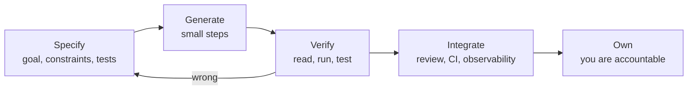

# Senior Engineer in the AI Era

<Note>
**TL;DR**

By 2025 AI coding tools were nearly universal (DORA 2025: 90% of respondents use AI at work; Stack Overflow 2025: 84% use or plan to use it), but trust fell and results are mixed: AI **amplifies** the strengths and weaknesses of a team, raises throughput and also instability, and produces code that is "almost right". Producing code got cheaper; **judgment, verification, system thinking, problem framing, and ownership** got relatively more valuable. The senior engineer's job moved toward specifying, reviewing, integrating and taking responsibility for code, whoever (or whatever) typed it.
</Note>

<Info>
**🆕 2025–2026 evidence**

- **Stack Overflow Developer Survey 2025** (AI section): 84% use or plan to use AI tools (76% in 2024); about 51% of professional developers use them daily; **46% distrust** AI accuracy vs 33% who trust it, and only ~3% highly trust it; the top frustration (66%) is answers that are "almost right, but not quite"; 45% say debugging AI-generated code takes longer; ~14% use AI agents daily; ~72% say "vibe coding" is not part of their professional work ([survey](https://survey.stackoverflow.co/2025/ai)).
- **DORA 2025, *State of AI-assisted Software Development*** (published 2025-09-24, ~5,000 respondents): 90% AI adoption; over 80% believe it increased their productivity; ~30% have little or no trust in AI-generated code; AI adoption now correlates with **higher throughput but also higher instability**; "AI is an amplifier". It introduced the **DORA AI Capabilities Model**: clear AI stance/policy, healthy data ecosystems, AI-accessible internal data, strong version control, **small batches**, user-centric focus, quality internal platforms ([Google Cloud blog](https://cloud.google.com/blog/products/ai-machine-learning/announcing-the-2025-dora-report), [dora.dev](https://dora.dev/dora-report-2025/)).
- **METR, 2025-07-10**: in a randomised controlled trial, 16 experienced open-source developers on their own mature repos (246 tasks) were **19% slower** with early-2025 AI tools (mostly Cursor + Claude 3.5/3.7 Sonnet), although they predicted a 24% speed-up and afterwards believed they had been 20% faster ([METR](https://metr.org/blog/2025-07-10-early-2025-ai-experienced-os-dev-study/)).
- **2025-04-04**: GitHub Copilot code review GA; AI review bots became a standard first pass ([changelog](https://github.blog/changelog/2025-04-04-copilot-code-review-now-generally-available/)).
- **Hiring**: Canva (June 2025) requires AI tools in an interview round; Meta rolled out an AI-enabled coding interview (late 2025); Google brought back in-person rounds to test fundamentals ([Interview Process & Preparation Plan](/Software%20Engineering/Interviews/Interview%20Process%20%26%20Preparation%20Plan)).
- **Security**: GitGuardian counted 1.27M leaked AI-service secrets in 2025 (+81%) ([Secrets Management](/Software%20Engineering/Security/Secrets%20Management)).
</Info>

## What changed
| Before (≈2022) | Now (2025–2026) |
|---|---|
| Writing code was the main cost | Code is cheap to produce; **verifying, integrating and maintaining** it is the cost |
| Review caught mistakes of humans who understood their code | Review catches plausible mistakes that the author may not fully understand |
| Juniors learned by writing lots of code | Juniors can ship code they can't explain; learning needs deliberate effort |
| Documentation for humans | Documentation also for AI tools (context files, clear conventions, good tests) |
| Throughput limited by typing and lookup | Throughput limited by review capacity, CI, clarity of requirements, and deployment safety |

## Skills that matter more
1. **Problem framing and specification.** AI solves the problem you describe. Writing precise requirements, constraints and acceptance tests is now a core engineering skill ([Technical Design Docs & RFCs](/Software%20Engineering/Career/Technical%20Design%20Docs%20%26%20RFCs)).
2. **Judgment and taste.** Choosing between options, knowing what not to build, recognising over-engineering and hidden complexity.
3. **Code review and verification.** Reading code critically, especially code that looks right ([Code Review Best Practices](/Software%20Engineering/Career/Code%20Review%20Best%20Practices)). Testing strategy: tests as the specification AI must satisfy.
4. **System thinking.** Understanding how components interact, failure modes, data flows, performance and security. AI works locally; systems fail globally.
5. **Debugging.** When AI-generated code fails in production, someone has to understand it ([Debugging Methodology](/Software%20Engineering/Career/Debugging%20Methodology)).
6. **Security awareness.** Hallucinated or typosquatted packages, insecure defaults, leaked secrets in prompts, prompt injection in agent workflows ([Security Index](/Software%20Engineering/Security/Security%20Index)).
7. **Communication and influence.** Aligning people and making decisions is untouched by autocomplete ([Communication & Influence for Engineers](/Software%20Engineering/Career/Communication%20%26%20Influence%20for%20Engineers)).
8. **Teaching.** Helping juniors build real understanding rather than prompt-and-paste habits ([Mentoring & Leading Without Authority](/Software%20Engineering/Career/Mentoring%20%26%20Leading%20Without%20Authority)).

## Using AI tools well

- Work in **small steps** with a clear goal; big generated diffs are hard to verify (DORA's small-batches finding).
- Give **context**: relevant files, conventions, constraints; many teams keep agent instruction files (e.g. `AGENTS.md`/`CLAUDE.md`) in the repo.
- **Tests first** where possible: write or review the tests, let AI implement, run them.
- Read everything before committing; never merge code you can't explain.
- Check every new dependency exists and is the right one.
- Keep secrets and sensitive data out of prompts; know your company's AI policy.
- Good uses: boilerplate, test scaffolding, exploring unfamiliar APIs, explaining legacy code, first drafts of docs, migration scripts, and review first passes. Weaker uses: core domain logic you don't understand, subtle concurrency, security-critical code without expert review.

## The team and organisation view
- DORA's finding that AI **amplifies** existing practices means the basics matter more: version control discipline, small batches, fast CI, good platforms, clear priorities.
- Review capacity becomes the bottleneck; invest in automated checks and in reviewer time.
- Define an explicit AI policy (what tools, what data, what must be human-reviewed).
- Track outcomes (lead time, change failure rate, incidents, rework), not "percent of code written by AI".
- Protect the **junior pipeline**: without deliberate mentoring, teams stop producing future seniors.

## Pitfalls
<Warning>
**Common mistakes**

- Trusting perceived speed-ups without measuring (METR's perception gap).
- Merging large AI-generated PRs with light review, leading to instability.
- Juniors outsourcing thinking, never building debugging skills.
- Seniors refusing to learn the tools and losing touch with how their team works.
- Pasting secrets, customer data or proprietary code into unapproved tools.
- Letting agents run commands or change infrastructure without guardrails (least privilege, sandboxing, human approval).
</Warning>

## Senior perspective
- Your value is **accountability for outcomes**: correctness, security, reliability and maintainability of what ships, regardless of who wrote it.
- Become the person who knows **when** AI helps and when it doesn't on your codebase; measure it.
- Shape the team's workflow: conventions, context files, test strategy, review norms, and AI policy.
- Double down on durable skills: fundamentals (data structures, networking, databases, OS), system design, writing, and people skills. They are also what in-person interview rounds are re-testing.

## Interview questions
<Accordion title="How do you use AI coding tools in your work?">
Be concrete: which tasks (tests, boilerplate, exploring APIs, explaining legacy code), how you give context, how you verify (read, run, test, check dependencies), where you don't use it (security-critical or subtle logic), and how you measure whether it helps.
</Accordion>

<Accordion title="What skills matter more for engineers now that AI writes code?">
Problem framing and specification, judgment, code review and verification, testing, system design, debugging, security awareness, and communication. Typing speed and memorising APIs matter less.
</Accordion>

<Accordion title="How do you review code that was mostly generated by AI?">
Check it solves the actual problem, verify every API and dependency, focus on edge cases, error handling, security and test quality, keep PRs small, and make sure the author understands and owns it.
</Accordion>

<Accordion title="What did the 2025 DORA report find about AI?">
AI use was nearly universal (~90%) and linked to higher throughput but also higher instability. AI acts as an amplifier of existing team practices; seven capabilities (clear AI policy, good data, AI-accessible internal data, strong version control, small batches, user focus, quality platforms) determine whether individual gains become organisational gains.
</Accordion>

<Accordion title="Does AI make developers faster?">
It depends on task, codebase and experience. Surveys show most developers feel more productive, but METR's 2025 randomised trial found experienced developers on familiar mature codebases were 19% slower with early-2025 tools while believing they were faster. Measure outcomes for your own context.
</Accordion>

## Related
- [Career Index](/Software%20Engineering/Career/Career%20Index)
- [Code Review Best Practices](/Software%20Engineering/Career/Code%20Review%20Best%20Practices) · [Productivity & Deep Work](/Software%20Engineering/Career/Productivity%20%26%20Deep%20Work) · [Engineering Levels - Junior to Staff](/Software%20Engineering/Career/Engineering%20Levels%20-%20Junior%20to%20Staff) · [Debugging Methodology](/Software%20Engineering/Career/Debugging%20Methodology)
- [Interview Process & Preparation Plan](/Software%20Engineering/Interviews/Interview%20Process%20%26%20Preparation%20Plan) · [Secrets Management](/Software%20Engineering/Security/Secrets%20Management) · [Supply Chain Security](/Software%20Engineering/Frontend/11%20Security/Supply%20Chain%20Security)
- [AI in Frontend - MCP, WebMCP & Built-in AI](/Software%20Engineering/Frontend/16%20AI%20in%20Frontend/AI%20in%20Frontend%20-%20MCP%2C%20WebMCP%20%26%20Built-in%20AI)

## Sources
- [Stack Overflow Developer Survey 2025: AI](https://survey.stackoverflow.co/2025/ai) and [press release](https://stackoverflow.co/company/press/archive/stack-overflow-2025-developer-survey/)
- [DORA: State of AI-assisted Software Development 2025](https://dora.dev/dora-report-2025/) and [report PDF](https://services.google.com/fh/files/misc/2025_state_of_ai_assisted_software_development.pdf)
- [Google Cloud: Announcing the 2025 DORA Report (2025-09-24)](https://cloud.google.com/blog/products/ai-machine-learning/announcing-the-2025-dora-report)
- [METR: Measuring the Impact of Early-2025 AI on Experienced Open-Source Developer Productivity (2025-07-10)](https://metr.org/blog/2025-07-10-early-2025-ai-experienced-os-dev-study/), [arXiv 2507.09089](https://arxiv.org/abs/2507.09089)
- [GitHub changelog: Copilot code review GA (2025-04-04)](https://github.blog/changelog/2025-04-04-copilot-code-review-now-generally-available/)
- [Canva Engineering: Yes, you can use AI in our interviews (2025)](https://www.canva.dev/blog/engineering/yes-you-can-use-ai-in-our-interviews/)
- [GitGuardian: State of Secrets Sprawl 2026](https://blog.gitguardian.com/the-state-of-secrets-sprawl-2026/)
