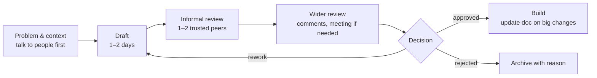

# Technical Design Docs & RFCs

<Note>
**TL;DR**

A design doc (or RFC) is a short written proposal of **how** to solve a problem and **why this way**, shared for review **before** the expensive work starts. Its most valuable parts are the **context and goals/non-goals**, the **alternatives considered**, and the **trade-offs**. Writing forces clear thinking, reviews catch mistakes cheaply, and the doc stays as a record of decisions. Keep small decisions in lightweight **ADRs**; write full design docs for work that is big, risky, cross-team or hard to reverse.
</Note>

## When to write one
| Write a design doc when… | Skip it (or write an ADR / PR description) when… |
|---|---|
| Several weeks of work or several engineers | A few days of work with an obvious approach |
| Changes a public API, data model or shared infrastructure | Internal refactor with no external effect |
| Cross-team dependencies | Only your team is affected |
| Hard to reverse (migrations, vendor choice) | Easily reversible (a feature flag toggle) |
| Security, privacy or compliance impact | No new data or trust boundaries |
| People disagree on the approach | Consensus already exists |

## The process


- Socialise the idea **before** the formal review: 1:1s with key stakeholders avoid surprises in the meeting.
- Timebox reviews (e.g. one week) and name the **decision maker** up front.
- Record decisions and unresolved questions in the doc.

## Template

<Info>
**Design doc template (copy this)**

```markdown
# <Title>
Author(s): · Reviewers: · Decision maker: · Status: Draft / In review / Approved / Superseded
Last updated: YYYY-MM-DD · Links: issue, PRD, related docs

## 1. Summary
Two or three sentences: the problem and the proposed solution.

## 2. Context & problem
What is happening today, why it matters (data: incidents, cost, user pain), who is affected.

## 3. Goals and non-goals
Goals: measurable outcomes (e.g. p99 < 200 ms, zero duplicate charges).
Non-goals: things we deliberately won't solve now.

## 4. Proposed design
- Architecture diagram
- Components and responsibilities
- Data model / schema changes
- APIs (request/response examples)
- Key flows (sequence diagrams)

## 5. Alternatives considered
| Option | Pros | Cons | Why not chosen |

## 6. Trade-offs & risks
What we're giving up, what could go wrong, how we'd detect and mitigate it.

## 7. Cross-cutting concerns
- Security & privacy (threat model summary, data classification)
- Reliability (failure modes, SLOs, capacity)
- Observability (metrics, logs, alerts, dashboards)
- Performance & cost
- Accessibility / i18n (if user-facing)

## 8. Rollout & migration
Feature flags, phases, backfill, backward compatibility, rollback plan.

## 9. Testing plan

## 10. Open questions

## 11. Timeline & milestones (optional)

## Appendix: decision log
Date · decision · who · why
```
</Info>

## ADRs (Architecture Decision Records)
Small, immutable records of one decision, kept in the repo (`docs/adr/0007-use-postgres-for-orders.md`):
```markdown
# 7. Use PostgreSQL for the orders service
Status: Accepted (2026-03-02)   Supersedes: -
## Context
Orders need multi-row transactions and ad-hoc reporting; team has Postgres experience.
## Decision
Use managed PostgreSQL 17 with read replicas.
## Consequences
+ ACID, SQL reporting. − Vertical write limit; revisit at ~10k writes/s.
```
ADRs answer "why is it like this?" years later. A design doc can produce several ADRs.

## Writing well
- Lead with the summary and the decision you need.
- Be concrete: numbers, examples, diagrams (Mermaid, sequence diagrams).
- Show **alternatives honestly**, including "do nothing". Reviewers trust docs that argue against themselves.
- Short over complete: 3–6 pages is typical. Move detail to appendices.
- Write for the reader who wasn't in the meetings, including you in a year.
- AI assistants help draft structure and check clarity, but the reasoning and trade-offs must be yours; reviewers can tell when a doc has no real thinking behind it.

## Pitfalls
<Warning>
**Common mistakes**

- Writing the doc after the code (a justification, not a design).
- Solution-first docs with no problem statement or goals.
- No alternatives section, or straw-man alternatives.
- Endless review with no decision maker or deadline.
- Docs that are never updated after big changes; mark them "Superseded" rather than leaving them wrong.
- Too long: nobody reads 30 pages.
</Warning>

## Senior perspective
- Design docs are a senior engineer's main **influence tool**: they scale your thinking beyond the meetings you attend.
- Use the review to build alignment, not just to get approval: invite the sceptics early.
- Standardise the template for your team/org, with required sections for security, observability and rollout.
- Keep a searchable index of docs and ADRs; it is the organisation's memory.
- Reviewing other people's docs well (asking "what happens when X fails?", "what's the simplest thing that could work?") is a staff-level skill.

## Interview questions
<Accordion title="What makes a good design doc?">
A clear problem and goals/non-goals, a concrete proposed design with diagrams and data model, honest alternatives with trade-offs, risks and failure modes, security/observability/rollout plans, and open questions. Short enough to be read.
</Accordion>

<Accordion title="Design doc vs ADR?">
A design doc proposes and discusses a solution to a larger problem before building. An ADR records one decision, its context and consequences, briefly and permanently, in the repository.
</Accordion>

<Accordion title="How do you handle disagreement in a design review?">
Clarify the underlying goals, compare options against agreed criteria, gather data or prototype if cheap, then the named decision maker decides and dissent is recorded. Disagree and commit.
</Accordion>

<Accordion title="Tell me about a design doc you wrote. What changed during review?">
Prepare a real story: the problem, the options, what reviewers challenged (a failure mode, a simpler option), how the design changed, and the outcome.
</Accordion>

## Related
- [Career Index](/Software%20Engineering/Career/Career%20Index)
- [Communication & Influence for Engineers](/Software%20Engineering/Career/Communication%20%26%20Influence%20for%20Engineers) · [Estimation & Planning](/Software%20Engineering/Career/Estimation%20%26%20Planning) · [Secure SDLC & Threat Modeling](/Software%20Engineering/Security/Secure%20SDLC%20%26%20Threat%20Modeling)
- [System Design Index](/Software%20Engineering/System%20Design/System%20Design%20Index) · [System Design Interview Framework](/Software%20Engineering/System%20Design/System%20Design%20Interview%20Framework)

## Sources
- Malte Ubl, [Design Docs at Google](https://www.industrialempathy.com/posts/design-docs-at-google/)
- Michael Nygard, [Documenting Architecture Decisions](https://cognitect.com/blog/2011/11/15/documenting-architecture-decisions)
- [adr.github.io](https://adr.github.io/)
- Gergely Orosz, [Software Engineering RFC and Design Doc Examples and Templates](https://blog.pragmaticengineer.com/rfcs-and-design-docs/)
- [Rust RFC process](https://github.com/rust-lang/rfcs) (a public example of an RFC process)
- Tanya Reilly, *The Staff Engineer's Path* (O'Reilly, 2022), chapters on writing and strategy
