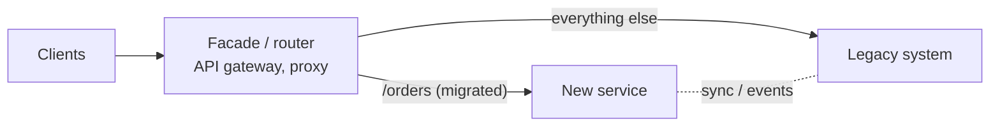

# Working With Legacy Code

> [!tldr] TL;DR
> Legacy code is code that works, earns money, and is scary to change, usually because it has **no tests** (Michael Feathers' definition). Don't rewrite it from scratch; change it **safely and incrementally**: understand it, pin its current behaviour with **characterization tests**, find **seams** to break dependencies, make the change, and refactor as you go. Replace large systems piece by piece with the **strangler fig** pattern. Manage tech debt as an explicit, prioritised investment.

## The idea
- Legacy isn't an insult: it's code that survived because it's valuable.
- The risk is changing behaviour you didn't know existed. Tests are what turn "scary" into "safe".
- Big-bang rewrites usually take far longer than planned and lose hidden behaviour (Joel Spolsky called rewriting from scratch "the single worst strategic mistake").

## The legacy change algorithm (Feathers)
1. **Identify change points**: where does the change need to go?
2. **Find test points**: where can you observe the behaviour?
3. **Break dependencies** so the code can run in a test.
4. **Write characterization tests** that capture current behaviour.
5. **Make the change and refactor**.

## Understanding the code first
- Run it. Use it like a user. Read the tests (if any) and the git history (`git log -p --follow file`, `git blame` for *why*).
- Trace one real request end to end with a debugger or logs.
- Draw a quick diagram of modules and data flow.
- Find the people who know it; ask about the "weird parts" (they usually encode a real business rule or past incident).
- Use AI assistants to summarise unfamiliar modules and propose call graphs, but **verify** against the code; summaries can be confidently wrong.

## Characterization tests
Tests that record what the code **does**, not what it should do.
```python
def test_price_characterization():
    # Discovered by running the code; we don't yet know if 0.0 for qty=0 is intended
    assert legacy_price(sku="A1", qty=0) == 0.0
    assert legacy_price(sku="A1", qty=10) == 92.5     # 7.5% bulk discount kicks in at 10
    assert legacy_price(sku="ZZ", qty=1) == -1        # unknown sku returns -1 (!)
```
- **Approval/snapshot testing** is great for big outputs: record the output once (report, HTML, JSON), then diff future runs (ApprovalTests, Jest snapshots).
- **Golden master** for whole flows: record inputs/outputs from production traffic (sanitised) and replay.
- When you find a bug, keep the test documenting current behaviour, and fix it in a separate, deliberate change.

## Seams and dependency breaking
A **seam** is a place where you can change behaviour without editing the code there (e.g. by injecting a different object).

```java
// Before: impossible to test without a real DB and clock
class InvoiceService {
  Invoice create(Order o) {
    var tax = new TaxDb().rateFor(o.country());          // hard dependency
    return new Invoice(o, tax, LocalDate.now());          // hidden time dependency
  }
}

// After: parameterise constructor (a seam), minimal change
class InvoiceService {
  private final TaxRates taxRates; private final Clock clock;
  InvoiceService() { this(new TaxDb(), Clock.systemDefaultZone()); }   // old callers unchanged
  InvoiceService(TaxRates taxRates, Clock clock) { this.taxRates = taxRates; this.clock = clock; }
  Invoice create(Order o) {
    return new Invoice(o, taxRates.rateFor(o.country()), LocalDate.now(clock));
  }
}
```
Other techniques: extract interface, extract method and override in a test subclass, wrap a static call in an instance method, **sprout method/class** (write the new logic in a new, tested unit and call it from the old code), **wrap method** (add behaviour before/after the old method).

## Strangler fig pattern (replacing systems incrementally)


1. Put a facade in front of the legacy system.
2. Route one capability at a time to the new implementation.
3. Keep data in sync (change data capture, events, dual writes with care).
4. Compare results in parallel ("shadow traffic", "dark launch") before switching.
5. Remove the legacy part when traffic is zero. Repeat.

Related: **branch by abstraction** (introduce an abstraction inside the code, build the new implementation behind it, switch with a flag), **expand/contract** for DB schema changes, feature flags for safe switching.

## Managing tech debt
- Make it visible: a debt register with impact ("costs ~2 days per feature in module X", "caused 3 incidents").
- Prioritise by **interest rate**: fix debt in code that changes often and hurts a lot; leave stable ugly code alone.
- The **boy scout rule**: leave code a bit better than you found it, inside normal work.
- Negotiate a steady allocation (e.g. ~15–20% of capacity) rather than a one-off "refactoring sprint".
- Tie proposals to business outcomes: speed, incidents, security, cost.

## Pitfalls
> [!warning] Common mistakes
> - The big rewrite that never catches up with the moving legacy system.
> - Refactoring without tests, or mixing refactoring and behaviour changes in one PR.
> - "Fixing" weird code that encoded an important edge case.
> - Letting AI tools mass-refactor a legacy module without characterization tests; the diff looks clean and behaviour silently changes.
> - Complaining about the previous developers; they had constraints you don't see.

## Senior perspective
- Choose between **refactor, strangle or rewrite** with evidence: cost of change, incident rate, team knowledge, business roadmap. Rewrite only small, well-understood components.
- Plan migrations with milestones that each deliver value and can stop safely halfway.
- Keep the old and new running in parallel long enough to compare; measure, then cut over.
- Document what you learn (ADRs, diagrams) so the next person doesn't start from zero.

## Interview questions
> [!question]- How do you safely change code that has no tests?
> Understand it, find a seam, write characterization tests around the area to capture current behaviour, then make small changes and refactor with the tests as a safety net. Keep refactors and behaviour changes in separate commits.

> [!question]- Rewrite or refactor?
> Usually refactor or strangle incrementally: rewrites lose hidden behaviour, take longer than estimated and deliver no value until the end. Rewrite only when the component is small, well understood, or the platform is truly dead, and even then migrate incrementally.

> [!question]- What is the strangler fig pattern?
> Put a routing facade in front of the legacy system and move functionality piece by piece to the new system until the legacy system can be removed, like a strangler fig growing around a tree.

> [!question]- How do you convince management to invest in tech debt?
> Quantify impact in business terms (lead time, incidents, onboarding time, security risk), propose a targeted plan with measurable outcomes, and prefer a steady allocation over a big-bang project.

## Related
- [[Career Index]]
- [[Debugging Methodology]] · [[Code Review Best Practices]] · [[Technical Design Docs & RFCs]] · [[Estimation & Planning]]

## Sources
- Michael Feathers, *Working Effectively with Legacy Code* (Prentice Hall, 2004)
- Martin Fowler, *Refactoring* (2nd ed., 2018) and [StranglerFigApplication](https://martinfowler.com/bliki/StranglerFigApplication.html), [BranchByAbstraction](https://martinfowler.com/bliki/BranchByAbstraction.html)
- Joel Spolsky, [Things You Should Never Do, Part I](https://www.joelonsoftware.com/2000/04/06/things-you-should-never-do-part-i/)
- [ApprovalTests](https://approvaltests.com/)
- Martin Fowler, [Technical Debt Quadrant](https://martinfowler.com/bliki/TechnicalDebtQuadrant.html)
