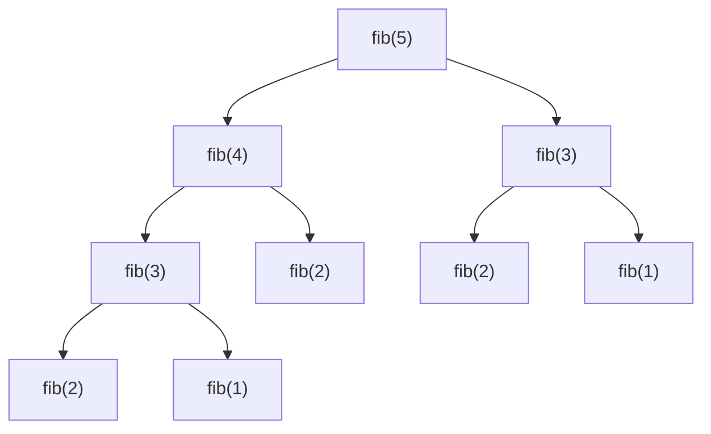

# Big-O & Complexity Analysis

> [!tldr] TL;DR
> Big-O describes how the **work** (time) or **memory** (space) of an algorithm **grows** as the input size `n` grows, ignoring constants and lower-order terms. You use it to compare approaches before writing code and to tell an interviewer *why* your optimized solution is better. Know the common classes (O(1), O(log n), O(n), O(n log n), O(n²), O(2ⁿ), O(n!)), how to read them off loops and recursion, what **amortized** means, and the **Master Theorem** for divide-and-conquer recurrences.

## The idea

- We don't count seconds; they depend on hardware. We count **basic operations** as a function of input size `n`.
- Big-O keeps only the **dominant term** and drops constants: `3n² + 10n + 7` → **O(n²)**.
- The question Big-O answers: *if I double the input, what happens to the running time?*

| If `n` doubles... | Class | Example |
|---|---|---|
| no change | O(1) | array index, hash lookup (average) |
| +1 step | O(log n) | binary search |
| doubles | O(n) | one loop over the array |
| a bit more than doubles | O(n log n) | merge sort, `sort()` |
| ×4 | O(n²) | nested loops over pairs |
| squares | O(2ⁿ) | all subsets |
| explodes | O(n!) | all permutations |

```text
n = 1 000        log n ≈ 10     n log n ≈ 10 000     n² = 1 000 000     2ⁿ ≈ 10³⁰¹
n = 1 000 000    log n ≈ 20     n log n ≈ 2·10⁷      n² = 10¹²          (never)
```

### What input size can I afford?
A rough rule for interview and judge limits (about 10⁸ simple operations per second):

| n up to | Acceptable complexity |
|---|---|
| 10–12 | O(n!) |
| 20–25 | O(2ⁿ) |
| 500 | O(n³) |
| 10⁴ | O(n²) |
| 10⁵–10⁶ | O(n log n) |
| 10⁸ | O(n) |
| any | O(log n), O(1) |

Reading the constraints backwards is a legitimate interview move: `n ≤ 10⁵` almost always means "you need O(n log n) or better".

## The notation (precisely)

| Symbol | Meaning | Informal |
|---|---|---|
| **O(g)** | upper bound: f(n) ≤ c·g(n) for large n | "grows no faster than" |
| **Ω(g)** | lower bound | "grows at least as fast as" |
| **Θ(g)** | tight bound (both O and Ω) | "grows exactly like" |

In interviews "Big-O" is used loosely to mean the tight bound of the **worst case**. Be explicit about which case you mean:

- **Best case**: insertion sort on sorted input, O(n).
- **Average case**: quicksort with random pivots, O(n log n).
- **Worst case**: quicksort with a bad pivot on sorted input, O(n²).

## How to compute it

### Rules of thumb
1. **Sequential steps add**: O(a) then O(b) → O(a + b). Drop the smaller one only if it really is smaller.
2. **Nested loops multiply**: loop over `n` inside a loop over `m` → O(n·m).
3. **Different inputs get different variables**. Comparing two arrays is O(a·b), not O(n²).
4. **Halving each step** → O(log n).
5. **Recursion**: count `(number of calls) × (work per call)`, or write a recurrence.
6. **Hidden costs**: `slice`, `substring`, string concatenation in a loop, `list.insert(0, x)`, `array.shift()`, `in` on a list, spreading `[...arr]` are all O(n).

### Worked examples

```ts
// O(n): one pass
function sum(nums: number[]): number {
  let total = 0;
  for (const x of nums) total += x;
  return total;
}

// O(n^2): all pairs
function hasDuplicatePairs(nums: number[]): boolean {
  for (let i = 0; i < nums.length; i++)
    for (let j = i + 1; j < nums.length; j++)
      if (nums[i] === nums[j]) return true;
  return false;
}

// O(n) time, O(n) space: trade memory for speed with a Set
function hasDuplicate(nums: number[]): boolean {
  const seen = new Set<number>();
  for (const x of nums) {
    if (seen.has(x)) return true;
    seen.add(x);
  }
  return false;
}

// O(log n): the loop variable doubles
function countDoublings(n: number): number {
  let steps = 0;
  for (let i = 1; i < n; i *= 2) steps++;
  return steps;
}
```

```python
def sum_all(nums: list[int]) -> int:          # O(n)
    total = 0
    for x in nums:
        total += x
    return total

def has_duplicate(nums: list[int]) -> bool:   # O(n) time, O(n) space
    seen = set()
    for x in nums:
        if x in seen:
            return True
        seen.add(x)
    return False

def count_doublings(n: int) -> int:           # O(log n)
    steps, i = 0, 1
    while i < n:
        i *= 2
        steps += 1
    return steps
```

A trap: this looks like O(n²) but is O(n), because `j` never moves backwards (the basis of [[Sliding Window]] and [[Two Pointers]]):

```python
j = 0
for i in range(n):          # i moves n times
    while j < n and ok(i, j):
        j += 1              # j moves at most n times in total
```

### Recursion: the recursion tree
Fibonacci without memoization branches twice per call, depth `n` → about **O(2ⁿ)** calls. With memoization each value is computed once → **O(n)**. See [[Dynamic Programming]].



**Space of recursion** = maximum call stack depth × frame size. A recursive DFS on a 10⁵-node linked-list-shaped tree needs 10⁵ frames, which overflows the default limit in CPython (1000) and can overflow V8's stack. See [[Recursion & Backtracking]].

## Space complexity
- Count **extra** (auxiliary) memory: new arrays, hash maps, recursion stack.
- The output usually doesn't count, but say so.
- "In-place" means O(1) extra space (sometimes O(log n) for a recursion stack, as in quicksort).
- Space and time trade against each other: a hash set turns an O(n²) search into O(n) time at the cost of O(n) space.

## Amortized analysis
Some operations are occasionally expensive but cheap **on average over a sequence**.

**Dynamic array append** (JS array `push`, Python `list.append`): when the backing store is full it allocates a bigger one (Python grows by about 1.125×, many implementations by 2×) and copies everything, which is O(n). But with geometric growth, `n` appends cost `n + (1 + 2 + 4 + ... + n) < 3n` → **O(1) amortized** per append.

```text
capacity: 1 → 2 → 4 → 8 → 16
copies:   1 + 2 + 4 + 8 = 15 for 16 appends  → < 2 copies per append
```

Other amortized O(1) examples: a queue built from two stacks, [[Union-Find]] with path compression (nearly O(1), inverse Ackermann), hash table insert with resizing.

Amortized is **not** the same as average case: amortized is a guarantee over any sequence of operations, average case is an expectation over random inputs.

## Common complexities cheat sheet

| Operation | Complexity |
|---|---|
| Array index / update | O(1) |
| Array push/pop at end | O(1) amortized |
| Array insert/delete at front or middle | O(n) |
| Hash map get/set/delete | O(1) average, O(n) worst |
| Balanced BST (TreeMap) get/set | O(log n) |
| Heap push/pop, peek | O(log n), O(1) |
| Build a heap from n items | O(n) |
| Binary search | O(log n) |
| Comparison sort | O(n log n) lower bound |
| BFS / DFS on a graph | O(V + E) |
| Dijkstra with a binary heap | O((V + E) log V) |
| Subsets / permutations | O(2ⁿ · n) / O(n! · n) |

## Master Theorem (basics)
For divide-and-conquer recurrences of the form

`T(n) = a · T(n / b) + O(n^d)` with `a ≥ 1` subproblems of size `n/b` and `O(n^d)` work to split and combine:

| Case | Condition | Result | Intuition |
|---|---|---|---|
| 1 | `d > log_b a` | O(n^d) | the top level's work dominates |
| 2 | `d = log_b a` | O(n^d · log n) | every level does equal work |
| 3 | `d < log_b a` | O(n^(log_b a)) | the leaves dominate |

Examples:

| Algorithm | Recurrence | a, b, d | Result |
|---|---|---|---|
| Binary search | T(n) = T(n/2) + O(1) | 1, 2, 0 | case 2 → O(log n) |
| Merge sort | T(n) = 2T(n/2) + O(n) | 2, 2, 1 | case 2 → O(n log n) |
| Binary tree traversal | T(n) = 2T(n/2) + O(1) | 2, 2, 0 | case 3 → O(n) |
| Karatsuba multiplication | T(n) = 3T(n/2) + O(n) | 3, 2, 1 | case 3 → O(n^1.585) |

The theorem does **not** apply to uneven splits like quicksort's worst case `T(n) = T(n-1) + O(n)`, which unrolls to O(n²). For those, draw the recursion tree or use the Akra–Bazzi method.

## Trade-offs & pitfalls
- **Constants matter in practice.** O(n log n) quicksort beats O(n log n) merge sort on arrays thanks to cache locality; insertion sort beats both for n < ~16, which is why TimSort uses it for small runs.
- **Big-O hides memory hierarchy.** A linked list and an array are both O(n) to scan, but the array is many times faster because it is contiguous (CPU cache lines, prefetching).
- **Forgetting string costs.** `s += c` in a loop is O(n²) in the worst case in many languages; build a list and `join`.
- **Forgetting the recursion stack** in space analysis.
- **Hash maps are O(1) average, not guaranteed.** Adversarial keys can force collisions (hash flooding). See [[Hash Tables]].
- **Mixing variables**: a grid is O(rows × cols), a graph is O(V + E); don't collapse everything into `n`.

## Senior perspective
- **Measure, then reason.** Big-O tells you how things scale; profilers tell you where time actually goes. A senior uses both: "this endpoint is O(n²) in the number of line items, which is fine at 50 items and a problem at 50 000".
- **Watch for accidental quadratic code** in production: `array.includes` inside a loop, `find` inside `map`, ORM N+1 queries, repeated `JSON.parse` of the same blob, re-rendering a whole list on each keystroke. These are the complexity bugs that actually reach prod.
- **Tail latency and worst case.** For request paths, worst-case and p99 matter more than average. Quickselect's O(n²) worst case or a hash map's degenerate case can become a DoS vector with attacker-controlled input.
- **Space is money.** In-memory caches, per-request allocations and GC pressure are space complexity with a price tag. See [[Memory Management & Garbage Collection]].
- **In review, ask:** what is `n` in production today and in 2 years? Is this on a hot path? Is the input attacker-controlled? Could we paginate, stream, or index instead?

## Interview questions

> [!question]- What does O(n log n) mean and where does the log come from?
> The work grows proportionally to n times log n. The log appears whenever the problem size is repeatedly halved: merge sort splits into log₂ n levels and does O(n) merging work per level, so n · log n in total.

> [!question]- What's the difference between amortized O(1) and average O(1)?
> Amortized is a worst-case guarantee over a **sequence** of operations: some calls are expensive but the total cost of n calls is O(n) (dynamic array append). Average case is an expectation over **random inputs** and can still be bad for specific inputs (hash map with colliding keys).

> [!question]- Why is appending to a dynamic array O(1) amortized?
> The array grows geometrically (e.g. doubling). Copies happen at sizes 1, 2, 4, ..., n, which sum to less than 2n, so n appends do O(n) total work, O(1) each.

> [!question]- What's the time and space complexity of recursive Fibonacci, with and without memoization?
> Without: O(2ⁿ) time (more precisely O(φⁿ)), O(n) space for the stack. With memoization: O(n) time and O(n) space. Bottom-up with two variables: O(n) time, O(1) space.

> [!question]- Apply the Master Theorem to T(n) = 2T(n/2) + O(n).
> a = 2, b = 2, d = 1. log₂ 2 = 1 = d, so case 2: O(n log n). This is merge sort.

> [!question]- Your solution is O(n²) and n ≤ 10⁵. Is that OK?
> No. 10¹⁰ operations is far too slow (roughly 100 s at 10⁸ ops/s). You need O(n log n) or O(n): think sorting, hashing, two pointers, a heap, or binary search.

> [!question]- Why can an O(n) algorithm be slower than an O(n log n) one in practice?
> Big-O hides constants and memory effects. Large constant factors, pointer chasing (cache misses), allocations or high GC pressure can make the "better" algorithm slower for realistic n.

## Related
- [[DSA Index]] · [[Problem Solving]]
- [[Arrays & Strings]] · [[Hash Tables]] · [[Sorting Algorithms]] · [[Recursion & Backtracking]] · [[Dynamic Programming]]
- [[Grokking Algorithms]] (chapter 1 introduces Big-O with binary search)
- [[Memory Management & Garbage Collection]]

## Sources
- Cormen, Leiserson, Rivest, Stein, *Introduction to Algorithms*, 4th ed., MIT Press 2022 (ch. 3 asymptotic notation, ch. 4 Master Theorem, ch. 16 amortized analysis)
- [Big-O Cheat Sheet](https://www.bigocheatsheet.com/)
- [Tech Interview Handbook: Algorithms study cheatsheet](https://www.techinterviewhandbook.org/algorithms/study-cheatsheet/)
- [CPython listobject.c: over-allocation growth pattern](https://github.com/python/cpython/blob/main/Objects/listobject.c)
- [Python wiki: TimeComplexity](https://wiki.python.org/moin/TimeComplexity)
- [Wikipedia: Master theorem (analysis of algorithms)](https://en.wikipedia.org/wiki/Master_theorem_(analysis_of_algorithms))
