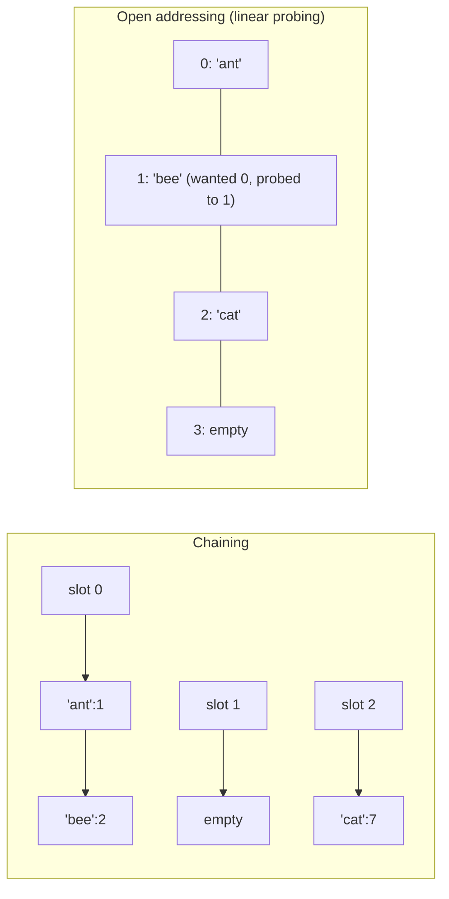

# Hash Tables

> [!tldr] TL;DR
> A **hash table** maps keys to values by running each key through a **hash function** that picks an array slot, giving **O(1) average** insert, lookup and delete. Different keys can land in the same slot (**collisions**), handled by **chaining** (a small list per slot) or **open addressing** (probe for another free slot). Keeping the **load factor** low by **resizing** keeps it fast; a bad hash or an attacker who forces collisions (**hash flooding**) degrades it to **O(n)**. In JS use `Map`/`Set` (not plain objects) for dynamic keys; in Python use `dict`/`set`, which are insertion-ordered since 3.7.

## The idea

Arrays give O(1) access **if you know the index**. A hash table turns any key into an index.

```text
key "cat" --hash()--> 2_918_451 --% 8--> slot 3

slots: 0     1     2     3            4     5     6     7
     +-----+-----+-----+------------+-----+-----+-----+-----+
     |     |     |     | "cat" : 7  |     |     |     |     |
     +-----+-----+-----+------------+-----+-----+-----+-----+
```

A good hash function is **deterministic** (same key, same hash), **fast**, and **spreads keys evenly** so few land in the same slot. Equal keys must have equal hashes; that's why mutable objects (like Python lists) are not hashable.

A **set** is a hash table with keys only. It answers "have I seen this?" in O(1) average.

## How it works

### Hash functions

- For integers, a simple scheme is `h(k) = k mod m`, better with `m` prime, or multiplicative hashing (`floor(m * frac(k * A))`) when `m` is a power of two.
- For strings, a polynomial rolling hash `h = h * 31 + code(c)` (Java's `String.hashCode`) or a keyed hash like **SipHash** (Python, Rust) that resists attacks.
- The table uses `hash(key) mod capacity` (or `& (capacity - 1)` when capacity is a power of two).

### Collision resolution



| | Separate chaining | Open addressing |
|---|---|---|
| Storage | each slot holds a list/tree of entries | all entries live in the slot array |
| On collision | append to the slot's list | probe the next slot: linear (`i+1`), quadratic (`i+k²`), or double hashing |
| Load factor | can exceed 1 | must stay below 1 (typically 0.5 to 0.875) |
| Delete | remove from list | needs **tombstones** or backward-shift, or probes break |
| Cache behaviour | pointer chasing | contiguous, cache friendly |
| Used by | Java `HashMap` (list, becomes a red-black tree at 8 entries since Java 8), C++ `std::unordered_map` | Python `dict`, Rust `HashMap` and Abseil (Swiss tables), V8 `Map` internals are ordered hash tables |

### Load factor and resizing

**Load factor** `α = n / capacity`. Expected chain length (or probe count) grows with `α`; for linear probing it blows up as `α → 1`.

When `α` passes a threshold, the table allocates a bigger array (usually 2x) and **rehashes** every entry into it, because `hash mod capacity` changes. One resize is O(n), but doubling makes insert **amortized O(1)**, exactly like dynamic arrays ([[Arrays & Strings]]).

| Runtime | Strategy | Resize threshold |
|---|---|---|
| Java `HashMap` | chaining (tree bins at 8) | 0.75 by default |
| CPython `dict` | open addressing with perturbed probing | about 2/3 full |
| C++ `unordered_map` | chaining | `max_load_factor()` 1.0 by default |

### Python dict: the compact, insertion-ordered dict

Since CPython 3.6, a dict stores two arrays:
1. A sparse **index table** of small integers (1, 2, 4 or 8 bytes each, depending on size).
2. A dense **entries array** of `(hash, key, value)` rows in insertion order.

Lookups probe the index table, which points into the entries array. Benefits: 20-25% less memory, faster iteration, and **insertion order for free**. Order preservation became a **language guarantee in Python 3.7**. `set` does **not** preserve order.

String and bytes hashes are **randomized per process** (hash randomization, default since Python 3.3; SipHash since 3.4 via PEP 456) to defeat hash flooding. Set `PYTHONHASHSEED` to reproduce. Small ints hash to themselves, so iteration order of a `set` of ints often looks sorted; never rely on it.

### JS: `Map` vs `Object`

| | `Object` / `{}` | `Map` |
|---|---|---|
| Key types | strings and symbols only (numbers become strings) | any value, including objects (by identity) |
| Order | integer-like keys ascending first, then string keys in insertion order | pure insertion order |
| Size | `Object.keys(o).length`, O(n) | `map.size`, O(1) |
| Prototype keys | inherits from `Object.prototype` (`"constructor" in {}` is true) unless `Object.create(null)` | none |
| Frequent add/delete | V8 may drop the object into slow "dictionary mode" | designed for it |
| JSON | native | needs conversion (`Object.fromEntries`) |
| Best for | fixed-shape records | dynamic keyed collections, counters, caches |

`Set` stores unique values with the same identity semantics (`SameValueZero`: `NaN` equals `NaN`; two different objects with equal contents are different keys). Details and `WeakMap`/`WeakRef`: [[Collections - Map, Set, WeakMap & WeakRef]].

> [!info]+ 🆕 2025–2026
> **ES2025** (ratified June 2025) added set algebra to `Set.prototype`: `union`, `intersection`, `difference`, `symmetricDifference`, `isSubsetOf`, `isSupersetOf`, `isDisjointFrom`. They return new `Set`s (or booleans) and accept any "set-like" argument (has `size`, `has`, `keys`), including a `Map`.
> ```ts
> const a = new Set([1, 2, 3]);
> const b = new Set([2, 3, 4]);
> a.intersection(b);        // Set {2, 3}
> a.union(b);               // Set {1, 2, 3, 4}
> a.difference(b);          // Set {1}
> a.symmetricDifference(b); // Set {1, 4}
> a.isDisjointFrom(new Set([9])); // true
> ```
> Python has had these forever: `a & b`, `a | b`, `a - b`, `a ^ b`, `a <= b`, `a.isdisjoint(b)`.

## Complexity

| Operation | Average | Worst | Notes |
|---|---|---|---|
| Insert / put | O(1) amortized | O(n) | worst: all keys collide, or a resize |
| Lookup / get / `has` | O(1) | O(n) | O(log n) worst for Java tree bins |
| Delete | O(1) | O(n) | |
| Iterate all | O(n) | O(n) | O(capacity) in naive open addressing |
| Resize (rehash) | O(n) | O(n) | amortized into inserts |
| Space | O(n) | O(n) | plus slack from load factor |

Hashing a key itself costs O(k) for a key of length k. "O(1)" assumes fixed-size keys; for strings, a lookup is O(k).

## Implementation

### Using the built-ins (what you do in interviews)

```ts
// Two Sum (LeetCode 1): value -> index
function twoSum(nums: number[], target: number): [number, number] | [] {
  const seen = new Map<number, number>();
  for (let i = 0; i < nums.length; i++) {
    const need = target - nums[i];
    if (seen.has(need)) return [seen.get(need)!, i];
    seen.set(nums[i], i);
  }
  return [];
}

// Frequency counter
function counts(words: string[]): Map<string, number> {
  const freq = new Map<string, number>();
  for (const w of words) freq.set(w, (freq.get(w) ?? 0) + 1);
  return freq;
}

// Group Anagrams (LeetCode 49): canonical key -> bucket
function groupAnagrams(strs: string[]): string[][] {
  const groups = new Map<string, string[]>();
  for (const s of strs) {
    const key = [...s].sort().join("");
    const bucket = groups.get(key);
    if (bucket) bucket.push(s);
    else groups.set(key, [s]);
  }
  return [...groups.values()];
}
```

```python
from collections import Counter, defaultdict

def two_sum(nums: list[int], target: int) -> list[int]:
    seen: dict[int, int] = {}
    for i, x in enumerate(nums):
        if target - x in seen:
            return [seen[target - x], i]
        seen[x] = i
    return []

def counts(words: list[str]) -> Counter:
    return Counter(words)              # Counter(words).most_common(3) for top 3

def group_anagrams(strs: list[str]) -> list[list[str]]:
    groups: defaultdict[tuple, list[str]] = defaultdict(list)
    for s in strs:
        key = [0] * 26                 # count tuple: O(k) instead of O(k log k) sort
        for ch in s:
            key[ord(ch) - ord("a")] += 1
        groups[tuple(key)].append(s)   # lists aren't hashable, tuples are
    return list(groups.values())
```

### Prefix sum + hash map (LeetCode 560)

Count subarrays summing to `k`: store how many times each running sum was seen. See [[Prefix Sum]].

```ts
function subarraySum(nums: number[], k: number): number {
  const seen = new Map<number, number>([[0, 1]]);
  let sum = 0, total = 0;
  for (const x of nums) {
    sum += x;
    total += seen.get(sum - k) ?? 0;
    seen.set(sum, (seen.get(sum) ?? 0) + 1);
  }
  return total;
}
```

```python
def subarray_sum(nums: list[int], k: int) -> int:
    seen = Counter({0: 1})
    total = running = 0
    for x in nums:
        running += x
        total += seen[running - k]
        seen[running] += 1
    return total
```

### A hash map from scratch (separate chaining)

```ts
class ChainedHashMap<V> {
  private buckets: [string, V][][];
  private count = 0;

  constructor(private capacity = 8, private maxLoad = 0.75) {
    this.buckets = Array.from({ length: capacity }, () => []);
  }

  private hash(key: string): number {
    let h = 2166136261;                       // FNV-1a, 32-bit
    for (let i = 0; i < key.length; i++) {
      h ^= key.charCodeAt(i);
      h = Math.imul(h, 16777619);
    }
    return (h >>> 0) % this.capacity;
  }

  set(key: string, value: V): void {
    const bucket = this.buckets[this.hash(key)];
    for (const entry of bucket) {
      if (entry[0] === key) { entry[1] = value; return; }
    }
    bucket.push([key, value]);
    this.count++;
    if (this.count / this.capacity > this.maxLoad) this.resize(this.capacity * 2);
  }

  get(key: string): V | undefined {
    for (const [k, v] of this.buckets[this.hash(key)]) if (k === key) return v;
    return undefined;
  }

  delete(key: string): boolean {
    const bucket = this.buckets[this.hash(key)];
    const i = bucket.findIndex(([k]) => k === key);
    if (i === -1) return false;
    bucket[i] = bucket[bucket.length - 1];    // swap-remove, O(1)
    bucket.pop();
    this.count--;
    return true;
  }

  private resize(newCap: number): void {
    const old = this.buckets;
    this.capacity = newCap;
    this.buckets = Array.from({ length: newCap }, () => []);
    for (const bucket of old) {
      for (const [k, v] of bucket) this.buckets[this.hash(k)].push([k, v]); // rehash
    }
  }
}
```

### Open addressing with linear probing and tombstones

```python
_EMPTY = object()
_DELETED = object()   # tombstone: keeps probe chains intact


class LinearProbingMap:
    def __init__(self, capacity: int = 8):
        self._keys = [_EMPTY] * capacity
        self._vals = [None] * capacity
        self._size = 0      # live entries
        self._used = 0      # live + tombstones

    def _slot(self, key) -> int:
        """Return the slot holding key, or the first reusable slot for it."""
        cap = len(self._keys)
        i = hash(key) % cap
        first_tomb = None
        while True:
            k = self._keys[i]
            if k is _EMPTY:
                return first_tomb if first_tomb is not None else i
            if k is _DELETED:
                if first_tomb is None:
                    first_tomb = i
            elif k == key:
                return i
            i = (i + 1) % cap

    def put(self, key, value) -> None:
        if (self._used + 1) / len(self._keys) > 2 / 3:
            self._resize(2 * len(self._keys))
        i = self._slot(key)
        k = self._keys[i]
        if k is _EMPTY or k is _DELETED:
            if k is _EMPTY:
                self._used += 1
            self._size += 1
            self._keys[i] = key
        self._vals[i] = value

    def get(self, key, default=None):
        i = self._slot(key)
        k = self._keys[i]
        if k is _EMPTY or k is _DELETED:
            return default
        return self._vals[i]

    def delete(self, key) -> bool:
        i = self._slot(key)
        k = self._keys[i]
        if k is _EMPTY or k is _DELETED:
            return False
        self._keys[i], self._vals[i] = _DELETED, None
        self._size -= 1
        return True

    def __len__(self) -> int:
        return self._size

    def _resize(self, cap: int) -> None:
        old = [(k, v) for k, v in zip(self._keys, self._vals)
               if k is not _EMPTY and k is not _DELETED]
        self._keys, self._vals = [_EMPTY] * cap, [None] * cap
        self._size = self._used = 0
        for k, v in old:
            self.put(k, v)       # tombstones are dropped on rehash
```

Why tombstones: if you delete `'bee'` (which probed from slot 0 to 1) by marking slot 1 empty, a later lookup for a key that probed past slot 1 stops early and wrongly reports "missing".

## Trade-offs & pitfalls

- **Mutable keys**: changing an object after using it as a key breaks lookups (its hash changes). Python forbids `list`/`dict` keys; use `tuple` or `frozenset`. In JS, `Map` keys objects **by identity**, so `map.get([1, 2])` never finds a different `[1, 2]` array; serialize to a string key (`"1,2"`) instead.
- **`__eq__` without `__hash__`**: in Python, defining `__eq__` sets `__hash__ = None`, making instances unhashable. Define both consistently (or use `@dataclass(frozen=True)`).
- **Plain object pitfalls in JS**: `obj["__proto__"]`, `"toString" in obj` and numeric-key reordering. Use `Map` or `Object.create(null)`.
- **Iteration order**: Python `dict` and JS `Map`/`Set` preserve insertion order; Python `set`, Java `HashMap` and Go maps do not (Go deliberately randomizes).
- **Modifying while iterating**: Python raises `RuntimeError: dictionary changed size during iteration`; iterate over `list(d)` instead.
- **Floating-point keys**: `0.1 + 0.2` is not `0.3`. Round or use integers.
- **Memory**: hash tables trade space for speed. A Python dict entry costs tens of bytes plus the key and value objects. For millions of small ints, a sorted array plus [[Binary Search]] or a bitset may be far smaller.
- **Not sorted**: if you need ordered keys or range queries ("all keys between a and b"), use a balanced BST / sorted container ([[Trees & Binary Search Trees]]), not a hash table.

## Senior perspective

- **Hash flooding / algorithmic complexity DoS.** If an attacker knows your hash function, they can send thousands of keys that collide (for example, POST parameters or JSON keys), turning each insert into O(n) and a request into O(n²) CPU. This was demonstrated against PHP, Java, Python, Ruby and ASP.NET at 28C3 in December 2011 (Klink and Walde). Fixes: **keyed hashes with a random per-process seed** (SipHash in Python, Rust, Ruby, Perl), Java's tree bins that cap worst case at O(log n), and **limits on the number of request parameters and JSON keys**.
- **Consistent hashing** (Karger et al., 1997) maps keys onto a ring so that adding or removing a cache/DB node only moves about `1/n` of the keys. Used by Dynamo-style stores, Cassandra, and CDN/cache sharding. Plain `hash mod N` remaps almost everything when `N` changes.
- **Hash tables in real systems**: database hash indexes and hash joins, in-memory caches (Redis is a big hash table with incremental rehashing so a resize never blocks the server), routing tables, symbol tables in compilers, deduplication, and interned strings.
- **Incremental rehashing**: a stop-the-world resize of a 10 GB table causes a latency spike. Redis keeps two tables and migrates a few buckets per operation.
- **Swiss tables** (Abseil `flat_hash_map`, Rust `hashbrown`) use open addressing with a separate array of 1-byte metadata tags scanned with SIMD, which is very cache friendly. They show why "same Big-O" hash tables can differ several-fold in speed.
- **Probabilistic cousins**: Bloom filters (set membership with false positives, tiny memory) and HyperLogLog (count distinct). Useful when an exact set won't fit in memory.
- **V8 and CPython details**: V8 objects with a stable shape use hidden classes (not hash tables) for fast property access; adding/deleting many keys pushes them into dictionary mode. `Map` is implemented as a deterministic (insertion-ordered) hash table. CPython dicts are also the backbone of the language: module globals, class attributes and instance `__dict__` (with key-sharing dicts for instances).
- **In review, ask**: are keys attacker-controlled (flooding, unbounded growth)? Is there eviction or a size cap (a cache without eviction is a leak; see [[Linked Lists]] for LRU)? Is `Object` being used where `Map` belongs? Is a composite key built safely (`${a},${b}` is ambiguous if `a` can contain commas)?
- **In interviews**: "hash map" is the answer to "can we trade space for time?" Say the average vs worst case explicitly, and mention that string keys cost O(k) to hash.

## Classic LeetCode problems

| # | Problem | Difficulty | Key idea |
|---|---|---|---|
| 1 | [Two Sum](https://leetcode.com/problems/two-sum/) | Easy | value to index map, look up complement |
| 217 | [Contains Duplicate](https://leetcode.com/problems/contains-duplicate/) | Easy | set membership |
| 205 | [Isomorphic Strings](https://leetcode.com/problems/isomorphic-strings/) | Easy | two maps for a bijection |
| 49 | [Group Anagrams](https://leetcode.com/problems/group-anagrams/) | Medium | canonical key (sorted or count tuple) |
| 128 | [Longest Consecutive Sequence](https://leetcode.com/problems/longest-consecutive-sequence/) | Medium | set; only start counting at sequence starts |
| 560 | [Subarray Sum Equals K](https://leetcode.com/problems/subarray-sum-equals-k/) | Medium | prefix sums counted in a map |
| 380 | [Insert Delete GetRandom O(1)](https://leetcode.com/problems/insert-delete-getrandom-o1/) | Medium | map value to index + array, swap-remove |
| 706 | [Design HashMap](https://leetcode.com/problems/design-hashmap/) | Easy | build chaining or open addressing yourself |

## Interview questions

> [!question]- Why is hash table lookup O(1) on average but O(n) in the worst case?
> A good hash spreads keys evenly, so each slot holds O(1) entries when the load factor is bounded. If many keys collide (bad hash or adversarial input), one slot holds O(n) entries and lookups degrade to a linear scan (O(log n) with Java's tree bins).

> [!question]- Chaining vs open addressing: pros and cons?
> Chaining is simple, tolerates load factor above 1, and deletes easily, but chases pointers. Open addressing stores everything in one array (cache friendly, less allocation) but must keep load below 1, suffers clustering, and needs tombstones or backward-shift for deletes.

> [!question]- What is the load factor and why do tables resize?
> `n / capacity`. As it grows, collisions and probe lengths grow. Tables double capacity and rehash every key past a threshold (0.75 in Java, ~2/3 in CPython). Doubling keeps insert amortized O(1).

> [!question]- Why is the Python dict ordered, and is a set ordered too?
> CPython 3.6 introduced a compact layout: a sparse index table pointing into a dense, insertion-ordered entries array. Python 3.7 made insertion order a language guarantee. `set` uses a different layout and is not ordered.

> [!question]- When should you use `Map` instead of a plain object in JS?
> When keys are dynamic or not strings, when you add/delete often, when you need `size` or reliable insertion-order iteration, or when keys might collide with prototype properties like `__proto__`. Objects are for fixed-shape records and JSON.

> [!question]- What is hash flooding and how do languages defend against it?
> An attacker crafts many colliding keys so every insert is O(n), causing CPU-exhaustion DoS (famous 2011 disclosure). Defenses: randomized keyed hashes (SipHash with a per-process seed), tree bins for bounded worst case, and limits on input key counts.

> [!question]- How would you use a list as a dictionary key in Python, or an array as a Map key in JS?
> Python: convert to a `tuple` (immutable, hashable). JS: `Map` compares objects by identity, so derive a primitive key such as `JSON.stringify(arr)` or `arr.join(",")` (ensure the separator can't appear in the values).

> [!question]- Design a data structure with O(1) insert, delete and getRandom.
> Keep values in an array and a map from value to its index. Insert: push and record the index. Delete: swap the element with the last one, update the moved element's index, pop. getRandom: pick a random index. (LeetCode 380.)

## Related
- [[DSA Index]]
- [[Big-O & Complexity Analysis]] · [[Arrays & Strings]] · [[Linked Lists]] · [[Trees & Binary Search Trees]] · [[Tries]]
- Patterns: [[Prefix Sum]] · [[Sliding Window]] · [[Two Pointers]]
- Frontend: [[Collections - Map, Set, WeakMap & WeakRef]] · [[Memory Management & Garbage Collection]]
- [[LeetCode Crash Course]]

## Sources
- Cormen, Leiserson, Rivest, Stein, *Introduction to Algorithms*, 4th ed., MIT Press 2022 (ch. 11, hash tables)
- [Sedgewick & Wayne, Algorithms 4th ed.: Hash Tables (3.4)](https://algs4.cs.princeton.edu/34hash/)
- [Python docs: What's New in 3.6 (compact dict)](https://docs.python.org/3/whatsnew/3.6.html#new-dict-implementation) · [What's New in 3.7 (order guarantee)](https://docs.python.org/3/whatsnew/3.7.html)
- [PEP 456: Secure and interchangeable hash algorithm](https://peps.python.org/pep-0456/)
- [Python docs: object.__hash__](https://docs.python.org/3/reference/datamodel.html#object.__hash__)
- [Java SE docs: HashMap](https://docs.oracle.com/en/java/javase/21/docs/api/java.base/java/util/HashMap.html) · [JEP 180: Handle frequent HashMap collisions with balanced trees](https://openjdk.org/jeps/180)
- [MDN: Map](https://developer.mozilla.org/en-US/docs/Web/JavaScript/Reference/Global_Objects/Map) · [MDN: Set](https://developer.mozilla.org/en-US/docs/Web/JavaScript/Reference/Global_Objects/Set)
- [TC39 finished proposals (Set methods, ES2025)](https://github.com/tc39/proposals/blob/main/finished-proposals.md)
- [V8 blog: Fast properties in V8](https://v8.dev/blog/fast-properties)
- [oCERT-2011-003: Multiple implementations denial-of-service via hash algorithm collision](https://ocert.org/advisories/ocert-2011-003.html)
- [Abseil: Swiss Tables design notes](https://abseil.io/about/design/swisstables)
- [LeetCode Explore: Hash Table card](https://leetcode.com/explore/learn/card/hash-table/)
