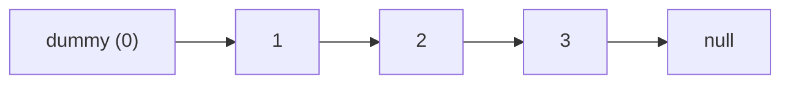
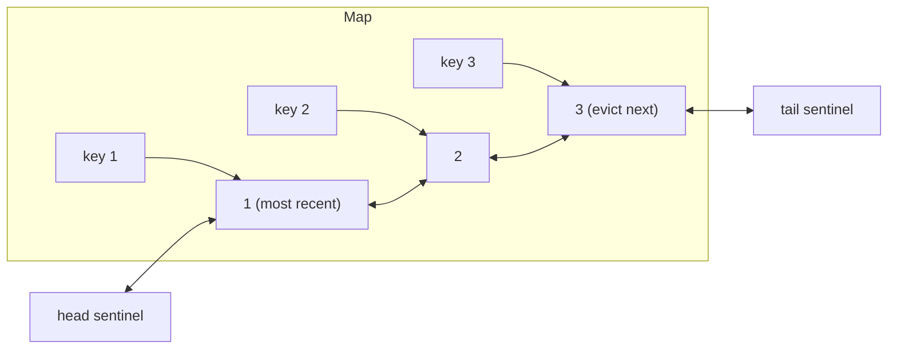

# Linked Lists

> [!tldr] TL;DR
> A **linked list** is a chain of nodes where each node holds a value and a pointer to the next node (and, in a **doubly** linked list, also to the previous one). You get **O(1) insert/delete when you already hold the node** (or at the head/tail), but **O(n) access by index** because you must walk the chain. The two tricks that make most problems easy are a **dummy (sentinel) head** and **multiple pointers** (prev/curr/next for reversal, [[Fast and Slow Pointer]] for middles and cycles). The flagship real-world use is the **LRU cache**: doubly linked list + hash map.

## Classes & pointers (the intuition you need first)

Linked lists only make sense once you see that variables holding objects hold **references** (pointers), not copies.

```ts
const a = { value: 1 };
const b = a;       // b points to the SAME object
b.value = 2;
console.log(a.value); // 2
```

```python
a = {"value": 1}
b = a              # same object
b["value"] = 2
print(a["value"])  # 2
```

A node is just an object with a `value` and a `next` reference. A linked list is an object that keeps references to the first node (`head`), usually the last (`tail`), and a `length`. When you write `curr = curr.next`, you are **moving a pointer**, not copying data. When nothing points to a node anymore, the garbage collector frees it ([[Memory Management & Garbage Collection]]).

## The idea

```text
Singly linked list
 head                               tail
  |                                  |
  v                                  v
+---+---+    +---+---+    +---+---+    +---+------+
| 7 | *-+--> | 3 | *-+--> | 9 | *-+--> | 4 | null |
+---+---+    +---+---+    +---+---+    +---+------+

Doubly linked list
        +------+---+---+    +---+---+---+    +---+---+------+
null <--+ prev | 7 |nxt+--> |prv| 3 |nxt+--> |prv| 9 | null |
        +------+---+---+ <--+---+---+---+ <--+---+---+------+
```

- **Array vs list**: an array stores items side by side, so index access is instant but inserting in the middle shifts everything. A list scatters nodes around the heap; inserting is just re-pointing two arrows, but finding item `i` means walking `i` steps.
- **Singly**: each node knows only its successor. Removing the tail needs the node before it, so `pop` is O(n).
- **Doubly**: each node knows both neighbours. Removing any node you hold is O(1). Costs one extra pointer per node.

## How it works

The course-style API (as in Udemy "Data Structures & Algorithms in JS/Python"):

| Operation | What it does | Singly | Doubly |
|---|---|---|---|
| `push(v)` | append at tail | O(1) with tail pointer | O(1) |
| `pop()` | remove tail | **O(n)** (find node before tail) | O(1) |
| `unshift(v)` | add at head | O(1) | O(1) |
| `shift()` | remove head | O(1) | O(1) |
| `get(i)` / `set(i, v)` | walk to index | O(n) | O(n), can start from the closer end |
| `insert(i, v)` | walk to `i-1`, relink | O(n) | O(n) |
| `remove(i)` | walk to `i-1`, relink | O(n) | O(n); O(1) if you already hold the node |
| `reverse()` | flip every `next` | O(n) | O(n) |

### Reversal, step by step

Three pointers: `prev`, `curr`, `next`.

```text
start:  prev=null  curr=1 -> 2 -> 3 -> null

step 1: next=2;  1.next=null;   prev=1; curr=2      null <- 1    2 -> 3
step 2: next=3;  2.next=1;      prev=2; curr=3      null <- 1 <- 2    3
step 3: next=null; 3.next=2;    prev=3; curr=null   null <- 1 <- 2 <- 3
return prev (3) as new head
```

### Dummy (sentinel) head

Many operations have a special case: "what if we remove or insert at the head?". Put a fake node in front: `dummy.next = head`. Now every real node has a predecessor, the special case disappears, and you return `dummy.next`.



## Complexity

| Operation | Singly | Doubly | Dynamic array |
|---|---|---|---|
| Access by index | O(n) | O(n) (n/2 from nearer end) | O(1) |
| Search by value | O(n) | O(n) | O(n) |
| Insert/delete at head | O(1) | O(1) | O(n) |
| Insert at tail | O(1) with tail | O(1) | O(1) amortized |
| Delete at tail | O(n) | O(1) | O(1) |
| Insert/delete given a node reference | O(1) after (needs prev to delete) | O(1) | O(n) |
| Space | n nodes + 1 pointer each | n nodes + 2 pointers each | n + slack |

## Implementation

### Singly linked list

```ts
class ListNode<T> {
  constructor(public value: T, public next: ListNode<T> | null = null) {}
}

class SinglyLinkedList<T> {
  head: ListNode<T> | null = null;
  tail: ListNode<T> | null = null;
  length = 0;

  push(value: T): this {
    const node = new ListNode(value);
    if (!this.tail) this.head = this.tail = node;
    else { this.tail.next = node; this.tail = node; }
    this.length++;
    return this;
  }

  pop(): T | undefined {
    if (!this.head) return undefined;
    let prev = this.head, curr = this.head;
    while (curr.next) { prev = curr; curr = curr.next; } // walk to the tail
    this.tail = prev;
    this.tail.next = null;
    this.length--;
    if (this.length === 0) this.head = this.tail = null;
    return curr.value;
  }

  unshift(value: T): this {
    const node = new ListNode(value, this.head);
    this.head = node;
    if (!this.tail) this.tail = node;
    this.length++;
    return this;
  }

  shift(): T | undefined {
    if (!this.head) return undefined;
    const old = this.head;
    this.head = old.next;
    old.next = null;
    this.length--;
    if (this.length === 0) this.tail = null;
    return old.value;
  }

  get(index: number): ListNode<T> | null {
    if (index < 0 || index >= this.length) return null;
    let curr = this.head;
    for (let i = 0; i < index; i++) curr = curr!.next;
    return curr;
  }

  insert(index: number, value: T): boolean {
    if (index < 0 || index > this.length) return false;
    if (index === 0) { this.unshift(value); return true; }
    if (index === this.length) { this.push(value); return true; }
    const prev = this.get(index - 1)!;
    prev.next = new ListNode(value, prev.next);
    this.length++;
    return true;
  }

  remove(index: number): T | undefined {
    if (index < 0 || index >= this.length) return undefined;
    if (index === 0) return this.shift();
    if (index === this.length - 1) return this.pop();
    const prev = this.get(index - 1)!;
    const removed = prev.next!;
    prev.next = removed.next;
    removed.next = null;
    this.length--;
    return removed.value;
  }

  reverse(): this {
    let prev: ListNode<T> | null = null;
    let curr = this.head;
    this.tail = this.head;
    while (curr) {
      const next = curr.next;
      curr.next = prev;
      prev = curr;
      curr = next;
    }
    this.head = prev;
    return this;
  }
}
```

```python
from __future__ import annotations
from typing import Generic, Optional, TypeVar

T = TypeVar("T")

class ListNode(Generic[T]):
    __slots__ = ("value", "next")

    def __init__(self, value: T, next: Optional[ListNode[T]] = None):
        self.value = value
        self.next = next


class SinglyLinkedList(Generic[T]):
    def __init__(self):
        self.head: Optional[ListNode[T]] = None
        self.tail: Optional[ListNode[T]] = None
        self.length = 0

    def push(self, value: T) -> None:
        node = ListNode(value)
        if self.tail is None:
            self.head = self.tail = node
        else:
            self.tail.next = node
            self.tail = node
        self.length += 1

    def pop(self) -> Optional[T]:
        if self.head is None:
            return None
        prev = curr = self.head
        while curr.next:
            prev, curr = curr, curr.next
        self.tail = prev
        prev.next = None
        self.length -= 1
        if self.length == 0:
            self.head = self.tail = None
        return curr.value

    def unshift(self, value: T) -> None:
        self.head = ListNode(value, self.head)
        if self.tail is None:
            self.tail = self.head
        self.length += 1

    def shift(self) -> Optional[T]:
        if self.head is None:
            return None
        old = self.head
        self.head = old.next
        old.next = None
        self.length -= 1
        if self.length == 0:
            self.tail = None
        return old.value

    def get(self, index: int) -> Optional[ListNode[T]]:
        if not 0 <= index < self.length:
            return None
        curr = self.head
        for _ in range(index):
            curr = curr.next
        return curr

    def insert(self, index: int, value: T) -> bool:
        if not 0 <= index <= self.length:
            return False
        if index == 0:
            self.unshift(value)
        elif index == self.length:
            self.push(value)
        else:
            prev = self.get(index - 1)
            prev.next = ListNode(value, prev.next)
            self.length += 1
        return True

    def remove(self, index: int) -> Optional[T]:
        if not 0 <= index < self.length:
            return None
        if index == 0:
            return self.shift()
        if index == self.length - 1:
            return self.pop()
        prev = self.get(index - 1)
        removed = prev.next
        prev.next = removed.next
        removed.next = None
        self.length -= 1
        return removed.value

    def reverse(self) -> None:
        prev, curr = None, self.head
        self.tail = self.head
        while curr:
            curr.next, prev, curr = prev, curr, curr.next
        self.head = prev
```

> [!warning] Python tuple assignment order
> `curr.next, prev, curr = prev, curr, curr.next` works because the right side is fully evaluated first, then assigned **left to right**. Reordering the targets (e.g. `curr, curr.next = ...`) assigns `curr` first and then sets `.next` on the wrong node. When in doubt, use a `nxt` temp variable.

### Doubly linked list (the operations that change)

```ts
class DNode<T> {
  prev: DNode<T> | null = null;
  next: DNode<T> | null = null;
  constructor(public value: T) {}
}

class DoublyLinkedList<T> {
  head: DNode<T> | null = null;
  tail: DNode<T> | null = null;
  length = 0;

  push(value: T): this {
    const node = new DNode(value);
    if (!this.tail) this.head = this.tail = node;
    else { node.prev = this.tail; this.tail.next = node; this.tail = node; }
    this.length++;
    return this;
  }

  pop(): T | undefined {                  // O(1) now: tail knows its prev
    if (!this.tail) return undefined;
    const old = this.tail;
    if (this.length === 1) this.head = this.tail = null;
    else { this.tail = old.prev!; this.tail.next = null; old.prev = null; }
    this.length--;
    return old.value;
  }

  get(index: number): DNode<T> | null {  // walk from the closer end
    if (index < 0 || index >= this.length) return null;
    if (index < this.length / 2) {
      let curr = this.head!;
      for (let i = 0; i < index; i++) curr = curr.next!;
      return curr;
    }
    let curr = this.tail!;
    for (let i = this.length - 1; i > index; i--) curr = curr.prev!;
    return curr;
  }
}
```

```python
class DNode:
    __slots__ = ("value", "prev", "next")

    def __init__(self, value):
        self.value = value
        self.prev = None
        self.next = None


class DoublyLinkedList:
    def __init__(self):
        self.head = self.tail = None
        self.length = 0

    def push(self, value) -> None:
        node = DNode(value)
        if self.tail is None:
            self.head = self.tail = node
        else:
            node.prev, self.tail.next = self.tail, node
            self.tail = node
        self.length += 1

    def pop(self):
        if self.tail is None:
            return None
        old = self.tail
        if self.length == 1:
            self.head = self.tail = None
        else:
            self.tail = old.prev
            self.tail.next = None
            old.prev = None
        self.length -= 1
        return old.value

    def get(self, index: int):
        if not 0 <= index < self.length:
            return None
        if index < self.length // 2:
            curr = self.head
            for _ in range(index):
                curr = curr.next
        else:
            curr = self.tail
            for _ in range(self.length - 1 - index):
                curr = curr.prev
        return curr
```

### Dummy head: Remove Nth Node From End (LeetCode 19)

Gap of `n` between two pointers; when the fast one hits the end, the slow one sits just before the target. The dummy handles "remove the head".

```ts
function removeNthFromEnd(head: ListNode<number> | null, n: number): ListNode<number> | null {
  const dummy = new ListNode(0, head);
  let fast: ListNode<number> | null = dummy;
  let slow: ListNode<number> = dummy;
  for (let i = 0; i <= n; i++) fast = fast!.next;   // gap of n+1
  while (fast) { fast = fast.next; slow = slow.next!; }
  slow.next = slow.next!.next;
  return dummy.next;
}
```

```python
def remove_nth_from_end(head, n):
    dummy = ListNode(0, head)
    fast = slow = dummy
    for _ in range(n + 1):
        fast = fast.next
    while fast:
        fast, slow = fast.next, slow.next
    slow.next = slow.next.next
    return dummy.next
```

### Merge Two Sorted Lists (LeetCode 21)

```ts
function mergeTwoLists(a: ListNode<number> | null, b: ListNode<number> | null) {
  const dummy = new ListNode(0);
  let tail = dummy;
  while (a && b) {
    if (a.value <= b.value) { tail.next = a; a = a.next; }
    else { tail.next = b; b = b.next; }
    tail = tail.next!;
  }
  tail.next = a ?? b;
  return dummy.next;
}
```

```python
def merge_two_lists(a, b):
    dummy = tail = ListNode(0)
    while a and b:
        if a.value <= b.value:
            tail.next, a = a, a.next
        else:
            tail.next, b = b, b.next
        tail = tail.next
    tail.next = a or b
    return dummy.next
```

### LRU cache: doubly linked list + hash map (LeetCode 146)

Goal: `get` and `put` in O(1), evicting the **least recently used** key when over capacity.

- The **hash map** gives O(1) key to node lookup.
- The **doubly linked list** keeps recency order: most recent right after `head`, least recent right before `tail`. Because each node knows its `prev`, unlinking is O(1).
- Two sentinels (`head`, `tail`) remove all null checks.



```ts
class LRUNode {
  prev: LRUNode | null = null;
  next: LRUNode | null = null;
  constructor(public key: number, public value: number) {}
}

class LRUCache {
  private map = new Map<number, LRUNode>();
  private head = new LRUNode(0, 0); // sentinel: most recent side
  private tail = new LRUNode(0, 0); // sentinel: least recent side

  constructor(private capacity: number) {
    this.head.next = this.tail;
    this.tail.prev = this.head;
  }

  private unlink(node: LRUNode): void {
    node.prev!.next = node.next;
    node.next!.prev = node.prev;
  }

  private addFront(node: LRUNode): void {
    node.prev = this.head;
    node.next = this.head.next;
    this.head.next!.prev = node;
    this.head.next = node;
  }

  get(key: number): number {
    const node = this.map.get(key);
    if (!node) return -1;
    this.unlink(node);
    this.addFront(node);
    return node.value;
  }

  put(key: number, value: number): void {
    const existing = this.map.get(key);
    if (existing) {
      existing.value = value;
      this.unlink(existing);
      this.addFront(existing);
      return;
    }
    const node = new LRUNode(key, value);
    this.map.set(key, node);
    this.addFront(node);
    if (this.map.size > this.capacity) {
      const lru = this.tail.prev!;
      this.unlink(lru);
      this.map.delete(lru.key); // node stores its key so we can do this
    }
  }
}
```

```python
class _Node:
    __slots__ = ("key", "value", "prev", "next")

    def __init__(self, key=0, value=0):
        self.key, self.value = key, value
        self.prev = self.next = None


class LRUCache:
    def __init__(self, capacity: int):
        self.cap = capacity
        self.map: dict[int, _Node] = {}
        self.head, self.tail = _Node(), _Node()
        self.head.next, self.tail.prev = self.tail, self.head

    def _unlink(self, node: _Node) -> None:
        node.prev.next, node.next.prev = node.next, node.prev

    def _add_front(self, node: _Node) -> None:
        node.prev, node.next = self.head, self.head.next
        self.head.next.prev = node
        self.head.next = node

    def get(self, key: int) -> int:
        node = self.map.get(key)
        if node is None:
            return -1
        self._unlink(node)
        self._add_front(node)
        return node.value

    def put(self, key: int, value: int) -> None:
        if key in self.map:
            node = self.map[key]
            node.value = value
            self._unlink(node)
            self._add_front(node)
            return
        node = _Node(key, value)
        self.map[key] = node
        self._add_front(node)
        if len(self.map) > self.cap:
            lru = self.tail.prev
            self._unlink(lru)
            del self.map[lru.key]
```

> [!tip] Library shortcuts (say them in interviews, then implement by hand if asked)
> - Python: `collections.OrderedDict` with `move_to_end(key)` and `popitem(last=False)`; `functools.lru_cache` for memoizing functions.
> - JS: `Map` iterates in insertion order, so `delete` + `set` moves a key to the end, and `map.keys().next().value` is the oldest key.

## Trade-offs & pitfalls

- **Losing the rest of the list**: when relinking, save `next` before you overwrite `curr.next`.
- **Forgetting head/tail updates**: after `pop`/`shift` of the last element, both `head` and `tail` must become `null`.
- **Null dereference**: check `curr && curr.next` before `curr.next.next`. A dummy head removes most of these.
- **Off-by-one when walking**: to modify position `i`, you need the node at `i - 1`.
- **Cycles**: a bug that creates a cycle makes traversal loop forever. Detect with [[Fast and Slow Pointer]] (Floyd).
- **Recursion depth**: recursive reversal or merge is elegant but uses O(n) stack. Python's default recursion limit is 1000, so a 10^4 node list crashes. Prefer iterative.
- **Singly `pop` is O(n)**: if you need both ends, use a doubly linked list or a deque.
- **Memory**: each node carries object header + pointer(s). In CPython a small object with `__slots__` is still tens of bytes; in V8 each node is a separate heap object. Millions of nodes stress the GC.

## Senior perspective

- **Linked lists are rarely the right default in application code.** Arrays win on cache locality; pointer chasing causes cache misses. Bjarne Stroustrup's well-known talk shows `std::vector` beating `std::list` even for middle inserts at realistic sizes, because finding the position (a linear walk) dominates.
- **Where they shine in real systems**:
  - **LRU / LFU caches** (Redis approximates LRU by sampling; Memcached uses per-slab-class LRU linked lists; OS page caches use list-based schemes like CLOCK and active/inactive lists in Linux).
  - **Intrusive lists** in kernels (Linux `list_head`): the node pointers live inside the struct, so no extra allocation and O(1) removal of an object you already hold.
  - **Free lists** in memory allocators, **hash table chaining** buckets ([[Hash Tables]]), adjacency lists ([[Graphs]]).
  - **Lock-free queues and stacks** (Michael-Scott queue) in concurrent runtimes.
  - **Persistent (immutable) lists** in functional languages: sharing the tail makes `cons` O(1) without copying.
- **Python's `collections.deque`** is a doubly linked list of fixed-size blocks (64 slots each), which keeps O(1) ends and better locality than one node per element. JS has no built-in linked list or deque.
- **In review, ask**: does this need O(1) removal of an arbitrary known element? If not, why not an array? Is there an unbounded list (memory leak)? Who owns node lifetimes if nodes are shared?
- **In interviews**: draw boxes and arrows before coding, name your pointers (`prev`, `curr`, `nxt`), use a dummy head, and test with lists of length 0, 1 and 2.

## Classic LeetCode problems

| # | Problem | Difficulty | Key idea |
|---|---|---|---|
| 206 | [Reverse Linked List](https://leetcode.com/problems/reverse-linked-list/) | Easy | prev/curr/next pointers |
| 21 | [Merge Two Sorted Lists](https://leetcode.com/problems/merge-two-sorted-lists/) | Easy | dummy head + tail pointer |
| 141 | [Linked List Cycle](https://leetcode.com/problems/linked-list-cycle/) | Easy | Floyd fast/slow pointers |
| 876 | [Middle of the Linked List](https://leetcode.com/problems/middle-of-the-linked-list/) | Easy | slow moves 1, fast moves 2 |
| 19 | [Remove Nth Node From End of List](https://leetcode.com/problems/remove-nth-node-from-end-of-list/) | Medium | gap of n between two pointers, dummy head |
| 2 | [Add Two Numbers](https://leetcode.com/problems/add-two-numbers/) | Medium | walk both lists with a carry |
| 92 | [Reverse Linked List II](https://leetcode.com/problems/reverse-linked-list-ii/) | Medium | reverse a sublist in place, dummy head |
| 138 | [Copy List with Random Pointer](https://leetcode.com/problems/copy-list-with-random-pointer/) | Medium | hash map old to new, or interleave copies |
| 146 | [LRU Cache](https://leetcode.com/problems/lru-cache/) | Medium | doubly linked list + hash map |

## Interview questions

> [!question]- When would you choose a linked list over an array?
> When you need O(1) insertion/removal at known positions (you already hold the node), such as LRU eviction, or frequent inserts at both ends with no need for random access. Otherwise arrays usually win on locality, memory and simplicity.

> [!question]- Why is `pop` O(n) in a singly linked list but O(1) in a doubly linked list?
> Removing the tail requires updating the second-to-last node's `next`. In a singly list you must walk from the head to find it. In a doubly list, `tail.prev` gives it directly.

> [!question]- What is a dummy (sentinel) node and why use it?
> A fake node placed before the real head (and sometimes after the tail). Every real node then has a predecessor/successor, so insertions and deletions at the ends need no special cases. Return `dummy.next` at the end.

> [!question]- Design an LRU cache with O(1) get and put.
> Hash map from key to node, plus a doubly linked list ordered by recency with head/tail sentinels. `get`: look up, move node to front. `put`: update or insert at front; if over capacity, remove `tail.prev` from both list and map (nodes store their key for this).

> [!question]- Reverse a linked list iteratively and recursively. Which is better?
> Iterative uses `prev`, `curr`, `next` and O(1) space. Recursive: reverse the rest, then `head.next.next = head; head.next = null`, using O(n) stack. Iterative is safer for long lists.

> [!question]- How do you find the middle node or detect a cycle?
> Fast and slow pointers: slow moves one step, fast two. When fast reaches the end, slow is in the middle. If they ever meet, there's a cycle. See [[Fast and Slow Pointer]].

> [!question]- How does a linked list affect memory and GC compared to an array?
> Each node is a separate heap allocation with an object header and pointers, so memory overhead is higher and nodes are scattered (poor locality). The GC has more objects to trace. An array is one allocation of contiguous slots.

## Related
- [[DSA Index]]
- [[Big-O & Complexity Analysis]] · [[Arrays & Strings]] · [[Stacks & Queues]] · [[Hash Tables]] · [[Graphs]]
- Patterns: [[Fast and Slow Pointer]] · [[Two Pointers]] · [[Recursion & Backtracking]]
- Frontend: [[Memory Management & Garbage Collection]] · [[Collections - Map, Set, WeakMap & WeakRef]]
- [[LeetCode Crash Course]]

## Sources
- Cormen, Leiserson, Rivest, Stein, *Introduction to Algorithms*, 4th ed., MIT Press 2022 (ch. 10, elementary data structures)
- [Sedgewick & Wayne, Algorithms 4th ed.: Bags, Queues and Stacks (linked lists)](https://algs4.cs.princeton.edu/13stacks/)
- [Python docs: collections.OrderedDict](https://docs.python.org/3/library/collections.html#collections.OrderedDict) · [functools.lru_cache](https://docs.python.org/3/library/functools.html#functools.lru_cache)
- [CPython source: _collectionsmodule.c (deque block design)](https://github.com/python/cpython/blob/main/Modules/_collectionsmodule.c)
- [MDN: Map (insertion order)](https://developer.mozilla.org/en-US/docs/Web/JavaScript/Reference/Global_Objects/Map)
- [Redis docs: Key eviction (approximated LRU)](https://redis.io/docs/latest/develop/reference/eviction/)
- [LeetCode Explore: Linked List card](https://leetcode.com/explore/learn/card/linked-list/)
- [NeetCode roadmap](https://neetcode.io/roadmap)
