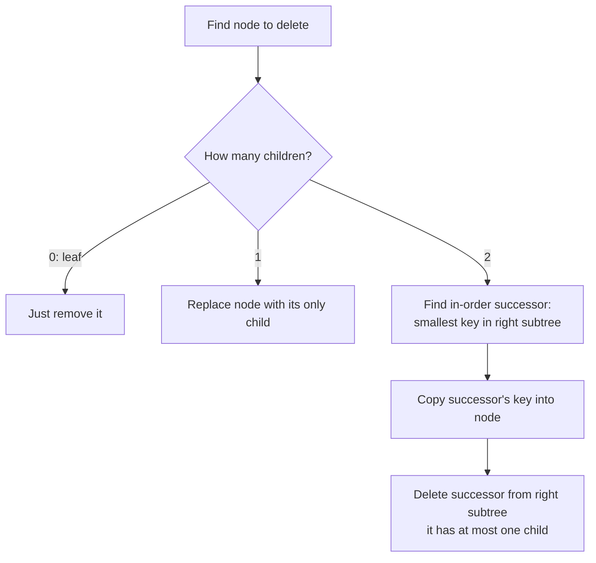

# Trees & Binary Search Trees

<Note>
**TL;DR**

A **tree** is a connected, acyclic hierarchy of nodes with one root. A **binary tree** gives each node at most two children, and a **binary search tree (BST)** adds an ordering rule: everything in the left subtree is smaller, everything in the right subtree is larger. That rule makes search, insert and delete **O(h)**, where h is the height: O(log n) when balanced, O(n) when it degenerates into a linked list. Self-balancing trees (AVL, red-black) guarantee O(log n); **B-trees / B+ trees** are the disk-friendly cousins behind almost every database index.
</Note>

## The idea

Think of a family tree or a file system: one root at the top, each node points to its children, and there are no loops. Trees model anything hierarchical (DOM, JSON, org charts, ASTs) and, with an ordering rule, give you a sorted structure that supports fast lookups **and** in-order iteration.

```text
            8          <- root (depth 0)
          /   \
         3     10      <- depth 1
        / \      \
       1   6      14   <- depth 2
          / \    /
         4   7  13     <- leaves (depth 3)
```

This is a valid BST: for every node, all keys on the left are smaller and all keys on the right are larger. An **in-order traversal** (left, node, right) prints `1 3 4 6 7 8 10 13 14`, the keys in sorted order.

### Terminology

| Term | Meaning |
|---|---|
| Root | The only node with no parent |
| Parent / child / sibling | Direct links; siblings share a parent |
| Leaf | Node with no children |
| Internal node | Node with at least one child |
| Edge | Link between parent and child (a tree with n nodes has n - 1 edges) |
| Depth of a node | Number of edges from the root to it (root = 0) |
| Height of a node | Number of edges on the longest path down to a leaf (leaf = 0) |
| Height of the tree | Height of the root. Some sources count nodes instead of edges, so check the convention (LeetCode 104 counts nodes) |
| Subtree | A node plus all its descendants |
| Degree | Number of children of a node |
| Ancestor / descendant | Any node on the path up / down |

### Kinds of binary trees

| Kind | Definition |
|---|---|
| **Full** | Every node has 0 or 2 children |
| **Complete** | Every level full except possibly the last, which is filled left to right. This is the shape of a heap, see [Heaps & Priority Queues](/Software%20Engineering/DSA/02%20Data%20Structures/Heaps%20%26%20Priority%20Queues) |
| **Perfect** | All internal nodes have 2 children and all leaves are on the same level: 2^(h+1) - 1 nodes |
| **Balanced** | Height is O(log n). Precise meaning depends on the scheme (AVL: subtree heights differ by at most 1) |
| **Degenerate / skewed** | Every node has one child. It is a linked list in disguise, height n - 1 |

## How it works

### Search

Start at the root. If the key equals the node, done. If it is smaller go left, otherwise go right. Stop at `null` (not found). Each step discards a whole subtree, which is binary search on a linked structure (see [Binary Search](/Software%20Engineering/DSA/04%20Patterns/Binary%20Search)).

### Insert

Search for the key. The place where the search falls off the tree (a `null` child) is exactly where the new leaf goes. New nodes are always inserted as leaves.

### Delete (three cases)



Deleting `3` from the tree above: it has two children, its successor is `4` (leftmost in the right subtree `6 -> 4`). Copy `4` into the node, then delete the old `4` leaf. The in-order predecessor (largest on the left) works equally well.

### Traversals

Pre-order, in-order, post-order (DFS) and level-order (BFS) are covered in depth in [Tree Traversal - DFS & BFS](/Software%20Engineering/DSA/03%20Algorithms/Tree%20Traversal%20-%20DFS%20%26%20BFS). For a BST, remember one fact: **in-order = sorted order**.

## Complexity

h = height. Balanced: h = O(log n). Degenerate (e.g. inserting sorted keys into a plain BST): h = n.

| Operation | Plain BST avg | Plain BST worst | AVL / red-black | Space |
|---|---|---|---|---|
| Search | O(log n) | O(n) | O(log n) | O(1) iterative, O(h) recursive |
| Insert | O(log n) | O(n) | O(log n) | same |
| Delete | O(log n) | O(n) | O(log n) | same |
| Min / max | O(log n) | O(n) | O(log n) | O(1) |
| In-order traversal | O(n) | O(n) | O(n) | O(h) stack |
| Build from n keys | O(n log n) | O(n^2) | O(n log n) | O(n) |
| Build from sorted array (LC 108) | O(n) | O(n) | n/a | O(n) |

"Average" assumes random insertion order: a randomly built BST has expected height O(log n) (CLRS 12.4); the average node depth is about 2 ln n, roughly 1.39 log2 n.

## Implementation

### Node and BST (search, insert, delete, in-order)

```ts
class TreeNode {
  constructor(
    public val: number,
    public left: TreeNode | null = null,
    public right: TreeNode | null = null,
  ) {}
}

class BST {
  root: TreeNode | null = null;

  search(key: number): TreeNode | null {
    let cur = this.root;
    while (cur && cur.val !== key) cur = key < cur.val ? cur.left : cur.right;
    return cur;
  }

  insert(key: number): void {
    this.root = this.insertAt(this.root, key);
  }
  private insertAt(node: TreeNode | null, key: number): TreeNode {
    if (!node) return new TreeNode(key);
    if (key < node.val) node.left = this.insertAt(node.left, key);
    else if (key > node.val) node.right = this.insertAt(node.right, key);
    return node; // duplicates ignored
  }

  delete(key: number): void {
    this.root = this.deleteAt(this.root, key);
  }
  private deleteAt(node: TreeNode | null, key: number): TreeNode | null {
    if (!node) return null;
    if (key < node.val) node.left = this.deleteAt(node.left, key);
    else if (key > node.val) node.right = this.deleteAt(node.right, key);
    else {
      if (!node.left) return node.right;   // 0 or 1 child
      if (!node.right) return node.left;
      let succ = node.right;               // 2 children: in-order successor
      while (succ.left) succ = succ.left;
      node.val = succ.val;
      node.right = this.deleteAt(node.right, succ.val);
    }
    return node;
  }

  *inorder(node = this.root): Generator<number> {
    if (!node) return;
    yield* this.inorder(node.left);
    yield node.val;
    yield* this.inorder(node.right);
  }
}

const t = new BST();
[8, 3, 10, 1, 6, 14, 4, 7, 13].forEach((k) => t.insert(k));
t.delete(3);
console.log([...t.inorder()]); // [1, 4, 6, 7, 8, 10, 13, 14]
```

```python
from __future__ import annotations
from dataclasses import dataclass
from typing import Iterator, Optional


@dataclass
class TreeNode:
    val: int
    left: Optional[TreeNode] = None
    right: Optional[TreeNode] = None


class BST:
    def __init__(self) -> None:
        self.root: Optional[TreeNode] = None

    def search(self, key: int) -> Optional[TreeNode]:
        cur = self.root
        while cur and cur.val != key:
            cur = cur.left if key < cur.val else cur.right
        return cur

    def insert(self, key: int) -> None:
        def go(node: Optional[TreeNode]) -> TreeNode:
            if node is None:
                return TreeNode(key)
            if key < node.val:
                node.left = go(node.left)
            elif key > node.val:
                node.right = go(node.right)
            return node  # duplicates ignored
        self.root = go(self.root)

    def delete(self, key: int) -> None:
        def go(node: Optional[TreeNode], key: int) -> Optional[TreeNode]:
            if node is None:
                return None
            if key < node.val:
                node.left = go(node.left, key)
            elif key > node.val:
                node.right = go(node.right, key)
            else:
                if node.left is None:
                    return node.right
                if node.right is None:
                    return node.left
                succ = node.right
                while succ.left:
                    succ = succ.left
                node.val = succ.val
                node.right = go(node.right, succ.val)
            return node
        self.root = go(self.root, key)

    def inorder(self) -> Iterator[int]:
        stack, cur = [], self.root  # iterative: no recursion limit issues
        while stack or cur:
            while cur:
                stack.append(cur)
                cur = cur.left
            cur = stack.pop()
            yield cur.val
            cur = cur.right


t = BST()
for k in [8, 3, 10, 1, 6, 14, 4, 7, 13]:
    t.insert(k)
t.delete(3)
print(list(t.inorder()))  # [1, 4, 6, 7, 8, 10, 13, 14]
```

### Validate a BST (LC 98)

The classic bug is checking only `left.val < node.val < right.val`. The rule applies to the **whole subtree**, so pass down a valid `(low, high)` range.

```ts
function isValidBST(root: TreeNode | null, lo = -Infinity, hi = Infinity): boolean {
  if (!root) return true;
  if (root.val <= lo || root.val >= hi) return false;
  return isValidBST(root.left, lo, root.val) && isValidBST(root.right, root.val, hi);
}
```

```python
def is_valid_bst(root: Optional[TreeNode], lo=float("-inf"), hi=float("inf")) -> bool:
    if root is None:
        return True
    if not (lo < root.val < hi):
        return False
    return is_valid_bst(root.left, lo, root.val) and is_valid_bst(root.right, root.val, hi)
```

## Balanced trees overview

A plain BST fed sorted input becomes a list. Balanced trees fix the height with **rotations**, local O(1) pointer rewrites that keep in-order order intact:

```text
Right rotation at y:        y                x
                           / \              / \
                          x   C    ==>     A   y
                         / \                  / \
                        A   B                B   C
```

| Tree | Invariant | Height bound | Notes |
|---|---|---|---|
| **AVL** | For every node, heights of left and right subtrees differ by at most 1 | about 1.44 log2 n | Stricter balance, faster lookups, more rotations on writes |
| **Red-black** | Nodes colored red/black; no red node has a red child; every root-to-null path has the same number of black nodes | at most 2 log2(n+1) | Fewer rotations per update (at most 2 on insert, 3 on delete). Used by Java `TreeMap`, C++ `std::map`, Linux CFS scheduler |
| **Treap / skip list** | Randomized balance | expected O(log n) | Simpler to code; Redis sorted sets use a skip list |
| **B-tree / B+ tree** | Many keys per node, all leaves at same depth | O(log_m n), m = fan-out | Built for disks and pages, see below |

You rarely implement AVL or red-black in interviews. Know the invariants, that rotations exist, and the O(log n) guarantee.

## Trade-offs & pitfalls

- **Unbalanced input**: inserting sorted or nearly sorted keys into a plain BST gives O(n) operations. Shuffle, or use a balanced tree.
- **Recursion depth**: a skewed tree with 10^5 nodes blows the stack. Python's default recursion limit is 1000; JS engines overflow around 10^4 frames. Use iterative versions for untrusted shapes.
- **Validating a BST locally** (only parent vs child) is wrong; use ranges or in-order monotonicity.
- **Duplicates**: decide a policy (ignore, count field, or always go right) and be consistent across insert, search and delete.
- **Height convention**: edges vs nodes. State which one you use.
- **Delete with two children**: after copying the successor's value, delete the successor from the **right subtree**, not from the root with the old key.
- **No built-in sorted map in JS or Python**: JS has only hash-based `Map`; Python has `dict` (insertion order, not sorted). Use `sortedcontainers.SortedList` in Python, or `bisect` on a list for small data.

## Senior perspective

- **B-trees and B+ trees power database indexes.** A disk or SSD reads in pages (commonly 4 to 16 KB), so a node holds hundreds of keys. With fan-out ~500, three or four levels index billions of rows, so a lookup costs 3 to 4 page reads, and the top levels usually sit in the buffer cache.
  - **B-tree**: keys and values in every node.
  - **B+ tree**: internal nodes hold only separator keys (higher fan-out); all records live in leaves, which are linked in order. That makes **range scans** (`WHERE created_at BETWEEN ...`, `ORDER BY ... LIMIT`) a sequential walk along the leaves. InnoDB (MySQL) clustered indexes and PostgreSQL's default index type are B-tree variants (Postgres nbtree is a Lehman-Yao B+ tree style).
  - Consequences you should reason about in review: composite index column order (leftmost prefix rule), random UUID primary keys causing page splits vs monotonic keys (UUIDv7, sequences), and why `LIKE '%foo'` cannot use the index.
  - LSM trees (RocksDB, Cassandra) are the write-optimized alternative: faster writes, costlier reads and compaction.
- **Cache locality**: pointer-based binary trees scatter nodes across the heap, so each step can be a cache miss. That is why B-trees also win in memory (Rust's `BTreeMap` is a B-tree, not a red-black tree) and why sorted arrays plus binary search often beat a BST for read-heavy, rarely-changing data.
- **Where trees show up in real systems**: DOM and virtual DOM, ASTs in compilers and bundlers, file systems, interval trees for calendars, segment/Fenwick trees for range queries, tries for autocomplete ([Tries](/Software%20Engineering/DSA/02%20Data%20Structures/Tries)), Merkle trees in Git and blockchains.
- **Interview framing**: say "O(h), which is O(log n) if balanced". Interviewers often probe the skewed case, the iterative version, and how you would get sorted order or the k-th element (augment nodes with subtree size for O(log n) order statistics).

## Classic LeetCode problems

| # | Problem | Difficulty | Key idea |
|---|---|---|---|
| 104 | [Maximum Depth of Binary Tree](https://leetcode.com/problems/maximum-depth-of-binary-tree/) | Easy | `1 + max(depth(left), depth(right))` |
| 700 | [Search in a Binary Search Tree](https://leetcode.com/problems/search-in-a-binary-search-tree/) | Easy | Go left or right by comparison |
| 108 | [Convert Sorted Array to Binary Search Tree](https://leetcode.com/problems/convert-sorted-array-to-binary-search-tree/) | Easy | Middle element as root, recurse on halves |
| 701 | [Insert into a Binary Search Tree](https://leetcode.com/problems/insert-into-a-binary-search-tree/) | Medium | Insert at the null where search falls off |
| 450 | [Delete Node in a BST](https://leetcode.com/problems/delete-node-in-a-bst/) | Medium | Three cases, in-order successor |
| 98 | [Validate Binary Search Tree](https://leetcode.com/problems/validate-binary-search-tree/) | Medium | Pass down (low, high) bounds |
| 235 | [Lowest Common Ancestor of a Binary Search Tree](https://leetcode.com/problems/lowest-common-ancestor-of-a-binary-search-tree/) | Medium | Split point where p and q go different ways |
| 230 | [Kth Smallest Element in a BST](https://leetcode.com/problems/kth-smallest-element-in-a-bst/) | Medium | Iterative in-order, stop at k |

## Interview questions

<Accordion title="What is the difference between a binary tree and a binary search tree?">
A binary tree only limits each node to two children. A BST adds the ordering invariant: every key in the left subtree is less than the node and every key in the right subtree is greater. That invariant enables O(h) search and makes in-order traversal sorted.
</Accordion>

<Accordion title="Why can a BST be O(n) and how do you prevent it?">
Operations are O(h). Inserting keys in sorted order makes each new node the right child of the previous one, so h = n - 1. Prevent it with a self-balancing tree (AVL, red-black), a randomized structure (treap, skip list), or by building from sorted data with the middle-element recursion.
</Accordion>

<Accordion title="Walk through deleting a node with two children.">
Find the in-order successor (leftmost node of the right subtree). It has no left child. Copy its key into the node being deleted, then delete the successor from the right subtree, which is now a 0- or 1-child case. The in-order predecessor works symmetrically.
</Accordion>

<Accordion title="AVL vs red-black: when would you pick each?">
AVL is more strictly balanced, so lookups are slightly faster; it may rotate more on inserts and deletes. Red-black allows more imbalance (height up to about 2 log n) but needs fewer rotations per update, so it is the common choice for general-purpose ordered maps with many writes (Java TreeMap, C++ std::map).
</Accordion>

<Accordion title="Why do databases use B+ trees instead of binary search trees?">
Storage is read in pages, and each page read is expensive. A B+ tree packs hundreds of keys per node, so the tree is only 3 to 4 levels deep for billions of rows, minimizing page reads. Leaves are linked in key order, so range queries and ordered scans are sequential. Binary trees would need about 30 levels and a random read per level.
</Accordion>

<Accordion title="How do you find the k-th smallest element efficiently?">
In-order traversal and stop at the k-th visited node: O(h + k). If this is a frequent query on a changing tree, augment each node with the size of its subtree; then you can descend directly in O(h) (an order-statistic tree).
</Accordion>

## Related
- [DSA Index](/Software%20Engineering/DSA/DSA%20Index)
- [Tree Traversal - DFS & BFS](/Software%20Engineering/DSA/03%20Algorithms/Tree%20Traversal%20-%20DFS%20%26%20BFS) · [Recursion & Backtracking](/Software%20Engineering/DSA/03%20Algorithms/Recursion%20%26%20Backtracking) · [Binary Search](/Software%20Engineering/DSA/04%20Patterns/Binary%20Search)
- [Heaps & Priority Queues](/Software%20Engineering/DSA/02%20Data%20Structures/Heaps%20%26%20Priority%20Queues) (complete binary trees in an array) · [Tries](/Software%20Engineering/DSA/02%20Data%20Structures/Tries) · [Graphs](/Software%20Engineering/DSA/02%20Data%20Structures/Graphs) (a tree is a connected acyclic graph)
- [Big-O & Complexity Analysis](/Software%20Engineering/DSA/01%20Foundations/Big-O%20%26%20Complexity%20Analysis) · [Execution Context & Call Stack](/Software%20Engineering/Frontend/01%20JavaScript/Execution%20Context%20%26%20Call%20Stack) (recursion depth)

## Sources
- Cormen, Leiserson, Rivest, Stein, *Introduction to Algorithms*, 4th ed., MIT Press 2022: ch. 12 (BSTs), ch. 13 (red-black trees), ch. 18 (B-trees)
- [Sedgewick & Wayne, Algorithms 4th ed.: 3.2 Binary Search Trees and 3.3 Balanced Search Trees](https://algs4.cs.princeton.edu/30searching/)
- [PostgreSQL docs: B-Tree indexes](https://www.postgresql.org/docs/current/btree.html)
- [MySQL docs: The physical structure of an InnoDB index](https://dev.mysql.com/doc/refman/8.4/en/innodb-physical-structure.html)
- [Use The Index, Luke: the B-tree](https://use-the-index-luke.com/sql/anatomy/the-tree)
- [Rust std: BTreeMap (why a B-tree instead of a BST)](https://doc.rust-lang.org/std/collections/struct.BTreeMap.html)
- [LeetCode Interview Crash Course](https://leetcode.com/explore/interview/card/leetcodes-interview-crash-course-data-structures-and-algorithms/)
- [Tech Interview Handbook: Tree cheatsheet](https://www.techinterviewhandbook.org/algorithms/tree/)
