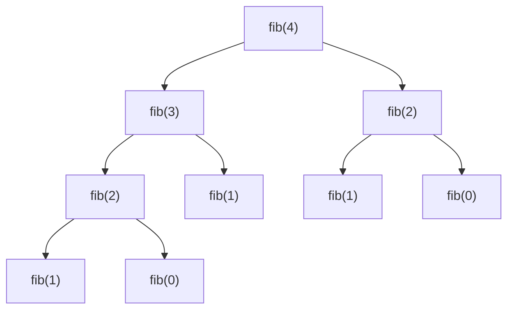
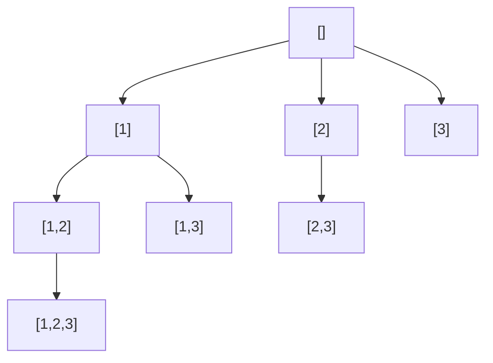

# Recursion & Backtracking

<Note>
**TL;DR**

**Recursion** solves a problem by solving smaller copies of the same problem: every recursive function needs a **base case** (stop) and a **recursive case** (shrink the input and call yourself). Each call gets its own frame on the [call stack](/Software%20Engineering/Frontend/01%20JavaScript/Execution%20Context%20%26%20Call%20Stack), so depth costs memory and can overflow. **Backtracking** is recursion that builds a candidate step by step and **undoes** each choice after exploring it; memoizing repeated calls turns recursion into [Dynamic Programming](/Software%20Engineering/DSA/03%20Algorithms/Dynamic%20Programming).
</Note>

## The idea

Think of Russian dolls: to count the dolls, open one, then count the dolls inside it. You stop when a doll has nothing inside.

- **Base case**: the smallest input you can answer directly (empty list, `n === 0`, `null` node).
- **Recursive case**: reduce the problem, call yourself, combine the result.
- **Leap of faith**: when writing the recursive case, *assume* the recursive call already works for the smaller input. You only have to get the combine step and the base case right.

[Grokking Algorithms](/Software%20Engineering/DSA/05%20Books%20%26%20Courses/Grokking%20Algorithms) (chapter 3) frames it the same way: every recursive function has a base case and a recursive case, and the call stack is how the computer keeps track of the unfinished calls.

```ts
function sum(arr: number[], i = 0): number {
  if (i === arr.length) return 0;      // base case
  return arr[i] + sum(arr, i + 1);     // recursive case
}
```

```python
def total(arr: list[int], i: int = 0) -> int:
    if i == len(arr):           # base case
        return 0
    return arr[i] + total(arr, i + 1)  # recursive case
```

### The call stack

Every call pushes a **frame** (arguments, locals, return address) onto the [call stack](/Software%20Engineering/Frontend/01%20JavaScript/Execution%20Context%20%26%20Call%20Stack). A frame is popped when the call returns. For `fact(3)`:

```text
push fact(3)        waits on fact(2)
  push fact(2)      waits on fact(1)
    push fact(1)    waits on fact(0)
      push fact(0)  base case -> returns 1
    fact(1) = 1 * 1 = 1   (pop)
  fact(2) = 2 * 1 = 2     (pop)
fact(3) = 3 * 2 = 6       (pop)
```

Max depth = max number of frames alive at once = the **space** cost of the recursion. Too deep and you get `RangeError: Maximum call stack size exceeded` (JS) or `RecursionError: maximum recursion depth exceeded` (Python).

### The recursion tree

When a function calls itself more than once, draw the calls as a tree. Naive Fibonacci:



- **Time** ≈ number of nodes × work per node. Branching factor `b`, depth `d` → `O(b^d)`. For fib that is `O(2^n)`.
- **Space** = depth of the tree (only one root-to-leaf path is on the stack at a time) → `O(n)`.
- `fib(2)` appears twice: **overlapping subproblems**. That is the signal for memoization (below).

## How it works

### Recipe for writing a recursive function

1. Define the function in words: "`f(node)` returns the height of the subtree at `node`".
2. Write the base case(s). Check the empty input first.
3. Shrink the input: `n - 1`, `i + 1`, `node.left`, `arr.slice(1)` (careful, slicing copies).
4. Combine the results of the sub-calls.
5. Check that every path reaches a base case (termination).

### Kinds of recursion

| Kind | Shape | Example |
|---|---|---|
| Linear | one self-call | factorial, sum of list, reverse linked list |
| Binary / tree | two or more self-calls | fib, merge sort, tree height |
| Divide and conquer | split, solve halves, merge | merge sort, quick sort, `pow(x, n)` |
| Mutual | `isEven` calls `isOdd` and vice versa | parsers (recursive descent) |
| Tail | the self-call is the **last** thing done | accumulator-style factorial |

### Tail recursion and TCO

A call is in **tail position** when its result is returned directly, with no work after it. An engine with **tail-call optimization (TCO)** can reuse the current frame, so tail recursion runs in `O(1)` stack space.

```ts
// Not tail recursive: multiply happens after the call returns
const fact = (n: number): number => (n <= 1 ? 1 : n * fact(n - 1));
// Tail recursive: the accumulator carries the work
const factTail = (n: number, acc = 1): number => (n <= 1 ? acc : factTail(n - 1, acc * n));
```

```python
def fact_tail(n: int, acc: int = 1) -> int:
    return acc if n <= 1 else fact_tail(n - 1, acc * n)
```

<Warning>
**Do not rely on TCO in JavaScript or Python**

- ES2015 specifies **proper tail calls** in strict mode, but **V8 (Chrome, Node.js) does not implement them**. V8 experimented with it behind a flag and removed it. Only Safari's JavaScriptCore ships it. So `factTail(100_000)` still overflows in Node.
- **CPython has no TCO by design** (Guido van Rossum argued it would destroy useful tracebacks). The default recursion limit is **1000** frames: read it with `sys.getrecursionlimit()`, raise it with `sys.setrecursionlimit(10_000)`. Raising it too far can crash the interpreter with a real C stack overflow, so prefer iteration for deep inputs.
- Node's stack size can be raised with `node --stack-size=...`, but that is a hack, not a fix.
</Warning>

### Converting recursion to iteration (explicit stack)

Any recursion can be rewritten with your own stack: push what the call stack would have pushed. Your stack lives on the heap, so it can grow to millions of entries.

## Complexity

| Case | Time | Space (stack) |
|---|---|---|
| Linear recursion on `n` | `O(n)` | `O(n)` |
| Divide and conquer, halving, one call (`pow`, binary search) | `O(log n)` | `O(log n)` |
| Divide and conquer, two halves + linear merge (merge sort) | `O(n log n)` | `O(log n)` stack + `O(n)` buffer |
| Binary recursion without memo (naive fib) | `O(2^n)` | `O(n)` |
| Same with memo | `O(n)` | `O(n)` |
| Backtracking: subsets / permutations | `O(n · 2^n)` / `O(n · n!)` | `O(n)` besides output |

Rule of thumb: time = (number of calls) × (work per call, excluding sub-calls). Master theorem for `T(n) = aT(n/b) + f(n)`: see [Big-O & Complexity Analysis](/Software%20Engineering/DSA/01%20Foundations/Big-O%20%26%20Complexity%20Analysis).

## Implementation

### Divide and conquer: fast power (`x^n` in `O(log n)`)

```ts
function myPow(x: number, n: number): number {
  if (n < 0) return 1 / myPow(x, -n);
  if (n === 0) return 1;                     // base case
  const half = myPow(x, Math.floor(n / 2));  // one call, reused
  return n % 2 === 0 ? half * half : half * half * x;
}
```

```python
def my_pow(x: float, n: int) -> float:
    if n < 0:
        return 1 / my_pow(x, -n)
    if n == 0:
        return 1.0
    half = my_pow(x, n // 2)
    return half * half if n % 2 == 0 else half * half * x
```

Calling `myPow(x, n/2)` twice instead of reusing `half` would make it `O(n)`: the recursion tree shape decides the cost.

### Recursion to iteration: flatten a nested array

```ts
type Nested = number | Nested[];

function flattenRec(a: Nested[]): number[] {
  return a.flatMap((x) => (Array.isArray(x) ? flattenRec(x) : [x]));
}

function flattenIter(a: Nested[]): number[] {
  const out: number[] = [];
  const stack: Nested[] = [...a].reverse();  // reverse so we pop in order
  while (stack.length) {
    const x = stack.pop()!;
    if (Array.isArray(x)) for (let i = x.length - 1; i >= 0; i--) stack.push(x[i]);
    else out.push(x);
  }
  return out;
}
```

```python
def flatten_iter(a: list) -> list[int]:
    out: list[int] = []
    stack = list(reversed(a))
    while stack:
        x = stack.pop()
        if isinstance(x, list):
            stack.extend(reversed(x))
        else:
            out.append(x)
    return out
```

When the recursion does work **after** the child returns (postorder), push a marker or a `(node, visited)` pair so you know when to "combine". See [Tree Traversal - DFS & BFS](/Software%20Engineering/DSA/03%20Algorithms/Tree%20Traversal%20-%20DFS%20%26%20BFS) for iterative postorder.

### Memoization: the bridge to Dynamic Programming

Cache results by argument so each subproblem is solved once. Fib goes from `O(2^n)` to `O(n)`.

```ts
function fib(n: number, memo = new Map<number, number>()): number {
  if (n < 2) return n;
  if (memo.has(n)) return memo.get(n)!;
  const v = fib(n - 1, memo) + fib(n - 2, memo);
  memo.set(n, v);
  return v;
}
```

```python
from functools import cache  # Python 3.9+; lru_cache(maxsize=None) before

@cache
def fib(n: int) -> int:
    return n if n < 2 else fib(n - 1) + fib(n - 2)
```

This is **top-down DP**. The bottom-up version fills a table in a loop and avoids recursion depth entirely. Full treatment in [Dynamic Programming](/Software%20Engineering/DSA/03%20Algorithms/Dynamic%20Programming). Closure-based `memoize` helpers are covered in [Closures & Memory Model](/Software%20Engineering/Frontend/01%20JavaScript/Closures%20%26%20Memory%20Model).

## Backtracking

Backtracking explores a **decision tree**: at each step choose an option, recurse, then **undo** the choice (backtrack) and try the next one. It is a depth-first search over partial solutions, with **pruning** to skip branches that cannot lead to a valid answer.

```text
function backtrack(state):
    if state is a complete solution: record a copy; return
    for choice in candidates(state):
        if not valid(choice): continue   # prune
        make(choice)
        backtrack(state)
        undo(choice)                      # restore state for the next choice
```

### Short example: all subsets (LeetCode 78)

Decision tree for `[1,2,3]`: at each node, the path so far is a subset; children add a larger index.



```ts
function subsets(nums: number[]): number[][] {
  const res: number[][] = [];
  const path: number[] = [];
  const dfs = (start: number): void => {
    res.push([...path]);                 // copy! path keeps changing
    for (let i = start; i < nums.length; i++) {
      path.push(nums[i]);                // choose
      dfs(i + 1);                        // explore
      path.pop();                        // un-choose
    }
  };
  dfs(0);
  return res;
}
```

```python
def subsets(nums: list[int]) -> list[list[int]]:
    res: list[list[int]] = []
    path: list[int] = []

    def dfs(start: int) -> None:
        res.append(path[:])          # copy
        for i in range(start, len(nums)):
            path.append(nums[i])
            dfs(i + 1)
            path.pop()

    dfs(0)
    return res
```

Templates for permutations, combinations, combination sum, N-Queens, word search and duplicate handling live in the [Backtracking](/Software%20Engineering/DSA/04%20Patterns/Backtracking) pattern note.

## Trade-offs & pitfalls

- **Missing or unreachable base case** → infinite recursion → stack overflow. Check `n < 0`, empty input, `null` nodes.
- **Recursion depth**: a linked list or skewed tree of 100k nodes will overflow in both Node and CPython. Use iteration or an explicit stack for input sizes you do not control.
- **Hidden copies**: `arr.slice(1)` / `arr[1:]` at every level makes a linear recursion `O(n^2)` time and memory. Pass an index instead.
- **Forgetting to copy in backtracking**: `res.push(path)` pushes the same array reference; at the end every entry is `[]`. Push `[...path]` / `path[:]`.
- **Forgetting to undo** the choice (the `pop`, the `visited[i] = false`) corrupts sibling branches.
- **Exponential blow-up**: two recursive calls on `n - 1` is `O(2^n)`. Draw the recursion tree and look for repeated nodes to memoize.
- **Mutable default args in Python**: `def f(memo={})` shares the dict across calls. Use `None` and create inside, or `functools.cache`.
- **Memo keys**: in JS, arrays as `Map` keys compare by reference. Serialize (`${i},${j}`) or use nested arrays.

## Senior perspective

- **Where recursion shows up in production**: parsers and compilers (recursive descent, AST walkers), JSON/DOM tree walking, file-system traversal, React reconciliation of the component tree, `structuredClone`-style deep copy, query planners.
- **Untrusted depth is a security issue**: a deeply nested JSON payload or regex can crash a recursive parser (stack exhaustion DoS). Production parsers cap depth or use explicit stacks. Ask "what is the maximum depth and who controls it?" in review.
- **Stack vs heap**: each JS/Python frame is much heavier than a C frame; an explicit stack array of small tuples is cheaper and cannot overflow the native stack.
- **Readability wins for bounded depth**: balanced trees (depth `O(log n)`), divide and conquer, and grammar-driven code are clearer recursive. Do not iterate-ify code whose depth is 30.
- **Generators** (`function*` / `yield from`) make recursive traversals lazy and composable; see [Iterators, Generators & Iterator Helpers](/Software%20Engineering/Frontend/01%20JavaScript/Iterators%2C%20Generators%20%26%20Iterator%20Helpers). `yield from` in Python still uses recursion depth, though.
- **In interviews**: state the recursion explicitly ("`dfs(i)` returns the number of ways from index `i`"), give time as nodes × work and space as depth, and mention the overflow risk plus the iterative alternative. That shows seniority.

## Classic LeetCode problems

| # | Problem | Difficulty | Key idea |
|---|---|---|---|
| 509 | [Fibonacci Number](https://leetcode.com/problems/fibonacci-number/) | Easy | Base cases, then memoize or iterate |
| 206 | [Reverse Linked List](https://leetcode.com/problems/reverse-linked-list/) | Easy | Reverse the rest, then fix `head.next.next = head` |
| 21 | [Merge Two Sorted Lists](https://leetcode.com/problems/merge-two-sorted-lists/) | Easy | Smaller head + merge(rest) |
| 50 | [Pow(x, n)](https://leetcode.com/problems/powx-n/) | Medium | Halve the exponent, reuse the half result |
| 779 | [K-th Symbol in Grammar](https://leetcode.com/problems/k-th-symbol-in-grammar/) | Medium | Recurse on the parent position |
| 78 | [Subsets](https://leetcode.com/problems/subsets/) | Medium | Choose / explore / un-choose |
| 46 | [Permutations](https://leetcode.com/problems/permutations/) | Medium | `used[]` array, backtrack |
| 22 | [Generate Parentheses](https://leetcode.com/problems/generate-parentheses/) | Medium | Prune with open/close counts |

## Interview questions

<Accordion title="What are the two parts of every recursive function?">
A **base case** that answers the smallest input directly and a **recursive case** that reduces the input and calls the function again. Every recursive path must eventually reach a base case, or you get infinite recursion and a stack overflow.
</Accordion>

<Accordion title="How do you analyze time and space of a recursive function?">
Draw the recursion tree. Time = number of nodes × non-recursive work per node (or solve the recurrence, e.g. with the master theorem). Space = maximum depth of the tree (frames alive at once) plus any auxiliary data such as memo tables.
</Accordion>

<Accordion title="What is tail recursion, and does Node.js or Python optimize it?">
A call is tail recursive when the recursive call is the last operation and its result is returned directly, so the frame could be reused. ES2015 specifies proper tail calls, but V8 (Node, Chrome) does not implement them; only Safari does. CPython deliberately has no TCO and caps depth at 1000 by default (`sys.setrecursionlimit` changes it). Convert deep recursion to a loop.
</Accordion>

<Accordion title="How do you convert a recursive DFS to an iterative one?">
Replace the call stack with an explicit stack: push the start state, loop while the stack is non-empty, pop a state, process it, push its children (reversed if order matters). For postorder-style work, push a `(node, visited)` flag or use two stacks.
</Accordion>

<Accordion title="What is the difference between recursion, memoization, and DP?">
Recursion expresses the problem in terms of smaller subproblems. If subproblems repeat, memoization caches each result (top-down DP). Bottom-up DP computes the same table iteratively in dependency order, avoiding recursion depth and often allowing space optimization.
</Accordion>

<Accordion title="What is backtracking and how does it differ from plain DFS?">
Backtracking is DFS over a tree of partial solutions: make a choice, recurse, undo the choice. It adds pruning (skip choices that violate constraints) and explicit state restoration so one mutable path can be reused across branches.
</Accordion>

<Accordion title="Why does `res.push(path)` give wrong answers in a backtracking solution?">
It stores a reference to the same mutable array, which is later emptied by the `pop` calls. You must store a snapshot: `[...path]` in JS or `path[:]` in Python.
</Accordion>

## Related
- [DSA Index](/Software%20Engineering/DSA/DSA%20Index)
- [Backtracking](/Software%20Engineering/DSA/04%20Patterns/Backtracking) (templates) · [Dynamic Programming](/Software%20Engineering/DSA/03%20Algorithms/Dynamic%20Programming) · [Tree Traversal - DFS & BFS](/Software%20Engineering/DSA/03%20Algorithms/Tree%20Traversal%20-%20DFS%20%26%20BFS) · [Sorting Algorithms](/Software%20Engineering/DSA/03%20Algorithms/Sorting%20Algorithms) (merge and quick sort are divide and conquer)
- [Big-O & Complexity Analysis](/Software%20Engineering/DSA/01%20Foundations/Big-O%20%26%20Complexity%20Analysis) · [Stacks & Queues](/Software%20Engineering/DSA/02%20Data%20Structures/Stacks%20%26%20Queues) · [Trees & Binary Search Trees](/Software%20Engineering/DSA/02%20Data%20Structures/Trees%20%26%20Binary%20Search%20Trees) · [Linked Lists](/Software%20Engineering/DSA/02%20Data%20Structures/Linked%20Lists)
- [Execution Context & Call Stack](/Software%20Engineering/Frontend/01%20JavaScript/Execution%20Context%20%26%20Call%20Stack) · [Closures & Memory Model](/Software%20Engineering/Frontend/01%20JavaScript/Closures%20%26%20Memory%20Model) · [Iterators, Generators & Iterator Helpers](/Software%20Engineering/Frontend/01%20JavaScript/Iterators%2C%20Generators%20%26%20Iterator%20Helpers)
- [Grokking Algorithms](/Software%20Engineering/DSA/05%20Books%20%26%20Courses/Grokking%20Algorithms) (chapter 3: recursion)

## Sources
- Aditya Bhargava, *Grokking Algorithms*, ch. 3 "Recursion" (Manning)
- Cormen, Leiserson, Rivest, Stein, *Introduction to Algorithms*, 4th ed., MIT Press 2022 (ch. 2 divide and conquer, ch. 4 recurrences)
- [Python docs: sys.setrecursionlimit](https://docs.python.org/3/library/sys.html#sys.setrecursionlimit)
- [Python docs: functools.cache](https://docs.python.org/3/library/functools.html#functools.cache)
- [Guido van Rossum: Tail Recursion Elimination (2009)](https://neopythonic.blogspot.com/2009/04/tail-recursion-elimination.html)
- [V8 blog: ES2015, ES2016, and beyond (proper tail calls status)](https://v8.dev/blog/modern-javascript)
- [MDN: Recursion (glossary)](https://developer.mozilla.org/en-US/docs/Glossary/Recursion)
- [LeetCode Explore: Recursion I](https://leetcode.com/explore/learn/card/recursion-i/)
- [Tech Interview Handbook: Recursion cheatsheet](https://www.techinterviewhandbook.org/algorithms/recursion/)
