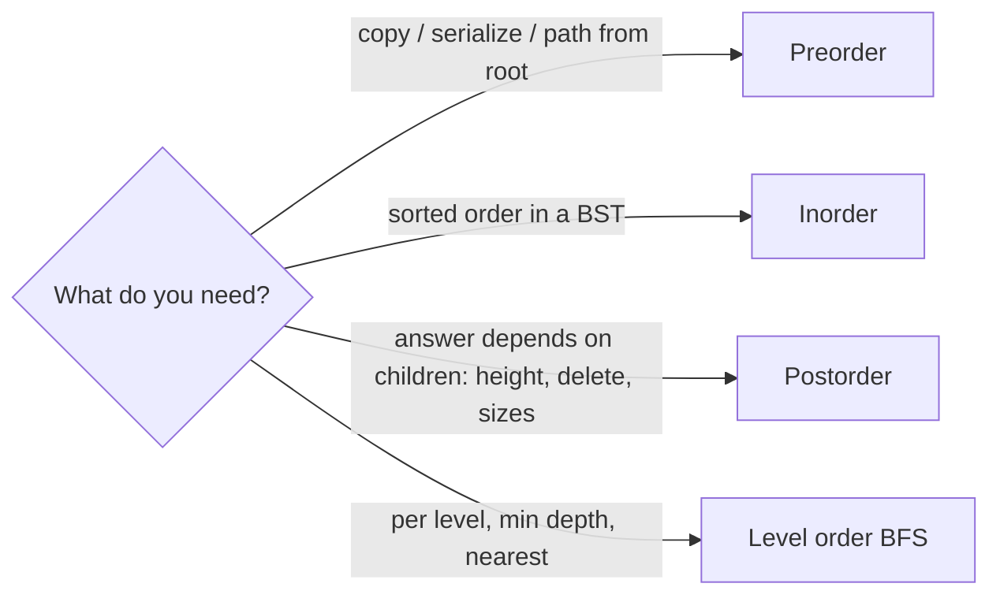

# Tree Traversal - DFS & BFS

> [!tldr] TL;DR
> Traversing a tree means visiting every node exactly once, in `O(n)` time. **DFS** goes deep first and comes in three orders (**preorder** root-left-right, **inorder** left-root-right, **postorder** left-right-root), using recursion or an explicit stack with `O(h)` space. **BFS / level order** visits the tree level by level with a **queue** and `O(w)` space (max width). Inorder on a BST yields sorted order; postorder is for "compute from children"; BFS is for anything per-level or shortest-depth.

## The idea

```text
            1
          /   \
         2     3
        / \     \
       4   5     6

Preorder  (root, L, R):  1 2 4 5 3 6
Inorder   (L, root, R):  4 2 5 1 3 6
Postorder (L, R, root):  4 5 2 6 3 1
Level order (BFS):       [1] [2 3] [4 5 6]
```

- The three DFS orders differ only in **when** you "visit" the node relative to its children. Picture walking around the outline of the tree: preorder records a node the first time you pass it, inorder when you pass under it, postorder the last time.
- **BFS** spreads out like ripples: all nodes at depth 0, then depth 1, and so on.



## How it works

- **Recursive DFS**: the call stack remembers where to return. Three lines differ only in order.
- **Iterative DFS**: use your own stack (see [[Stacks & Queues]]). Preorder is easy; inorder needs "go left as far as possible"; postorder is the trickiest (reverse of a modified preorder, or track the last visited node).
- **BFS**: push the root into a queue; repeatedly pop from the front and push children. To group by level, snapshot `queue.length` at the start of each level.
- **Morris traversal**: inorder (or preorder) in `O(1)` extra space by temporarily threading each node's inorder predecessor's `right` pointer back to the node, then removing the thread. It mutates the tree during the walk (and restores it), so it is not safe with concurrent readers.

## Complexity

| Traversal | Time | Extra space |
|---|---|---|
| DFS recursive (any order) | `O(n)` | `O(h)` call stack; `O(log n)` balanced, `O(n)` skewed |
| DFS iterative | `O(n)` | `O(h)` explicit stack |
| BFS level order | `O(n)` | `O(w)` queue; up to `n/2` on the last level of a full tree |
| Morris | `O(n)` (each edge walked at most ~3 times) | `O(1)` |
| Serialize / deserialize | `O(n)` | `O(n)` for the string, `O(h)` stack |

`h` = height, `w` = max width. A complete tree has large `w` and small `h` (DFS uses less memory); a skewed tree is the opposite (BFS uses less).

## Implementation

Shared node types:

```ts
class TreeNode {
  constructor(
    public val: number,
    public left: TreeNode | null = null,
    public right: TreeNode | null = null,
  ) {}
}
```

```python
from __future__ import annotations
from dataclasses import dataclass

@dataclass
class TreeNode:
    val: int
    left: TreeNode | None = None
    right: TreeNode | None = None
```

### Recursive DFS (all three orders)

```ts
function dfs(root: TreeNode | null, order: "pre" | "in" | "post"): number[] {
  const out: number[] = [];
  const go = (n: TreeNode | null): void => {
    if (!n) return;
    if (order === "pre") out.push(n.val);
    go(n.left);
    if (order === "in") out.push(n.val);
    go(n.right);
    if (order === "post") out.push(n.val);
  };
  go(root);
  return out;
}
```

```python
def dfs(root: TreeNode | None, order: str) -> list[int]:
    out: list[int] = []

    def go(n: TreeNode | None) -> None:
        if not n:
            return
        if order == "pre":
            out.append(n.val)
        go(n.left)
        if order == "in":
            out.append(n.val)
        go(n.right)
        if order == "post":
            out.append(n.val)

    go(root)
    return out
```

### Iterative preorder

Push right before left so left is popped first.

```ts
function preorder(root: TreeNode | null): number[] {
  const out: number[] = [];
  const stack: TreeNode[] = root ? [root] : [];
  while (stack.length) {
    const n = stack.pop()!;
    out.push(n.val);
    if (n.right) stack.push(n.right);
    if (n.left) stack.push(n.left);
  }
  return out;
}
```

```python
def preorder(root: TreeNode | None) -> list[int]:
    out, stack = [], [root] if root else []
    while stack:
        n = stack.pop()
        out.append(n.val)
        if n.right:
            stack.append(n.right)
        if n.left:
            stack.append(n.left)
    return out
```

### Iterative inorder

Walk left pushing nodes; when you cannot go left, pop, visit, then go right.

```ts
function inorder(root: TreeNode | null): number[] {
  const out: number[] = [];
  const stack: TreeNode[] = [];
  let cur = root;
  while (cur || stack.length) {
    while (cur) { stack.push(cur); cur = cur.left; }
    cur = stack.pop()!;
    out.push(cur.val);
    cur = cur.right;
  }
  return out;
}
```

```python
def inorder(root: TreeNode | None) -> list[int]:
    out, stack, cur = [], [], root
    while cur or stack:
        while cur:
            stack.append(cur)
            cur = cur.left
        cur = stack.pop()
        out.append(cur.val)
        cur = cur.right
    return out
```

### Iterative postorder

Trick: preorder with children swapped gives root-right-left; reversing it gives left-right-root. Simple and `O(n)`, but it builds the whole output before reversing, so it cannot "stream" postorder. The `(node, visited)` flag version streams correctly.

```ts
function postorder(root: TreeNode | null): number[] {
  const out: number[] = [];
  const stack: Array<[TreeNode, boolean]> = root ? [[root, false]] : [];
  while (stack.length) {
    const [n, visited] = stack.pop()!;
    if (visited) { out.push(n.val); continue; }
    stack.push([n, true]);                 // visit after children
    if (n.right) stack.push([n.right, false]);
    if (n.left) stack.push([n.left, false]);
  }
  return out;
}
```

```python
def postorder(root: TreeNode | None) -> list[int]:
    out: list[int] = []
    stack = [(root, False)] if root else []
    while stack:
        n, visited = stack.pop()
        if visited:
            out.append(n.val)
            continue
        stack.append((n, True))
        if n.right:
            stack.append((n.right, False))
        if n.left:
            stack.append((n.left, False))
    return out
```

The flag technique works for any order: change where you push `[n, true]` relative to the children.

### Level order BFS

JS has no built-in deque, and `Array.prototype.shift()` is `O(n)`. Use a head index (or a ring buffer) for a real queue.

```ts
function levelOrder(root: TreeNode | null): number[][] {
  const res: number[][] = [];
  let queue: TreeNode[] = root ? [root] : [];
  while (queue.length) {
    const level: number[] = [];
    const next: TreeNode[] = [];        // one array per level, no shift()
    for (const n of queue) {
      level.push(n.val);
      if (n.left) next.push(n.left);
      if (n.right) next.push(n.right);
    }
    res.push(level);
    queue = next;
  }
  return res;
}
```

```python
from collections import deque

def level_order(root: TreeNode | None) -> list[list[int]]:
    res: list[list[int]] = []
    q = deque([root] if root else [])
    while q:
        level = []
        for _ in range(len(q)):          # snapshot the level size
            n = q.popleft()
            level.append(n.val)
            if n.left:
                q.append(n.left)
            if n.right:
                q.append(n.right)
        res.append(level)
    return res
```

Variants from the same loop: right side view (last node per level), zigzag (reverse every other level), min depth (return at the first leaf), level averages.

### Morris inorder (O(1) space)

```ts
function morrisInorder(root: TreeNode | null): number[] {
  const out: number[] = [];
  let cur = root;
  while (cur) {
    if (!cur.left) { out.push(cur.val); cur = cur.right; continue; }
    let pred = cur.left;                              // inorder predecessor
    while (pred.right && pred.right !== cur) pred = pred.right;
    if (!pred.right) { pred.right = cur; cur = cur.left; }        // make thread
    else { pred.right = null; out.push(cur.val); cur = cur.right; } // remove thread
  }
  return out;
}
```

```python
def morris_inorder(root: TreeNode | None) -> list[int]:
    out, cur = [], root
    while cur:
        if not cur.left:
            out.append(cur.val)
            cur = cur.right
            continue
        pred = cur.left
        while pred.right and pred.right is not cur:
            pred = pred.right
        if not pred.right:
            pred.right = cur
            cur = cur.left
        else:
            pred.right = None
            out.append(cur.val)
            cur = cur.right
    return out
```

### Serialize and deserialize (LeetCode 297)

Preorder with explicit null markers uniquely describes a binary tree (a plain preorder without nulls does not).

```ts
function serialize(root: TreeNode | null): string {
  const parts: string[] = [];
  const go = (n: TreeNode | null): void => {
    if (!n) { parts.push("#"); return; }
    parts.push(String(n.val));
    go(n.left);
    go(n.right);
  };
  go(root);
  return parts.join(",");
}

function deserialize(data: string): TreeNode | null {
  const tokens = data.split(",");
  let i = 0;
  const build = (): TreeNode | null => {
    const t = tokens[i++];
    if (t === "#") return null;
    const n = new TreeNode(Number(t));
    n.left = build();
    n.right = build();
    return n;
  };
  return build();
}
```

```python
def serialize(root: TreeNode | None) -> str:
    parts: list[str] = []

    def go(n: TreeNode | None) -> None:
        if not n:
            parts.append("#")
            return
        parts.append(str(n.val))
        go(n.left)
        go(n.right)

    go(root)
    return ",".join(parts)

def deserialize(data: str) -> TreeNode | None:
    tokens = iter(data.split(","))

    def build() -> TreeNode | None:
        t = next(tokens)
        if t == "#":
            return None
        n = TreeNode(int(t))
        n.left = build()
        n.right = build()
        return n

    return build()
```

Alternatives: BFS with nulls (LeetCode's own `[1,2,3,null,null,4,5]` format), or preorder + inorder arrays (needs unique values). For a BST, preorder alone is enough because the BST property tells you where the left subtree ends.

## When to use which

| Need | Use |
|---|---|
| Sorted output, kth smallest, validate BST | Inorder |
| Copy/clone a tree, serialize, root-to-leaf paths | Preorder |
| Height, diameter, subtree sums, delete/free a tree, "return info from children" | Postorder |
| Per-level results, right side view, min depth, nearest node | BFS |
| Very deep or skewed tree | Iterative DFS or BFS (avoid recursion depth) |
| Very wide tree, memory-tight | DFS (`O(h)`), or Morris for `O(1)` |

## Trade-offs & pitfalls

- **Recursion depth**: a degenerate (linked-list-shaped) tree of 10^5 nodes overflows in CPython (limit 1000) and often in Node. See [[Recursion & Backtracking]].
- **`queue.shift()` in JS** is `O(n)` per call, turning BFS into `O(n^2)`. Use per-level arrays, an index pointer, or a deque.
- **Level grouping**: read `len(q)` once before the inner loop; the queue grows while you iterate.
- **Pushing nulls**: either check children before pushing or handle `null` at pop. Mixing both causes crashes or extra levels.
- **Postorder via reversed preorder** gives the right list but visits in the wrong order, so it cannot be used when the "visit" has side effects that need children first.
- **Morris mutates the tree**. If you exit early (break at kth), threads are left in place and the tree is corrupted. Always finish or clean up.
- **Serialization ambiguity**: without null markers, different trees serialize the same way. Also watch negative numbers and multi-digit values; use a delimiter.

## Senior perspective

- **Real-world trees**: the DOM (`TreeWalker`, `querySelectorAll` is a preorder DFS), ASTs in Babel/TypeScript/ESLint (visitor pattern = DFS with enter/exit hooks, i.e. pre and post), React's fiber tree (iterative DFS with `child`/`sibling`/`return` pointers so work can pause), file systems (`du` is postorder, `find` is preorder), B-tree range scans (inorder over leaves).
- **Why React fibers are iterative**: a recursive walk cannot be paused and resumed; an explicit linked structure lets the scheduler yield between units of work.
- **Memory profile**: BFS on a wide tree (e.g. a 1M-node complete tree) holds ~500k nodes in the queue; DFS holds ~20. For huge trees prefer DFS, or iterative deepening if you need BFS-like guarantees.
- **Serialization in practice**: JSON of nested objects is a preorder serialization. Watch for cycles (graphs, not trees) and depth limits on untrusted input.
- **Generators** let traversals stream lazily (`function*` inorder with `yield*`), useful for iterating a BST without materializing it; see [[Iterators, Generators & Iterator Helpers]].
- **Interview signal**: write the recursive version fast, then offer the iterative version and state `O(h)` vs `O(w)` space. Mention Morris as a follow-up for `O(1)` space.

## Classic LeetCode problems

| # | Problem | Difficulty | Key idea |
|---|---|---|---|
| 94 | [Binary Tree Inorder Traversal](https://leetcode.com/problems/binary-tree-inorder-traversal/) | Easy | Iterative "go left, pop, go right" |
| 144 | [Binary Tree Preorder Traversal](https://leetcode.com/problems/binary-tree-preorder-traversal/) | Easy | Stack, push right then left |
| 145 | [Binary Tree Postorder Traversal](https://leetcode.com/problems/binary-tree-postorder-traversal/) | Easy | Visited flag or reversed preorder |
| 104 | [Maximum Depth of Binary Tree](https://leetcode.com/problems/maximum-depth-of-binary-tree/) | Easy | Postorder: `1 + max(left, right)` |
| 102 | [Binary Tree Level Order Traversal](https://leetcode.com/problems/binary-tree-level-order-traversal/) | Medium | Queue, snapshot level size |
| 199 | [Binary Tree Right Side View](https://leetcode.com/problems/binary-tree-right-side-view/) | Medium | Last node of each BFS level |
| 230 | [Kth Smallest Element in a BST](https://leetcode.com/problems/kth-smallest-element-in-a-bst/) | Medium | Inorder, stop at k |
| 297 | [Serialize and Deserialize Binary Tree](https://leetcode.com/problems/serialize-and-deserialize-binary-tree/) | Hard | Preorder with null markers |

## Interview questions

> [!question]- What is the difference between preorder, inorder, and postorder?
> When the node is visited relative to its subtrees: before both (pre), between left and right (in), after both (post). All are DFS with `O(n)` time and `O(h)` space.

> [!question]- Why does inorder traversal of a BST give sorted output?
> BST invariant: everything in the left subtree is smaller than the node, everything in the right is larger. Inorder visits left subtree, node, right subtree, so by induction values come out ascending.

> [!question]- When would you choose BFS over DFS on a tree?
> When the answer is about levels or the nearest/shallowest node: level order, right side view, min depth, connecting nodes on the same level. BFS finds the shallowest match first and can stop early. DFS is better for path-based questions and uses `O(h)` instead of `O(w)` memory.

> [!question]- How do you do postorder traversal iteratively?
> Either push `(node, visited)` pairs and emit a node on its second pop, or do a root-right-left preorder with a stack and reverse the result. A third way tracks the last visited node to know whether the right subtree is done.

> [!question]- What is Morris traversal and what are its trade-offs?
> Inorder traversal in `O(1)` extra space: for each node with a left child, find its inorder predecessor and temporarily point its `right` at the node, so you can climb back without a stack. It is `O(n)` time but mutates the tree during traversal, is not thread-safe, and must run to completion to restore the tree.

> [!question]- How would you serialize a binary tree so it can be rebuilt?
> Preorder DFS writing values and a marker like `#` for null children, joined with commas. Deserialize by reading tokens in the same order recursively. BFS with nulls also works. Without null markers, a single traversal is ambiguous.

## Related
- [[DSA Index]]
- [[Trees & Binary Search Trees]] · [[Stacks & Queues]] · [[Graphs]] · [[Graph BFS-DFS patterns]]
- [[Recursion & Backtracking]] · [[Dynamic Programming]] (DP on trees uses postorder)
- [[Big-O & Complexity Analysis]] · [[Iterators, Generators & Iterator Helpers]]

## Sources
- Cormen et al., *Introduction to Algorithms*, 4th ed., MIT Press 2022 (ch. 12 binary search trees, ch. 20 BFS/DFS)
- Sedgewick & Wayne, *Algorithms*, 4th ed. ([algs4.cs.princeton.edu](https://algs4.cs.princeton.edu/32bst/))
- J. H. Morris, "Traversing binary trees simply and cheaply", *Information Processing Letters* 9(5), 1979
- [LeetCode Explore: Binary Tree card](https://leetcode.com/explore/learn/card/data-structure-tree/)
- [Python docs: collections.deque](https://docs.python.org/3/library/collections.html#collections.deque)
- [MDN: TreeWalker](https://developer.mozilla.org/en-US/docs/Web/API/TreeWalker)
- [Tech Interview Handbook: Tree cheatsheet](https://www.techinterviewhandbook.org/algorithms/tree/)
