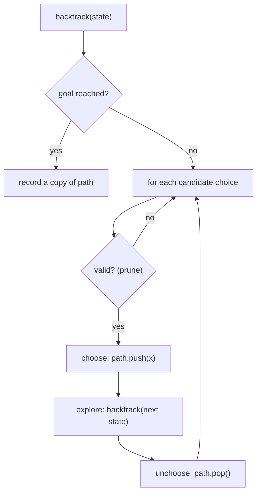

# Backtracking

> [!tldr] TL;DR
> Backtracking builds a solution **one choice at a time**, recurses, and **undoes the choice** before trying the next one: **choose, explore, unchoose**. It is a DFS over a tree of partial solutions, used whenever the problem says "generate all" (subsets, permutations, combinations, boards) or "find any valid arrangement". The cost is exponential by nature (2^n subsets, n! permutations), so the craft is in **pruning** branches early.

## The idea

Picture every decision as a branch in a tree. The root is the empty solution; each level adds one element; each leaf is a complete candidate. Backtracking walks that tree depth first with **one shared, mutable path** that grows on the way down and shrinks on the way back up.

```text
subsets of [1, 2, 3]  (each node is recorded)

                    []
          /          |         \
        [1]         [2]        [3]
       /   \         |
   [1,2]  [1,3]    [2,3]
     |
  [1,2,3]
```

The general recipe is in [[Recursion & Backtracking]]. This note is the interview pattern: a reusable template plus the four families (subsets, combinations, permutations, constraint boards) and how to prune.



## How it works

Four questions define every backtracking solution:

1. **What is the path (state)?** The partial solution: a list of chosen numbers, a board, a string.
2. **What are the choices at this step?** Remaining elements, digits, board cells, directions.
3. **When is it a complete solution?** Length reached, sum hit, all rows filled, word matched.
4. **When can I stop early?** Invalid partial state, sum already too big, letter mismatch. This is **pruning**.

The family decides how the loop looks:

| Family | Loop over | Recurse with | Record when |
|---|---|---|---|
| **Subsets** | `i` from `start` to `n - 1` | `i + 1` | every node |
| **Combinations (size k)** | `i` from `start` | `i + 1` | `len(path) == k` |
| **Combination sum (reuse allowed)** | `i` from `start` | `i` (same element again) | `remaining == 0` |
| **Permutations** | all `i` not `used` | mark `used[i]` | `len(path) == n` |
| **Constraint boards** (N-Queens, Sudoku) | options for the next cell/row | next cell/row | board complete |

**Duplicates in input** (Subsets II, Combination Sum II, Permutations II): sort first, then skip `nums[i]` when `i > start and nums[i] == nums[i - 1]` (for permutations: when the previous equal element is not used).

## Complexity

The number of nodes in the decision tree times the work per node (usually copying the path, O(n)).

| Problem | Time | Extra space (excluding output) |
|---|---|---|
| Subsets of n | O(n · 2^n) | O(n) recursion + path |
| Combinations C(n, k) | O(k · C(n, k)) | O(k) |
| Permutations of n | O(n · n!) | O(n) path + used |
| Combination sum (target T, min candidate m) | exponential, roughly O(n^(T/m)) | O(T/m) depth |
| N-Queens | O(n!) upper bound, much less with pruning | O(n) |
| Word search (R x C board, word length L) | O(R · C · 3^L) | O(L) recursion |

Output size is a lower bound: you cannot list 2^n subsets faster than O(2^n). Exponential here is not a bug; it is the size of the answer.

## Template

```ts
// Generic shape: choose, explore, unchoose.
function backtrackTemplate<T>(choices: T[], isGoal: (path: T[]) => boolean): T[][] {
  const res: T[][] = [];
  const path: T[] = [];
  const dfs = (start: number): void => {
    if (isGoal(path)) {
      res.push([...path]);          // copy! path keeps changing
      // return here if goals cannot be extended further
    }
    for (let i = start; i < choices.length; i++) {
      // if (!valid(choices[i])) continue;   // prune
      path.push(choices[i]);        // choose
      dfs(i + 1);                   // explore
      path.pop();                   // unchoose
    }
  };
  dfs(0);
  return res;
}
```

```python
def backtrack_template(choices, is_goal):
    res, path = [], []

    def dfs(start: int) -> None:
        if is_goal(path):
            res.append(path[:])      # copy! path keeps changing
        for i in range(start, len(choices)):
            # if not valid(choices[i]): continue   # prune
            path.append(choices[i])  # choose
            dfs(i + 1)               # explore
            path.pop()               # unchoose

    dfs(0)
    return res
```

## Worked example

**[78. Subsets](https://leetcode.com/problems/subsets/)**: return all subsets of distinct integers.

Input `nums = [1, 2, 3]`. Every node of the tree is a valid subset, so we record on entry.

| call | start | path on entry | recorded | loop choices |
|---|---|---|---|---|
| 1 | 0 | [] | [] | 1, 2, 3 |
| 2 | 1 | [1] | [1] | 2, 3 |
| 3 | 2 | [1,2] | [1,2] | 3 |
| 4 | 3 | [1,2,3] | [1,2,3] | none, return, pop 3 |
| back in 3 | | [1,2] | | loop ends, return, pop 2 |
| 5 | 3 | [1,3] | [1,3] | none, pop 3, back to call 2, pop 1 |
| 6 | 2 | [2] | [2] | 3 |
| 7 | 3 | [2,3] | [2,3] | none, pop 3, pop 2 |
| 8 | 3 | [3] | [3] | none, pop 3 |

Result: `[[], [1], [1,2], [1,2,3], [1,3], [2], [2,3], [3]]`, 8 = 2^3 subsets. Using `start` guarantees each set appears once (`[2,1]` is never built because after choosing 2 we only look right).

```ts
function subsets(nums: number[]): number[][] {
  const res: number[][] = [];
  const path: number[] = [];
  const dfs = (start: number): void => {
    res.push([...path]);
    for (let i = start; i < nums.length; i++) {
      path.push(nums[i]);
      dfs(i + 1);
      path.pop();
    }
  };
  dfs(0);
  return res;
}
```

```python
def subsets(nums: list[int]) -> list[list[int]]:
    res: list[list[int]] = []
    path: list[int] = []

    def dfs(start: int) -> None:
        res.append(path[:])
        for i in range(start, len(nums)):
            path.append(nums[i])
            dfs(i + 1)
            path.pop()

    dfs(0)
    return res
```

Alternative without recursion: iterate masks `0 .. 2^n - 1` and include `nums[i]` when bit `i` is set (see [[Bit Manipulation]]).

## More templates

### Permutations ([46. Permutations](https://leetcode.com/problems/permutations/))

```ts
function permute(nums: number[]): number[][] {
  const res: number[][] = [];
  const path: number[] = [];
  const used = new Array<boolean>(nums.length).fill(false);
  const dfs = (): void => {
    if (path.length === nums.length) { res.push([...path]); return; }
    for (let i = 0; i < nums.length; i++) {
      if (used[i]) continue;
      used[i] = true; path.push(nums[i]);   // choose
      dfs();                                // explore
      path.pop(); used[i] = false;          // unchoose
    }
  };
  dfs();
  return res;
}
```

```python
def permute(nums: list[int]) -> list[list[int]]:
    res, path, used = [], [], [False] * len(nums)

    def dfs() -> None:
        if len(path) == len(nums):
            res.append(path[:])
            return
        for i, x in enumerate(nums):
            if used[i]:
                continue
            used[i] = True; path.append(x)
            dfs()
            path.pop(); used[i] = False

    dfs()
    return res
```

### Combinations with pruning ([77. Combinations](https://leetcode.com/problems/combinations/))

Pruning: if there are not enough numbers left to fill the path, stop. The last useful start value is `n - (k - path.length) + 1`.

```ts
function combine(n: number, k: number): number[][] {
  const res: number[][] = [];
  const path: number[] = [];
  const dfs = (start: number): void => {
    if (path.length === k) { res.push([...path]); return; }
    for (let i = start; i <= n - (k - path.length) + 1; i++) { // prune
      path.push(i);
      dfs(i + 1);
      path.pop();
    }
  };
  dfs(1);
  return res;
}
```

```python
def combine(n: int, k: int) -> list[list[int]]:
    res, path = [], []

    def dfs(start: int) -> None:
        if len(path) == k:
            res.append(path[:])
            return
        for i in range(start, n - (k - len(path)) + 2):   # prune
            path.append(i)
            dfs(i + 1)
            path.pop()

    dfs(1)
    return res
```

### Combination sum ([39. Combination Sum](https://leetcode.com/problems/combination-sum/))

Each candidate can be reused, so recurse with `i`, not `i + 1`. Sorting lets you `break` as soon as a candidate is too big.

```ts
function combinationSum(candidates: number[], target: number): number[][] {
  const nums = candidates.toSorted((a, b) => a - b);
  const res: number[][] = [];
  const path: number[] = [];
  const dfs = (start: number, remaining: number): void => {
    if (remaining === 0) { res.push([...path]); return; }
    for (let i = start; i < nums.length; i++) {
      if (nums[i] > remaining) break;     // prune: sorted, so all later are too big
      path.push(nums[i]);
      dfs(i, remaining - nums[i]);        // i, not i + 1: reuse allowed
      path.pop();
    }
  };
  dfs(0, target);
  return res;
}
```

```python
def combination_sum(candidates: list[int], target: int) -> list[list[int]]:
    nums = sorted(candidates)
    res, path = [], []

    def dfs(start: int, remaining: int) -> None:
        if remaining == 0:
            res.append(path[:])
            return
        for i in range(start, len(nums)):
            if nums[i] > remaining:
                break                        # prune
            path.append(nums[i])
            dfs(i, remaining - nums[i])      # reuse allowed
            path.pop()

    dfs(0, target)
    return res
```

### N-Queens ([51. N-Queens](https://leetcode.com/problems/n-queens/))

Place one queen per row. A column `c` in row `r` is safe if the column, the diagonal `r - c` and the anti-diagonal `r + c` are all free. Sets make each check O(1).

```ts
function solveNQueens(n: number): string[][] {
  const res: string[][] = [];
  const queens: number[] = [];                 // queens[r] = column
  const cols = new Set<number>(), diag = new Set<number>(), anti = new Set<number>();
  const dfs = (r: number): void => {
    if (r === n) {
      res.push(queens.map(c => '.'.repeat(c) + 'Q' + '.'.repeat(n - c - 1)));
      return;
    }
    for (let c = 0; c < n; c++) {
      if (cols.has(c) || diag.has(r - c) || anti.has(r + c)) continue; // prune
      cols.add(c); diag.add(r - c); anti.add(r + c); queens.push(c);
      dfs(r + 1);
      cols.delete(c); diag.delete(r - c); anti.delete(r + c); queens.pop();
    }
  };
  dfs(0);
  return res;
}
```

```python
def solve_n_queens(n: int) -> list[list[str]]:
    res: list[list[str]] = []
    queens: list[int] = []
    cols, diag, anti = set(), set(), set()

    def dfs(r: int) -> None:
        if r == n:
            res.append(["." * c + "Q" + "." * (n - c - 1) for c in queens])
            return
        for c in range(n):
            if c in cols or (r - c) in diag or (r + c) in anti:
                continue                                  # prune
            cols.add(c); diag.add(r - c); anti.add(r + c); queens.append(c)
            dfs(r + 1)
            cols.remove(c); diag.remove(r - c); anti.remove(r + c); queens.pop()

    dfs(0)
    return res
```

n = 4 has 2 solutions; n = 8 has 92.

### Word search on a grid ([79. Word Search](https://leetcode.com/problems/word-search/))

The "choice" is a direction; "choose" marks the cell as used, "unchoose" restores it.

```ts
function exist(board: string[][], word: string): boolean {
  const R = board.length, C = board[0].length;
  const dfs = (r: number, c: number, i: number): boolean => {
    if (i === word.length) return true;
    if (r < 0 || r >= R || c < 0 || c >= C || board[r][c] !== word[i]) return false;
    const saved = board[r][c];
    board[r][c] = '#';                                  // choose (mark used)
    const found = dfs(r + 1, c, i + 1) || dfs(r - 1, c, i + 1)
               || dfs(r, c + 1, i + 1) || dfs(r, c - 1, i + 1);
    board[r][c] = saved;                                // unchoose
    return found;
  };
  for (let r = 0; r < R; r++)
    for (let c = 0; c < C; c++)
      if (dfs(r, c, 0)) return true;
  return false;
}
```

```python
def exist(board: list[list[str]], word: str) -> bool:
    R, C = len(board), len(board[0])

    def dfs(r: int, c: int, i: int) -> bool:
        if i == len(word):
            return True
        if not (0 <= r < R and 0 <= c < C) or board[r][c] != word[i]:
            return False
        saved, board[r][c] = board[r][c], "#"           # choose
        found = (dfs(r + 1, c, i + 1) or dfs(r - 1, c, i + 1)
                 or dfs(r, c + 1, i + 1) or dfs(r, c - 1, i + 1))
        board[r][c] = saved                             # unchoose
        return found

    return any(dfs(r, c, 0) for r in range(R) for c in range(C))
```

## When to use it (recognition signals)

- **"Return all ..."**: all subsets, permutations, combinations, partitions, valid parentheses, IP addresses, phone letter combinations.
- **"Find any / count arrangements that satisfy constraints"**: N-Queens, Sudoku, crosswords, graph coloring.
- **Small n** (roughly n <= 20 for subsets, n <= 10 for permutations). Tiny constraints are a strong hint that exponential search is expected.
- **Path search on a grid** where a cell cannot be reused within one path (word search).
- If the problem asks only for a **count or optimum** and subproblems repeat, backtracking plus memoization becomes [[Dynamic Programming]].

## Trade-offs & pitfalls

- **Forgetting to copy** the path when recording. `res.push(path)` stores a reference that ends up empty. Use `[...path]` / `path[:]`.
- **Forgetting to unchoose.** Every mutation before the recursive call needs a mirror after it: `pop`, `used[i] = false`, restore the board cell, remove from sets.
- **Duplicates.** With repeated input values, sort and skip equal neighbors at the same tree level (`i > start and nums[i] == nums[i-1]`).
- **`i` vs `i + 1`.** Recurse with `i` when reuse is allowed (combination sum), `i + 1` when not (subsets, combination sum II).
- **Pruning order.** Put the cheapest, most selective checks first. Sort candidates so you can `break` instead of `continue`.
- **Recursion depth** is usually small (depth = solution length), but grid path searches can go deep. Python's default limit is about 1000.
- **Returning early.** For "find any" problems, propagate `true` upward and stop; for "find all", do not return early.

## Senior perspective

- **Real systems**: constraint solvers (SAT/SMT, CP-SAT), Sudoku and puzzle solvers, regex engines with backtracking (the cause of catastrophic ReDoS on patterns like `(a+)+$`), package version resolvers (pip, npm, Cargo resolve dependency constraints with backtracking search), and query planners enumerating join orders with pruning.
- **ReDoS is a production incident class.** Backtracking regex engines (JS, Python `re`, Java) can take exponential time on crafted input. Linear-time engines such as RE2 avoid it; see [[Frontend Security - XSS, CSRF, CSP & Trusted Types]] for input handling.
- **Pruning beats micro-optimizing.** A good bound (branch and bound), symmetry breaking (N-Queens: only try half the first row), or ordering heuristics (most constrained variable first in Sudoku) cut orders of magnitude.
- **Bitmasks** replace sets for speed on small boards: N-Queens with three integers is several times faster than with hash sets.
- **Generators** fit well for streaming results without holding all of them in memory: `yield` each solution ([[Iterators, Generators & Iterator Helpers]]).
- **In review**, ask: is the output size bounded? What stops a runaway search on bad input (timeouts, depth limits)? Is shared state restored on every path, including early returns and exceptions?
- **In interviews**, draw the decision tree for a tiny input, name the family, write the template, then add pruning and duplicate handling. State the exponential complexity confidently and relate it to the output size.

## Classic LeetCode problems

| # | Problem | Difficulty | Key idea |
|---|---|---|---|
| 78 | [Subsets](https://leetcode.com/problems/subsets/) | Medium | record every node, recurse with `i + 1` |
| 46 | [Permutations](https://leetcode.com/problems/permutations/) | Medium | `used[]` array, record at depth n |
| 77 | [Combinations](https://leetcode.com/problems/combinations/) | Medium | fixed size k, prune by remaining count |
| 39 | [Combination Sum](https://leetcode.com/problems/combination-sum/) | Medium | reuse with `i`, sort and break |
| 79 | [Word Search](https://leetcode.com/problems/word-search/) | Medium | grid DFS, mark and restore cell |
| 51 | [N-Queens](https://leetcode.com/problems/n-queens/) | Hard | column and diagonal sets |

Next steps: [90. Subsets II](https://leetcode.com/problems/subsets-ii/), [40. Combination Sum II](https://leetcode.com/problems/combination-sum-ii/), [17. Letter Combinations of a Phone Number](https://leetcode.com/problems/letter-combinations-of-a-phone-number/).

## Interview questions

> [!question]- What is backtracking and how does it differ from plain recursion or DFS?
> It is DFS over a tree of partial solutions where you mutate one shared state: choose, recurse, then undo the choice. Plain recursion does not necessarily undo anything; backtracking specifically explores alternatives by reverting state, and prunes branches that cannot lead to a valid solution.

> [!question]- Why is the complexity of Subsets O(n · 2^n)?
> There are 2^n subsets, each is a node in the tree, and copying each into the result costs up to O(n). You cannot do better because the output itself has that size.

> [!question]- How do you avoid duplicate results when the input has duplicates?
> Sort the input, then at each tree level skip a candidate equal to the previous one: `if i > start and nums[i] == nums[i - 1]: continue`. For permutations, skip `nums[i]` if it equals `nums[i-1]` and `nums[i-1]` is not currently used.

> [!question]- What is pruning? Give an example.
> Cutting off a branch as soon as you know it cannot produce a valid answer. In Combination Sum, sort candidates and `break` when a candidate exceeds the remaining target. In N-Queens, skip columns and diagonals already attacked. In Combinations, stop when too few numbers remain to reach size k.

> [!question]- When does backtracking become dynamic programming?
> When you only need a count or an optimum (not the list of solutions) and the same subproblem is reached by different paths. Then you memoize the state (for example `(index, remaining)`) and it becomes top-down DP.

> [!question]- Word Search: why O(R · C · 3^L) and not 4^L?
> From each cell after the first you never go back to the cell you came from (it is marked), so at most 3 new directions per step. You may start from each of the R · C cells.

## Related
- [[DSA Index]]
- [[Recursion & Backtracking]] · [[Tree Traversal - DFS & BFS]] · [[Graph BFS-DFS patterns]]
- [[Dynamic Programming]] (backtracking plus memoization) · [[Bit Manipulation]] (subsets via bitmask) · [[Tries]] (Word Search II)
- [[Execution Context & Call Stack]] · [[Big-O & Complexity Analysis]]

## Sources
- Cormen et al., *Introduction to Algorithms*, 4th ed., MIT Press 2022
- Skiena, *The Algorithm Design Manual*, 3rd ed., Springer 2020 (combinatorial search and backtracking chapter)
- [Tech Interview Handbook: Recursion](https://www.techinterviewhandbook.org/algorithms/recursion/)
- [LeetCode's Interview Crash Course](https://leetcode.com/explore/interview/card/leetcodes-interview-crash-course-data-structures-and-algorithms/)
- [OWASP: Regular expression Denial of Service (ReDoS)](https://owasp.org/www-community/attacks/Regular_expression_Denial_of_Service_-_ReDoS)
- [NeetCode roadmap](https://neetcode.io/roadmap)
