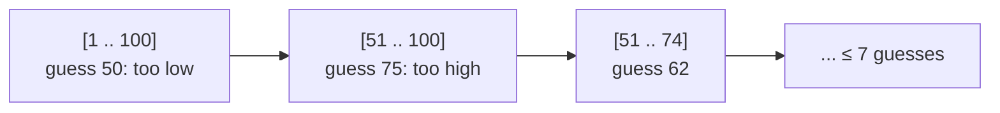

# Binary Search

<Note>
**TL;DR**

**Binary search** finds a target (or a boundary) in a **sorted** or otherwise **monotonic** space by halving the search range each step: O(log n) instead of O(n). The robust way to think about it is "find the first index where a condition becomes true" (`lower_bound`). The same template also searches **on the answer** (smallest speed, capacity, or size that works) and handles **rotated** sorted arrays.
</Note>

## The idea

Guess the middle. If the target is bigger, throw away the left half; otherwise throw away the right half. Grokking Algorithms opens with exactly this (chapter 1, [Grokking Algorithms](/Software%20Engineering/DSA/05%20Books%20%26%20Courses/Grokking%20Algorithms)): guessing a number from 1 to 100 takes at most 7 guesses, and a sorted list of 4 billion items needs at most 32 steps, because log₂(4·10⁹) ≈ 32.



The general view: you have a predicate `ok(x)` that is **false, false, ..., false, true, true, ..., true** over the search space. Binary search finds the first `true`. "Sorted array contains target" is just one such predicate (`a[i] >= target`).

## How it works

Pick an interval convention and keep it consistent:

| Style | Interval | Loop | Update | Ends with |
|---|---|---|---|---|
| Classic (exact match) | closed `[lo, hi]`, `hi = n - 1` | `while (lo <= hi)` | `lo = mid + 1` / `hi = mid - 1` | `-1` if not found |
| Boundary (`lower_bound`) | half-open `[lo, hi)`, `hi = n` | `while (lo < hi)` | `lo = mid + 1` / `hi = mid` | `lo == hi` = first index where `ok` is true (or `n`) |

- **`lower_bound(target)`**: first index `i` with `a[i] >= target` (where target would be inserted to stay sorted, before equal elements).
- **`upper_bound(target)`**: first index `i` with `a[i] > target` (insert after equal elements).
- Count of `target` in the array = `upper_bound - lower_bound`. First/last occurrence (LC 34) = `lower_bound` and `upper_bound - 1`.

### The midpoint overflow note

`mid = (lo + hi) / 2` overflows when `lo + hi` exceeds the integer max (2³¹ - 1 for Java/C++ `int`). This bug sat in the JDK's `Arrays.binarySearch` for about nine years until Joshua Bloch wrote it up in 2006. Always write:

```text
mid = lo + (hi - lo) / 2
```

- **Java/C++**: use `lo + (hi - lo) / 2` (or `(lo + hi) >>> 1` in Java).
- **JavaScript**: numbers are doubles, so no overflow below 2⁵³, but `/` gives a fraction: use `Math.floor` or `(lo + hi) >>> 1` (only valid for values < 2³¹).
- **Python**: ints are unbounded, `(lo + hi) // 2` is fine; use the safe form anyway for habit.

### Binary search on the answer

When the question asks for the **minimum x such that something is feasible** (or the maximum such that it is still feasible), and feasibility is monotonic in x, binary search over x itself: `lo` = smallest possible answer, `hi` = largest, predicate = "is x enough?". Examples: Koko's eating speed, ship capacity in D days, split array largest sum, minimum days to make bouquets.

### Rotated sorted arrays

`[4, 5, 6, 7, 0, 1, 2]` is sorted then rotated. At any `mid`, **one half is still sorted**. Check which one (`a[lo] <= a[mid]` means the left half is sorted), test whether the target lies inside that sorted half's range, and discard accordingly (LC 33). For the minimum (LC 153), compare `a[mid]` with `a[hi]`: if `a[mid] > a[hi]`, the drop is to the right.

## Complexity

| Operation | Time | Space |
|---|---|---|
| Search in sorted array | O(log n) | O(1) iterative, O(log n) recursive |
| Binary search on answer | O(log(range) × cost of `ok`) | depends on `ok` |
| Rotated array search | O(log n) (O(n) worst case if duplicates allowed, LC 81) | O(1) |
| Linear scan for comparison | O(n) | O(1) |

## Template

### Classic exact match (LC 704)

```ts
function search(nums: number[], target: number): number {
  let lo = 0, hi = nums.length - 1;
  while (lo <= hi) {
    const mid = lo + Math.floor((hi - lo) / 2);
    if (nums[mid] === target) return mid;
    if (nums[mid] < target) lo = mid + 1;
    else hi = mid - 1;
  }
  return -1;
}
```

```python
def search(nums: list[int], target: int) -> int:
    lo, hi = 0, len(nums) - 1
    while lo <= hi:
        mid = lo + (hi - lo) // 2
        if nums[mid] == target:
            return mid
        if nums[mid] < target:
            lo = mid + 1
        else:
            hi = mid - 1
    return -1
```

### lower_bound / upper_bound

```ts
/** first index with a[i] >= target (a.length if none) */
function lowerBound(a: number[], target: number): number {
  let lo = 0, hi = a.length;
  while (lo < hi) {
    const mid = lo + Math.floor((hi - lo) / 2);
    if (a[mid] < target) lo = mid + 1;
    else hi = mid;
  }
  return lo;
}

/** first index with a[i] > target (a.length if none) */
function upperBound(a: number[], target: number): number {
  let lo = 0, hi = a.length;
  while (lo < hi) {
    const mid = lo + Math.floor((hi - lo) / 2);
    if (a[mid] <= target) lo = mid + 1;
    else hi = mid;
  }
  return lo;
}

/** generic: first x in [lo, hi) where ok(x) is true, assuming F...F T...T */
function firstTrue(lo: number, hi: number, ok: (x: number) => boolean): number {
  while (lo < hi) {
    const mid = lo + Math.floor((hi - lo) / 2);
    if (ok(mid)) hi = mid;
    else lo = mid + 1;
  }
  return lo;
}
```

```python
from bisect import bisect_left, bisect_right
from typing import Callable

a = [1, 2, 2, 2, 5, 8]
bisect_left(a, 2)   # 1 -> lower_bound
bisect_right(a, 2)  # 4 -> upper_bound
bisect_right(a, 2) - bisect_left(a, 2)  # 3 occurrences

def first_true(lo: int, hi: int, ok: Callable[[int], bool]) -> int:
    """first x in [lo, hi) with ok(x) True, assuming F...F T...T"""
    while lo < hi:
        mid = lo + (hi - lo) // 2
        if ok(mid):
            hi = mid
        else:
            lo = mid + 1
    return lo
```

Python's [`bisect`](https://docs.python.org/3/library/bisect.html) module gives `bisect_left` (lower_bound), `bisect_right`/`bisect` (upper_bound), and `insort_left`/`insort_right` to insert while keeping order (insertion is still O(n) because of the list shift). Since Python 3.10 the functions take a `key=` argument.

### Rotated sorted array (LC 33)

```ts
function searchRotated(nums: number[], target: number): number {
  let lo = 0, hi = nums.length - 1;
  while (lo <= hi) {
    const mid = lo + Math.floor((hi - lo) / 2);
    if (nums[mid] === target) return mid;
    if (nums[lo] <= nums[mid]) {
      // left half [lo, mid] is sorted
      if (nums[lo] <= target && target < nums[mid]) hi = mid - 1;
      else lo = mid + 1;
    } else {
      // right half [mid, hi] is sorted
      if (nums[mid] < target && target <= nums[hi]) lo = mid + 1;
      else hi = mid - 1;
    }
  }
  return -1;
}
```

```python
def search_rotated(nums: list[int], target: int) -> int:
    lo, hi = 0, len(nums) - 1
    while lo <= hi:
        mid = lo + (hi - lo) // 2
        if nums[mid] == target:
            return mid
        if nums[lo] <= nums[mid]:          # left half sorted
            if nums[lo] <= target < nums[mid]:
                hi = mid - 1
            else:
                lo = mid + 1
        else:                              # right half sorted
            if nums[mid] < target <= nums[hi]:
                lo = mid + 1
            else:
                hi = mid - 1
    return -1
```

## Worked example

**[875. Koko Eating Bananas](https://leetcode.com/problems/koko-eating-bananas/)**: piles `[3, 6, 7, 11]`, `h = 8` hours. Each hour Koko eats up to `k` bananas from one pile. Find the minimum integer `k` to finish within `h` hours. Answer `4`.

- Search space: `k` in `[1, max(piles)] = [1, 11]`. With `k = 11` she needs one hour per pile, always enough.
- Predicate: `hours(k) = Σ ceil(p / k) <= h`. Bigger `k` never needs more hours, so it's monotonic: F F F T T T.

| lo | hi | mid | hours(mid) | ≤ 8? | Update |
|---|---|---|---|---|---|
| 1 | 11 | 6 | 1+1+2+2 = 6 | yes | `hi = 6` |
| 1 | 6 | 3 | 1+2+3+4 = 10 | no | `lo = 4` |
| 4 | 6 | 5 | 1+2+2+3 = 8 | yes | `hi = 5` |
| 4 | 5 | 4 | 1+2+2+3 = 8 | yes | `hi = 4` |
| 4 | 4 | | | | stop, answer `4` |

Cost: O(n log(max pile)).

```ts
function minEatingSpeed(piles: number[], h: number): number {
  const hours = (k: number) => piles.reduce((t, p) => t + Math.ceil(p / k), 0);
  let lo = 1, hi = Math.max(...piles);
  while (lo < hi) {
    const mid = lo + Math.floor((hi - lo) / 2);
    if (hours(mid) <= h) hi = mid; // mid works, try smaller
    else lo = mid + 1;             // too slow
  }
  return lo;
}
```

```python
def min_eating_speed(piles: list[int], h: int) -> int:
    def hours(k: int) -> int:
        return sum((p + k - 1) // k for p in piles)  # integer ceil

    lo, hi = 1, max(piles)
    while lo < hi:
        mid = lo + (hi - lo) // 2
        if hours(mid) <= h:
            hi = mid
        else:
            lo = mid + 1
    return lo
```

## When to use it (recognition signals)

- Input is **sorted** and you need a target, first/last occurrence, insert position, or count.
- Required complexity is **O(log n)** or the input is huge (10⁹ range of values).
- "**Minimum** x such that ..." / "**maximum** x such that ..." with a feasibility check that is monotonic in x → binary search on the answer.
- Sorted but **rotated**, or a "mountain"/bitonic array (find peak, LC 162).
- A 2D matrix with sorted rows and columns that can be treated as a flattened sorted array (LC 74).
- Not sorted and only one query? A linear scan is O(n) and simpler; sorting first costs O(n log n).

## Trade-offs & pitfalls

- **Infinite loops**: with `while (lo < hi)` and `hi = mid`, `mid` must round **down**; if you write `lo = mid` (searching for the last true), round **up** (`mid = lo + (hi - lo + 1) / 2`).
- **Mixing conventions**: `hi = n - 1` with `while (lo < hi)` or `hi = n` with `lo <= hi` causes misses or out-of-bounds reads.
- **Overflow** in `(lo + hi) / 2` (see above). Also overflow in the predicate: in Koko, sums of hours can exceed 32-bit in Java.
- **Wrong search bounds** on the answer: `lo` must be a value that could be valid (Koko: 1, not 0, or you divide by zero).
- **Duplicates** in rotated arrays break the "which half is sorted" test (`a[lo] == a[mid] == a[hi]`); shrink `lo++` / `hi--`, worst case O(n).
- JS `Array.prototype.sort()` without a comparator sorts **lexicographically**; `[10, 9, 1].sort()` gives `[1, 10, 9]`. Use `(a, b) => a - b` before binary searching numbers.

## Senior perspective

- **Databases**: B-tree/B+-tree nodes are searched with binary search over sorted keys inside each page; LSM-tree SSTables keep a sparse sorted index that is binary searched. See [Trees & Binary Search Trees](/Software%20Engineering/DSA/02%20Data%20Structures/Trees%20%26%20Binary%20Search%20Trees).
- **`git bisect`** is binary search over commit history to find the commit that introduced a bug; the same trick works for bisecting deploys, feature flags, or config changes.
- **Standard libraries**: C++ `std::lower_bound`/`upper_bound`, Java `Arrays.binarySearch` / `Collections.binarySearch`, Python `bisect`, Rust `partition_point`. JavaScript has **no** built-in binary search, so you write your own.
- **Cache behaviour**: binary search on a big array jumps around memory (poor locality). For hot lookups, cache-friendly layouts (Eytzinger/B-tree-like layouts) or a hash map may be faster despite the same big-O.
- **Capacity planning** and load tests use binary search on the answer: find the max QPS that keeps p99 under a threshold.
- In interviews, say the invariant ("answer is always in `[lo, hi]`", "everything left of `lo` is false") and test on a 1- and 2-element array.

## Classic LeetCode problems

| # | Problem | Difficulty | Key idea |
|---|---|---|---|
| 704 | [Binary Search](https://leetcode.com/problems/binary-search/) | Easy | Classic closed interval |
| 35 | [Search Insert Position](https://leetcode.com/problems/search-insert-position/) | Easy | `lower_bound` |
| 34 | [Find First and Last Position of Element in Sorted Array](https://leetcode.com/problems/find-first-and-last-position-of-element-in-sorted-array/) | Medium | `lower_bound` and `upper_bound - 1` |
| 33 | [Search in Rotated Sorted Array](https://leetcode.com/problems/search-in-rotated-sorted-array/) | Medium | One half is always sorted |
| 153 | [Find Minimum in Rotated Sorted Array](https://leetcode.com/problems/find-minimum-in-rotated-sorted-array/) | Medium | Compare `a[mid]` with `a[hi]` |
| 1011 | [Capacity To Ship Packages Within D Days](https://leetcode.com/problems/capacity-to-ship-packages-within-d-days/) | Medium | Binary search on the answer, `lo = max(weights)` |

## Interview questions

<Accordion title="Why write `lo + (hi - lo) / 2` instead of `(lo + hi) / 2`?">
With fixed-width integers, `lo + hi` can exceed the max int and wrap to a negative number, giving a negative index. `hi - lo` never overflows when both are valid indices. The bug was in the JDK's binary search for years (Bloch, 2006). Python has unbounded ints and JS uses doubles, but the safe form is a good habit.
</Accordion>

<Accordion title="What's the difference between lower_bound and upper_bound?">
`lower_bound(x)` is the first index with value `>= x`; `upper_bound(x)` is the first with value `> x`. Their difference is the count of `x`. In Python they are `bisect_left` and `bisect_right`.
</Accordion>

<Accordion title="How do you recognise &quot;binary search on the answer&quot;?">
The question asks for a minimum or maximum value, you can write a check "is value x feasible?" in O(n) or so, and feasibility is monotonic (if x works, x+1 works too). Search x over its possible range.
</Accordion>

<Accordion title="How do you search in a rotated sorted array in O(log n)?">
At each `mid`, one half is sorted. If `a[lo] <= a[mid]` the left half is sorted: go left if `a[lo] <= target < a[mid]`, else right. Otherwise the right half is sorted: go right if `a[mid] < target <= a[hi]`, else left.
</Accordion>

<Accordion title="Your binary search loops forever. What do you check?">
Whether the range always shrinks. With `lo = mid` you need `mid` to round up; with `hi = mid` it must round down. Also check the loop condition matches the interval convention (closed `<=` vs half-open `<`).
</Accordion>

<Accordion title="Is binary search always better than a linear scan?">
No. It needs sorted data (sorting costs O(n log n)), random access (not linked lists), and for small arrays (dozens of elements) a linear scan can be faster due to branch prediction and cache locality. For many repeated lookups on static data, sort once and binary search, or use a hash set if you only need membership.
</Accordion>

## Related
- [DSA Index](/Software%20Engineering/DSA/DSA%20Index)
- [Arrays & Strings](/Software%20Engineering/DSA/02%20Data%20Structures/Arrays%20%26%20Strings) · [Sorting Algorithms](/Software%20Engineering/DSA/03%20Algorithms/Sorting%20Algorithms) · [Trees & Binary Search Trees](/Software%20Engineering/DSA/02%20Data%20Structures/Trees%20%26%20Binary%20Search%20Trees) · [Two Pointers](/Software%20Engineering/DSA/04%20Patterns/Two%20Pointers) · [Recursion & Backtracking](/Software%20Engineering/DSA/03%20Algorithms/Recursion%20%26%20Backtracking)
- [Big-O & Complexity Analysis](/Software%20Engineering/DSA/01%20Foundations/Big-O%20%26%20Complexity%20Analysis)
- Books & courses: [Grokking Algorithms](/Software%20Engineering/DSA/05%20Books%20%26%20Courses/Grokking%20Algorithms) (chapter 1, binary search) · [LeetCode Crash Course](/Software%20Engineering/DSA/05%20Books%20%26%20Courses/LeetCode%20Crash%20Course)

## Sources
- Aditya Bhargava, *Grokking Algorithms*, Manning (chapter 1: binary search, Big-O)
- [cp-algorithms: Binary search](https://cp-algorithms.com/num_methods/binary_search.html)
- [Google Research blog (Joshua Bloch, 2006): Nearly All Binary Searches and Mergesorts are Broken](https://research.google/blog/extra-extra-read-all-about-it-nearly-all-binary-searches-and-mergesorts-are-broken/)
- [Python docs: bisect](https://docs.python.org/3/library/bisect.html)
- [Tech Interview Handbook: Binary search cheatsheet](https://www.techinterviewhandbook.org/algorithms/binary-search/)
- Cormen, Leiserson, Rivest, Stein, *Introduction to Algorithms*, 4th ed., MIT Press 2022
- [git-bisect documentation](https://git-scm.com/docs/git-bisect)
