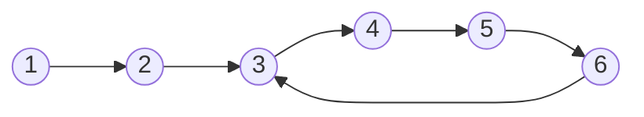

# Fast and Slow Pointer

> [!tldr] TL;DR
> Two pointers walk the same structure at **different speeds**: the slow one moves 1 step, the fast one moves 2. When the fast one reaches the end, the slow one is at the **middle**. If there is a **cycle**, the fast one laps the slow one and they meet (Floyd's algorithm), and a second phase finds **where the cycle starts**. All in O(n) time and O(1) space, which is why it beats a hash set of visited nodes.

## The idea

Also known as the **Tortoise and Hare** algorithm / **Floyd's Cycle Detection Algorithm**.

It uses two pointers to determine some traits about a Linked List, Array, or Graph (a cycle, the middle, or flattening).

- **Slow** pointer travels one node at a time.
- **Fast** pointer travels two nodes at a time.

To implement the algorithm, the two pointers start at a location (the head, when detecting a loop), then with each iteration the two pointers advance to different locations. They can move at different rates, but 1 and 2 is the standard choice: a speed difference of 1 guarantees they meet within one lap (with other speeds, e.g. 1 and 3, they can skip over each other forever in an even-length cycle; see the interview questions).



In the list above, both start at `1`. Slow enters the loop `3 → 4 → 5 → 6`; fast is already inside and gains **one node per step** on slow, so it must land exactly on slow within one lap. If the two pointers never meet (fast hits `null`), there is no cycle.

Base loop:

```java
Node slow = head, fast = head;

while (fast != null && fast.next != null) {
	slow = slow.next;      // 1 move
	fast = fast.next.next; // 2 moves
	// Logic for the problem
}
// Logic for the problem
```

## How it works

| Goal | How |
|---|---|
| Middle of list | Run the base loop until fast falls off; slow is the middle |
| Cycle exists? | Run the base loop; if `slow == fast` inside the loop, there is a cycle |
| Where does the cycle start? | After they meet, move one pointer back to `head`; step both by 1; they meet at the start |
| Cycle length | After meeting, keep one fixed and walk the other until it returns; count steps |
| Cycles in a function / array | Treat `x → f(x)` (or `i → nums[i]`) as a linked list (happy number, find duplicate) |

### Why the cycle start trick works (LC 142)

Let:
- `a` = distance from `head` to the cycle start,
- `b` = distance from the cycle start to the meeting point (along the cycle),
- `c` = cycle length.

At the meeting point slow has walked `a + b`, fast has walked `2(a + b)`. Fast has done some extra full laps `k ≥ 1`, so:

```text
2(a + b) = a + b + k·c
    a + b = k·c
        a = k·c - b = (k - 1)·c + (c - b)
```

`c - b` is the distance from the meeting point **forward** to the cycle start. So a pointer starting at `head` and a pointer starting at the meeting point, both moving 1 step at a time, arrive at the cycle start together (the second one may do `k - 1` extra full laps first).

```text
head ──a──► start ──b──► meet
              ▲            │
              └──(c - b)───┘
```

## Complexity

| Problem | Time | Space |
|---|---|---|
| Middle of list | O(n) | O(1) |
| Detect cycle | O(n) | O(1) |
| Cycle start / length | O(n) | O(1) |
| Hash-set alternative | O(n) | O(n) |

> [!note] About "O(N + N/2)"
> My original note wrote **O(N + N/2)** for the middle-of-list loop: fast touches about N nodes and slow about N/2. That's O(1.5·N), and Big-O drops constant factors, so it is simply **O(N)**. The loop itself only runs about N/2 iterations. See [[Big-O & Complexity Analysis]].

## Template

```ts
class ListNode {
  constructor(public val: number, public next: ListNode | null = null) {}
}

function middleNode(head: ListNode | null): ListNode | null {
  let slow = head, fast = head;
  while (fast !== null && fast.next !== null) {
    slow = slow!.next;
    fast = fast.next.next;
  }
  return slow; // second middle for even length
}

function hasCycle(head: ListNode | null): boolean {
  let slow = head, fast = head;
  while (fast !== null && fast.next !== null) {
    slow = slow!.next;
    fast = fast.next.next;
    if (slow === fast) return true; // compare AFTER moving
  }
  return false;
}
```

```python
from __future__ import annotations
from dataclasses import dataclass

@dataclass(eq=False)  # compare nodes by identity
class ListNode:
    val: int
    next: ListNode | None = None

def middle_node(head: ListNode | None) -> ListNode | None:
    slow = fast = head
    while fast and fast.next:
        slow = slow.next
        fast = fast.next.next
    return slow  # second middle for even length

def has_cycle(head: ListNode | None) -> bool:
    slow = fast = head
    while fast and fast.next:
        slow = slow.next
        fast = fast.next.next
        if slow is fast:  # compare AFTER moving
            return True
    return False
```

## My Java snippets (corrected)

### Problem 1: Find the middle of the Linked List (LC 876)

```java
Node fast = head, slow = head;

while (fast != null && fast.next != null) {
	slow = slow.next;
	fast = fast.next.next;
}

return slow;
```

O(N) time (see the note above on O(N + N/2)), O(1) space. For an even length this returns the **second** middle, which is what LC 876 wants. To get the first middle, loop while `fast.next != null && fast.next.next != null`.

### Problem 2: Detect Cycles in Linked List (LC 141)

The original version started both pointers at `head` and used `while (fast != slow)`. Since `fast == slow == head` at the start, the loop body **never runs** and the method always returns `true`. Two correct fixes:

```java
// Fix A: standard loop, compare after moving
boolean hasCycle(Node head) {
    Node slow = head, fast = head;
    while (fast != null && fast.next != null) {
        slow = slow.next;
        fast = fast.next.next;
        if (slow == fast) return true;
    }
    return false;
}
```

```java
// Fix B: keep the original shape, but start fast one step ahead
boolean hasCycle(Node head) {
    if (head == null) return false;
    Node slow = head, fast = head.next;
    while (fast != slow) {
        if (fast == null || fast.next == null) {
            return false;
        }
        fast = fast.next.next;
        slow = slow.next;
    }
    return true;
}
```

Time complexity is O(N) with space complexity O(1).

### Find the k-th element from the end (two-pointer gap method)

This is not a fast/slow (different speed) technique; it's the **gap** variant: both pointers move at the **same** speed, but one starts `k` nodes ahead. When the leader falls off the end, the trailer is `k` nodes from the end. One pass, no length needed. (LC 19 Remove Nth Node From End of List uses this.)

```java
Node findKthFromEnd(int k) {
    if (k <= 0) return null;
    Node lead = head, trail = head;

    // move lead k nodes ahead
    for (int i = 0; i < k; i++) {
        if (lead == null) return null; // list shorter than k
        lead = lead.next;
    }

    // move both until lead falls off the end
    while (lead != null) {
        lead = lead.next;
        trail = trail.next;
    }
    return trail; // k = 1 -> last node
}
```

> [!note]- Original version (length-based, with an off-by-one bug)
> ```java
> Node findKthFromEnd(int k) {
>     if (head == null) {
>         return null;
>     }
>     int length = 0;
>     Node temp = head;
>     while (temp != null && temp.next != null) {
>         temp = temp.next;
>         length++;
>     }
>     if (k > length) return null;
>     temp = head;
>     for (int i = 0; i < length - k + 1; i++)  {
>         temp = temp.next;
>     }
>     return temp;
> }
> ```
> **Bug:** the first loop stops at the last node, so `length` counts the **links** (`n - 1`), not the nodes (`n`). The `+ 1` in the second loop happens to cancel that for `1 <= k < n`, but the guard `k > length` then rejects `k == n` (the head, a valid answer) and returns `null`. `k <= 0` isn't guarded either (a negative `k` walks off the list and throws). Fix: count with `while (temp != null)` so `length == n`, guard `k < 1 || k > length`, and move `length - k` steps. It also needs two passes; the gap method above needs one.

## Worked example

**[142. Linked List Cycle II](https://leetcode.com/problems/linked-list-cycle-ii/)**: return the node where the cycle begins, or `null`.

List: `3 → 2 → 0 → -4 → (back to 2)`. So `a = 1` (head to `2`), `c = 3`.

Phase 1 (detect):

| Step | slow | fast | Meet? |
|---|---|---|---|
| 0 | 3 | 3 | start |
| 1 | 2 | 0 | no |
| 2 | 0 | 2 (0 → -4 → 2) | no |
| 3 | -4 | -4 (2 → 0 → -4) | **yes** |

Meeting point `-4`: `b = 2` (2 → 0 → -4), and `c - b = 1 = a`. 

Phase 2 (find start): `p = head (3)`, `q = meet (-4)`.

| Step | p | q |
|---|---|---|
| 0 | 3 | -4 |
| 1 | 2 | 2 → **cycle starts at node 2** |

```ts
function detectCycle(head: ListNode | null): ListNode | null {
  let slow = head, fast = head;
  while (fast !== null && fast.next !== null) {
    slow = slow!.next;
    fast = fast.next.next;
    if (slow === fast) {
      let p = head;
      while (p !== slow) {
        p = p!.next;
        slow = slow!.next;
      }
      return p;
    }
  }
  return null;
}
```

```python
def detect_cycle(head: ListNode | None) -> ListNode | None:
    slow = fast = head
    while fast and fast.next:
        slow = slow.next
        fast = fast.next.next
        if slow is fast:
            p = head
            while p is not slow:
                p = p.next
                slow = slow.next
            return p
    return None
```

## More applications

### Happy Number (LC 202): cycle in a function

Repeatedly replace `n` with the sum of the squares of its digits. Either you reach 1 or you loop forever. The sequence `n → f(n) → f(f(n))` is an implicit linked list, so Floyd detects the loop without a set.

```ts
function isHappy(n: number): boolean {
  const next = (x: number): number => {
    let s = 0;
    while (x > 0) { const d = x % 10; s += d * d; x = Math.floor(x / 10); }
    return s;
  };
  let slow = n, fast = next(n);
  while (fast !== 1 && slow !== fast) {
    slow = next(slow);
    fast = next(next(fast));
  }
  return fast === 1;
}
```

```python
def is_happy(n: int) -> bool:
    def nxt(x: int) -> int:
        return sum(int(d) ** 2 for d in str(x))

    slow, fast = n, nxt(n)
    while fast != 1 and slow != fast:
        slow = nxt(slow)
        fast = nxt(nxt(fast))
    return fast == 1
```

### Find the Duplicate Number (LC 287): cycle in an array

`nums` has `n + 1` values in `[1, n]`, exactly one repeated, and you may not modify the array or use extra space. Treat index `i` as a node with an edge to `nums[i]`. Two indices point to the duplicate value, so it is the **entrance of a cycle**. Index `0` is never a target (values start at 1), so it acts as the head. Run LC 142 on it.

```ts
function findDuplicate(nums: number[]): number {
  let slow = 0, fast = 0;
  do {
    slow = nums[slow];
    fast = nums[nums[fast]];
  } while (slow !== fast);
  slow = 0;
  while (slow !== fast) {
    slow = nums[slow];
    fast = nums[fast];
  }
  return slow;
}
```

```python
def find_duplicate(nums: list[int]) -> int:
    slow = fast = 0
    while True:
        slow = nums[slow]
        fast = nums[nums[fast]]
        if slow == fast:
            break
    slow = 0
    while slow != fast:
        slow = nums[slow]
        fast = nums[fast]
    return slow
```

### Palindrome Linked List (LC 234): middle + reverse

Find the middle with fast/slow, reverse the second half in place, compare the halves node by node, then (politely) reverse it back. O(n) time, O(1) space.

```ts
function isPalindrome(head: ListNode | null): boolean {
  let slow = head, fast = head;
  while (fast !== null && fast.next !== null) {
    slow = slow!.next;
    fast = fast.next.next;
  }
  // reverse second half starting at slow
  let prev: ListNode | null = null, cur = slow;
  while (cur !== null) {
    const nxt = cur.next;
    cur.next = prev;
    prev = cur;
    cur = nxt;
  }
  let left = head, right = prev;
  let ok = true;
  while (right !== null) {
    if (left!.val !== right.val) { ok = false; break; }
    left = left!.next;
    right = right.next;
  }
  // restoring the list (reverse `prev` again) is left out for brevity
  return ok;
}
```

```python
def is_palindrome(head: ListNode | None) -> bool:
    slow = fast = head
    while fast and fast.next:
        slow = slow.next
        fast = fast.next.next
    prev, cur = None, slow            # reverse second half
    while cur:
        cur.next, prev, cur = prev, cur, cur.next
    left, right = head, prev
    while right:
        if left.val != right.val:
            return False
        left, right = left.next, right.next
    return True
```

## Related linked list technique: reverse a sublist (LC 92)

Not a fast/slow technique, but it lives here because it's a common linked-list pointer manipulation (and the palindrome check above reuses reversal). [92. Reverse Linked List II](https://leetcode.com/problems/reverse-linked-list-ii/) reverses the nodes from position `m` to `n`.

The idea: a dummy node before `head`, walk `prev` to the node just **before** the sublist, then repeatedly move the node after `current` to the front of the sublist ("head insertion"), `n - m` times.

> [!warning] Indexing
> My original loop `for (int i = 0; i < m; i++)` assumes **0-indexed** `m` (positions start at 0). LC 92 uses **1-indexed** positions (`left`, `right` start at 1), so to stop just before position `m` you need **`m - 1`** iterations. The version below is the 1-indexed one.

```java
public void reverseBetween(int m, int n) {   // m, n are 1-indexed (LC 92)
        // Return if the list is empty
        if (head == null) return;

        // Create a dummy node and connect it to the head
        Node dummy = new Node(0);
        dummy.next = head;
        Node prev = dummy;

        // Move prev to the node just before the sublist
        // (0-indexed m would use i < m; 1-indexed LC 92 uses i < m - 1)
        for (int i = 0; i < m - 1; i++) {
            prev = prev.next;
        }

        // Set current to the first node of the sublist
        Node current = prev.next;

        // Reverse the sublist iteratively
        for (int i = 0; i < n - m; i++) {
            // Save the next node in the original order
            Node temp = current.next;
            // Update current's next to skip temp
            current.next = temp.next;
            // Reverse the order of temp and current
            temp.next = prev.next;
            // Update prev's next to maintain reversed order
            prev.next = temp;
        }

        // Update the head of the list
        head = dummy.next;
    }
```

```ts
function reverseBetween(head: ListNode | null, left: number, right: number): ListNode | null {
  const dummy = new ListNode(0, head);
  let prev: ListNode = dummy;
  for (let i = 0; i < left - 1; i++) prev = prev.next!;
  const current = prev.next!;
  for (let i = 0; i < right - left; i++) {
    const temp = current.next!;
    current.next = temp.next;
    temp.next = prev.next;
    prev.next = temp;
  }
  return dummy.next;
}
```

```python
def reverse_between(head: ListNode | None, left: int, right: int) -> ListNode | None:
    dummy = ListNode(0, head)
    prev = dummy
    for _ in range(left - 1):
        prev = prev.next
    current = prev.next
    for _ in range(right - left):
        temp = current.next
        current.next = temp.next
        temp.next = prev.next
        prev.next = temp
    return dummy.next
```

## When to use it (recognition signals)

- **Linked list** + "middle", "cycle", "loop", "where does the cycle begin", "palindrome" with O(1) space.
- A sequence generated by **repeatedly applying a function** that might loop (happy number, pseudo-random generators).
- An array whose values are valid **indices** into itself (`nums[i]` in `[0, n)` or `[1, n]`) and you can't modify it or use extra space (LC 287).
- "k-th from the end", "remove n-th from end": not different speeds, but the related **gap** technique.
- If extra memory is fine and clarity matters more, a hash set of visited nodes also works.

## Trade-offs & pitfalls

- **Null checks**: always test `fast != null && fast.next != null` before `fast.next.next`.
- **Compare after moving**, not before, when both start at `head` (the original bug above).
- **Identity vs value**: compare nodes by reference (`===`, `is`), not by `val`; two different nodes can hold the same value.
- **Even-length middle**: decide whether you want the first or second middle and pick the loop condition to match.
- **Mutating input**: the palindrome trick reverses half of the caller's list; restore it or document it.
- **Off-by-one with 0- vs 1-indexed positions** (see LC 92 above).

## Senior perspective

- **Floyd vs hash set**: both O(n) time, but Floyd is O(1) memory. That matters on huge or implicit sequences where you can't store every visited state.
- **Brent's algorithm** is an alternative cycle finder that usually does fewer function evaluations (teleporting the tortoise at powers of two). Both appear in **Pollard's rho** integer factorisation, which detects a cycle in `x → x² + c mod n`.
- **Implicit graphs**: detecting that a state machine, PRNG, or iterative process has entered a loop (e.g. a retry/redirect loop, a cyclic `parent` pointer in a corrupted tree) is the same problem.
- Real systems often prefer **visited sets or depth limits** for clarity (e.g. detecting cycles in dependency graphs uses DFS colouring, see [[Graphs]]); Floyd shines only when each node has exactly one successor.
- In review: check null-safety of `fast.next.next`, whether the function mutates the input list, and whether node equality is by reference.

## Classic LeetCode problems

| # | Problem | Difficulty | Key idea |
|---|---|---|---|
| 876 | [Middle of the Linked List](https://leetcode.com/problems/middle-of-the-linked-list/) | Easy | Slow is at the middle when fast ends |
| 141 | [Linked List Cycle](https://leetcode.com/problems/linked-list-cycle/) | Easy | Meet ⇒ cycle |
| 202 | [Happy Number](https://leetcode.com/problems/happy-number/) | Easy | Cycle in `n → digit-square-sum(n)` |
| 234 | [Palindrome Linked List](https://leetcode.com/problems/palindrome-linked-list/) | Easy | Middle + reverse second half |
| 142 | [Linked List Cycle II](https://leetcode.com/problems/linked-list-cycle-ii/) | Medium | Reset one pointer to head, step both by 1 |
| 287 | [Find the Duplicate Number](https://leetcode.com/problems/find-the-duplicate-number/) | Medium | Index graph `i → nums[i]`, cycle entrance |

Also related: [19. Remove Nth Node From End of List](https://leetcode.com/problems/remove-nth-node-from-end-of-list/) (gap method) and [92. Reverse Linked List II](https://leetcode.com/problems/reverse-linked-list-ii/) (sublist reversal).

## Interview questions

> [!question]- Why are the fast and slow pointers guaranteed to meet if there's a cycle?
> Once both are in the cycle, the gap between them shrinks by exactly 1 each step (fast +2, slow +1). A gap that decreases by 1 must hit 0, so they meet within one lap of the cycle, before slow finishes its first lap.

> [!question]- How do you find where the cycle starts, and why does it work?
> After meeting, put one pointer at the head and move both 1 step at a time; they meet at the start. From `2(a + b) = a + b + k·c` you get `a = (k - 1)·c + (c - b)`: the distance from head to the start equals the distance from the meeting point forward to the start, modulo full laps.

> [!question]- What would go wrong if fast moved 3 steps instead of 2?
> The gap (mod cycle length `c`) would shrink by 2 per step instead of 1, so it can jump over 0. If `c` is even and the gap is odd when both enter the cycle, the gap stays odd forever and they **never** meet at the same node. A speed difference of 1 always works, which is why 1 and 2 are the standard choice (and the cycle-start math relies on it).

> [!question]- Find the duplicate in [1..n] with n + 1 numbers, O(1) space, without modifying the array.
> Treat it as a linked list `i → nums[i]` starting at index 0. The duplicate value has two incoming edges, so it's the cycle's entrance. Run Floyd phase 1 and phase 2 (LC 287). O(n) time, O(1) space.

> [!question]- How do you find the k-th node from the end in one pass?
> Gap method: move a leader `k` nodes ahead, then move leader and trailer together until the leader is `null`. The trailer is the k-th from the end. Guard `k <= 0` and lists shorter than `k`.

> [!question]- Fast/slow or a hash set for cycle detection?
> Hash set: simple, also gives the first repeated node directly, but O(n) memory. Floyd: O(1) memory, slightly trickier. Use Floyd when memory matters or the sequence is implicit/huge; use a set when clarity matters and n is small.

## Related
- [[DSA Index]]
- [[Linked Lists]] · [[Two Pointers]] · [[Hash Tables]] · [[Graphs]]
- [[Big-O & Complexity Analysis]]
- Course: [[LeetCode Crash Course]]

## Sources
- [cp-algorithms: Floyd's Linked List Cycle Finding Algorithm](https://cp-algorithms.com/others/tortoise_and_hare.html)
- Donald Knuth, *The Art of Computer Programming*, Vol. 2, Seminumerical Algorithms (section 3.1, exercise 6, attributes the cycle-finding method to Floyd)
- R. P. Brent, "An improved Monte Carlo factorization algorithm", *BIT* 20 (1980) (Brent's cycle detection)
- [LeetCode's Interview Crash Course: Data Structures and Algorithms](https://leetcode.com/explore/interview/card/leetcodes-interview-crash-course-data-structures-and-algorithms/) (Linked lists, fast and slow pointers)
- [Tech Interview Handbook: Linked list cheatsheet](https://www.techinterviewhandbook.org/algorithms/linked-list/)
