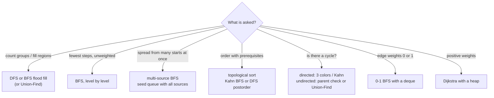

# Graph BFS-DFS patterns

<Note>
**TL;DR**

Most graph interview problems are one of a handful of shapes: **count connected components** (islands), **shortest path in an unweighted graph** (BFS), **spread from many sources at once** (multi-source BFS), **detect a cycle**, or **order tasks with dependencies** (topological sort). The engine is always the same: a **visited set** plus a **queue (BFS)** or **stack / recursion (DFS)**, costing O(V + E). A 2D grid is just a graph where each cell has up to 4 neighbors.
</Note>

## The idea

A graph is nodes plus edges (see [Graphs](/Software%20Engineering/DSA/02%20Data%20Structures/Graphs)). You rarely get a ready-made graph class in interviews. Instead you get:

- an **edge list** `[[a, b], ...]` that you turn into an adjacency list,
- a **grid** where cells are nodes and up/down/left/right are edges,
- an **implicit graph** where neighbors are generated on the fly (word ladder: words that differ by one letter).

Then you explore it:

- **BFS** explores in rings of increasing distance. The first time it reaches a node is along a **shortest path** (in edges). Use a queue.
- **DFS** goes deep first, then backtracks. Great for "visit everything reachable", components, cycle detection, and topological order. Use recursion or an explicit stack.

```text
Grid as a graph          BFS from S (distance rings)
. . # .                  2 1 # 3
. S . .                  1 0 1 2
# . # .                  # 1 # 3
. . . .                  3 2 3 4
```



## How it works

### Visited set
Mark a node **when you push it**, not when you pop it. Otherwise the same node can sit in the queue many times and BFS can blow up to O(V·E) work. On grids you can mark in place (for example set `'1'` to `'0'`) to save memory, if mutating input is allowed.

### BFS level by level
Process the queue in batches of `len(queue)`: each batch is one distance level. This gives you "minutes", "steps" or "moves" for free.

### Multi-source BFS
Push **all** sources into the queue before starting (all rotten oranges, all gates, all zeros). BFS then computes, for every cell, the distance to the **nearest** source in one O(V + E) pass, instead of one BFS per source.

### Cycle detection
- **Undirected**: during DFS, seeing a visited neighbor that is **not your parent** means a cycle. Or use [Union-Find](/Software%20Engineering/DSA/02%20Data%20Structures/Union-Find): an edge whose endpoints are already connected closes a cycle.
- **Directed**: three colors. White = unvisited, gray = on the current DFS path, black = done. An edge to a **gray** node is a back edge, so a cycle.

### Topological sort
Only for DAGs (directed acyclic graphs).
- **Kahn's algorithm (BFS)**: compute in-degrees, queue every node with in-degree 0, pop, append to the order, decrement neighbors' in-degrees, queue new zeros. If the order has fewer than V nodes, there is a cycle.
- **DFS**: append each node after all its descendants finish (postorder), then reverse.

### Mentions
- **Bidirectional BFS**: search from start and goal at the same time and stop when frontiers meet. With branching factor b and distance d, work drops from about b^d to about 2·b^(d/2). Classic use: [127. Word Ladder](https://leetcode.com/problems/word-ladder/).
- **0-1 BFS**: when edges cost 0 or 1, use a deque; push 0-cost neighbors to the **front** and 1-cost neighbors to the **back**. It is Dijkstra in O(V + E). Example: [1368. Minimum Cost to Make at Least One Valid Path in a Grid](https://leetcode.com/problems/minimum-cost-to-make-at-least-one-valid-path-in-a-grid/).
- **Positive weights**: Dijkstra with a min-heap, O((V + E) log V). See [Top-K & Heaps pattern](/Software%20Engineering/DSA/04%20Patterns/Top-K%20%26%20Heaps%20pattern).

## Complexity

| Pattern | Time | Space |
|---|---|---|
| BFS / DFS on adjacency list | O(V + E) | O(V) visited + queue/stack |
| BFS / DFS on R x C grid | O(R·C) | O(R·C) worst (queue or recursion depth) |
| Multi-source BFS | O(V + E) total | O(V) |
| Topological sort (Kahn or DFS) | O(V + E) | O(V + E) adjacency + in-degrees |
| Cycle detection (directed, 3 colors) | O(V + E) | O(V) |
| 0-1 BFS | O(V + E) | O(V) |
| Bidirectional BFS | about O(b^(d/2)) vs O(b^d) | same order as time |
| Adjacency matrix instead of list | O(V²) | O(V²) |

## Template

### BFS on a grid (shortest path in steps)

JavaScript has no built-in deque. `Array.shift()` is O(n), so use an array plus a **head index**.

```ts
const DIRS = [[1, 0], [-1, 0], [0, 1], [0, -1]] as const;

// Steps from (sr, sc) to (tr, tc) through cells equal to 0; -1 if unreachable.
function bfsGrid(grid: number[][], sr: number, sc: number, tr: number, tc: number): number {
  const R = grid.length, C = grid[0].length;
  const seen: boolean[][] = Array.from({ length: R }, () => Array(C).fill(false));
  const queue: Array<[number, number]> = [[sr, sc]];
  seen[sr][sc] = true;
  let head = 0, steps = 0;
  while (head < queue.length) {
    const levelEnd = queue.length;              // one BFS level
    while (head < levelEnd) {
      const [r, c] = queue[head++];
      if (r === tr && c === tc) return steps;
      for (const [dr, dc] of DIRS) {
        const nr = r + dr, nc = c + dc;
        if (nr < 0 || nr >= R || nc < 0 || nc >= C) continue;
        if (seen[nr][nc] || grid[nr][nc] !== 0) continue;
        seen[nr][nc] = true;                    // mark on push
        queue.push([nr, nc]);
      }
    }
    steps++;
  }
  return -1;
}
```

```python
from collections import deque

DIRS = ((1, 0), (-1, 0), (0, 1), (0, -1))

def bfs_grid(grid: list[list[int]], start: tuple[int, int], target: tuple[int, int]) -> int:
    R, C = len(grid), len(grid[0])
    seen = {start}
    q = deque([start])
    steps = 0
    while q:
        for _ in range(len(q)):                 # one BFS level
            r, c = q.popleft()
            if (r, c) == target:
                return steps
            for dr, dc in DIRS:
                nr, nc = r + dr, c + dc
                if 0 <= nr < R and 0 <= nc < C and grid[nr][nc] == 0 and (nr, nc) not in seen:
                    seen.add((nr, nc))          # mark on push
                    q.append((nr, nc))
        steps += 1
    return -1
```

### Connected components on a grid ([200. Number of Islands](https://leetcode.com/problems/number-of-islands/))

Iterative DFS avoids stack overflow on big grids (a 1000 x 1000 island is a million-deep recursion).

```ts
function numIslands(grid: string[][]): number {
  const R = grid.length, C = grid[0].length;
  let islands = 0;
  for (let r = 0; r < R; r++) {
    for (let c = 0; c < C; c++) {
      if (grid[r][c] !== '1') continue;
      islands++;
      const stack: Array<[number, number]> = [[r, c]];
      grid[r][c] = '0';                         // sink as visited
      while (stack.length > 0) {
        const [cr, cc] = stack.pop()!;
        for (const [dr, dc] of DIRS) {
          const nr = cr + dr, nc = cc + dc;
          if (nr >= 0 && nr < R && nc >= 0 && nc < C && grid[nr][nc] === '1') {
            grid[nr][nc] = '0';
            stack.push([nr, nc]);
          }
        }
      }
    }
  }
  return islands;
}
```

```python
def num_islands(grid: list[list[str]]) -> int:
    R, C = len(grid), len(grid[0])
    islands = 0
    for r in range(R):
        for c in range(C):
            if grid[r][c] != "1":
                continue
            islands += 1
            stack = [(r, c)]
            grid[r][c] = "0"                    # sink as visited
            while stack:
                cr, cc = stack.pop()
                for dr, dc in DIRS:
                    nr, nc = cr + dr, cc + dc
                    if 0 <= nr < R and 0 <= nc < C and grid[nr][nc] == "1":
                        grid[nr][nc] = "0"
                        stack.append((nr, nc))
    return islands
```

### Topological sort, Kahn's algorithm ([207](https://leetcode.com/problems/course-schedule/) / [210. Course Schedule II](https://leetcode.com/problems/course-schedule-ii/))

`prerequisites[i] = [a, b]` means take `b` before `a`, so the edge is `b -> a`.

```ts
function findOrder(n: number, prerequisites: number[][]): number[] {
  const adj: number[][] = Array.from({ length: n }, () => []);
  const indeg = new Array<number>(n).fill(0);
  for (const [a, b] of prerequisites) {
    adj[b].push(a);
    indeg[a]++;
  }
  const queue: number[] = [];
  for (let i = 0; i < n; i++) if (indeg[i] === 0) queue.push(i);
  const order: number[] = [];
  for (let head = 0; head < queue.length; head++) {
    const u = queue[head];
    order.push(u);
    for (const v of adj[u]) if (--indeg[v] === 0) queue.push(v);
  }
  return order.length === n ? order : []; // fewer than n means a cycle
}
```

```python
from collections import deque

def find_order(n: int, prerequisites: list[list[int]]) -> list[int]:
    adj: list[list[int]] = [[] for _ in range(n)]
    indeg = [0] * n
    for a, b in prerequisites:
        adj[b].append(a)
        indeg[a] += 1
    q = deque(i for i in range(n) if indeg[i] == 0)
    order: list[int] = []
    while q:
        u = q.popleft()
        order.append(u)
        for v in adj[u]:
            indeg[v] -= 1
            if indeg[v] == 0:
                q.append(v)
    return order if len(order) == n else []     # cycle -> impossible
```

### Directed cycle detection with three colors

```ts
function hasCycle(n: number, adj: number[][]): boolean {
  const color = new Array<number>(n).fill(0); // 0 white, 1 gray, 2 black
  const dfs = (u: number): boolean => {
    color[u] = 1;
    for (const v of adj[u]) {
      if (color[v] === 1) return true;            // back edge
      if (color[v] === 0 && dfs(v)) return true;
    }
    color[u] = 2;
    return false;
  };
  for (let u = 0; u < n; u++) if (color[u] === 0 && dfs(u)) return true;
  return false;
}
```

```python
import sys

def has_cycle(n: int, adj: list[list[int]]) -> bool:
    sys.setrecursionlimit(10_000 + n)           # default limit is about 1000
    WHITE, GRAY, BLACK = 0, 1, 2
    color = [WHITE] * n

    def dfs(u: int) -> bool:
        color[u] = GRAY
        for v in adj[u]:
            if color[v] == GRAY:
                return True                     # back edge
            if color[v] == WHITE and dfs(v):
                return True
        color[u] = BLACK
        return False

    return any(color[u] == WHITE and dfs(u) for u in range(n))
```

## Worked example

**[994. Rotting Oranges](https://leetcode.com/problems/rotting-oranges/)**: `0` empty, `1` fresh, `2` rotten. Each minute, rotten oranges rot their 4-neighbors. Return minutes until no fresh orange remains, or `-1`.

This is **multi-source BFS**: every rotten orange is a source at minute 0; BFS levels are minutes.

Input:

```text
2 1 1
1 1 0
0 1 1
```

Initial queue: `(0,0)`; fresh = 6.

| minute (level) | cells popped | newly rotten | fresh left |
|---|---|---|---|
| 1 | (0,0) | (1,0), (0,1) | 4 |
| 2 | (1,0), (0,1) | (1,1), (0,2) | 2 |
| 3 | (1,1), (0,2) | (2,1) | 1 |
| 4 | (2,1) | (2,2) | 0 |

Fresh reaches 0 after level 4, so the answer is **4**. If any fresh orange is unreachable (for example cut off by empty cells), `fresh > 0` at the end and we return `-1`.

```ts
function orangesRotting(grid: number[][]): number {
  const R = grid.length, C = grid[0].length;
  const queue: Array<[number, number]> = [];
  let fresh = 0;
  for (let r = 0; r < R; r++)
    for (let c = 0; c < C; c++) {
      if (grid[r][c] === 2) queue.push([r, c]);   // all sources up front
      else if (grid[r][c] === 1) fresh++;
    }
  let head = 0, minutes = 0;
  while (head < queue.length && fresh > 0) {
    const levelEnd = queue.length;
    while (head < levelEnd) {
      const [r, c] = queue[head++];
      for (const [dr, dc] of DIRS) {
        const nr = r + dr, nc = c + dc;
        if (nr >= 0 && nr < R && nc >= 0 && nc < C && grid[nr][nc] === 1) {
          grid[nr][nc] = 2;                          // mark on push
          fresh--;
          queue.push([nr, nc]);
        }
      }
    }
    minutes++;
  }
  return fresh === 0 ? minutes : -1;
}
```

```python
from collections import deque

def oranges_rotting(grid: list[list[int]]) -> int:
    R, C = len(grid), len(grid[0])
    q: deque[tuple[int, int]] = deque()
    fresh = 0
    for r in range(R):
        for c in range(C):
            if grid[r][c] == 2:
                q.append((r, c))                  # all sources up front
            elif grid[r][c] == 1:
                fresh += 1
    minutes = 0
    while q and fresh:
        for _ in range(len(q)):
            r, c = q.popleft()
            for dr, dc in ((1, 0), (-1, 0), (0, 1), (0, -1)):
                nr, nc = r + dr, c + dc
                if 0 <= nr < R and 0 <= nc < C and grid[nr][nc] == 1:
                    grid[nr][nc] = 2              # mark on push
                    fresh -= 1
                    q.append((nr, nc))
        minutes += 1
    return minutes if fresh == 0 else -1
```

Time O(R·C), space O(R·C) for the queue. The `while q and fresh` condition avoids counting an extra minute after the last orange rots.

## When to use it (recognition signals)

- A **grid** of cells with "connected", "adjacent", "region", "island", "flood", "spread", "infect".
- **"Minimum number of steps / moves / transformations"** with every move costing the same: BFS.
- **Many starting points** spreading simultaneously, or "distance to the nearest X": multi-source BFS.
- **"Prerequisites", "dependencies", "build order", "can all tasks finish"**: topological sort / directed cycle detection.
- **"Is it a valid tree?", "redundant connection"**, dynamic connectivity: DFS or [Union-Find](/Software%20Engineering/DSA/02%20Data%20Structures/Union-Find).
- **States** that are not obviously a graph (lock combinations, word transformations, puzzle boards): model each state as a node and BFS over it.
- Weights **0/1**: 0-1 BFS. Positive weights: Dijkstra. Negative weights: Bellman-Ford.

## Trade-offs & pitfalls

- **Marking visited on pop** instead of push: duplicates in the queue, wrong distances in some variants, and potential time-limit issues.
- **Recursion depth.** Python's default limit is about 1000 frames; JS engines overflow around ten thousand frames. Use an explicit stack for big grids or raise the limit consciously.
- **`Array.shift()` in JS** is O(n); a BFS with shift can go quadratic. Use a head index or a ring buffer.
- **Bounds checks** before indexing `grid[nr][nc]`, and `grid[0].length` on an empty grid.
- **Directed vs undirected.** When building adjacency from an undirected edge list, add both directions. The "parent" trick for cycles only works for undirected graphs.
- **Mutating input** (sinking islands) is fast but may be disallowed; ask, or use a separate `seen`.
- **DFS does not give shortest paths** in unweighted graphs. Use BFS.
- **Disconnected graphs.** Loop over all nodes as potential starts, or you will miss components and cycles.

## Senior perspective

- **Real graph traversals everywhere**: package managers and build tools (npm, Bazel, Gradle, Turborepo) use topological sort and cycle detection on dependency graphs; spreadsheets recompute cells in topological order; garbage collectors do a mark phase that is graph reachability from roots (see [Memory Management & Garbage Collection](/Software%20Engineering/Frontend/01%20JavaScript/Memory%20Management%20%26%20Garbage%20Collection)); web crawlers are BFS with a visited set that must be distributed.
- **Social "degrees of separation"** and routing on huge graphs use bidirectional BFS or landmarks, because a plain BFS frontier grows exponentially.
- **Memory is the bottleneck** at scale. A visited set of 10^8 nodes does not fit a hash set comfortably; use bitsets indexed by node id or Bloom filters (accepting false positives) in crawlers.
- **Representation matters.** Adjacency lists (arrays of arrays, or CSR format: one flat array of neighbors plus offsets) are cache friendly. Matrices only pay off for dense graphs.
- **In review**, ask: can the graph have cycles? Can it be disconnected? What is the max depth (recursion)? Is visited marked before enqueueing? Are node ids dense (use arrays) or sparse (use maps)?
- **In interviews**, say how you will represent the graph, state O(V + E), and pick BFS or DFS with a reason. For grids, mention the 4 vs 8 directions choice.

## Classic LeetCode problems

| # | Problem | Difficulty | Key idea |
|---|---|---|---|
| 200 | [Number of Islands](https://leetcode.com/problems/number-of-islands/) | Medium | flood fill per unvisited land cell |
| 994 | [Rotting Oranges](https://leetcode.com/problems/rotting-oranges/) | Medium | multi-source BFS, levels are minutes |
| 1091 | [Shortest Path in Binary Matrix](https://leetcode.com/problems/shortest-path-in-binary-matrix/) | Medium | BFS on grid, 8 directions |
| 207 | [Course Schedule](https://leetcode.com/problems/course-schedule/) | Medium | directed cycle detection / Kahn |
| 210 | [Course Schedule II](https://leetcode.com/problems/course-schedule-ii/) | Medium | return the topological order |
| 127 | [Word Ladder](https://leetcode.com/problems/word-ladder/) | Hard | BFS on implicit graph, bidirectional BFS |

## Interview questions

<Accordion title="Why does BFS give the shortest path in an unweighted graph but DFS does not?">
BFS visits nodes in nondecreasing order of distance (all distance-1 nodes, then distance-2, ...), so the first time it reaches a node is via a fewest-edge path. DFS may reach a node through a long detour first and mark it visited.
</Accordion>

<Accordion title="Why mark nodes visited when pushing rather than when popping?">
Otherwise several neighbors can enqueue the same node before it is popped, so the queue holds duplicates and work can grow beyond O(V + E). Marking on push guarantees each node enters the queue once.
</Accordion>

<Accordion title="What is multi-source BFS and when do you need it?">
Seed the queue with every source before starting. BFS then computes distance to the nearest source for all nodes in one pass. Use it for rotting oranges, walls and gates, 01 matrix, and "distance to nearest X" problems. Running BFS from each source separately would be O(S·(V + E)).
</Accordion>

<Accordion title="How do you detect a cycle in a directed vs an undirected graph?">
Directed: DFS with three colors; an edge to a gray (in-progress) node is a back edge. Or run Kahn's algorithm: if not all nodes get processed, there is a cycle. Undirected: a visited neighbor that is not the parent means a cycle, or Union-Find finds an edge whose endpoints are already connected.
</Accordion>

<Accordion title="Explain Kahn's algorithm and its output.">
Count in-degrees, queue all nodes with in-degree 0, repeatedly pop a node, append it to the order and decrement its neighbors, queueing any that hit 0. The output is a valid topological order; if its length is less than V, the graph has a cycle. O(V + E).
</Accordion>

<Accordion title="BFS vs DFS vs Union-Find for counting connected components?">
All work in about O(V + E). DFS/BFS are simplest on a static graph. Union-Find shines when edges arrive over time (online connectivity, "number of islands II") or when you only need connectivity, not paths.
</Accordion>

<Accordion title="What is 0-1 BFS?">
A shortest-path algorithm for graphs whose edge weights are 0 or 1. Use a deque: relax a 0-weight edge by pushing to the front, a 1-weight edge by pushing to the back. It behaves like Dijkstra but runs in O(V + E).
</Accordion>

## Related
- [DSA Index](/Software%20Engineering/DSA/DSA%20Index)
- [Graphs](/Software%20Engineering/DSA/02%20Data%20Structures/Graphs) · [Tree Traversal - DFS & BFS](/Software%20Engineering/DSA/03%20Algorithms/Tree%20Traversal%20-%20DFS%20%26%20BFS) · [Union-Find](/Software%20Engineering/DSA/02%20Data%20Structures/Union-Find) · [Stacks & Queues](/Software%20Engineering/DSA/02%20Data%20Structures/Stacks%20%26%20Queues)
- [Top-K & Heaps pattern](/Software%20Engineering/DSA/04%20Patterns/Top-K%20%26%20Heaps%20pattern) (Dijkstra's heap) · [Backtracking](/Software%20Engineering/DSA/04%20Patterns/Backtracking) (DFS over choices) · [Dynamic Programming](/Software%20Engineering/DSA/03%20Algorithms/Dynamic%20Programming) (DP on DAGs)
- [Recursion & Backtracking](/Software%20Engineering/DSA/03%20Algorithms/Recursion%20%26%20Backtracking) · [Execution Context & Call Stack](/Software%20Engineering/Frontend/01%20JavaScript/Execution%20Context%20%26%20Call%20Stack) (recursion depth)
- [Big-O & Complexity Analysis](/Software%20Engineering/DSA/01%20Foundations/Big-O%20%26%20Complexity%20Analysis)

## Sources
- [Sedgewick & Wayne, Algorithms 4th ed.: Undirected Graphs](https://algs4.cs.princeton.edu/41graph/) and [Directed Graphs](https://algs4.cs.princeton.edu/42digraph/)
- [cp-algorithms: Breadth-first search](https://cp-algorithms.com/graph/breadth-first-search.html)
- [cp-algorithms: 0-1 BFS](https://cp-algorithms.com/graph/01_bfs.html)
- [cp-algorithms: Topological sorting](https://cp-algorithms.com/graph/topological-sort.html)
- Cormen et al., *Introduction to Algorithms*, 4th ed., MIT Press 2022 (elementary graph algorithms)
- [Tech Interview Handbook: Graph](https://www.techinterviewhandbook.org/algorithms/graph/)
- [NeetCode roadmap](https://neetcode.io/roadmap)
