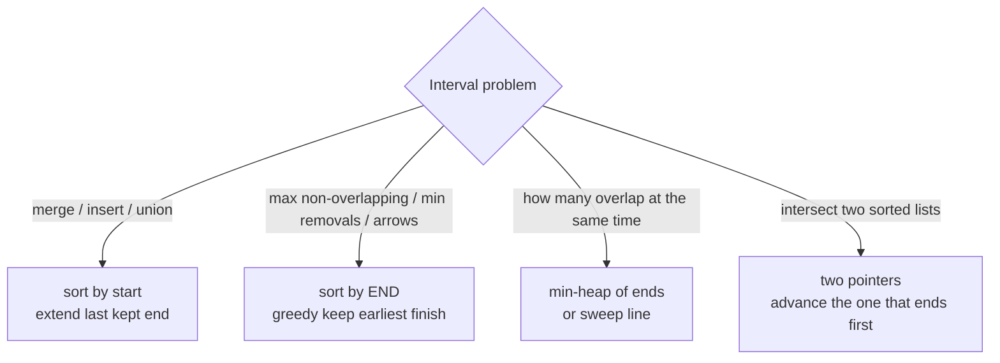

# Intervals

> [!tldr] TL;DR
> Interval problems give you ranges like `[start, end]` and ask you to merge, insert, intersect, count overlaps, or remove the fewest to avoid overlap. The core move is **sort by start** (or by end for greedy selection), then do **one linear pass** comparing each interval with the last one you kept. For "how many overlap at once" (meeting rooms), use a **min-heap of end times** or a **sweep line** over sorted start and end points. Most solutions are O(n log n) for the sort and O(n) after.

## The idea

Two intervals `a = [a1, a2]` and `b = [b1, b2]` either overlap or they do not. Once the list is **sorted by start**, an interval can only overlap with the ones right before it, so you never need to compare all pairs.

```text
sorted by start:
[1,3]   ■■■
[2,6]    ■■■■■         overlaps [1,3]  -> merge into [1,6]
[8,10]         ■■■     starts after 6  -> new group
[15,18]               ■■■■
result: [1,6] [8,10] [15,18]
```

### The overlap test

For **closed** intervals `[s, e]`:

```text
overlap(a, b)  <=>  a.start <= b.end  AND  b.start <= a.end
```

For **half-open** intervals `[s, e)` (typical for meetings and time ranges: a meeting ending at 10:00 does not clash with one starting at 10:00) use strict `<`:

```text
overlap(a, b)  <=>  a.start < b.end  AND  b.start < a.end
```

The intersection, if non-empty, is `[max(a.start, b.start), min(a.end, b.end)]`.



## How it works

1. **Merge**: sort by start. Keep a result list. If the current start is `<=` the last kept end, extend the last end to `max(lastEnd, curEnd)`. Otherwise append.
2. **Insert** into an already sorted, non-overlapping list: copy everything that ends before the new one starts, merge everything that overlaps, copy the rest. O(n), no sort needed.
3. **Intersections of two sorted lists**: two pointers; add the intersection if non-empty, then advance whichever interval ends first.
4. **Minimum removals / maximum non-overlapping set**: sort by **end**, greedily keep an interval if it starts at or after the last kept end. That is classic interval scheduling (proof in [[Greedy]]).
5. **Max concurrent intervals (meeting rooms)**:
   - **Min-heap**: sort by start; heap holds end times of rooms in use. If the earliest ending room is free (`heap.top <= start`), reuse it; otherwise open a new room. Answer is heap size.
   - **Sweep line**: turn each interval into `+1` at start and `-1` at end, sort the events (ends before starts at the same time for half-open), and track the running sum's max. Same result, no heap.

## Complexity

| Operation | Time | Space |
|---|---|---|
| Merge intervals | O(n log n) sort + O(n) | O(n) output (sort may use O(log n) to O(n)) |
| Insert into sorted list | O(n) | O(n) output |
| Overlap test for two intervals | O(1) | O(1) |
| Intersection of two sorted lists (sizes m, n) | O(m + n) | O(m + n) output |
| Min removals (sort by end) | O(n log n) | O(1) extra |
| Meeting rooms II (heap or sweep) | O(n log n) | O(n) |
| Can attend all meetings (sort + check neighbors) | O(n log n) | O(1) extra |

## Template

The merge pass is the template most interval problems start from.

```ts
type Interval = [number, number];

function mergeIntervals(intervals: Interval[]): Interval[] {
  const sorted = intervals.toSorted((a, b) => a[0] - b[0]); // ES2023, does not mutate
  const merged: Interval[] = [];
  for (const [start, end] of sorted) {
    const last = merged.at(-1);
    if (last && start <= last[1]) {
      last[1] = Math.max(last[1], end); // overlap: extend
    } else {
      merged.push([start, end]);        // gap: new group
    }
  }
  return merged;
}

function overlaps(a: Interval, b: Interval): boolean {
  return a[0] <= b[1] && b[0] <= a[1]; // closed intervals
}
```

```python
def merge_intervals(intervals: list[list[int]]) -> list[list[int]]:
    merged: list[list[int]] = []
    for start, end in sorted(intervals, key=lambda iv: iv[0]):
        if merged and start <= merged[-1][1]:
            merged[-1][1] = max(merged[-1][1], end)   # overlap: extend
        else:
            merged.append([start, end])               # gap: new group
    return merged

def overlaps(a: list[int], b: list[int]) -> bool:
    return a[0] <= b[1] and b[0] <= a[1]              # closed intervals
```

## Worked example

**[56. Merge Intervals](https://leetcode.com/problems/merge-intervals/)**: merge all overlapping intervals.

Input `[[1,3],[2,6],[8,10],[15,18]]` (already sorted by start). Expected `[[1,6],[8,10],[15,18]]`.

| step | current | last kept | start <= last end? | action | merged |
|---|---|---|---|---|---|
| 1 | [1,3] | none | n/a | append | `[[1,3]]` |
| 2 | [2,6] | [1,3] | 2 <= 3 yes | end = max(3, 6) = 6 | `[[1,6]]` |
| 3 | [8,10] | [1,6] | 8 <= 6 no | append | `[[1,6],[8,10]]` |
| 4 | [15,18] | [8,10] | 15 <= 10 no | append | `[[1,6],[8,10],[15,18]]` |

Edge case: `[[1,4],[4,5]]` merges into `[[1,5]]` because LeetCode treats touching intervals as overlapping (`<=`). Another: `[[1,4],[2,3]]` gives `[[1,4]]`, which is why you take `max` of the ends instead of just the new end.

Code: the template above is the full solution. Time O(n log n), space O(n).

## More templates

### Insert interval ([57. Insert Interval](https://leetcode.com/problems/insert-interval/))

```ts
function insert(intervals: Interval[], newInterval: Interval): Interval[] {
  const res: Interval[] = [];
  let i = 0;
  const n = intervals.length;
  while (i < n && intervals[i][1] < newInterval[0]) res.push(intervals[i++]); // fully left
  let [s, e] = newInterval;
  while (i < n && intervals[i][0] <= e) {                                     // overlapping
    s = Math.min(s, intervals[i][0]);
    e = Math.max(e, intervals[i][1]);
    i++;
  }
  res.push([s, e]);
  while (i < n) res.push(intervals[i++]);                                     // fully right
  return res;
}
```

```python
def insert(intervals: list[list[int]], new: list[int]) -> list[list[int]]:
    res, i, n = [], 0, len(intervals)
    while i < n and intervals[i][1] < new[0]:     # fully left
        res.append(intervals[i]); i += 1
    s, e = new
    while i < n and intervals[i][0] <= e:         # overlapping
        s, e = min(s, intervals[i][0]), max(e, intervals[i][1]); i += 1
    res.append([s, e])
    res.extend(intervals[i:])                     # fully right
    return res
```

### Intersection of two sorted lists ([986. Interval List Intersections](https://leetcode.com/problems/interval-list-intersections/))

```ts
function intervalIntersection(A: Interval[], B: Interval[]): Interval[] {
  const res: Interval[] = [];
  let i = 0, j = 0;
  while (i < A.length && j < B.length) {
    const lo = Math.max(A[i][0], B[j][0]);
    const hi = Math.min(A[i][1], B[j][1]);
    if (lo <= hi) res.push([lo, hi]);
    if (A[i][1] < B[j][1]) i++; else j++;  // drop the one that ends first
  }
  return res;
}
```

```python
def interval_intersection(A: list[list[int]], B: list[list[int]]) -> list[list[int]]:
    res, i, j = [], 0, 0
    while i < len(A) and j < len(B):
        lo, hi = max(A[i][0], B[j][0]), min(A[i][1], B[j][1])
        if lo <= hi:
            res.append([lo, hi])
        if A[i][1] < B[j][1]:
            i += 1
        else:
            j += 1
    return res
```

### Minimum removals ([435. Non-overlapping Intervals](https://leetcode.com/problems/non-overlapping-intervals/))

Sort by **end**. Keep an interval if it starts at or after the last kept end; otherwise remove it. Touching (`[1,2]` and `[2,3]`) counts as non-overlapping here.

```ts
function eraseOverlapIntervals(intervals: Interval[]): number {
  const sorted = intervals.toSorted((a, b) => a[1] - b[1]);
  let removed = 0, lastEnd = -Infinity;
  for (const [s, e] of sorted) {
    if (s >= lastEnd) lastEnd = e; // keep
    else removed++;                // overlaps the kept one, which ends earlier
  }
  return removed;
}
```

```python
def erase_overlap_intervals(intervals: list[list[int]]) -> int:
    removed, last_end = 0, float("-inf")
    for s, e in sorted(intervals, key=lambda iv: iv[1]):
        if s >= last_end:
            last_end = e
        else:
            removed += 1
    return removed
```

### Meeting rooms ([252](https://leetcode.com/problems/meeting-rooms/) and [253](https://leetcode.com/problems/meeting-rooms-ii/))

> [!note] Premium problems
> 252 Meeting Rooms and 253 Meeting Rooms II are **LeetCode Premium**. Free equivalents: LintCode 920 / 919, or NeetCode's versions of the same problems.

- **252 (can one person attend all?)**: sort by start, return false if any `intervals[i].start < intervals[i-1].end`.
- **253 (minimum rooms)**: maximum number of meetings in progress at the same moment.

Sweep line with two sorted arrays: walk the starts; if the next start is before the earliest unused end, you need a new room, otherwise a room has freed up and you move the end pointer.

```ts
function minMeetingRooms(intervals: Interval[]): number {
  const starts = intervals.map(([s]) => s).sort((a, b) => a - b);
  const ends = intervals.map(([, e]) => e).sort((a, b) => a - b);
  let rooms = 0, j = 0;
  for (const s of starts) {
    if (s < ends[j]) rooms++; // nobody has left yet: open a room
    else j++;                 // a meeting ended at or before s: reuse its room
  }
  return rooms;
}
```

```python
import heapq

def min_meeting_rooms(intervals: list[list[int]]) -> int:
    # Min-heap version: heap holds end times of rooms currently in use.
    heap: list[int] = []
    for s, e in sorted(intervals):
        if heap and heap[0] <= s:
            heapq.heapreplace(heap, e)   # earliest room is free: reuse it
        else:
            heapq.heappush(heap, e)      # all rooms busy: open another
    return len(heap)
```

The heap version also tells you *which* room frees next, which is handy for follow-ups like [2402. Meeting Rooms III](https://leetcode.com/problems/meeting-rooms-iii/). See [[Top-K & Heaps pattern]] for the heap in TS.

## When to use it (recognition signals)

- Input is a list of **pairs** `[start, end]`: meetings, bookings, time ranges, ranges of numbers, balloons, video clips.
- Words like **overlap, merge, conflict, schedule, free time, cover, rooms, arrows, gaps**.
- "Minimum number of resources so nothing clashes" (rooms, platforms, CPUs) is **max concurrency**: heap or sweep line.
- "Maximum number of things that fit" or "fewest to remove" is **interval scheduling**: sort by end, greedy.
- Two already-sorted lists of intervals: **two pointers**.

## Trade-offs & pitfalls

- **Closed vs half-open.** Decide whether `[1,2]` and `[2,3]` overlap. Merge (56) says yes; non-overlapping (435) and meetings say no. The difference is `<=` versus `<`.
- **Sort key.** Merge and insert sort by start. Maximum non-overlapping and minimum arrows sort by **end**. Sorting 435 by start without extra care gives wrong answers.
- **Take `max` of ends when merging.** A long interval can swallow later short ones: `[[1,10],[2,3]]`.
- **Mutation.** `merged[-1][1] = ...` mutates lists that may alias the input. `Array.prototype.sort` also mutates; use `toSorted` (ES2023) or copy.
- **JS numeric sort.** `.sort()` without a comparator sorts `[10, 9]` as strings. Always pass `(a, b) => a - b`.
- **Sweep line tie-breaking.** When using `(time, +1/-1)` events, process `-1` before `+1` at the same time for half-open intervals, or you overcount rooms.
- **Empty input** and single intervals: make sure the code returns `[]` / `0` without indexing `ends[0]` on an empty array.

## Senior perspective

- **Calendars and booking systems** (room booking, doctor appointments, hotel nights) are interval problems with persistence. Databases solve them with range types and exclusion constraints: PostgreSQL `tstzrange` with an `EXCLUDE USING gist (room WITH =, during WITH &&)` constraint prevents double booking at the storage layer, which is safer than checking in application code (race conditions).
- **Interval trees and segment trees** answer "which intervals contain point x / overlap range r" in O(log n + k) when intervals change over time. Sorting once is only fine for static batches.
- **Sweep line** is a general technique: rectangle union area, skyline ([218. The Skyline Problem](https://leetcode.com/problems/the-skyline-problem/)), and resource usage graphs all use sorted events plus a running structure.
- **Time zones and DST** break naive interval math in real products. Store UTC instants, and treat intervals as half-open `[start, end)` so adjacent slots do not collide.
- **In review**, ask: are bounds inclusive? Can `start == end` (zero-length)? Is input already sorted (skip the O(n log n))? Is the list big enough that a streaming merge is needed?
- **In interviews**, draw a number line first. Clarify inclusivity, then state "sort by start, one pass", and mention the heap vs sweep line choice for concurrency.

## Classic LeetCode problems

| # | Problem | Difficulty | Key idea |
|---|---|---|---|
| 56 | [Merge Intervals](https://leetcode.com/problems/merge-intervals/) | Medium | sort by start, extend last end |
| 57 | [Insert Interval](https://leetcode.com/problems/insert-interval/) | Medium | left part, merge middle, right part, O(n) |
| 435 | [Non-overlapping Intervals](https://leetcode.com/problems/non-overlapping-intervals/) | Medium | sort by end, greedy keep |
| 452 | [Minimum Number of Arrows to Burst Balloons](https://leetcode.com/problems/minimum-number-of-arrows-to-burst-balloons/) | Medium | sort by end, shoot at the end, closed intervals |
| 986 | [Interval List Intersections](https://leetcode.com/problems/interval-list-intersections/) | Medium | two pointers, advance earlier end |
| 253 | [Meeting Rooms II](https://leetcode.com/problems/meeting-rooms-ii/) | Medium (Premium) | min-heap of ends or sweep line |

Also: [252. Meeting Rooms](https://leetcode.com/problems/meeting-rooms/) (Easy, Premium).

## Interview questions

> [!question]- Why sort by start for merging but by end for "maximum non-overlapping"?
> Merging needs every overlapping group to be contiguous, which sorting by start guarantees. For selection, choosing the interval that **finishes earliest** leaves the most room for the rest; an exchange argument shows it never hurts. Sorting by start can pick one long interval that blocks many short ones.

> [!question]- How do you test whether two intervals overlap?
> `a.start <= b.end && b.start <= a.end` for closed intervals, or with `<` for half-open. Equivalently, they do not overlap if one ends before the other starts.

> [!question]- Meeting Rooms II: heap or sweep line?
> Both are O(n log n). The sweep line with two sorted arrays is shorter and has smaller constants. The min-heap keeps track of which room frees next, so it extends naturally to follow-ups (assign room ids, Meeting Rooms III).

> [!question]- Insert Interval: why is it O(n) and not O(n log n)?
> The input is already sorted and non-overlapping, so a single pass finds the three regions (left, overlapping, right). You could binary search for the boundaries, but building the output is still O(n).

> [!question]- Given each employee's sorted busy intervals, find common free time.
> Merge all intervals (k-way merge with a heap, or flatten and sort), then the gaps between consecutive merged intervals are the free slots. This is 759 Employee Free Time (Premium).

> [!question]- How would you prevent double bookings in a real system?
> Enforce it in the database: a range column plus an exclusion constraint (PostgreSQL `EXCLUDE USING gist` with `&&`), or a unique slot table with row locks. Checking overlaps in application code alone races under concurrency.

## Related
- [[DSA Index]]
- [[Greedy]] (interval scheduling proof) · [[Top-K & Heaps pattern]] · [[Heaps & Priority Queues]]
- [[Sorting Algorithms]] · [[Two Pointers]] · [[Prefix Sum]] (difference arrays are a sweep line on integers)
- [[Arrays & Strings]] · [[Big-O & Complexity Analysis]]

## Sources
- [Tech Interview Handbook: Interval](https://www.techinterviewhandbook.org/algorithms/interval/)
- [LeetCode's Interview Crash Course](https://leetcode.com/explore/interview/card/leetcodes-interview-crash-course-data-structures-and-algorithms/)
- Kleinberg & Tardos, *Algorithm Design*, Pearson 2005, ch. 4 (interval scheduling, interval partitioning)
- Cormen et al., *Introduction to Algorithms*, 4th ed., MIT Press 2022 (activity selection, interval trees)
- [PostgreSQL docs: Range types and exclusion constraints](https://www.postgresql.org/docs/current/rangetypes.html)
- [MDN: Array.prototype.toSorted](https://developer.mozilla.org/en-US/docs/Web/JavaScript/Reference/Global_Objects/Array/toSorted)
- [NeetCode roadmap](https://neetcode.io/roadmap)
