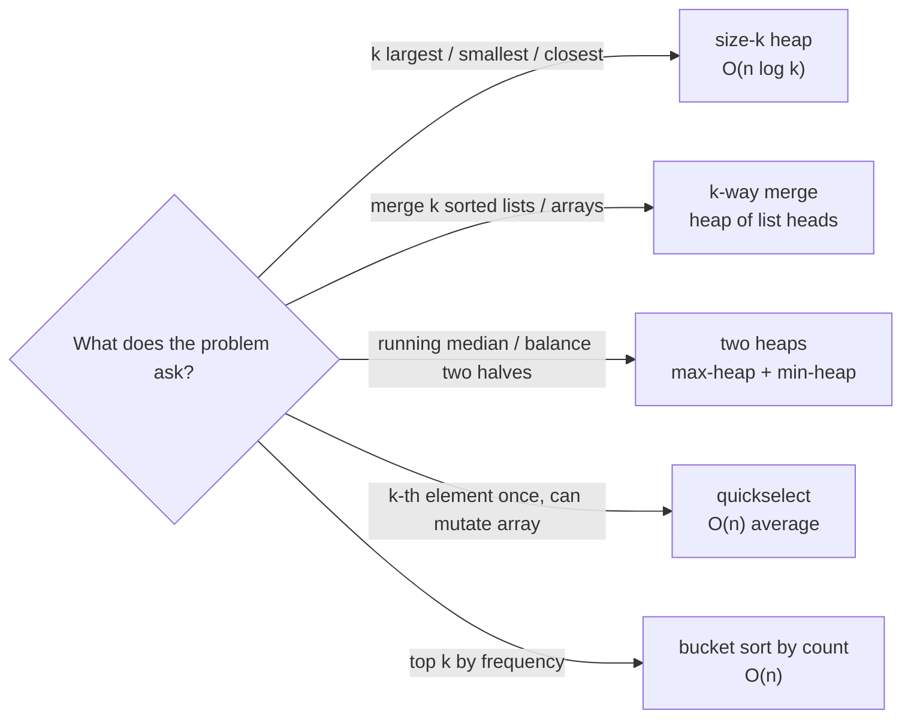

# Top-K & Heaps pattern

<Note>
**TL;DR**

When a problem asks for the **k largest / smallest / most frequent / closest** items, keep a **heap of size k** instead of sorting everything: O(n log k) time, O(k) space. The same tool gives you **k-way merge** (a heap holding one "head" per sorted list) and the **two heaps** trick for a running median. When you only need the k-th element once, **quickselect** is O(n) on average, and for "top-k frequent" a **bucket sort** by frequency is O(n).
</Note>

## The idea

A heap always gives you the best item at the top in O(1) and lets you add or remove in O(log n) (see [Heaps & Priority Queues](/Software%20Engineering/DSA/02%20Data%20Structures/Heaps%20%26%20Priority%20Queues)). The trick for top-k is counter-intuitive:

- To keep the **k largest**, use a **min-heap** of size k. The top is the *smallest of the winners*, the one to kick out when something bigger arrives.
- To keep the **k smallest**, use a **max-heap** of size k.

```text
stream: 3 2 1 5 6 4      k = 2      (min-heap, top on the left)

push 3  -> [3]
push 2  -> [2, 3]
push 1  -> [1, 2, 3]  size 3 > k, pop 1  -> [2, 3]
push 5  -> [2, 3, 5]  pop 2              -> [3, 5]
push 6  -> [3, 5, 6]  pop 3              -> [5, 6]
push 4  -> [4, 5, 6]  pop 4              -> [5, 6]
top = 5 = 2nd largest
```

The heap is a "bouncer" with k spots: the weakest member is always at the door.



## How it works

### 1. Size-k heap
Push every item; whenever the heap grows past k, pop the top. At the end the heap holds exactly the answer. Each element costs one push and at most one pop on a heap of size k, so O(log k).

### 2. K-way merge
You have k sorted lists. Put the **first element of each list** in a min-heap, keyed by value. Pop the smallest, emit it, and push the **next element from the same list**. The heap never holds more than k items, so merging N total items costs O(N log k). This is how external merge sort, LSM-tree compaction and "merge k sorted streams" work.

### 3. Two heaps (running median)
Split the numbers into a **lower half** (max-heap `lo`) and an **upper half** (min-heap `hi`), keeping `len(lo) == len(hi)` or `len(lo) == len(hi) + 1`. The median is `lo.top` (odd count) or the average of both tops (even count). Each insert is O(log n), each median query O(1).

```text
lower half (max-heap)    |   upper half (min-heap)
   [1, 2, 3]  top = 3    |   top = 4  [4, 5]
                  median = 3 (lo has one extra)
```

### 4. Quickselect (alternative)
Partition like quicksort around a random pivot, then recurse into **only the side that contains index k**. Average O(n), worst O(n²) (rare with a random pivot). It mutates the input and does not give you the items in order.

### 5. Bucket sort for "top k frequent"
Frequencies are bounded by n, so create `n + 1` buckets indexed by count, drop each value into its bucket, and walk from the highest count down until you have k values. O(n) time and space.

## Complexity

| Technique | Time | Space | Notes |
|---|---|---|---|
| Sort everything, take k | O(n log n) | O(n) or O(1) | simplest baseline |
| Size-k heap | O(n log k) | O(k) | works on streams; best when k is much less than n |
| Heapify all n, pop k times | O(n + k log n) | O(n) | `heapq.nlargest` picks between strategies |
| K-way merge (N items, k lists) | O(N log k) | O(k) | plus output |
| Two heaps: add / median | O(log n) / O(1) | O(n) | |
| Quickselect | avg O(n), worst O(n²) | O(1) iterative | mutates input; median-of-medians gives worst O(n) but is slow in practice |
| Bucket sort by frequency | O(n) | O(n) | only when keys are small integers (counts) |

## Template

JavaScript and TypeScript have **no built-in heap**. Interviews usually let you write a small one (or assume one exists, e.g. LeetCode ships `@datastructures-js/priority-queue`). Here is a minimal generic binary heap used by all TS examples in this note.

```ts
// Minimal binary heap. less(a, b) === true means a should be closer to the top.
class Heap<T> {
  private a: T[] = [];
  constructor(private less: (x: T, y: T) => boolean) {}

  get size(): number { return this.a.length; }
  peek(): T | undefined { return this.a[0]; }

  push(x: T): void {
    const a = this.a;
    a.push(x);
    let i = a.length - 1;
    while (i > 0) {
      const p = (i - 1) >> 1;
      if (!this.less(a[i], a[p])) break;
      [a[i], a[p]] = [a[p], a[i]];
      i = p;
    }
  }

  pop(): T | undefined {
    const a = this.a;
    if (a.length === 0) return undefined;
    const top = a[0];
    const last = a.pop()!;
    if (a.length > 0) {
      a[0] = last;
      let i = 0;
      for (;;) {
        const l = 2 * i + 1, r = l + 1;
        let m = i;
        if (l < a.length && this.less(a[l], a[m])) m = l;
        if (r < a.length && this.less(a[r], a[m])) m = r;
        if (m === i) break;
        [a[i], a[m]] = [a[m], a[i]];
        i = m;
      }
    }
    return top;
  }
}

// Top-k largest: min-heap of size k.
function topKLargest(nums: number[], k: number): number[] {
  const heap = new Heap<number>((a, b) => a < b);
  for (const x of nums) {
    heap.push(x);
    if (heap.size > k) heap.pop(); // evict the weakest winner
  }
  const out: number[] = [];
  while (heap.size > 0) out.push(heap.pop()!);
  return out.reverse(); // largest first
}
```

```python
import heapq

def top_k_largest(nums: list[int], k: int) -> list[int]:
    heap: list[int] = []          # min-heap
    for x in nums:
        heapq.heappush(heap, x)
        if len(heap) > k:
            heapq.heappop(heap)   # evict the weakest winner
    return sorted(heap, reverse=True)

# One-liners from the standard library:
# heapq.nlargest(k, nums)   heapq.nsmallest(k, nums, key=...)
# For "push then pop" in one O(log k) step: heapq.heappushpop(heap, x)
```

For the "k closest / k smallest by key" variant, key the heap by a tuple: `(-distance, x, y)` in Python (negated so a min-heap acts as a max-heap), or a comparator in TS.

<Info>
**🆕 2025–2026**

**Python 3.14** (released 2025-10-07) added public max-heap functions to `heapq`: `heapify_max`, `heappush_max`, `heappop_max`, `heapreplace_max` and `heappushpop_max`. Before 3.14 the idiom is to **negate** values (`heappush(h, -x)`) or push tuples with a negated key. Negation still works and is what you will see in most interview solutions; on 3.14+ the `_max` functions are clearer.
```python
# Python 3.14+
import heapq
lo: list[int] = []
heapq.heappush_max(lo, 5)
heapq.heappush_max(lo, 9)
heapq.heappop_max(lo)   # 9
```
</Info>

## Worked example

**[215. Kth Largest Element in an Array](https://leetcode.com/problems/kth-largest-element-in-an-array/)**: return the k-th largest element (in sorted order, duplicates count).

Input `nums = [3, 2, 1, 5, 6, 4]`, `k = 2`. Expected `5`.

Plan: min-heap of size k. After processing everything, the top is the k-th largest.

| step | x | heap after push | size > k? | heap after pop |
|---|---|---|---|---|
| 1 | 3 | [3] | no | [3] |
| 2 | 2 | [2, 3] | no | [2, 3] |
| 3 | 1 | [1, 2, 3] | yes, pop 1 | [2, 3] |
| 4 | 5 | [2, 3, 5] | yes, pop 2 | [3, 5] |
| 5 | 6 | [3, 5, 6] | yes, pop 3 | [5, 6] |
| 6 | 4 | [4, 5, 6] | yes, pop 4 | [5, 6] |

Answer: top of heap = **5**. Time O(n log k), space O(k).

```ts
function findKthLargest(nums: number[], k: number): number {
  const heap = new Heap<number>((a, b) => a < b); // min-heap
  for (const x of nums) {
    heap.push(x);
    if (heap.size > k) heap.pop();
  }
  return heap.peek()!;
}
```

```python
import heapq

def find_kth_largest(nums: list[int], k: int) -> int:
    heap = nums[:k]
    heapq.heapify(heap)                  # O(k)
    for x in nums[k:]:
        if x > heap[0]:
            heapq.heapreplace(heap, x)   # pop + push in one sift
    return heap[0]
```

### Alternative: quickselect (average O(n))

The k-th largest is the element at index `n - k` in ascending order. Partition, then keep only the side containing that index.

```ts
function findKthLargestQS(nums: number[], k: number): number {
  const target = nums.length - k;
  let lo = 0, hi = nums.length - 1;
  while (true) {
    const p = lo + Math.floor(Math.random() * (hi - lo + 1));
    [nums[p], nums[hi]] = [nums[hi], nums[p]];
    const pivot = nums[hi];
    let store = lo;
    for (let i = lo; i < hi; i++) {
      if (nums[i] < pivot) {
        [nums[store], nums[i]] = [nums[i], nums[store]];
        store++;
      }
    }
    [nums[store], nums[hi]] = [nums[hi], nums[store]]; // pivot in final place
    if (store === target) return nums[store];
    if (store < target) lo = store + 1;
    else hi = store - 1;
  }
}
```

```python
import random

def find_kth_largest_qs(nums: list[int], k: int) -> int:
    target = len(nums) - k
    lo, hi = 0, len(nums) - 1
    while True:
        p = random.randint(lo, hi)
        nums[p], nums[hi] = nums[hi], nums[p]
        pivot, store = nums[hi], lo
        for i in range(lo, hi):
            if nums[i] < pivot:
                nums[store], nums[i] = nums[i], nums[store]
                store += 1
        nums[store], nums[hi] = nums[hi], nums[store]
        if store == target:
            return nums[store]
        if store < target:
            lo = store + 1
        else:
            hi = store - 1
```

## More templates

### K-way merge ([23. Merge k Sorted Lists](https://leetcode.com/problems/merge-k-sorted-lists/))

```ts
class ListNode {
  constructor(public val = 0, public next: ListNode | null = null) {}
}

function mergeKLists(lists: Array<ListNode | null>): ListNode | null {
  const heap = new Heap<ListNode>((a, b) => a.val < b.val);
  for (const node of lists) if (node) heap.push(node);
  const dummy = new ListNode();
  let tail = dummy;
  while (heap.size > 0) {
    const node = heap.pop()!;
    tail.next = node;
    tail = node;
    if (node.next) heap.push(node.next); // next item from the same list
  }
  return dummy.next;
}
```

```python
import heapq

def merge_k_lists(lists):
    # (value, list index, node): the index breaks ties, since ListNode is not comparable
    heap = [(node.val, i, node) for i, node in enumerate(lists) if node]
    heapq.heapify(heap)
    dummy = tail = ListNode()
    while heap:
        _, i, node = heapq.heappop(heap)
        tail.next = node
        tail = node
        if node.next:
            heapq.heappush(heap, (node.next.val, i, node.next))
    return dummy.next
```

### Two heaps ([295. Find Median from Data Stream](https://leetcode.com/problems/find-median-from-data-stream/))

Always route a new number through `lo` into `hi`, then rebalance. This keeps every element of `lo` at most every element of `hi`.

```ts
class MedianFinder {
  private lo = new Heap<number>((a, b) => a > b); // max-heap: lower half
  private hi = new Heap<number>((a, b) => a < b); // min-heap: upper half

  addNum(num: number): void {
    this.lo.push(num);
    this.hi.push(this.lo.pop()!);
    if (this.hi.size > this.lo.size) this.lo.push(this.hi.pop()!);
  }

  findMedian(): number {
    if (this.lo.size > this.hi.size) return this.lo.peek()!;
    return (this.lo.peek()! + this.hi.peek()!) / 2;
  }
}
```

```python
import heapq

class MedianFinder:
    def __init__(self) -> None:
        self.lo: list[int] = []   # max-heap via negation
        self.hi: list[int] = []   # min-heap

    def addNum(self, num: int) -> None:
        heapq.heappush(self.lo, -num)
        heapq.heappush(self.hi, -heapq.heappop(self.lo))
        if len(self.hi) > len(self.lo):
            heapq.heappush(self.lo, -heapq.heappop(self.hi))

    def findMedian(self) -> float:
        if len(self.lo) > len(self.hi):
            return -self.lo[0]
        return (-self.lo[0] + self.hi[0]) / 2
```

### Bucket sort ([347. Top K Frequent Elements](https://leetcode.com/problems/top-k-frequent-elements/))

```ts
function topKFrequent(nums: number[], k: number): number[] {
  const count = new Map<number, number>();
  for (const x of nums) count.set(x, (count.get(x) ?? 0) + 1);
  const buckets: number[][] = Array.from({ length: nums.length + 1 }, () => []);
  for (const [num, c] of count) buckets[c].push(num);
  const res: number[] = [];
  for (let c = buckets.length - 1; c > 0 && res.length < k; c--) {
    for (const num of buckets[c]) {
      res.push(num);
      if (res.length === k) break;
    }
  }
  return res;
}
```

```python
from collections import Counter

def top_k_frequent(nums: list[int], k: int) -> list[int]:
    count = Counter(nums)
    buckets: list[list[int]] = [[] for _ in range(len(nums) + 1)]
    for num, c in count.items():
        buckets[c].append(num)
    res: list[int] = []
    for c in range(len(buckets) - 1, 0, -1):
        for num in buckets[c]:
            res.append(num)
            if len(res) == k:
                return res
    return res

# Heap version, O(n log k): heapq.nlargest(k, count.keys(), key=count.get)
```

## When to use it (recognition signals)

- The words **"k-th", "top k", "k largest / smallest", "k closest", "k most frequent"**.
- A **stream** or data too large to sort in memory, where you only keep a small summary.
- **"Merge k sorted ..."** lists, arrays, files, or iterators; "smallest range covering k lists".
- **"Median"** of a growing set or a sliding window; anything that needs the boundary between a lower and upper half.
- Repeatedly needing **"the current best"** while items are added (scheduling, Dijkstra, event simulation).
- If you only need the answer **once**, input fits in memory and order does not matter, consider quickselect.

## Trade-offs & pitfalls

- **Wrong heap direction.** k largest needs a *min*-heap; k smallest needs a *max*-heap. Say it out loud before coding.
- **Python has only a min-heap** before 3.14. Negate numbers, or push `(-key, item)`. Negating does not work for strings; use a wrapper class with `__lt__` or the key tuple.
- **Uncomparable payloads in Python.** `(priority, node)` crashes on ties if `node` has no `<`. Add a unique counter as the second tuple field.
- **Off-by-one on k.** Pop when `size > k`, not `>= k`. Quickselect target is `n - k` for the k-th largest.
- **Quickselect worst case.** Always randomize the pivot. With many duplicates, Lomuto partition degrades toward O(n²); use a three-way (Dutch flag) partition.
- **Quickselect mutates input.** Copy first if the caller needs the original order.
- **Two heaps imbalance.** Rebalance after every insert. For a *sliding window* median you also need deletions: use lazy deletion (a "to-delete" map checked when popping) or a sorted container.
- **JS sort gotcha** in the baseline: `arr.sort()` sorts numbers as strings. Use `arr.sort((a, b) => a - b)` or `toSorted`.

## Senior perspective

- **Real systems use this constantly.** Priority queues run OS and job schedulers, timers (Node's timer lists, Go's timer heap), Dijkstra/A* routing, and event-driven simulations. K-way merge powers external sort, LSM-tree compaction (RocksDB, Cassandra) and merging sorted shards in search engines.
- **Top-k at scale** is often approximate: Count-Min Sketch plus a heap for "heavy hitters", or the Space-Saving algorithm, when exact counts do not fit in memory. Distributed top-k is "local top-k per shard, then merge", which is correct for max/min but needs care for frequency (a global heavy hitter can be locally small).
- **Constant factors matter.** A heap is an array, so it is cache friendly, but each sift jumps around. For small k, a sorted array with insertion can beat a heap. For "give me everything sorted", just sort.
- **Streaming and memory.** A size-k heap is O(k) memory no matter how large the stream is. That is the answer to "what if the data does not fit in RAM?".
- **In review**, a senior asks: is k bounded? Do ties matter and are they deterministic? Is the comparator a strict weak ordering? Are we allocating a tuple per push in a hot loop?
- **In interviews**, state the baseline (sort, O(n log n)), then the heap (O(n log k)), then mention quickselect (O(n) average) and its trade-offs. That progression shows range.

## Classic LeetCode problems

| # | Problem | Difficulty | Key idea |
|---|---|---|---|
| 215 | [Kth Largest Element in an Array](https://leetcode.com/problems/kth-largest-element-in-an-array/) | Medium | size-k min-heap or quickselect |
| 703 | [Kth Largest Element in a Stream](https://leetcode.com/problems/kth-largest-element-in-a-stream/) | Easy | persistent size-k min-heap |
| 347 | [Top K Frequent Elements](https://leetcode.com/problems/top-k-frequent-elements/) | Medium | counter + heap, or bucket sort O(n) |
| 973 | [K Closest Points to Origin](https://leetcode.com/problems/k-closest-points-to-origin/) | Medium | max-heap of size k keyed by squared distance |
| 23 | [Merge k Sorted Lists](https://leetcode.com/problems/merge-k-sorted-lists/) | Hard | k-way merge with heap of list heads |
| 295 | [Find Median from Data Stream](https://leetcode.com/problems/find-median-from-data-stream/) | Hard | two heaps, keep sizes balanced |

## Interview questions

<Accordion title="Why a min-heap to find the k largest elements?">
The heap holds the current k best candidates. The one to evict when a better element arrives is the *smallest* of them, and a min-heap exposes exactly that at the top in O(1), with O(log k) removal.
</Accordion>

<Accordion title="Heap vs sort vs quickselect for &quot;k-th largest&quot;: which and when?">
Sort: O(n log n), simplest, fine for small n. Heap: O(n log k), O(k) memory, works on streams and does not mutate input. Quickselect: O(n) average but O(n²) worst, mutates the array, needs all data in memory. Pick the heap for streams or small k, quickselect for one-off queries on an in-memory array.
</Accordion>

<Accordion title="What is the complexity of merging k sorted lists with N total nodes?">
O(N log k) time: each node is pushed and popped once on a heap of at most k items. O(k) extra space. Pairwise divide-and-conquer merging also gives O(N log k); merging lists one by one is O(N k).
</Accordion>

<Accordion title="How does the two-heaps median work, and what invariant do you keep?">
Max-heap for the lower half, min-heap for the upper half. Invariants: every element in `lo` is at most every element in `hi`, and `len(lo)` equals `len(hi)` or `len(hi) + 1`. The median is the top of `lo`, or the average of both tops. Insert O(log n), query O(1).
</Accordion>

<Accordion title="How do you get a max-heap in Python?">
Before 3.14: push negated values (`-x`) or tuples with a negated key. From Python 3.14 (Oct 2025), `heapq` has `heappush_max`, `heappop_max`, `heapify_max`, `heapreplace_max` and `heappushpop_max`.
</Accordion>

<Accordion title="Top-k frequent in better than O(n log k)?">
Yes. Counts are between 1 and n, so bucket by count into an array of n + 1 lists and read from the highest bucket down: O(n) time and space.
</Accordion>

<Accordion title="The data is a 1 TB log file. Find the 100 most frequent IPs.">
Hash-partition lines by IP into files that fit in memory (same IP always lands in the same file), count each file with a hash map and keep a size-100 min-heap per file, then merge the per-file candidates with one more size-100 heap. If approximate is fine, use Count-Min Sketch plus a heap in one pass.
</Accordion>

## Related
- [DSA Index](/Software%20Engineering/DSA/DSA%20Index)
- [Heaps & Priority Queues](/Software%20Engineering/DSA/02%20Data%20Structures/Heaps%20%26%20Priority%20Queues) · [Sorting Algorithms](/Software%20Engineering/DSA/03%20Algorithms/Sorting%20Algorithms) · [Hash Tables](/Software%20Engineering/DSA/02%20Data%20Structures/Hash%20Tables) · [Linked Lists](/Software%20Engineering/DSA/02%20Data%20Structures/Linked%20Lists)
- [Intervals](/Software%20Engineering/DSA/04%20Patterns/Intervals) (meeting rooms with a min-heap) · [Greedy](/Software%20Engineering/DSA/04%20Patterns/Greedy) (task scheduler) · [Graph BFS-DFS patterns](/Software%20Engineering/DSA/04%20Patterns/Graph%20BFS-DFS%20patterns) (Dijkstra uses a heap)
- [Big-O & Complexity Analysis](/Software%20Engineering/DSA/01%20Foundations/Big-O%20%26%20Complexity%20Analysis) · [Problem Solving](/Software%20Engineering/DSA/01%20Foundations/Problem%20Solving)

## Sources
- [Python docs: heapq](https://docs.python.org/3/library/heapq.html)
- [What's New in Python 3.14 (heapq max-heap functions)](https://docs.python.org/3/whatsnew/3.14.html)
- Cormen, Leiserson, Rivest, Stein, *Introduction to Algorithms*, 4th ed., MIT Press 2022 (heaps, priority queues, order statistics)
- [Sedgewick & Wayne, Algorithms 4th ed.: Priority Queues](https://algs4.cs.princeton.edu/24pq/)
- [cp-algorithms: K-th order statistic in O(N)](https://cp-algorithms.com/sequences/k-th.html)
- [Tech Interview Handbook: Heap](https://www.techinterviewhandbook.org/algorithms/heap/)
- [NeetCode roadmap](https://neetcode.io/roadmap)
