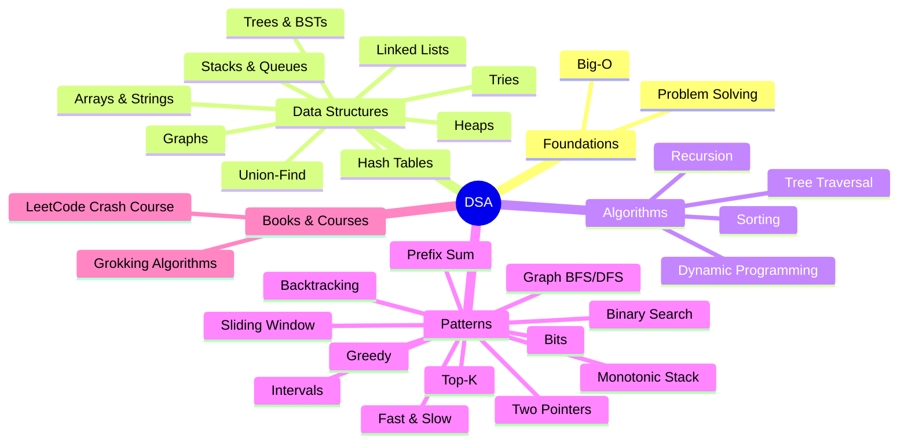

# DSA Index

<Note>
**Start here**

Entry point for Data Structures & Algorithms and coding-interview prep. Notes go from foundations (Big-O, how to approach a problem) through the core data structures and algorithms to the ~12 **patterns** that cover most interview questions. Every topic note has a complexity table, TypeScript and Python code, classic LeetCode problems and interview questions; every pattern note has a template, a worked example and practice problems.
</Note>

## 🧭 Quick links
- 🎯 Interview mode: [Problem Solving](/Software%20Engineering/DSA/01%20Foundations/Problem%20Solving) → the [Patterns → problems](#patterns--problems) table → a curated list (below)
- 📐 Cheat sheet: [Big-O & Complexity Analysis](/Software%20Engineering/DSA/01%20Foundations/Big-O%20%26%20Complexity%20Analysis#common-complexities-cheat-sheet)
- 📚 [Grokking Algorithms](/Software%20Engineering/DSA/05%20Books%20%26%20Courses/Grokking%20Algorithms) (book) · [LeetCode Crash Course](/Software%20Engineering/DSA/05%20Books%20%26%20Courses/LeetCode%20Crash%20Course) (course map) · [Data structure & Algorithms](/Software%20Engineering/DSA/Data%20structure%20%26%20Algorithms) (old overview, maps the original sections to the new notes)

## 01 Foundations (beginner)
- [Big-O & Complexity Analysis](/Software%20Engineering/DSA/01%20Foundations/Big-O%20%26%20Complexity%20Analysis): time/space, amortized, what `n` you can afford, Master Theorem
- [Problem Solving](/Software%20Engineering/DSA/01%20Foundations/Problem%20Solving): the UMPIRE interview framework, clarifying questions, brute force → optimize, testing, AI-era interviews

## 02 Data Structures
| Beginner | Intermediate | Advanced |
|---|---|---|
| [Arrays & Strings](/Software%20Engineering/DSA/02%20Data%20Structures/Arrays%20%26%20Strings) | [Trees & Binary Search Trees](/Software%20Engineering/DSA/02%20Data%20Structures/Trees%20%26%20Binary%20Search%20Trees) | [Graphs](/Software%20Engineering/DSA/02%20Data%20Structures/Graphs) |
| [Linked Lists](/Software%20Engineering/DSA/02%20Data%20Structures/Linked%20Lists) | [Heaps & Priority Queues](/Software%20Engineering/DSA/02%20Data%20Structures/Heaps%20%26%20Priority%20Queues) | [Tries](/Software%20Engineering/DSA/02%20Data%20Structures/Tries) |
| [Stacks & Queues](/Software%20Engineering/DSA/02%20Data%20Structures/Stacks%20%26%20Queues) | | [Union-Find](/Software%20Engineering/DSA/02%20Data%20Structures/Union-Find) |
| [Hash Tables](/Software%20Engineering/DSA/02%20Data%20Structures/Hash%20Tables) | | |

## 03 Algorithms
| Beginner | Intermediate | Advanced |
|---|---|---|
| [Recursion & Backtracking](/Software%20Engineering/DSA/03%20Algorithms/Recursion%20%26%20Backtracking) | [Tree Traversal - DFS & BFS](/Software%20Engineering/DSA/03%20Algorithms/Tree%20Traversal%20-%20DFS%20%26%20BFS) | [Dynamic Programming](/Software%20Engineering/DSA/03%20Algorithms/Dynamic%20Programming) |
| [Sorting Algorithms](/Software%20Engineering/DSA/03%20Algorithms/Sorting%20Algorithms) | | |

## 04 Patterns
| Beginner | Intermediate | Advanced |
|---|---|---|
| [Two Pointers](/Software%20Engineering/DSA/04%20Patterns/Two%20Pointers) | [Fast and Slow Pointer](/Software%20Engineering/DSA/04%20Patterns/Fast%20and%20Slow%20Pointer) | [Monotonic Stack & Queue](/Software%20Engineering/DSA/04%20Patterns/Monotonic%20Stack%20%26%20Queue) |
| [Sliding Window](/Software%20Engineering/DSA/04%20Patterns/Sliding%20Window) | [Top-K & Heaps pattern](/Software%20Engineering/DSA/04%20Patterns/Top-K%20%26%20Heaps%20pattern) | [Backtracking](/Software%20Engineering/DSA/04%20Patterns/Backtracking) |
| [Prefix Sum](/Software%20Engineering/DSA/04%20Patterns/Prefix%20Sum) | [Intervals](/Software%20Engineering/DSA/04%20Patterns/Intervals) | [Greedy](/Software%20Engineering/DSA/04%20Patterns/Greedy) |
| [Binary Search](/Software%20Engineering/DSA/04%20Patterns/Binary%20Search) | [Graph BFS-DFS patterns](/Software%20Engineering/DSA/04%20Patterns/Graph%20BFS-DFS%20patterns) | [Bit Manipulation](/Software%20Engineering/DSA/04%20Patterns/Bit%20Manipulation) |

## 05 Books & Courses
- [Grokking Algorithms](/Software%20Engineering/DSA/05%20Books%20%26%20Courses/Grokking%20Algorithms): illustrated intro, chapter by chapter
- [LeetCode Crash Course](/Software%20Engineering/DSA/05%20Books%20%26%20Courses/LeetCode%20Crash%20Course): LeetCode's Explore card, mapped to the notes here

## Patterns → problems
How to read it: spot the **signal** in the problem statement, reach for the **pattern**, practise with the **problems** (LeetCode numbers, easiest first).

| Pattern | Signals | Classic problems |
|---|---|---|
| [Hashing](/Software%20Engineering/DSA/02%20Data%20Structures/Hash%20Tables) | "seen before?", counts, pairs to a target, grouping | 1 Two Sum · 217 Contains Duplicate · 242 Valid Anagram · 49 Group Anagrams · 128 Longest Consecutive Sequence |
| [Two Pointers](/Software%20Engineering/DSA/04%20Patterns/Two%20Pointers) | sorted array, pairs/triplets, palindromes, in-place partition | 125 Valid Palindrome · 167 Two Sum II · 15 3Sum · 11 Container With Most Water · 42 Trapping Rain Water |
| [Sliding Window](/Software%20Engineering/DSA/04%20Patterns/Sliding%20Window) | longest/shortest **contiguous** subarray or substring with a condition | 643 Maximum Average Subarray I · 209 Minimum Size Subarray Sum · 3 Longest Substring Without Repeating Characters · 424 Longest Repeating Character Replacement · 76 Minimum Window Substring |
| [Prefix Sum](/Software%20Engineering/DSA/04%20Patterns/Prefix%20Sum) | range sums, "subarray sum equals k", products except self | 303 Range Sum Query · 238 Product of Array Except Self · 560 Subarray Sum Equals K · 525 Contiguous Array · 304 Range Sum Query 2D |
| [Binary Search](/Software%20Engineering/DSA/04%20Patterns/Binary%20Search) | sorted input, "minimum X such that...", O(log n) required | 704 Binary Search · 35 Search Insert Position · 153 Find Minimum in Rotated Sorted Array · 33 Search in Rotated Sorted Array · 875 Koko Eating Bananas · 4 Median of Two Sorted Arrays |
| [Fast and Slow Pointer](/Software%20Engineering/DSA/04%20Patterns/Fast%20and%20Slow%20Pointer) | linked list cycle, middle, "number sequence loops" | 876 Middle of the Linked List · 141 Linked List Cycle · 202 Happy Number · 142 Linked List Cycle II · 287 Find the Duplicate Number |
| [Linked list manipulation](/Software%20Engineering/DSA/02%20Data%20Structures/Linked%20Lists) | reverse, merge, reorder, dummy head | 206 Reverse Linked List · 21 Merge Two Sorted Lists · 19 Remove Nth Node From End · 143 Reorder List · 146 LRU Cache |
| [Monotonic Stack & Queue](/Software%20Engineering/DSA/04%20Patterns/Monotonic%20Stack%20%26%20Queue) | next greater/smaller, spans, histogram, window max | 20 Valid Parentheses (plain stack) · 496 Next Greater Element I · 739 Daily Temperatures · 84 Largest Rectangle in Histogram · 239 Sliding Window Maximum |
| [Top-K & Heaps pattern](/Software%20Engineering/DSA/04%20Patterns/Top-K%20%26%20Heaps%20pattern) | k largest/smallest/most frequent, merge k sorted, running median | 215 Kth Largest Element · 973 K Closest Points to Origin · 347 Top K Frequent Elements · 23 Merge k Sorted Lists · 295 Find Median from Data Stream |
| [Intervals](/Software%20Engineering/DSA/04%20Patterns/Intervals) | ranges, meetings, overlaps, calendars | 56 Merge Intervals · 57 Insert Interval · 435 Non-overlapping Intervals · 986 Interval List Intersections · 253 Meeting Rooms II (premium) |
| [Trees](/Software%20Engineering/DSA/03%20Algorithms/Tree%20Traversal%20-%20DFS%20%26%20BFS) | hierarchy, depth, paths, levels, BST ordering | 104 Maximum Depth · 226 Invert Binary Tree · 102 Level Order Traversal · 98 Validate BST · 236 Lowest Common Ancestor · 124 Maximum Path Sum · 297 Serialize and Deserialize |
| [Graph BFS-DFS patterns](/Software%20Engineering/DSA/04%20Patterns/Graph%20BFS-DFS%20patterns) | grids, islands, shortest steps, dependencies, "clone" | 200 Number of Islands · 133 Clone Graph · 994 Rotting Oranges · 207 Course Schedule · 417 Pacific Atlantic Water Flow · 127 Word Ladder |
| [Union-Find](/Software%20Engineering/DSA/02%20Data%20Structures/Union-Find) | connectivity, merging groups, redundant edge | 547 Number of Provinces · 684 Redundant Connection · 721 Accounts Merge |
| [Tries](/Software%20Engineering/DSA/02%20Data%20Structures/Tries) | prefixes, autocomplete, many words on a board | 208 Implement Trie · 211 Add and Search Words · 212 Word Search II |
| [Backtracking](/Software%20Engineering/DSA/04%20Patterns/Backtracking) | "all" subsets/permutations/combinations, constraint puzzles | 78 Subsets · 46 Permutations · 39 Combination Sum · 17 Letter Combinations · 79 Word Search · 51 N-Queens |
| [Greedy](/Software%20Engineering/DSA/04%20Patterns/Greedy) | local best choice provably works, sort by end/deadline | 55 Jump Game · 763 Partition Labels · 134 Gas Station · 45 Jump Game II · 621 Task Scheduler |
| [Dynamic Programming](/Software%20Engineering/DSA/03%20Algorithms/Dynamic%20Programming) | count ways / min cost / max value with overlapping subproblems | 70 Climbing Stairs · 198 House Robber · 322 Coin Change · 300 Longest Increasing Subsequence · 1143 Longest Common Subsequence · 416 Partition Equal Subset Sum · 72 Edit Distance |
| [Bit Manipulation](/Software%20Engineering/DSA/04%20Patterns/Bit%20Manipulation) | "no extra space", XOR pairs, powers of two, subsets as masks | 136 Single Number · 191 Number of 1 Bits · 338 Counting Bits · 268 Missing Number · 371 Sum of Two Integers |

Links to each problem are in the pattern notes.

## Curated problem lists
| List | Size | Best for |
|---|---|---|
| **Blind 75** | 75 | The classic minimum set, if time is short |
| **Grind 75** | 75 by default, configurable (up to 169) | A generated week-by-week schedule for the hours you have, by the Blind 75 author |
| **NeetCode 150** | 150 | Blind 75 plus 75 more, grouped by pattern, with video solutions; best for learning patterns |

Pick **one**, finish it, then redo the ones you got wrong. More problems don't help as much as understanding each pattern.

## Suggested study path
<Info>
**🌱 Beginner (weeks 1–3): foundations and linear structures**

1. [Big-O & Complexity Analysis](/Software%20Engineering/DSA/01%20Foundations/Big-O%20%26%20Complexity%20Analysis) → [Problem Solving](/Software%20Engineering/DSA/01%20Foundations/Problem%20Solving)
2. [Arrays & Strings](/Software%20Engineering/DSA/02%20Data%20Structures/Arrays%20%26%20Strings) → [Hash Tables](/Software%20Engineering/DSA/02%20Data%20Structures/Hash%20Tables) → [Two Pointers](/Software%20Engineering/DSA/04%20Patterns/Two%20Pointers) → [Sliding Window](/Software%20Engineering/DSA/04%20Patterns/Sliding%20Window) → [Prefix Sum](/Software%20Engineering/DSA/04%20Patterns/Prefix%20Sum)
3. [Linked Lists](/Software%20Engineering/DSA/02%20Data%20Structures/Linked%20Lists) → [Fast and Slow Pointer](/Software%20Engineering/DSA/04%20Patterns/Fast%20and%20Slow%20Pointer) → [Stacks & Queues](/Software%20Engineering/DSA/02%20Data%20Structures/Stacks%20%26%20Queues)
4. [Binary Search](/Software%20Engineering/DSA/04%20Patterns/Binary%20Search) · [Sorting Algorithms](/Software%20Engineering/DSA/03%20Algorithms/Sorting%20Algorithms) · [Recursion & Backtracking](/Software%20Engineering/DSA/03%20Algorithms/Recursion%20%26%20Backtracking)
5. Optional companion: [Grokking Algorithms](/Software%20Engineering/DSA/05%20Books%20%26%20Courses/Grokking%20Algorithms) chapters 1–5, or the first chapters of [LeetCode Crash Course](/Software%20Engineering/DSA/05%20Books%20%26%20Courses/LeetCode%20Crash%20Course)
Goal: solve Easy problems in ~15 minutes and explain their Big-O.
</Info>

<Info>
**🌿 Intermediate (weeks 4–7): trees, graphs, heaps**

1. [Trees & Binary Search Trees](/Software%20Engineering/DSA/02%20Data%20Structures/Trees%20%26%20Binary%20Search%20Trees) → [Tree Traversal - DFS & BFS](/Software%20Engineering/DSA/03%20Algorithms/Tree%20Traversal%20-%20DFS%20%26%20BFS)
2. [Heaps & Priority Queues](/Software%20Engineering/DSA/02%20Data%20Structures/Heaps%20%26%20Priority%20Queues) → [Top-K & Heaps pattern](/Software%20Engineering/DSA/04%20Patterns/Top-K%20%26%20Heaps%20pattern) → [Intervals](/Software%20Engineering/DSA/04%20Patterns/Intervals)
3. [Graphs](/Software%20Engineering/DSA/02%20Data%20Structures/Graphs) → [Graph BFS-DFS patterns](/Software%20Engineering/DSA/04%20Patterns/Graph%20BFS-DFS%20patterns) → [Union-Find](/Software%20Engineering/DSA/02%20Data%20Structures/Union-Find)
4. [Monotonic Stack & Queue](/Software%20Engineering/DSA/04%20Patterns/Monotonic%20Stack%20%26%20Queue) · [Tries](/Software%20Engineering/DSA/02%20Data%20Structures/Tries)
Goal: solve most Mediums in 25–30 minutes using the [Problem Solving](/Software%20Engineering/DSA/01%20Foundations/Problem%20Solving) framework out loud.
</Info>

<Info>
**🌳 Senior interview level (weeks 8–12): search, optimization, polish**

1. [Backtracking](/Software%20Engineering/DSA/04%20Patterns/Backtracking) → [Dynamic Programming](/Software%20Engineering/DSA/03%20Algorithms/Dynamic%20Programming) (1D → 2D → knapsack → strings) → [Greedy](/Software%20Engineering/DSA/04%20Patterns/Greedy) → [Bit Manipulation](/Software%20Engineering/DSA/04%20Patterns/Bit%20Manipulation)
2. Advanced graphs in [Graphs](/Software%20Engineering/DSA/02%20Data%20Structures/Graphs): topological sort, Dijkstra, MST
3. Work through one curated list (NeetCode 150 or Grind 75) under timed conditions; do mock interviews out loud
4. Practise follow-ups a senior is expected to handle: streaming input, memory limits, concurrency, "how would this run across machines", and reading/debugging unfamiliar code (AI-assisted rounds)
Goal: optimal solution plus clean code, tests and trade-off discussion within 35–40 minutes, and handle Hards with hints.
</Info>

<Info>
**⏱️ One week before an interview**

[Problem Solving](/Software%20Engineering/DSA/01%20Foundations/Problem%20Solving) (reread) · the [Patterns → problems](#patterns--problems) table, one pattern per session, 2–3 problems each · [Big-O & Complexity Analysis](/Software%20Engineering/DSA/01%20Foundations/Big-O%20%26%20Complexity%20Analysis#common-complexities-cheat-sheet) · ask the recruiter whether AI tools are allowed and in which rounds.
</Info>

## 🆕 2025–2026 in this area
- **AI-enabled coding interviews**: Meta piloted a coding round with a built-in AI assistant from October 2025 (bug fixing, implementation, optimization in a multi-file codebase); Canva replaced its CS fundamentals screen with an AI-assisted coding interview (June 2025). → [Problem Solving](/Software%20Engineering/DSA/01%20Foundations/Problem%20Solving)
- **Companies restricting AI**: Amazon warned candidates they can be disqualified for unauthorized GenAI use (2025); Anthropic allows Claude for application materials but not in live interviews unless told; Google is reintroducing at least one in-person round. → [Problem Solving](/Software%20Engineering/DSA/01%20Foundations/Problem%20Solving)
- **What changed for prep**: more weight on reading, debugging and verifying code, less on reproducing memorized solutions. → [Problem Solving](/Software%20Engineering/DSA/01%20Foundations/Problem%20Solving)
- **Python 3.14** (2025-10-07) adds public max-heap functions to `heapq` (`heappush_max`, `heappop_max`, ...), no more negation trick. → [Heaps & Priority Queues](/Software%20Engineering/DSA/02%20Data%20Structures/Heaps%20%26%20Priority%20Queues) · [Top-K & Heaps pattern](/Software%20Engineering/DSA/04%20Patterns/Top-K%20%26%20Heaps%20pattern)
- **ES2025** adds `Set` methods (`union`, `intersection`, `difference`, ...) to JavaScript. → [Hash Tables](/Software%20Engineering/DSA/02%20Data%20Structures/Hash%20Tables)

## Related
- [Software Engineering](/Software%20Engineering/Software%20Engineering), the vault root
- [Frontend Home](/Software%20Engineering/Frontend/Frontend%20Home) · [Frontend System Design Index](/Software%20Engineering/Frontend/15%20System%20Design/Frontend%20System%20Design%20Index) (system design rounds)
- `_Archive` holds the originals replaced in this restructure: the empty `Data structure & Algorithms` skeleton, `LC - Crash Course` (now [Sliding Window](/Software%20Engineering/DSA/04%20Patterns/Sliding%20Window)) and `Arrays and strings` (now [Two Pointers](/Software%20Engineering/DSA/04%20Patterns/Two%20Pointers))

## Sources
- [LeetCode Explore: Interview Crash Course, DSA](https://leetcode.com/explore/interview/card/leetcodes-interview-crash-course-data-structures-and-algorithms/)
- [Tech Interview Handbook: Grind 75](https://www.techinterviewhandbook.org/grind75) · [Algorithms study cheatsheet](https://www.techinterviewhandbook.org/algorithms/study-cheatsheet/)
- [NeetCode 150](https://neetcode.io/practice/practice/neetcode150) · [Blind 75](https://neetcode.io/practice/practice/blind75) · [NeetCode roadmap](https://neetcode.io/roadmap)
- [Hello Interview: Meta's AI-Enabled Coding Interview](https://www.hellointerview.com/blog/meta-ai-enabled-coding) · [404 Media (2025)](https://www.404media.co/meta-is-going-to-let-job-candidates-use-ai-during-coding-tests/)
- [Canva Engineering (2025-06-11)](https://www.canva.dev/blog/engineering/yes-you-can-use-ai-in-our-interviews/)
- [Python 3.14 What's New](https://docs.python.org/3/whatsnew/3.14.html)
- [TC39 finished proposals](https://github.com/tc39/proposals/blob/main/finished-proposals.md)
