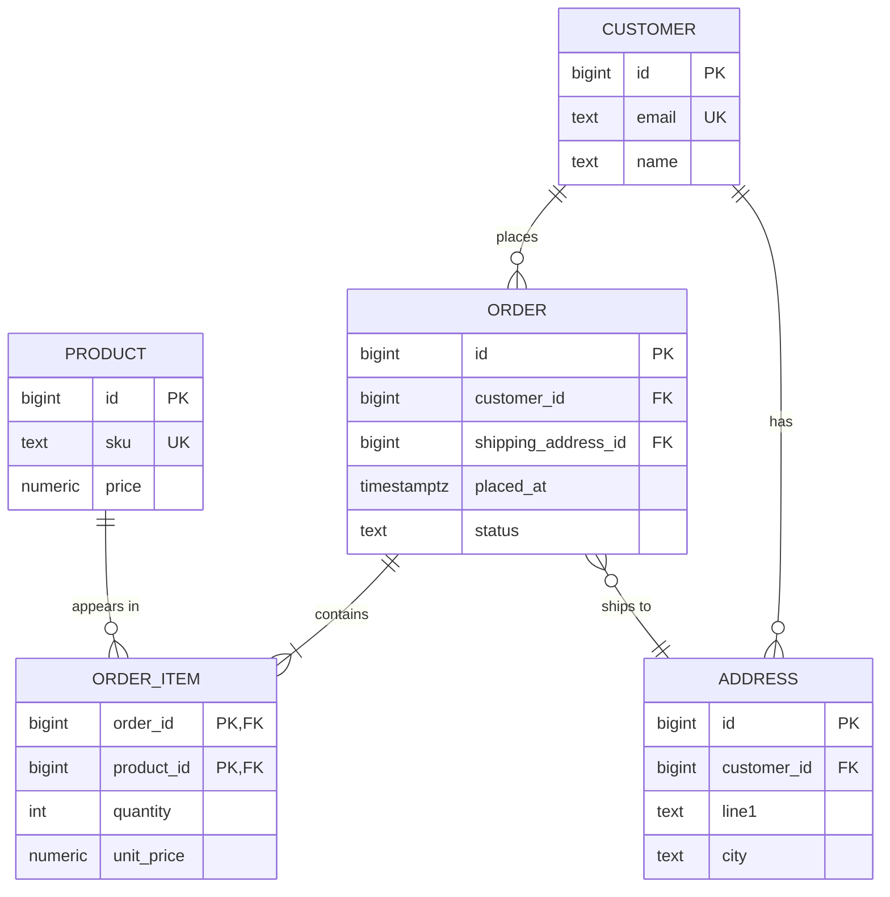

# Data Modeling & Normalization

<Note>
**TL;DR**

**Data modeling** turns a business domain into entities, attributes and relationships, then into tables (or documents) with keys and constraints. **Normalization** (1NF → 2NF → 3NF → BCNF) removes redundancy so each fact is stored once, which kills insert, update and delete anomalies. **Denormalization** deliberately re-adds redundancy for read speed, at the cost of keeping copies in sync. Relational models start from the data and its invariants; document and key-value models start from the access patterns.
</Note>

## The idea

- A **model** is a decision about *what facts exist* and *where each fact lives*.
- Good models make wrong data hard to store (constraints) and common questions cheap to answer (shape matches queries).
- The classic path: **conceptual** model (ER diagram, business words) → **logical** model (tables, keys, normal forms) → **physical** model (types, indexes, partitions, engine choices).

## ER modeling

| Concept | Meaning | Example (orders domain) |
|---|---|---|
| **Entity** | A thing with identity you store facts about | Customer, Order, Product |
| **Attribute** | A fact about an entity | `email`, `placed_at`, `price` |
| **Relationship** | How entities relate | Customer *places* Order |
| **Cardinality** | How many on each side | 1:1, 1:N, M:N |
| **Optionality** | Whether the relationship is required | an Order must have a Customer; a Customer may have zero Orders |
| **Weak entity** | Identity depends on a parent | OrderItem only exists inside an Order |



Mapping rules:
- **1:N** → foreign key on the "many" side (`order.customer_id`).
- **M:N** → a **junction table** (`order_item`), usually with a composite primary key and its own attributes (`quantity`, `unit_price`).
- **1:1** → FK with a `UNIQUE` constraint, or merge the tables if they are always read together.

<Note>
**Why `order_item.unit_price` duplicates `product.price`**

It is not redundancy. The price *at the time of purchase* is a different fact from the product's current price. Spotting "snapshot" facts versus "current" facts is a core modeling skill.
</Note>

## Keys recap

Full definitions (super, candidate, primary, alternate, foreign keys) are in [Introduction to SQL](/Software%20Engineering/Databases/SQL%20ANSI/Introduction%20to%20SQL). In short:

- **Superkey**: any set of columns that uniquely identifies a row.
- **Candidate key**: a minimal superkey. **Primary key**: the chosen candidate key. **Alternate keys**: the others (enforce with `UNIQUE`).
- **Foreign key**: a column referencing another table's key; enforces referential integrity.

## Functional dependencies

A **functional dependency** `X → Y` means: if two rows agree on `X`, they must agree on `Y`. Example: `sku → price`, `order_id → customer_id`.

- Normal forms are defined in terms of FDs. Every non-trivial FD should be "about the key, the whole key, and nothing but the key".
- A **partial dependency**: a non-key column depends on part of a composite key.
- A **transitive dependency**: a non-key column depends on another non-key column.

## Anomalies (why we normalize)

| Anomaly | What goes wrong |
|---|---|
| **Insert** | You cannot record a fact without an unrelated fact (can't add a product until someone orders it) |
| **Update** | One fact stored in many rows; updating some but not all creates contradictions |
| **Delete** | Deleting one fact accidentally deletes another (delete the last order, lose the customer's email) |

## The normal forms, with examples

### 1NF: atomic values, no repeating groups

Before (a list inside a cell):

| order_id | customer | products |
|---|---|---|
| 1 | ann@x.io | "SKU1, SKU2" |

After:

| order_id | customer | sku |
|---|---|---|
| 1 | ann@x.io | SKU1 |
| 1 | ann@x.io | SKU2 |

Removes: you can now query, index and constrain each product. (Postgres arrays and JSONB technically bend 1NF; fine for data you never join or constrain individually.)

### 2NF: no partial dependency on a composite key

Key is `(order_id, sku)`. Before:

| order_id | sku | quantity | product_name |
|---|---|---|---|
| 1 | SKU1 | 2 | Mug |
| 2 | SKU1 | 1 | Mug |

`product_name` depends only on `sku` (part of the key). Renaming the mug means updating every order row: **update anomaly**. After: split into `order_item(order_id, sku, quantity)` and `product(sku, product_name)`.

### 3NF: no transitive dependency

Before, key `order_id`:

| order_id | customer_id | customer_email |
|---|---|---|
| 1 | 10 | ann@x.io |
| 2 | 10 | ann@x.io |

`order_id → customer_id → customer_email`. Deleting both orders loses Ann's email (**delete anomaly**); you can't store a customer with no orders (**insert anomaly**). After: `orders(order_id, customer_id)` and `customer(customer_id, email)`.

### BCNF: every determinant is a candidate key

3NF allows an FD `X → Y` where `Y` is part of a key. BCNF does not. Classic example, table `teaching(student, course, instructor)` where each instructor teaches exactly one course (`instructor → course`) and the key is `(student, course)`:

| student | course | instructor |
|---|---|---|
| Ann | DB | Codd |
| Bob | DB | Codd |
| Cid | DB | Date |

`instructor → course`, but `instructor` is not a key. If Codd switches to teaching "Logic", several rows must change (**update anomaly**). After: `instructor_course(instructor PK, course)` and `enrollment(student, instructor)`. Trade-off: the rule "a student takes a course once" is no longer a simple UNIQUE constraint. BCNF decompositions can lose dependency preservation; 3NF never does.

### 4NF and 5NF (briefly)

- **4NF**: no independent **multi-valued dependencies** in one table. `employee(emp, skill, language)` where skills and languages are unrelated creates a cross product of rows. Split into `employee_skill` and `employee_language`.
- **5NF** (project-join NF): a table that can only be losslessly rebuilt by joining three or more projections should be split into them. Rare in practice; usually shows up in supplier/part/project style ternary relationships.

<Tip>
**Rule of thumb**

Aim for **3NF/BCNF** in OLTP schemas by default. Denormalize on purpose, with a measured reason, and document where the copies come from.
</Tip>

## Denormalization

**When**: read paths are hot and joins or aggregations are the bottleneck; analytics; data that is written rarely and read constantly; cross-service read models.

| Technique | Example | Cost |
|---|---|---|
| Duplicated column | `orders.customer_email` for fast listing | must update on email change (or accept snapshot semantics) |
| Counter / summary column | `posts.comment_count` | contention on hot rows, drift if a code path forgets |
| Summary table | `daily_sales(day, product_id, revenue)` | batch or trigger maintenance, staleness |
| Materialized view | `CREATE MATERIALIZED VIEW ...; REFRESH MATERIALIZED VIEW CONCURRENTLY` | refresh cost, stale between refreshes, needs a unique index for `CONCURRENTLY` |
| Generated column | `total numeric GENERATED ALWAYS AS (qty * price)` | only same-row expressions |
| Embedding in documents | order doc contains its items | large documents, duplicated sub-data |

```sql
CREATE MATERIALIZED VIEW product_revenue AS
SELECT oi.product_id, sum(oi.quantity * oi.unit_price) AS revenue
FROM order_item oi
JOIN orders o ON o.id = oi.order_id
WHERE o.status = 'paid'
GROUP BY oi.product_id;

CREATE UNIQUE INDEX ON product_revenue (product_id);
REFRESH MATERIALIZED VIEW CONCURRENTLY product_revenue;  -- readers not blocked
```

<Warning>
**Denormalization pitfalls**

- Every copy needs an owner and a sync mechanism (trigger, app code, CDC, batch). "We'll keep it in sync in the service" usually drifts.
- Counters on popular rows serialize writes (row lock contention). Consider sharded counters or async aggregation.
- Write amplification: one logical change becomes N physical writes.
</Warning>

## Surrogate vs natural keys

- **Natural key**: comes from the domain (`email`, `isbn`, `country_code`). Meaningful, but can change and may be sensitive (never use SSN/email as PK).
- **Surrogate key**: meaningless generated ID. Stable, compact. Keep natural keys as `UNIQUE` constraints anyway.

| Type | Size | Ordered? | Pros | Cons |
|---|---|---|---|---|
| `bigint GENERATED ALWAYS AS IDENTITY` | 8 B | yes | smallest, fastest B-tree inserts, human-friendly | leaks row counts and growth rate; needs the DB to allocate (harder for offline/multi-region) |
| UUIDv4 | 16 B | no (random) | generate anywhere, unguessable | random inserts scatter across the B-tree: page splits, poor cache locality, bigger WAL |
| UUIDv7 | 16 B | yes (ms timestamp prefix) | generate anywhere **and** index-friendly | exposes creation time; still 2x a bigint |
| ULID / Snowflake | 16 B / 8 B | yes | similar trade-offs to UUIDv7 | non-standard types |

```sql
-- PostgreSQL 18+
CREATE TABLE orders (
  id          uuid PRIMARY KEY DEFAULT uuidv7(),
  customer_id bigint NOT NULL REFERENCES customer(id),
  placed_at   timestamptz NOT NULL DEFAULT now()
);
```

Common compromise: `bigint` internal PK for joins, plus a UUIDv7 `public_id` exposed in URLs and APIs.

## Common patterns and anti-patterns

### Many-to-many junction tables

```sql
CREATE TABLE post_tag (
  post_id bigint REFERENCES post(id) ON DELETE CASCADE,
  tag_id  bigint REFERENCES tag(id)  ON DELETE CASCADE,
  created_at timestamptz NOT NULL DEFAULT now(),
  PRIMARY KEY (post_id, tag_id)
);
CREATE INDEX ON post_tag (tag_id);  -- PK covers post_id-first lookups only
```

Forgetting the reverse index is the most common junction-table performance bug. See [Joining Tables](/Software%20Engineering/Databases/SQL%20ANSI/Joining%20Tables).

### Soft deletes

`deleted_at timestamptz NULL` instead of `DELETE`.

- Pros: undo, audit, referential history.
- Cons: every query must filter it (easy to forget), `UNIQUE (email)` now blocks re-signup. Fix with a partial unique index: `CREATE UNIQUE INDEX ON users (email) WHERE deleted_at IS NULL;`
- GDPR "right to erasure" still requires real deletion or anonymization.
- Alternatives: move rows to an `_archive` table, or keep history in an audit/event table.

### Polymorphic associations

`comment(commentable_type text, commentable_id bigint)` pointing to posts *or* photos (popular in Rails).

<Warning>
**Why polymorphic FKs hurt**

The database cannot enforce a foreign key on `commentable_id`, so orphans appear. Joins need `CASE`/`UNION`. Better options: one nullable FK column per target with a `CHECK (num_nonnulls(post_id, photo_id) = 1)`, a shared supertype table (`commentable(id)` that posts and photos reference), or separate `post_comment` / `photo_comment` tables.
</Warning>

### EAV (Entity-Attribute-Value) anti-pattern

```sql
CREATE TABLE attr (entity_id bigint, name text, value text);
```

Looks flexible. In practice: no types, no NOT NULL, no FKs, every read is a pivot with N self-joins, and the optimizer has no useful statistics. Use it only for truly user-defined fields, and prefer JSONB for that today.

### JSONB as a hybrid

```sql
CREATE TABLE product (
  id bigint GENERATED ALWAYS AS IDENTITY PRIMARY KEY,
  sku text UNIQUE NOT NULL,
  price numeric(12,2) NOT NULL CHECK (price >= 0),
  attributes jsonb NOT NULL DEFAULT '{}'   -- color, size, varies per category
);
CREATE INDEX ON product USING gin (attributes jsonb_path_ops);
SELECT * FROM product WHERE attributes @> '{"color": "red"}';
```

Rule: fields you filter, join, constrain or aggregate often become real columns; the sparse, varying tail goes in JSONB. See [Understanding Advanced SQL Features](/Software%20Engineering/Databases/SQL%20ANSI/Understanding%20Advanced%20SQL%20Features).

## Relational vs document modeling

| | Relational | Document ([MongoDB](/Software%20Engineering/Databases/MongoDB/MongoDB)) |
|---|---|---|
| Starting point | The data and its invariants | The application's access patterns |
| Relationships | Foreign keys + joins | **Embed** (contained, read together) or **reference** (shared, unbounded, independently updated) |
| Redundancy | Normalized by default | Duplication accepted when it serves reads |
| Schema | Enforced by DDL | Flexible; enforce with `$jsonSchema` validation |
| Transactions | Multi-row, multi-table by default | Single-document atomic; multi-document transactions exist but cost more |

Document guideline: **"data that is accessed together should be stored together."**

- **Embed** when the child is owned by the parent, bounded in size, and read with it (order + line items, user + addresses).
- **Reference** when the child is shared, unbounded (comments on a viral post), or updated independently. Watch MongoDB's 16 MB document limit.
- Course detail: [Unit 04 MongoDB Data Modeling Intro](/Software%20Engineering/Databases/MongoDB/Unit%2004%20MongoDB%20Data%20Modeling%20Intro).

### Access-pattern-first and single-table design

In DynamoDB you list the queries first ("get order by id", "list orders of customer by date", "list open orders"), then design partition keys (`PK`) and sort keys (`SK`) so each query is one `Query` call. **Single-table design** stores several entity types in one table:

| PK | SK | data |
|---|---|---|
| `CUSTOMER#10` | `PROFILE` | name, email |
| `CUSTOMER#10` | `ORDER#2026-09-01#A1` | total, status |
| `ORDER#A1` | `ITEM#SKU1` | qty, price |

One `Query(PK = CUSTOMER#10, SK begins_with ORDER#)` returns the customer's orders sorted by date. The cost: new access patterns may need new GSIs or a data migration, and ad hoc queries are hard. See [NoSQL Database Types](/Software%20Engineering/Databases/Core%20Concepts/NoSQL%20Database%20Types).

## Pitfalls

<Warning>
**Common modeling mistakes**

- Storing lists in comma-separated strings (breaks 1NF, unindexable).
- Using `float` for money. Use `numeric` or integer minor units.
- `timestamp` without time zone for events. Use `timestamptz` and store UTC.
- No FK constraints "for performance". Orphans cost more than the checks. Index the FK columns instead.
- One giant `status` text field with no `CHECK` or enum; typos become new states.
- Modeling for today's UI screen instead of the domain; screens change faster than facts.
- Choosing email or username as primary key; they change.
</Warning>

## Senior perspective

- **Model invariants, not just shapes.** Put rules in the database where possible: `NOT NULL`, `CHECK`, `UNIQUE`, FKs, exclusion constraints. Application code has many writers over the years (scripts, backfills, new services); the DB is the only place every write passes.
- **Model for the queries you will run**, then verify with `EXPLAIN` on realistic data. A normalized model with the right indexes beats premature denormalization almost every time.
- **Migrations are the real cost of a model.** Renaming a concept on a 2 TB table is a multi-week expand/contract project ([Database Migrations & Schema Evolution](/Software%20Engineering/Databases/Core%20Concepts/Database%20Migrations%20%26%20Schema%20Evolution)). Spend time on names and boundaries up front.
- **Multi-tenant schemas**: shared tables with `tenant_id` (cheapest, needs row-level security and `tenant_id` in every index and FK), schema-per-tenant (isolation, but migrations run N times and catalog bloat), or database-per-tenant (strongest isolation, highest ops cost). Put `tenant_id` first in composite keys so it can become a shard key later ([Sharding & Partitioning](/Software%20Engineering/Databases/Database%20Round/Sharding%20%26%20Partitioning)).
- **Time and history**: decide early whether you need "current state" or "state as of time T". Temporal tables, SCD type 2, or event sourcing are much harder to retrofit.
- **Review questions a senior asks**: What is the natural key and is it enforced? What happens on delete? Which queries hit this table and are they indexed? How big will it be in 3 years? Which columns are PII? How do we change this later?

<Info>
**🆕 2025–2026**

**PostgreSQL 18 (released 2025-09-25)** brings several modeling features:
- `uuidv7()` built in (timestamp-ordered UUIDs, index-friendly), plus a `uuidv4()` alias.
- **Virtual generated columns**, computed on read, and now the **default** kind of generated column (use `STORED` for the old behavior).
- **Temporal constraints**: `WITHOUT OVERLAPS` on `PRIMARY KEY`/`UNIQUE` and `PERIOD` on `FOREIGN KEY`, so "one price per product per time range" is a declarative constraint.
```sql
CREATE EXTENSION btree_gist;
CREATE TABLE product_price (
  product_id bigint,
  valid      tstzrange,
  price      numeric(12,2) NOT NULL,
  PRIMARY KEY (product_id, valid WITHOUT OVERLAPS)
);
```
</Info>

## Interview questions

<Accordion title="What problem does normalization solve?">
Redundancy and the anomalies it causes: insert anomalies (can't store one fact without another), update anomalies (a fact stored in many rows gets partially updated), and delete anomalies (deleting one fact loses another). Normalization stores each fact once, keyed by what it depends on.
</Accordion>

<Accordion title="Explain 1NF, 2NF, 3NF and BCNF in one line each.">
1NF: atomic values, no repeating groups. 2NF: 1NF plus no non-key column depends on only part of a composite key. 3NF: 2NF plus no non-key column depends on another non-key column. BCNF: every determinant of a functional dependency is a candidate key.
</Accordion>

<Accordion title="When would you denormalize, and how?">
When a measured read path is too slow due to joins or aggregation and the data is read far more than written. Options: duplicated columns, counters, summary tables, materialized views, or embedding. Each copy needs an owner and a sync mechanism, and you accept staleness or write amplification.
</Accordion>

<Accordion title="UUIDv4, UUIDv7 or bigint for a primary key?">
bigint identity is smallest and fastest but must be allocated by the DB and leaks counts. UUIDv4 can be generated anywhere but random inserts fragment B-tree indexes. UUIDv7 is time-ordered so it keeps inserts append-like while still being globally unique; it leaks creation time. A common pattern is bigint internally plus a UUIDv7 public ID.
</Accordion>

<Accordion title="Why are polymorphic associations and EAV considered anti-patterns?">
Both hide structure from the database. Polymorphic `type/id` pairs can't have real foreign keys, so orphans appear. EAV loses types, NOT NULL and FKs and needs pivots with many self-joins. Alternatives: exclusive FK columns with a CHECK, supertype tables, or JSONB for truly dynamic attributes.
</Accordion>

<Accordion title="Embed or reference in MongoDB?">
Embed data that is owned by the parent, bounded, and read together. Reference data that is shared, unbounded or updated independently. Design from the access patterns and watch the 16 MB document limit.
</Accordion>

<Accordion title="How do soft deletes interact with unique constraints?">
A plain `UNIQUE(email)` still sees soft-deleted rows, blocking re-registration. Use a partial unique index `WHERE deleted_at IS NULL`, and remember all queries must filter deleted rows (views or RLS can help).
</Accordion>

## Related
- [Databases Index](/Software%20Engineering/Databases/Databases%20Index)
- [Introduction to SQL](/Software%20Engineering/Databases/SQL%20ANSI/Introduction%20to%20SQL) · [Joining Tables](/Software%20Engineering/Databases/SQL%20ANSI/Joining%20Tables) · [Understanding Advanced SQL Features](/Software%20Engineering/Databases/SQL%20ANSI/Understanding%20Advanced%20SQL%20Features) · [Creating and Manipulating Tables](/Software%20Engineering/Databases/SQL%20ANSI/Creating%20and%20Manipulating%20Tables)
- [NoSQL Database Types](/Software%20Engineering/Databases/Core%20Concepts/NoSQL%20Database%20Types) · [MongoDB](/Software%20Engineering/Databases/MongoDB/MongoDB) · [Unit 04 MongoDB Data Modeling Intro](/Software%20Engineering/Databases/MongoDB/Unit%2004%20MongoDB%20Data%20Modeling%20Intro)
- [Database Migrations & Schema Evolution](/Software%20Engineering/Databases/Core%20Concepts/Database%20Migrations%20%26%20Schema%20Evolution) · [Sharding & Partitioning](/Software%20Engineering/Databases/Database%20Round/Sharding%20%26%20Partitioning)

## Sources
- [E. F. Codd, A Relational Model of Data for Large Shared Data Banks (1970)](https://dl.acm.org/doi/10.1145/362384.362685)
- [PostgreSQL 18 released (2025-09-25)](https://www.postgresql.org/about/news/postgresql-18-released-3142/)
- [PostgreSQL 18 release notes](https://www.postgresql.org/docs/18/release-18.html)
- [PostgreSQL docs: Constraints](https://www.postgresql.org/docs/current/ddl-constraints.html)
- [PostgreSQL docs: Generated columns](https://www.postgresql.org/docs/current/ddl-generated-columns.html)
- [RFC 9562: Universally Unique IDentifiers (UUIDv7)](https://www.rfc-editor.org/rfc/rfc9562)
- [MongoDB docs: Data modeling](https://www.mongodb.com/docs/manual/data-modeling/)
- [AWS docs: Best practices for DynamoDB design](https://docs.aws.amazon.com/amazondynamodb/latest/developerguide/best-practices.html)
- Bill Karwin, *SQL Antipatterns* (Pragmatic Bookshelf), chapters on EAV and polymorphic associations
- Martin Kleppmann, *Designing Data-Intensive Applications*, ch. 2 (O'Reilly)
