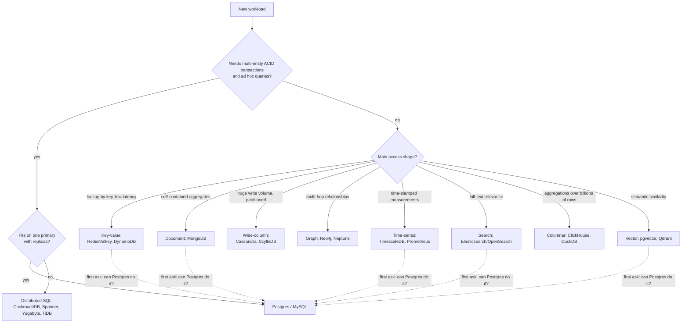

# NoSQL Database Types

<Note>
**TL;DR**

"NoSQL" is a family of non-relational models, each optimized for a specific access shape: **key-value** (lookup by key), **document** (JSON-like aggregates), **wide-column** (huge write-heavy partitioned tables), **graph** (relationships), **time-series**, **search**, plus neighbours like **columnar analytics**, **distributed SQL** and **vector** stores. You pick one by listing your access patterns, consistency needs and scale, not by hype. For most applications a relational database (usually Postgres) covers 80–90% of needs, and specialized stores are added only when a workload clearly outgrows it.
</Note>

## The idea

Relational databases model data as normalized tables joined at query time. NoSQL systems trade some of that generality (joins, ad hoc queries, multi-row transactions, fixed schema) for one or more of:

- **Horizontal scale** by partitioning data across nodes ([Sharding & Partitioning](/Software%20Engineering/Databases/Database%20Round/Sharding%20%26%20Partitioning)).
- **Flexible schema** (store what the app sends).
- **A data model closer to the access pattern** (a document, a graph, a time series).
- **Predictable latency** at very high throughput.

The trade-offs are framed by [CAP Theorem](/Software%20Engineering/Databases/Database%20Round/CAP%20Theorem): during a network partition you choose consistency or availability. **PACELC** adds: *Else* (no partition) you still trade **latency vs consistency**. Dynamo-style stores (Cassandra, DynamoDB default reads) lean PA/EL; Spanner-style systems lean PC/EC.

## The families

### Key-value

- **Model**: opaque value addressed by a key. Some add rich value types (Redis: strings, hashes, lists, sets, sorted sets, streams).
- **Examples**: Redis, Valkey, Memcached, DynamoDB (key-value + document), etcd.

```bash
SET session:abc123 '{"userId":42}' EX 3600    # value with 1h TTL
GET session:abc123
INCR rate:user:42:2026-09-27T10:05            # atomic counter for rate limiting
ZADD leaderboard 1500 "ann" 1320 "bob"
ZREVRANGE leaderboard 0 9 WITHSCORES          # top 10
```

- **Strengths**: sub-millisecond reads, simple scaling by key hash, great for caches, sessions, rate limits, queues, leaderboards.
- **Weaknesses**: no querying by value (unless secondary indexes), in-memory stores cost RAM, durability depends on config (RDB/AOF).
- **Use when**: you always know the key.

### Document

- **Model**: self-contained JSON/BSON documents grouped in collections; fields can be indexed and queried.
- **Examples**: MongoDB, Couchbase, Firestore, Amazon DocumentDB, CosmosDB.

```js
// orders collection
{
  _id: ObjectId("..."),
  customerId: 10,
  status: "paid",
  placedAt: ISODate("2026-09-01T10:00:00Z"),
  items: [ { sku: "SKU1", qty: 2, price: 9.5 }, { sku: "SKU2", qty: 1, price: 20 } ],
  shipTo: { city: "Cairo", line1: "..." }
}
db.orders.find({ customerId: 10, status: "paid" }).sort({ placedAt: -1 })
db.orders.createIndex({ customerId: 1, placedAt: -1 })
```

- **Strengths**: aggregate read in one fetch, flexible schema, rich queries and aggregation pipeline, easy horizontal sharding.
- **Weaknesses**: joins (`$lookup`) are limited and slower; duplication must be kept in sync; unbounded arrays and huge documents hurt.
- **Use when**: data forms natural aggregates (orders, profiles, CMS content, catalogs) with varied shapes. See [MongoDB](/Software%20Engineering/Databases/MongoDB/MongoDB) and [Data Modeling & Normalization](/Software%20Engineering/Databases/Core%20Concepts/Data%20Modeling%20%26%20Normalization).

### Wide-column

- **Model**: rows grouped into **partitions** by a partition key and sorted inside a partition by **clustering columns**. Designed for massive write throughput (LSM trees). Query-first design: one table per query.
- **Examples**: Apache Cassandra, ScyllaDB, HBase, Google Bigtable.

```sql
-- CQL: messages per conversation, newest first
CREATE TABLE messages_by_conversation (
  conversation_id uuid,
  sent_at         timeuuid,
  sender_id       uuid,
  body            text,
  PRIMARY KEY ((conversation_id), sent_at)     -- partition key, clustering key
) WITH CLUSTERING ORDER BY (sent_at DESC);

SELECT * FROM messages_by_conversation
WHERE conversation_id = ? LIMIT 50;             -- single-partition, fast
```

- **Strengths**: linear write scaling, multi-datacenter replication, tunable consistency (`ONE`, `QUORUM`, `ALL`), no single point of failure.
- **Weaknesses**: queries must include the partition key; no joins; denormalize into many tables; large partitions and tombstones (deletes) cause latency spikes.
- **Use when**: time-ordered event data, messaging, IoT, activity feeds at very high write volume.

### Graph

- **Model**: nodes and relationships (edges), both with properties. Traversals follow pointers instead of joining tables.
- **Examples**: Neo4j, Amazon Neptune, Memgraph, TigerGraph; Postgres via Apache AGE.

```cypher
// friends-of-friends who like the same band, not already friends
MATCH (me:Person {name: 'Ann'})-[:FRIEND]->(:Person)-[:FRIEND]->(fof:Person),
      (fof)-[:LIKES]->(b:Band)<-[:LIKES]-(me)
WHERE NOT (me)-[:FRIEND]->(fof) AND fof <> me
RETURN fof.name, count(b) AS shared
ORDER BY shared DESC LIMIT 10;
```

- **Query languages**: Cypher (Neo4j, openCypher), Gremlin (TinkerPop), SPARQL (RDF). **GQL**, the ISO standard graph query language, was published as **ISO/IEC 39075:2024** on 2024-04-12, largely based on Cypher. SQL:2023 also added SQL/PGQ (property-graph queries inside SQL).
- **Strengths**: variable-depth traversals (recommendations, fraud rings, access-control graphs, knowledge graphs).
- **Weaknesses**: global aggregations and bulk scans are not their strength; sharding graphs is hard; smaller ecosystem.
- **Use when**: the questions are about paths and connections, several hops deep.

### Time-series

- **Model**: measurements keyed by time + tags/labels; optimized for append, time-range queries, downsampling and retention.
- **Examples**: TimescaleDB (Postgres extension, company now **Tiger Data**), InfluxDB, Prometheus TSDB, QuestDB, VictoriaMetrics.

```sql
-- TimescaleDB
CREATE TABLE metrics (time timestamptz NOT NULL, device_id int, temp double precision);
SELECT create_hypertable('metrics', by_range('time'));
SELECT time_bucket('5 minutes', time) AS bucket, device_id, avg(temp)
FROM metrics WHERE time > now() - interval '1 day'
GROUP BY bucket, device_id ORDER BY bucket;
```

```promql
rate(http_requests_total{job="api", status=~"5.."}[5m])
```

- **Strengths**: high ingest, compression (often 10x+), automatic retention and rollups.
- **Weaknesses**: high-cardinality labels (user IDs as tags) explode memory in Prometheus/Influx; updates and deletes are awkward.
- **Use when**: metrics, IoT sensors, financial ticks, observability.

### Search engines

- **Model**: documents indexed into an **inverted index** (term → list of documents), with analyzers (tokenize, lowercase, stem) and relevance scoring (BM25).
- **Examples**: Elasticsearch, OpenSearch, Apache Solr, Meilisearch, Typesense; managed MongoDB Atlas Search ([Unit 13 MongoDB Atlas Search](/Software%20Engineering/Databases/MongoDB/Unit%2013%20MongoDB%20Atlas%20Search)).

```json
GET /products/_search
{ "query": { "bool": {
    "must":   { "match": { "title": "wireless headphones" } },
    "filter": { "range": { "price": { "lte": 200 } } } } } }
```

- **Strengths**: full-text relevance, fuzzy matching, facets/aggregations, log analytics.
- **Weaknesses**: near-real-time (refresh interval), not a system of record, reindexing for mapping changes, cluster ops are heavy.
- **Use when**: user-facing search, log/observability search. Feed it from the primary DB via CDC.

### Columnar / analytical (OLAP)

- **Model**: data stored by column, compressed, scanned with vectorized execution. See [Row Vs Column Oriented Databases](/Software%20Engineering/Databases/Database%20Round/Row%20Vs%20Column%20Oriented%20Databases).
- **Examples**: ClickHouse, DuckDB (in-process), Snowflake, BigQuery, Apache Druid, Pinot.

```sql
-- DuckDB querying Parquet files directly
SELECT country, count(*) AS orders, sum(total) AS revenue
FROM 's3://bucket/orders/*.parquet'
GROUP BY country ORDER BY revenue DESC;
```

- **Strengths**: aggregations over billions of rows in seconds.
- **Weaknesses**: point updates/deletes are expensive; not for OLTP.
- **Use when**: dashboards, analytics, event analysis. DuckDB for local/embedded analysis, ClickHouse for real-time analytics services.

### NewSQL / distributed SQL

- **Model**: relational SQL with ACID transactions, automatically sharded and replicated (Raft/Paxos per range).
- **Examples**: CockroachDB, YugabyteDB, Google Spanner, TiDB, Amazon Aurora DSQL.
- **Strengths**: SQL + horizontal scale + strong consistency + multi-region.
- **Weaknesses**: higher per-query latency than a single-node DB (consensus round trips), cross-region writes are slow, cost and operational complexity.
- **Use when**: you have outgrown one Postgres/MySQL primary and need global consistency, not just read scaling.

### Vector

- **Model**: high-dimensional embeddings indexed for approximate nearest-neighbour search (HNSW, IVF).
- **Examples**: Pinecone, Qdrant, Weaviate, Milvus; pgvector in Postgres. Full note: [Vector Databases & pgvector](/Software%20Engineering/Databases/Core%20Concepts/Vector%20Databases%20%26%20pgvector).

## Big comparison

| Family | Data model | Query style | Scaling | Consistency (typical) | Sweet spot | Avoid for |
|---|---|---|---|---|---|---|
| Relational (Postgres, MySQL) | Tables + FKs | SQL, joins | Vertical + read replicas, sharding with effort | Strong, ACID | Most OLTP apps | Massive write fan-out, deep graph traversals |
| Key-value (Redis, DynamoDB) | Key → value | GET/PUT by key | Hash partitioning | Varies (Dynamo: eventual or strong per read) | Caching, sessions, counters | Ad hoc queries |
| Document (MongoDB) | JSON documents | Field queries, aggregation | Sharding by shard key | Strong on primary, tunable | Aggregates with varied shape | Heavy many-to-many joins |
| Wide-column (Cassandra) | Partition + clustering rows | CQL by partition key | Linear, masterless | Tunable (ONE/QUORUM) | Write-heavy time-ordered data | Ad hoc queries, transactions |
| Graph (Neo4j) | Nodes + edges | Cypher/GQL traversals | Mostly vertical | ACID (Neo4j) | Multi-hop relationships | Bulk analytics scans |
| Time-series (Timescale, Influx) | Time + tags + values | Time-range, downsampling | Time partitioning | Varies | Metrics, IoT | High-cardinality tags, frequent updates |
| Search (Elasticsearch) | Inverted index | Relevance queries | Shards + replicas | Near-real-time | Full-text, logs | System of record |
| Columnar (ClickHouse, DuckDB) | Columns | SQL aggregations | Distributed or embedded | Batch-oriented | Analytics | OLTP point writes |
| Distributed SQL (CockroachDB, Spanner) | Tables | SQL | Auto-sharded ranges | Strong (serializable) | Global OLTP | Low-latency single-region at small scale |
| Vector (Qdrant, pgvector) | Embeddings + metadata | kNN / ANN | Varies | Varies | Semantic search, RAG | Exact filtering-heavy queries alone |

## Decision flow



## "Postgres can do most of this"

| Need | Postgres feature |
|---|---|
| Documents | `jsonb` + GIN indexes, JSON path, `jsonb_path_ops` |
| Full-text search | `tsvector`/`tsquery`, `ts_rank`; fuzzy with `pg_trgm` |
| Time-series | TimescaleDB extension, declarative partitioning, BRIN indexes |
| Vectors | `pgvector` (+ `pgvectorscale`) |
| Graph | recursive CTEs; Apache AGE for openCypher |
| Queue | `SELECT ... FOR UPDATE SKIP LOCKED`, pgmq |
| Key-value cache | unlogged tables (but Redis is still faster for hot caches) |
| Geospatial | PostGIS |

Arguments for one Postgres: one backup, one security model, transactional consistency across all data, one set of skills. Arguments against: a single primary's write ceiling, noisy-neighbour workloads (analytics hurting OLTP), and specialized engines being 10–100x better at their one job at scale.

### Polyglot persistence trade-offs

Using several stores, each for what it does best, is normal at scale (Postgres as system of record + Redis cache + Elasticsearch search + ClickHouse analytics). The costs:

- **Consistency between stores**: dual writes from the app are unsafe (one succeeds, one fails). Use CDC (Debezium) or the transactional outbox pattern.
- **Operational load**: each engine needs backups, upgrades, monitoring, on-call expertise.
- **Staleness**: derived stores lag. The UI must tolerate it.

<Warning>
**Common pitfalls**

- Choosing MongoDB/Cassandra "for scale" at 10 GB of data. Scale is rarely the first problem.
- Modeling Cassandra or DynamoDB like a relational DB (normalized tables, then discovering there are no joins).
- Treating Elasticsearch or Redis as the system of record without planning for data loss.
- Ignoring hot partitions: a celebrity user or a date-only partition key sends all traffic to one node.
- Forgetting that "eventual consistency" means your own write may not be visible on the next read.
</Warning>

## Senior perspective

- **Start from access patterns and invariants.** Write down the top 10 queries, their latency targets, write rates and consistency needs. The store choice usually falls out.
- **Default to boring.** A well-indexed Postgres with read replicas handles far more than most teams expect. Add a specialized store when you can name the metric it fixes.
- **Plan data movement.** Every extra store needs a feed (CDC, outbox, batch) and a rebuild path from the system of record.
- **Licensing matters now.** Redis, Elasticsearch, MongoDB and others changed licenses in recent years; forks (Valkey, OpenSearch) exist. Check what your cloud provider actually runs.
- **Evaluate operational maturity**: backup/restore tested? Multi-region story? Managed offering? Hiring pool?
- **Review questions**: What is the partition key and can it get hot? What consistency does each read need? How do we reindex or reshard? What is the exit plan?

<Info>
**🆕 2025–2026**

- **Redis 8.0** (announced 2025-05-01) added **AGPLv3** as a license option alongside RSALv2/SSPLv1, after Redis left BSD in March 2024. Redis 8 folded the former Redis Stack modules (JSON, time series, probabilistic structures) into core and added **vector sets**.
- **Valkey**, the Linux Foundation fork of Redis 7.2.4 formed in 2024, announced **Valkey 9.0** on 2025-10-21: hash field expiration, atomic slot migration, and multiple databases in cluster mode.
- **DuckDB 1.4.0 LTS** (September 2025) is the first long-term-support release with one year of support; **DuckDB 1.5.0** was released 2026-03-09.
- **MongoDB 8.2** (2025-09-16) brought **Search and Vector Search** to self-managed Community and Enterprise Server in public preview (previously Atlas-only).
- **MongoDB 8.3** (2026-05-07) made the `$scoreFusion` hybrid-ranking aggregation stage generally available.
</Info>

## Interview questions

<Accordion title="SQL vs NoSQL: how do you choose?">
List access patterns, consistency needs and scale. If you need multi-entity transactions, ad hoc queries and the data fits on one primary, choose relational. Choose NoSQL when a specific access shape dominates (key lookups, aggregates, massive partitioned writes, graph traversals) or scale exceeds a single node in a way replicas can't solve. Many systems use both.
</Accordion>

<Accordion title="What are the partition key and clustering key in Cassandra?">
The partition key decides which node(s) store the row (hashed) and must be in every efficient query. Clustering columns sort rows inside a partition and allow range queries on them. Good partition keys spread load evenly and keep partitions bounded (e.g. `(sensor_id, day)`).
</Accordion>

<Accordion title="Explain CAP and PACELC.">
CAP: during a network partition a distributed system must choose consistency or availability. PACELC extends it: if Partitioned choose A or C; Else, choose Latency or Consistency. Cassandra/Dynamo lean PA/EL, Spanner/CockroachDB lean PC/EC.
</Accordion>

<Accordion title="When is a graph database worth it?">
When queries traverse variable-depth relationships (friends of friends, fraud rings, dependency graphs, permissions). In SQL these become recursive CTEs or many self-joins that get slow. For simple one-hop relationships, a relational DB is fine.
</Accordion>

<Accordion title="Why not use Elasticsearch as the primary database?">
It is near-real-time, has weaker durability and transactional guarantees, and mapping changes require reindexing. Use it as a derived index fed from the system of record via CDC, so you can always rebuild it.
</Accordion>

<Accordion title="What is polyglot persistence and what does it cost?">
Using multiple storage technologies, each for its best workload. Costs: keeping stores consistent (use CDC or outbox, not dual writes), more operational expertise, and eventual consistency between stores.
</Accordion>

## Related
- [Databases Index](/Software%20Engineering/Databases/Databases%20Index)
- [CAP Theorem](/Software%20Engineering/Databases/Database%20Round/CAP%20Theorem) · [Row Vs Column Oriented Databases](/Software%20Engineering/Databases/Database%20Round/Row%20Vs%20Column%20Oriented%20Databases) · [Sharding & Partitioning](/Software%20Engineering/Databases/Database%20Round/Sharding%20%26%20Partitioning) · [Replication & 2PC 3PC](/Software%20Engineering/Databases/Database%20Round/Replication%20%26%202PC%203PC)
- [MongoDB](/Software%20Engineering/Databases/MongoDB/MongoDB) · [Unit 13 MongoDB Atlas Search](/Software%20Engineering/Databases/MongoDB/Unit%2013%20MongoDB%20Atlas%20Search) · [Vector Databases & pgvector](/Software%20Engineering/Databases/Core%20Concepts/Vector%20Databases%20%26%20pgvector)
- [Data Modeling & Normalization](/Software%20Engineering/Databases/Core%20Concepts/Data%20Modeling%20%26%20Normalization)

## Sources
- [Redis blog: Redis is open source again (AGPLv3), 2025-05-01](https://redis.io/blog/agplv3/)
- [Linux Foundation: Valkey 9.0 announcement, 2025-10-21](https://www.linuxfoundation.org/press/valkey-9.0-delivers-performance-and-resiliency-for-real-time-workloads)
- [DuckDB: Announcing DuckDB 1.5.0, 2026-03-09](https://duckdb.org/2026/03/09/announcing-duckdb-150)
- [MongoDB 8.2 is now available](https://www.mongodb.com/products/updates/mongodb-8-2-is-now-available/)
- [MongoDB 8.3 release notes](https://www.mongodb.com/docs/manual/release-notes/8.3/)
- [Wikipedia: Graph Query Language (ISO/IEC 39075:2024)](https://en.wikipedia.org/wiki/Graph_Query_Language)
- [Apache Cassandra docs: Data modeling](https://cassandra.apache.org/doc/latest/cassandra/developing/data-modeling/index.html)
- [Neo4j Cypher manual](https://neo4j.com/docs/cypher-manual/current/)
- [Daniel Abadi, Consistency Tradeoffs in Modern Distributed Database System Design (PACELC), IEEE Computer 2012](https://www.cs.umd.edu/~abadi/papers/abadi-pacelc.pdf)
- [DeCandia et al., Dynamo: Amazon's Highly Available Key-value Store (2007)](https://www.allthingsdistributed.com/files/amazon-dynamo-sosp2007.pdf)
- Martin Kleppmann, *Designing Data-Intensive Applications*, ch. 2–3 (O'Reilly)
