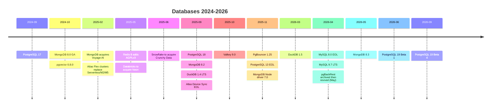

# PostgreSQL 17 to 18 - What's New

<Note>
**TL;DR**

**PostgreSQL 17** (2024-09-26) made VACUUM far lighter on memory, added incremental backups, `JSON_TABLE` and `MERGE ... RETURNING`. **PostgreSQL 18** (2025-09-25) is the big one: an **asynchronous I/O** subsystem, `uuidv7()`, **virtual generated columns** (now the default), `OLD`/`NEW` in `RETURNING`, **B-tree skip scan**, temporal `WITHOUT OVERLAPS` constraints, **OAuth** login, MD5 deprecation, checksums on by default and statistics kept across `pg_upgrade`. **PostgreSQL 19** is in beta (Beta 4 on 2026-09-24) with GA expected around October 2026. Around it, 2025–2026 saw Redis return to open source (AGPL), Valkey 9, MongoDB 8.2/8.3, DuckDB's first LTS, MySQL 8.0's end of life and big-money Postgres acquisitions.
</Note>

Every claim below has a dated official source. Topic notes hold the details; this note is the timeline.

## Timeline



## PostgreSQL 17 (released 2024-09-26)

| Area | What changed | Details in |
|---|---|---|
| Vacuum | New dead-tuple memory structure: up to **20x less memory**, no 1 GB cap | [MVCC & Vacuum](/Software%20Engineering/Databases/Core%20Concepts/MVCC%20%26%20Vacuum) |
| Performance | Up to 2x WAL write throughput under concurrency; streaming I/O for sequential scans and `ANALYZE`; faster `IN` lists with B-trees; parallel BRIN builds | [Query Optimization & EXPLAIN](/Software%20Engineering/Databases/Core%20Concepts/Query%20Optimization%20%26%20EXPLAIN) |
| SQL/JSON | `JSON_TABLE`, `JSON_EXISTS`, `JSON_QUERY`, `JSON_VALUE`, constructors | [Understanding Advanced SQL Features](/Software%20Engineering/Databases/SQL%20ANSI/Understanding%20Advanced%20SQL%20Features) |
| DML | `MERGE ... RETURNING`, `MERGE` on updatable views; `COPY ... ON_ERROR` to skip bad rows | [Inserting Data](/Software%20Engineering/Databases/SQL%20ANSI/Inserting%20Data) |
| Backup | **Incremental** `pg_basebackup` + `pg_combinebackup`; `pg_dump --filter` | [Database Backup](/Software%20Engineering/Databases/Database%20Round/Database%20Backup) |
| Replication | Logical slots survive `pg_upgrade`; failover of logical slots; `pg_createsubscriber` | [Replication & 2PC 3PC](/Software%20Engineering/Databases/Database%20Round/Replication%20%26%202PC%203PC) |
| Partitioning | Identity columns and exclusion constraints on partitioned tables | [SQL Table Partitioning](/Software%20Engineering/Databases/SQL%20ANSI/SQL%20Table%20Partitioning) |
| Ops/security | `sslnegotiation=direct` (TLS with ALPN, one round trip less); `pg_maintain` role; `pg_wait_events` view; `EXPLAIN (SERIALIZE, MEMORY)` | [Connection Pooling](/Software%20Engineering/Databases/Database%20Round/Connection%20Pooling) |

## PostgreSQL 18 (released 2025-09-25)

### Performance

- **Asynchronous I/O**: new `io_method` setting (`worker` default, `io_uring` on Linux, `sync` = old behaviour). Used for sequential scans, bitmap heap scans and vacuum; PostgreSQL reports up to **3x** faster reads from storage in some benchmarks. See [Database Internals](/Software%20Engineering/Databases/Database%20Round/Database%20Internals).
- **Skip scan** on multicolumn B-tree indexes when leading columns have no `=` condition; better index use for `OR` and `IN`; improved hash joins and merge joins with incremental sort; **parallel GIN index builds**. See [Database Indexes](/Software%20Engineering/Databases/Database%20Round/Indexes/Database%20Indexes).
- Vacuum: eager freezing (`vacuum_max_eager_freeze_failure_rate`), `autovacuum_vacuum_max_threshold`, `autovacuum_worker_slots` (change worker count without restart). See [MVCC & Vacuum](/Software%20Engineering/Databases/Core%20Concepts/MVCC%20%26%20Vacuum).

### Developer features

```sql
-- time-ordered UUIDs: much better B-tree locality than v4
CREATE TABLE events (id uuid PRIMARY KEY DEFAULT uuidv7(), payload jsonb);

-- virtual generated columns (now the default kind): computed on read, no storage
CREATE TABLE items (
  price    numeric,
  qty      int,
  subtotal numeric GENERATED ALWAYS AS (price * qty)          -- VIRTUAL by default
);

-- OLD and NEW in RETURNING
UPDATE items SET price = price * 1.1 WHERE qty > 10
RETURNING old.price AS before, new.price AS after;

-- temporal constraints: no overlapping bookings per room
CREATE EXTENSION IF NOT EXISTS btree_gist;
CREATE TABLE bookings (
  room_id int,
  during  tstzrange,
  PRIMARY KEY (room_id, during WITHOUT OVERLAPS)
);
```

- `casefold()` and the `PG_UNICODE_FAST` collation; `LIKE` with nondeterministic collations.
- `NOT NULL` constraints can be added as `NOT VALID` and validated later (useful for migrations, see [Database Migrations & Schema Evolution](/Software%20Engineering/Databases/Core%20Concepts/Database%20Migrations%20%26%20Schema%20Evolution)).
- `CREATE FOREIGN TABLE ... LIKE`.

### Security and operations

- **OAuth 2.0 authentication** (`oauth` method in `pg_hba.conf`) for SSO.
- **MD5 password auth deprecated**: move to SCRAM-SHA-256.
- **Data checksums on by default** for new clusters (`initdb --no-data-checksums` to opt out; matters for `pg_upgrade` compatibility).
- `pg_upgrade` **keeps planner statistics**, runs checks in parallel (`--jobs`) and adds `--swap`.
- `EXPLAIN ANALYZE` shows **BUFFERS by default** plus index-search counts.
- Logical replication: conflict logging/stats, parallel streaming by default, idle slot invalidation.
- Wire protocol **3.2** (first new protocol version since 7.4 in 2003; libpq still defaults to 3.0).

### Upgrade notes

- Test extensions (pgvector 0.8.1 added PG 18 support on 2025-09-04), `io_method` behaviour on your storage, and checksum settings before `pg_upgrade`.
- Change `md5` entries in `pg_hba.conf` and re-hash passwords as SCRAM.

## PostgreSQL 19 (beta, as of 2026-09-27)

- **Beta 1: 2026-06-04. Beta 4: 2026-09-24.** Release candidate planned for early October; GA "potentially October" 2026. Not production-ready yet.
- Headline items still in after Beta 4: `REPACK` / `REPACK CONCURRENTLY` (online table rewrite, a built-in alternative to pg_repack), `WAIT FOR` (read-your-writes on standbys), parallel autovacuum and a new autovacuum scoring system, faster foreign-key checks (up to 2x inserts), `pg_plan_advice`, `GROUP BY ALL`, `INSERT ... ON CONFLICT DO SELECT ... RETURNING`, logical replication of sequences, `CREATE PUBLICATION ... EXCEPT`, `pg_stat_lock`, SNI with multiple TLS certificates, JIT off by default, `lz4` as default TOAST compression, RADIUS auth removed.
- **Reverted before Beta 4** (won't be in 19.0): SQL/PGQ property graph queries, online enabling/disabling of checksums, temporal `UPDATE/DELETE ... FOR PORTION OF`, `ALTER TABLE ... MERGE/SPLIT PARTITIONS`, `pg_get_*_ddl()` functions.

## Version support

PostgreSQL supports each major version for 5 years. **PostgreSQL 13 reached end of life on 2025-11-13**; **14 ends 2026-11-12**, so plan upgrades now. Supported as of this note: 14–18 (18 until 2030-11-14).

## Other 2025–2026 database developments

| Date | What | Note |
|---|---|---|
| 2024-10-02 | MongoDB 8.0 GA (MongoDB reports ~36% faster reads vs 7.0) | [MongoDB](/Software%20Engineering/Databases/MongoDB/MongoDB) |
| 2024-10-30 | pgvector 0.8.0: iterative index scans for filtered vector search | [Vector Databases & pgvector](/Software%20Engineering/Databases/Core%20Concepts/Vector%20Databases%20%26%20pgvector) |
| 2025-02-24 | MongoDB announces acquisition of **Voyage AI** (embeddings, reranking) | [Vector Databases & pgvector](/Software%20Engineering/Databases/Core%20Concepts/Vector%20Databases%20%26%20pgvector) |
| 2025-02 → 2026-01-22 | Atlas **Flex** clusters replace Serverless and M2/M5; those tiers unsupported from 2026-01-22 | [Unit 02 Getting Started with MongoDB Atlas](/Software%20Engineering/Databases/MongoDB/Unit%2002%20Getting%20Started%20with%20MongoDB%20Atlas) |
| 2025-05-01 | **Redis 8** adds **AGPLv3** as a license option (alongside RSALv2/SSPLv1), folds Redis Stack modules into core, adds vector sets | [NoSQL Database Types](/Software%20Engineering/Databases/Core%20Concepts/NoSQL%20Database%20Types) |
| 2025-05-14 | **Databricks to acquire Neon** (serverless Postgres, ~$1B) | [Row Vs Column Oriented Databases](/Software%20Engineering/Databases/Database%20Round/Row%20Vs%20Column%20Oriented%20Databases) |
| 2025-06-02 | **Snowflake to acquire Crunchy Data** (~$250M), launching Snowflake Postgres | [Row Vs Column Oriented Databases](/Software%20Engineering/Databases/Database%20Round/Row%20Vs%20Column%20Oriented%20Databases) |
| 2025-09 | **DuckDB 1.4.0** LTS, first long-term-support release (one year) | [NoSQL Database Types](/Software%20Engineering/Databases/Core%20Concepts/NoSQL%20Database%20Types) |
| 2025-09-16 | **MongoDB 8.2**: first minor release for Community/Enterprise too; Search & Vector Search for self-managed (preview), `$scoreFusion` | [MongoDB](/Software%20Engineering/Databases/MongoDB/MongoDB) |
| 2025-09-30 | Atlas **Device Sync** / Device SDKs (Realm) and Data API end of life | [Unit 02 Getting Started with MongoDB Atlas](/Software%20Engineering/Databases/MongoDB/Unit%2002%20Getting%20Started%20with%20MongoDB%20Atlas) |
| 2025-10-21 | **Valkey 9.0** (Linux Foundation fork of Redis): hash field expiration, atomic slot migration, multiple DBs in cluster mode | [NoSQL Database Types](/Software%20Engineering/Databases/Core%20Concepts/NoSQL%20Database%20Types) |
| 2025-11-06 | MongoDB Node.js driver 7.0 (Node 20.19+) | [Unit 06 Connecting to MongoDB in Node.js](/Software%20Engineering/Databases/MongoDB/Unit%2006%20Connecting%20to%20MongoDB%20in%20Node.js) |
| 2025-11-09 / 12-03 | PgBouncer 1.25.0 (LDAP, direct TLS) and 1.25.1 (CVE-2025-12819 fix) | [Connection Pooling](/Software%20Engineering/Databases/Database%20Round/Connection%20Pooling) |
| 2026-02-26 | pgvector 0.8.2 fixes CVE-2026-3172 (parallel HNSW build overflow) | [Vector Databases & pgvector](/Software%20Engineering/Databases/Core%20Concepts/Vector%20Databases%20%26%20pgvector) |
| 2026-03-09 | **DuckDB 1.5.0**: `VARIANT` and built-in `GEOMETRY` types | [NoSQL Database Types](/Software%20Engineering/Databases/Core%20Concepts/NoSQL%20Database%20Types) |
| 2026-04-21 | **MySQL 9.7 LTS** released (next LTS after 8.4) | [Database Migrations & Schema Evolution](/Software%20Engineering/Databases/Core%20Concepts/Database%20Migrations%20%26%20Schema%20Evolution) |
| 2026-04-30 | **MySQL 8.0 end of life** (extended support ended) | [Database Migrations & Schema Evolution](/Software%20Engineering/Databases/Core%20Concepts/Database%20Migrations%20%26%20Schema%20Evolution) |
| 2026-04-27 → 05-18 | **pgBackRest** archived for lack of sponsorship, then revived with a sponsor coalition | [Database Backup](/Software%20Engineering/Databases/Database%20Round/Database%20Backup) |
| 2026-05 | **MongoDB 8.3**: `$scoreFusion` GA, performance improvements | [MongoDB](/Software%20Engineering/Databases/MongoDB/MongoDB) |

## Senior perspective

- Upgrade cadence: stay within one or two majors of current; each Postgres major gives measurable free performance, and minor releases carry security fixes. Budget a yearly major upgrade and practise it (logical replication or `pg_upgrade --link/--swap` with statistics kept).
- Licensing is an architectural risk: Redis's license changes pushed teams to Valkey; know the license of every data store you depend on.
- Consolidation: Postgres keeps absorbing workloads (vectors, JSON, time series), and analytics vendors are buying Postgres companies. "Just use Postgres" is a stronger default in 2026 than it was in 2020, until a workload clearly outgrows it.

## Interview questions

<Accordion title="What are the headline features of PostgreSQL 18?">
Asynchronous I/O (`io_method`), `uuidv7()`, virtual generated columns as default, OLD/NEW in RETURNING, B-tree skip scan, temporal WITHOUT OVERLAPS constraints, OAuth authentication, MD5 deprecation, checksums on by default, and planner statistics preserved by pg_upgrade.
</Accordion>

<Accordion title="Why would you prefer UUIDv7 over UUIDv4 for primary keys?">
UUIDv7 starts with a timestamp, so new values are roughly increasing: inserts go to the right edge of the B-tree, giving better cache locality, fewer page splits and smaller indexes, while keeping global uniqueness without coordination. UUIDv4 is random and scatters inserts.
</Accordion>

<Accordion title="What did PostgreSQL 17 change about backups?">
Native incremental physical backups: `pg_basebackup --incremental` using WAL summaries, and `pg_combinebackup` to rebuild a full backup from the chain.
</Accordion>

<Accordion title="Why did Valkey appear and what happened with Redis's license in 2025?">
Redis moved from BSD to source-available licenses (RSALv2/SSPLv1) in March 2024; the Linux Foundation forked Redis 7.2.4 as Valkey with cloud vendor backing. In May 2025 Redis 8 added AGPLv3 as an OSI-approved option. Valkey continued independently (9.0 in October 2025).
</Accordion>

## Related
- [Databases Index](/Software%20Engineering/Databases/Databases%20Index) · [Database Round](/Software%20Engineering/Databases/Database%20Round/Database%20Round) · [SQL ANSI](/Software%20Engineering/Databases/SQL%20ANSI/SQL%20ANSI) · [MongoDB](/Software%20Engineering/Databases/MongoDB/MongoDB)
- [MVCC & Vacuum](/Software%20Engineering/Databases/Core%20Concepts/MVCC%20%26%20Vacuum) · [Query Optimization & EXPLAIN](/Software%20Engineering/Databases/Core%20Concepts/Query%20Optimization%20%26%20EXPLAIN) · [Database Indexes](/Software%20Engineering/Databases/Database%20Round/Indexes/Database%20Indexes) · [Database Backup](/Software%20Engineering/Databases/Database%20Round/Database%20Backup) · [Replication & 2PC 3PC](/Software%20Engineering/Databases/Database%20Round/Replication%20%26%202PC%203PC)
- [NoSQL Database Types](/Software%20Engineering/Databases/Core%20Concepts/NoSQL%20Database%20Types) · [Vector Databases & pgvector](/Software%20Engineering/Databases/Core%20Concepts/Vector%20Databases%20%26%20pgvector) · [Database Migrations & Schema Evolution](/Software%20Engineering/Databases/Core%20Concepts/Database%20Migrations%20%26%20Schema%20Evolution)

## Sources
- PostgreSQL 17 released: https://www.postgresql.org/about/news/postgresql-17-released-2936/
- PostgreSQL 18 released: https://www.postgresql.org/about/news/postgresql-18-released-3142/ · Release notes: https://www.postgresql.org/docs/18/release-18.html
- PostgreSQL 19 Beta 1: https://www.postgresql.org/about/news/postgresql-19-beta-1-released-3313/ · Beta 4: https://www.postgresql.org/about/news/postgresql-19-beta-4-released-3386/
- PostgreSQL versioning policy: https://www.postgresql.org/support/versioning/
- MongoDB 8.0 GA: https://www.mongodb.com/company/newsroom/press-releases/mongo-db-announces-general-availability-of-mongo-db-8-0 · 8.2: https://www.mongodb.com/products/updates/mongodb-8-2-is-now-available/ · 8.3: https://www.mongodb.com/products/updates/mongodb-8-3/
- MongoDB acquires Voyage AI: https://www.mongodb.com/press/mongodb-announces-acquisition-of-voyage-ai
- Atlas Flex migration: https://www.mongodb.com/docs/atlas/flex-migration/ · Device Sync EOL: https://www.mongodb.com/community/forums/t/atlas-device-sync-end-of-life-and-deprecation/296687
- Redis AGPLv3: https://redis.io/blog/agplv3/
- Valkey 9.0: https://www.linuxfoundation.org/press/valkey-9.0-delivers-performance-and-resiliency-for-real-time-workloads
- DuckDB 1.5.0: https://duckdb.org/2026/03/09/announcing-duckdb-150 · Release cycle: https://duckdb.org/docs/current/dev/release_cycle
- Databricks/Neon: https://techcrunch.com/2025/05/14/databricks-to-buy-open-source-database-startup-neon-for-1b/ · Snowflake/Crunchy Data: https://www.cnbc.com/2025/06/02/snowflake-to-buy-crunchy-data-250-million.html
- MySQL end of life: https://endoflife.date/mysql
- pgvector: https://www.postgresql.org/about/news/pgvector-080-released-2952/ · https://www.postgresql.org/about/news/pgvector-082-released-3245/
- PgBouncer: https://postgresql.org/about/news/pgbouncer-1250-released-3169/ · https://www.pgbouncer.org/changelog.html
- pgBackRest news: https://pgbackrest.org/news.html
- MongoDB Node.js driver 7.0: https://www.mongodb.com/community/forums/t/mongodb-nodejs-driver-7-0-0-released/331061
