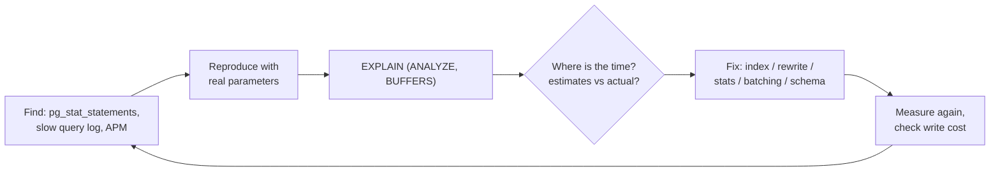

# Query Optimization & EXPLAIN

> [!tldr] TL;DR
> Find the queries that cost the most in total (`pg_stat_statements`), read their plans with `EXPLAIN (ANALYZE, BUFFERS)`, and look for the few big problems: **bad row estimates**, **sequential scans on big tables for selective filters**, **sorts/hashes spilling to disk**, **nested loops over many rows**, and **too many round trips** (N+1). Fix with the right index, a sargable predicate, fresh statistics, a rewritten query or batching. Measure again. Most wins come from indexes and from not asking the database for work you don't need.

## The workflow



```sql
-- top queries by total time (needs shared_preload_libraries = 'pg_stat_statements')
CREATE EXTENSION IF NOT EXISTS pg_stat_statements;
SELECT calls, round(total_exec_time) AS total_ms, round(mean_exec_time, 2) AS mean_ms,
       rows, left(query, 80) AS query
FROM pg_stat_statements ORDER BY total_exec_time DESC LIMIT 10;
```

A 2 ms query called 5 million times a day matters more than a 3 s report run once.

Also useful: `log_min_duration_statement = '500ms'` to log slow queries, and `auto_explain` to log plans of slow queries automatically.

## EXPLAIN basics

| Command | Runs the query? | Shows |
|---|---|---|
| `EXPLAIN q` | No | Chosen plan with **estimated** cost and rows |
| `EXPLAIN ANALYZE q` | **Yes** | Plus actual time, rows, loops per node |
| `EXPLAIN (ANALYZE, BUFFERS) q` | Yes | Plus pages hit in shared buffers vs read from OS/disk |
| `EXPLAIN (ANALYZE, BUFFERS, VERBOSE, SETTINGS, WAL) q` | Yes | Output columns, non-default settings, WAL generated |

> [!warning] `ANALYZE` executes the statement
> For `UPDATE`/`DELETE`/`INSERT`, wrap it: `BEGIN; EXPLAIN ANALYZE UPDATE ...; ROLLBACK;`

### Reading a plan

```sql
EXPLAIN (ANALYZE, BUFFERS)
SELECT o.id, o.total, c.name
FROM orders o JOIN customers c ON c.id = o.customer_id
WHERE o.created_at >= now() - interval '1 day'
ORDER BY o.total DESC LIMIT 20;
```

```text
Limit  (cost=5210.33..5210.38 rows=20 width=44) (actual time=38.12..38.13 rows=20 loops=1)
  Buffers: shared hit=812 read=4410
  ->  Sort  (cost=5210.33..5235.10 rows=9907 width=44) (actual time=38.11..38.12 rows=20 loops=1)
        Sort Key: o.total DESC
        Sort Method: top-N heapsort  Memory: 27kB
        ->  Hash Join  (cost=289.00..4946.72 rows=9907 width=44) (actual time=2.90..35.40 rows=10233 loops=1)
              Hash Cond: (o.customer_id = c.id)
              ->  Seq Scan on orders o  (cost=0.00..4630.00 rows=9907 width=24) (actual time=0.02..30.10 rows=10233 loops=1)
                    Filter: (created_at >= (now() - '1 day'::interval))
                    Rows Removed by Filter: 189767
              ->  Hash  (cost=164.00..164.00 rows=10000 width=28) (actual time=2.80..2.80 rows=10000 loops=1)
                    ->  Seq Scan on customers c ...
Planning Time: 0.4 ms
Execution Time: 38.3 ms
```

How to read it:

- It's a **tree**; execution starts at the most indented nodes. Each node's time **includes its children**.
- `cost=startup..total` is in arbitrary planner units (based on `seq_page_cost`, `random_page_cost`, `cpu_tuple_cost`...), not milliseconds.
- `rows=` estimated vs `actual rows=`: a big mismatch (10x+) is the #1 cause of bad plans.
- `loops=N`: per-loop numbers; multiply actual time and rows by loops for the total.
- `Rows Removed by Filter: 189767` on a Seq Scan: the table was read in full to keep 5%. Candidate for an index on `created_at`.
- `Buffers: shared hit` (from cache) vs `read` (from OS/disk). Lots of `read` on repeat runs means the working set doesn't fit in memory.
- `Sort Method: external merge  Disk: 120MB` means the sort spilled: raise `work_mem` for that query or avoid the sort with an index.

Fix for the example: `CREATE INDEX ON orders (created_at);` turns the seq scan into an index/bitmap scan reading only yesterday's pages. Visualisers such as explain.depesz.com and explain.dalibo.com help with big plans.

### Node types cheat sheet

| Node | Means | Watch for |
|---|---|---|
| Seq Scan | Read whole table | Big table + selective filter → index |
| Index Scan / Index Only Scan | B-tree lookup (+ heap) / index only | `Heap Fetches` high in index-only → vacuum |
| Bitmap Index/Heap Scan | Collect TIDs, read pages in order | `lossy` blocks → more `work_mem` |
| Nested Loop | For each outer row, probe inner | Many outer rows with a non-indexed inner side |
| Hash Join | Build hash on one input | `Batches: > 1` means it spilled |
| Merge Join | Merge two sorted inputs | Extra Sort nodes feeding it |
| Sort / Incremental Sort | Order rows | Disk spills; `LIMIT` without a matching index |
| HashAggregate / GroupAggregate | GROUP BY | Spills, huge group counts |
| Gather / Parallel ... | Parallel workers | Workers planned vs launched |

## Statistics

The planner estimates selectivity from `pg_stats` (null fraction, distinct count, most common values, histogram) gathered by `ANALYZE` (autovacuum runs it automatically).

```sql
ANALYZE orders;                                         -- refresh after bulk loads
ALTER TABLE orders ALTER COLUMN status SET STATISTICS 1000;   -- finer histogram for skewed column
CREATE STATISTICS orders_city_zip (dependencies, ndistinct) ON city, zip FROM orders;  -- correlated columns
```

## Common anti-patterns and fixes

### N+1 queries

The ORM loads a list, then runs one more query per item:

```js
const posts = await db.query('SELECT * FROM posts ORDER BY id DESC LIMIT 50');
for (const p of posts.rows) {
  p.author = (await db.query('SELECT * FROM users WHERE id = $1', [p.author_id])).rows[0]; // 50 round trips
}
```

Each query is fast; 51 round trips aren't. Fix with a join or one batched query:

```sql
SELECT p.*, u.name AS author_name
FROM posts p JOIN users u ON u.id = p.author_id
ORDER BY p.id DESC LIMIT 50;
-- or: SELECT * FROM users WHERE id = ANY($1)   -- $1 = array of author ids
```

ORM equivalents: `include`/`select_related`/`prefetch_related`/`JOIN FETCH`/eager loading; GraphQL uses DataLoader-style batching. Detect it by counting queries per request in logs/APM.

### Non-sargable predicates

"Sargable" = can use an index (Search ARGument ABLE). Wrapping the column in a function or cast hides it from a plain index.

| Bad | Better |
|---|---|
| `WHERE date(created_at) = '2026-09-27'` | `WHERE created_at >= '2026-09-27' AND created_at < '2026-09-28'` |
| `WHERE lower(email) = $1` (no expression index) | `CREATE INDEX ON users (lower(email))` or `citext` |
| `WHERE amount + 10 > 100` | `WHERE amount > 90` |
| `WHERE name LIKE '%son'` | trigram index (`pg_trgm` GIN) or full-text search |
| `WHERE id::text = $1` / comparing int to text param | pass the right type |
| `WHERE a = 1 OR b = 2` | separate indexes (bitmap OR) or `UNION ALL` |

### Other frequent issues

- **`SELECT *`**: drags unneeded columns (TOASTed blobs), prevents index-only scans, breaks when columns change.
- **`OFFSET` pagination** at depth: use keyset pagination ([[Keyset Pagination vs Offset]]).
- **`NOT IN (subquery)` with NULLs** returns nothing and plans badly: use `NOT EXISTS`.
- **`COUNT(*)` on huge tables** for UI badges: use estimates (`reltuples`) or cached counters.
- **Functions/triggers per row** doing extra queries.
- **Implicit cross joins** or missing join conditions.
- **Huge `IN` lists** built in the app: use `= ANY($1::int[])` or a temp table/`VALUES` join.
- **Correlated subqueries** executed per row: rewrite as joins or `LATERAL`, or check the planner decorrelated them.
- **Chatty transactions**: many small statements where one set-based statement would do. SQL is set-oriented; loops in application code over rows are usually the slow path.
- **Missing indexes on foreign keys**: deletes on the parent scan the child table; joins get slower.
- **Generic plans for prepared statements** with skewed data: check `plan_cache_mode`.

## Tuning knobs (use sparingly)

`work_mem` (per sort/hash node, per connection: careful), `random_page_cost` (lower to ~1.1 on SSDs), `effective_cache_size`, `shared_buffers`, parallelism settings (`max_parallel_workers_per_gather`). For experiments, `SET enable_seqscan = off` in a session shows whether the planner *could* use an index. Never leave such flags on globally.

## Pitfalls

> [!warning] Common pitfalls
> - Optimising with tiny dev data: plans differ completely on production-size tables. Test on realistic volumes.
> - Adding an index for every slow query: write amplification, memory pressure, blocked HOT updates. Consolidate into composite indexes.
> - Trusting `EXPLAIN` without `ANALYZE` when estimates are the problem.
> - Cold vs warm cache: run twice and compare `Buffers: read`.
> - Blaming the database for time spent in network, serialization, or the ORM (compare DB time with request time).

## Senior perspective

- Make query performance observable: `pg_stat_statements` dashboards, `auto_explain` for outliers, query counts per request, p95/p99 latency per endpoint.
- Set guardrails: `statement_timeout` per role, `idle_in_transaction_session_timeout`, lint for N+1 in tests.
- Design for the query: denormalize or precompute (materialized views, summary tables) when the same expensive aggregation runs constantly.
- Plan stability: after upgrades or statistics changes plans can flip; PG 19 adds plan-advice tooling for this.
- Review questions: How many queries does this endpoint run? What's the plan at 10x data? Which index serves it, and what does it cost on writes?

> [!info]+ 🆕 2025–2026
> - **PostgreSQL 17 (2024-09-26)**: `EXPLAIN` gained `SERIALIZE` (cost of converting output for the client) and `MEMORY` (planner memory) options and shows local I/O timing.
> - **PostgreSQL 18 (2025-09-25)**: `EXPLAIN ANALYZE` includes **BUFFERS by default**, reports the number of index lookups/searches in index scans, and shows extra CPU, WAL and average read statistics with `VERBOSE`. The planner got **B-tree skip scan**, better `OR`/`IN` index use and hash/merge join improvements; `pg_upgrade` keeps planner statistics so plans don't collapse right after a major upgrade.
> - **PostgreSQL 19 (beta; Beta 4 on 2026-09-24, GA expected ~October 2026)**: `pg_plan_advice` and `pg_stash_advice` extensions to stabilise and steer planner decisions, an `IO` option for `EXPLAIN ANALYZE`, and planner improvements (eager aggregation, anti-join and incremental sort optimisations). Beta status: details may change.

## Interview questions

> [!question]- How do you approach a slow query?
> Reproduce with real parameters, run `EXPLAIN (ANALYZE, BUFFERS)`, find the node(s) where time goes and compare estimated vs actual rows, then fix: add/adjust an index, make the predicate sargable, refresh or extend statistics, rewrite the query, or reduce round trips. Re-measure and consider the write cost of any new index.

> [!question]- What's the difference between EXPLAIN and EXPLAIN ANALYZE?
> EXPLAIN shows the planned tree with estimated costs and rows without running the query. EXPLAIN ANALYZE executes it and adds actual timings, row counts and loops, so you can spot estimate errors; it has side effects for writes.

> [!question]- What is the N+1 problem and how do you fix it?
> Fetching a list with one query, then issuing one query per row for related data. Fix with joins, batched `WHERE id = ANY(...)` queries, ORM eager loading, or DataLoader batching.

> [!question]- Why might Postgres ignore your index?
> The predicate isn't sargable (function/cast on the column, leading wildcard), the filter isn't selective so a seq scan is cheaper, statistics are stale or misleading, the column order of a composite index doesn't match, or the table is small.

> [!question]- What does a large gap between estimated and actual rows indicate?
> Bad statistics or correlations the planner doesn't model (dependent columns, skew, functions). It leads to wrong join orders and algorithms. Fix with `ANALYZE`, higher statistics targets, extended statistics, or query rewrites.

> [!question]- When is a sequential scan the right choice?
> When a large fraction of the table is needed, the table is small, or rows are needed in no particular order: sequential IO over all pages beats many random index-to-heap lookups.

## Related
- [[Databases Index]] · [[Database Round]]
- [[Database Internals]] · [[Database Indexes]] · [[SQL Indexes Deep Dive]] · [[Keyset Pagination vs Offset]]
- [[MVCC & Vacuum]] · [[Data Modeling & Normalization]] · [[Connection Pooling]]
- MongoDB: [[Unit 12 MongoDB Indexes]] (`explain()`, IXSCAN vs COLLSCAN)

## Sources
- PostgreSQL docs, Using EXPLAIN: https://www.postgresql.org/docs/current/using-explain.html
- PostgreSQL docs, EXPLAIN: https://www.postgresql.org/docs/current/sql-explain.html
- PostgreSQL docs, Statistics Used by the Planner: https://www.postgresql.org/docs/current/planner-stats.html
- PostgreSQL docs, pg_stat_statements / auto_explain: https://www.postgresql.org/docs/current/pgstatstatements.html · https://www.postgresql.org/docs/current/auto-explain.html
- PostgreSQL 17 / 18 releases: https://www.postgresql.org/about/news/postgresql-17-released-2936/ · https://www.postgresql.org/about/news/postgresql-18-released-3142/ · https://www.postgresql.org/docs/18/release-18.html
- PostgreSQL 19 Beta 1: https://www.postgresql.org/about/news/postgresql-19-beta-1-released-3313/
- Markus Winand, *Use The Index, Luke*: https://use-the-index-luke.com/
- explain.depesz.com: https://explain.depesz.com/ · explain.dalibo.com: https://explain.dalibo.com/
