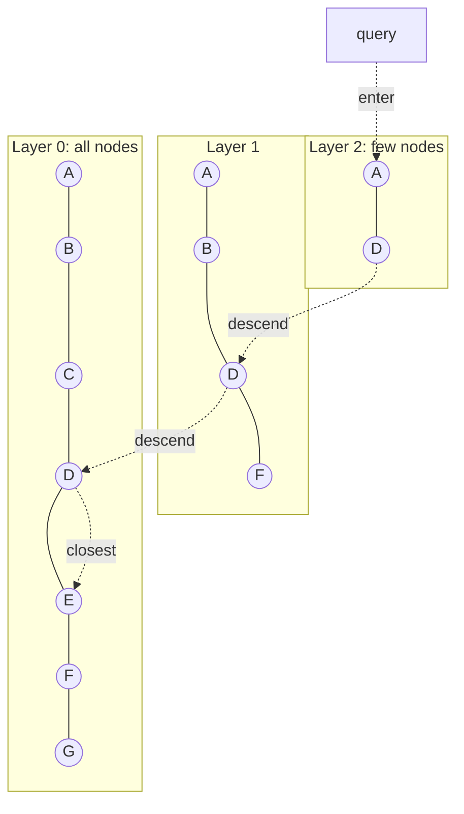
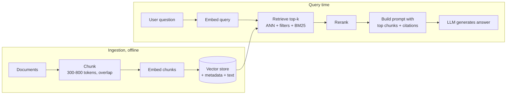

# Vector Databases & pgvector

<Note>
**TL;DR**

An **embedding** is a vector of numbers that places text, images or other items in a space where "similar meaning" means "close together". A **vector database** stores these vectors and answers "find the k nearest neighbours" fast, using **approximate** indexes such as **HNSW** and **IVFFlat** that trade a little recall for huge speedups. **pgvector** adds this to Postgres, which is enough for most applications up to tens of millions of vectors. The hard parts in production are filtering, hybrid search, memory sizing and re-embedding when models change.
</Note>

## The idea: embeddings

- An embedding model (OpenAI, Voyage, Cohere, open-source like BGE/E5) maps input to a fixed-length float array, e.g. **1536** or **1024 dimensions**.
- Semantically similar inputs map to nearby vectors: "refund policy" is close to "how do I get my money back".
- Search becomes geometry: embed the query, then find the stored vectors nearest to it.

### Distance metrics

| Metric | pgvector operator | Meaning | Use when |
|---|---|---|---|
| Cosine distance | `<=>` | 1 − cos(angle); ignores length | Most text embeddings |
| Inner product (negative) | `<#>` | −(a·b); pgvector returns the negative so smaller is closer | Normalized vectors (fastest) |
| L2 / Euclidean | `<->` | straight-line distance | Image/feature vectors, when the model says so |
| L1 | `<+>` | Manhattan distance | Rare |
| Hamming / Jaccard | `<~>` / `<%>` | on `bit` vectors | Binary quantized vectors |

**Normalization**: if vectors are normalized to length 1, cosine, inner product and L2 give the **same ranking**, and inner product is cheapest. Many providers already return normalized embeddings. Always use the metric the embedding model was trained for.

## Exact kNN vs ANN

- **Exact kNN**: compare the query to every vector. Perfect recall, cost O(N·d). Fine for up to roughly 100k vectors or when a filter leaves few candidates.
- **ANN (approximate nearest neighbour)**: an index visits a small fraction of vectors. Recall is below 100% (often 95–99%) but latency drops by orders of magnitude.
- **Recall@k** = fraction of the true top-k found by the ANN query. It is the key quality metric for an index.

## ANN index families

### HNSW (Hierarchical Navigable Small World)

A multi-layer proximity graph. Upper layers are sparse "express lanes", the bottom layer has every vector. Search starts at the top, greedily walks toward the query, drops a layer, repeats.



| Parameter | pgvector default | Effect |
|---|---|---|
| `m` | 16 | max edges per node per layer. Higher = better recall, more memory, slower build |
| `ef_construction` | 64 | candidate list size while building. Higher = better graph, slower build |
| `hnsw.ef_search` | 40 | candidate list size at query time. Higher = better recall, slower query. Must be ≥ `LIMIT` |

- **Pros**: best recall/latency trade-off, no training step, can be built on an empty table and updated incrementally.
- **Cons**: slow, memory-hungry builds; the index is large (vectors + graph links); deletes leave tombstones until vacuum.

### IVFFlat (inverted file with flat lists)

Runs k-means to split vectors into `lists` clusters. A query finds the nearest centroids and scans only `probes` lists.

- `lists`: pgvector suggests starting at `rows / 1000` up to 1M rows, `sqrt(rows)` above that.
- `ivfflat.probes`: start near `sqrt(lists)`. Default 1 (fast, low recall).
- **Must be built after data is loaded**: centroids come from existing rows. If the distribution shifts, recall degrades until you rebuild.
- **Pros**: faster build, smaller index. **Cons**: lower recall than HNSW at the same speed, needs periodic rebuilds.

### Quantization (shrinking vectors)

| Technique | Idea | Savings | Cost |
|---|---|---|---|
| `halfvec` (float16) | 2 bytes per dimension instead of 4 | 2x | tiny recall loss |
| Binary quantization | keep only the sign bit per dimension, compare with Hamming | 32x | big recall loss; **re-rank** top candidates with full vectors |
| Product quantization (PQ) | split vector into sub-vectors, replace each with a codebook ID | 10–60x | used by FAISS, Milvus, Qdrant; not native in pgvector |
| Scalar quantization (int8) | map floats to 8-bit ints | 4x | small recall loss |

## Full pgvector example

```sql
CREATE EXTENSION IF NOT EXISTS vector;

CREATE TABLE items (
  id         bigserial PRIMARY KEY,
  tenant_id  bigint NOT NULL,
  content    text NOT NULL,
  embedding  vector(1536) NOT NULL,
  model      text NOT NULL DEFAULT 'text-embedding-3-small',
  created_at timestamptz NOT NULL DEFAULT now()
);

-- Speed up the build: give it memory and parallel workers
SET maintenance_work_mem = '4GB';
SET max_parallel_maintenance_workers = 7;

-- HNSW index for cosine distance
CREATE INDEX items_embedding_hnsw
  ON items USING hnsw (embedding vector_cosine_ops)
  WITH (m = 16, ef_construction = 64);

-- Query: top 10 nearest to a query vector ($1 is a vector(1536) parameter)
SET hnsw.ef_search = 100;
SELECT id, content, embedding <=> $1 AS distance
FROM items
ORDER BY embedding <=> $1
LIMIT 10;
```

Notes:
- The operator class must match the operator: `vector_cosine_ops` ↔ `<=>`, `vector_l2_ops` ↔ `<->`, `vector_ip_ops` ↔ `<#>`.
- The index is only used with `ORDER BY <distance expression> LIMIT n`. A `WHERE distance < 0.3` alone will not use it.
- `SET LOCAL` inside a transaction scopes the setting to one query.
- HNSW index limits: `vector` up to 2,000 dimensions, `halfvec` up to 4,000, `bit` up to 64,000.

IVFFlat alternative:

```sql
-- after loading data
CREATE INDEX items_embedding_ivf
  ON items USING ivfflat (embedding vector_l2_ops) WITH (lists = 1000);
SET ivfflat.probes = 32;
SELECT id FROM items ORDER BY embedding <-> $1 LIMIT 10;
```

Half-precision and binary quantization with re-ranking:

```sql
-- index a float16 copy: half the index size. Same trick indexes 3072-dim models
-- (over the 2,000-dim limit for vector, under 4,000 for halfvec)
CREATE INDEX ON items USING hnsw ((embedding::halfvec(1536)) halfvec_cosine_ops);
-- query must use the same expression to hit the index:
-- ORDER BY embedding::halfvec(1536) <=> $1::halfvec(1536) LIMIT 10

-- binary quantization + re-rank with full precision
CREATE INDEX ON items USING hnsw ((binary_quantize(embedding)::bit(1536)) bit_hamming_ops);

SELECT id, content FROM (
  SELECT * FROM items
  ORDER BY binary_quantize(embedding)::bit(1536) <~> binary_quantize($1)
  LIMIT 200                       -- cheap candidate set
) candidates
ORDER BY embedding <=> $1         -- exact re-rank
LIMIT 10;
```

## The filtering problem

Real queries filter: "nearest docs **for tenant 42**, **in English**, **after 2025**".

- **Post-filtering**: ANN returns the top `ef_search` candidates, then `WHERE` removes non-matching ones. If the filter is selective, you may get **fewer than k results or zero** ("overfiltering").
- **Pre-filtering**: apply the filter first, then search only matching vectors. Exact but may fall back to a slow scan; graph indexes can't easily skip non-matching nodes.
- **pgvector's answer (0.8.0+)**: **iterative index scans**. If not enough rows survive the filter, the index scan continues automatically.

```sql
SET hnsw.iterative_scan = relaxed_order;   -- off (default) | strict_order | relaxed_order
SET hnsw.max_scan_tuples = 20000;          -- stop after this many tuples (default 20000)

SELECT id, content FROM items
WHERE tenant_id = 42
ORDER BY embedding <=> $1
LIMIT 10;

-- IVFFlat equivalent
SET ivfflat.iterative_scan = relaxed_order;
SET ivfflat.max_probes = 100;
```

`relaxed_order` gives better recall but results can be slightly out of order; wrap in a subquery with `ORDER BY distance` if exact order matters. Other options: a B-tree index on the filter column (the planner may choose exact search on the filtered subset), **partial indexes** per category, or **partitioning** by tenant.

## Hybrid search

Vectors are good at meaning, bad at exact tokens (product codes, names, error IDs). Keyword search (BM25 / Postgres full text) is the opposite. **Hybrid search** runs both and fuses the rankings. **Reciprocal Rank Fusion (RRF)** is the simple, robust default: `score = Σ 1 / (k + rank)`, with k ≈ 60.

```sql
WITH semantic AS (
  SELECT id, row_number() OVER (ORDER BY embedding <=> $1) AS rank
  FROM items
  ORDER BY embedding <=> $1
  LIMIT 50
),
keyword AS (
  SELECT id, row_number() OVER (ORDER BY ts_rank_cd(tsv, q) DESC) AS rank
  FROM items, plainto_tsquery('english', $2) q
  WHERE tsv @@ q
  ORDER BY ts_rank_cd(tsv, q) DESC
  LIMIT 50
)
SELECT coalesce(s.id, k.id) AS id,
       coalesce(1.0 / (60 + s.rank), 0) + coalesce(1.0 / (60 + k.rank), 0) AS rrf_score
FROM semantic s
FULL OUTER JOIN keyword k ON s.id = k.id
ORDER BY rrf_score DESC
LIMIT 10;
-- assumes: ALTER TABLE items ADD COLUMN tsv tsvector
--   GENERATED ALWAYS AS (to_tsvector('english', content)) STORED;
--   CREATE INDEX ON items USING gin (tsv);
```

A **cross-encoder reranker** (Cohere Rerank, Voyage rerank, BGE reranker) on the fused top 50 usually improves quality further.

## RAG pipeline

Retrieval-Augmented Generation grounds an LLM answer in your documents.



Key choices: chunk size and boundaries (split on headings, not mid-sentence), metadata for filtering and citations, same embedding model for documents and queries, and evaluation on real questions.

## Dedicated vector DBs vs vector support in general DBs

| Option | Type | Notes |
|---|---|---|
| **pgvector** (+ **pgvectorscale**) | Postgres extension | Transactions, joins, one system; pgvectorscale (Timescale/Tiger Data) adds a StreamingDiskANN index |
| **Pinecone** | Managed, serverless | No ops, pay per usage, proprietary |
| **Qdrant** | Open source (Rust) | Strong filtering, quantization, payload indexes |
| **Weaviate** | Open source (Go) | Built-in vectorizer modules, hybrid search |
| **Milvus / Zilliz** | Open source, distributed | Billions of vectors, many index types (IVF-PQ, DiskANN, GPU) |
| **Chroma** | Open source, embedded | Prototyping, small apps |
| **MongoDB Atlas Vector Search** | Document DB | `$vectorSearch` stage next to your documents ([Unit 13 MongoDB Atlas Search](/Software%20Engineering/Databases/MongoDB/Unit%2013%20MongoDB%20Atlas%20Search)) |
| **Redis vector sets / Redis Query Engine** | In-memory | Very low latency, RAM cost |
| **Elasticsearch / OpenSearch** | Search engine | `dense_vector` / k-NN, strong hybrid with BM25 |

### How to choose

- Already on Postgres and under ~10–50M vectors? **Start with pgvector.** You get transactional consistency between data and embeddings, and filters are just SQL.
- Need hybrid search with heavy text relevance tuning? Elasticsearch/OpenSearch, or Postgres full text + RRF.
- Hundreds of millions to billions of vectors, strict latency, or advanced quantization? Qdrant, Milvus, or a managed service.
- No ops capacity at all? Pinecone or a managed Qdrant/Weaviate.

## Evaluating recall

1. Take a sample of real queries (a few hundred).
2. Compute the **exact** top-k (disable the index: `SET enable_indexscan = off;` or query a copy without an index).
3. Run the ANN query and compute recall@k = |ANN ∩ exact| / k.
4. Sweep `ef_search` / `probes` and plot recall vs p95 latency. Pick the knee.
5. Separately, evaluate **retrieval quality** (does the right document come back?) with labeled pairs: recall@k, MRR, nDCG. A perfect index over a bad embedding model is still bad.

<Warning>
**Common pitfalls**

- Using a different operator than the index's operator class (the index is silently ignored). Check with `EXPLAIN`, see [Query Optimization & EXPLAIN](/Software%20Engineering/Databases/Core%20Concepts/Query%20Optimization%20%26%20EXPLAIN).
- Building IVFFlat on an empty or tiny table; centroids are garbage.
- Selective `WHERE` filters with HNSW returning fewer than k rows (enable iterative scans).
- Mixing embeddings from two models or versions in one column. Distances between them are meaningless.
- `ef_search` lower than `LIMIT`.
- Index build running out of `maintenance_work_mem` and spilling to disk (builds get dramatically slower).
- Storing only vectors without the source text and model version; you can't re-embed or debug.
</Warning>

## Senior perspective

- **Embedding model versioning**: store `model` (and version) per row. Changing models means **re-embedding everything**. Plan it like a migration: new column or table, backfill in batches, build the new index, dual-query and compare, switch, drop the old one ([Database Migrations & Schema Evolution](/Software%20Engineering/Databases/Core%20Concepts/Database%20Migrations%20%26%20Schema%20Evolution)).
- **Dimension cost**: memory ≈ rows × dims × 4 bytes for `vector` (2 for `halfvec`), plus HNSW graph overhead. 10M × 1536 × 4 B ≈ 61 GB before the graph. Models that support shorter outputs (Matryoshka embeddings) or `halfvec` can halve or quarter this with small quality loss.
- **Memory sizing**: HNSW performs well when the index fits in RAM (shared_buffers + OS cache). Once it spills to disk, latency jumps. Consider disk-oriented indexes (DiskANN / pgvectorscale) or quantization.
- **Index builds** on large tables take hours; use `CREATE INDEX CONCURRENTLY`, generous `maintenance_work_mem`, parallel workers, and build on a replica or new table when possible.
- **Multi-tenancy**: one shared index with a tenant filter (needs iterative scans), partitions per large tenant, or separate collections/namespaces in a dedicated DB. Small tenants often do fine with exact search over their subset.
- **Freshness**: HNSW supports inserts, but heavy updates and deletes degrade graph quality; vacuum regularly. For IVFFlat, rebuild as the distribution drifts.
- **Cost**: embedding API calls at ingest and query time, RAM for indexes, re-embedding runs. Cache query embeddings for frequent questions.
- **Security**: embeddings can leak information about the source text; apply the same access controls as the text itself and filter by permissions at query time.

<Info>
**🆕 2025–2026**

- **pgvector 0.8.0** (2024-10-30) introduced **iterative index scans** (`hnsw.iterative_scan`, `ivfflat.iterative_scan`, `hnsw.max_scan_tuples`, `ivfflat.max_probes`), fixing most overfiltering problems. It is the baseline for 2025–2026 deployments.
- **pgvector 0.8.1** (2025-09-04) added **PostgreSQL 18** support.
- **pgvector 0.8.2** (2026-02-26) fixed **CVE-2026-3172**, a buffer overflow in **parallel HNSW index builds**. Upgrade is advised.
- **MongoDB acquired Voyage AI** (embedding and reranking models), announced 2025-02-24.
- **MongoDB 8.2** (2025-09-16) brought Search and Vector Search to self-managed Community/Enterprise Server in public preview; **MongoDB 8.3** (2026-05-07) made `$scoreFusion` (hybrid score fusion) generally available.
- **Redis 8** (2025) added **vector sets**, a native data type for vector similarity.
</Info>

## Interview questions

<Accordion title="What is an embedding and why does nearest-neighbour search work on it?">
A fixed-length vector produced by a model trained so that semantically similar inputs land close together. Similarity search therefore becomes a geometric nearest-neighbour problem using cosine, inner product or L2 distance.
</Accordion>

<Accordion title="HNSW vs IVFFlat?">
HNSW is a layered proximity graph: better recall/latency, no training, supports inserts on an empty table, but slower builds and more memory. IVFFlat clusters vectors with k-means and scans the nearest `probes` lists: faster to build and smaller, but needs data before building, lower recall at the same speed, and rebuilds as data drifts.
</Accordion>

<Accordion title="What happens when you combine a selective WHERE filter with an ANN index?">
The index returns its top candidates, then the filter removes most of them, so you can get fewer than k results (overfiltering). Fixes: iterative index scans in pgvector 0.8+, partial indexes or partitions per filter value, pre-filtering with exact search on small subsets, or engines with filter-aware graph traversal.
</Accordion>

<Accordion title="What is hybrid search and how does RRF work?">
Running keyword (BM25/full-text) and vector search and merging results. RRF scores each document as the sum of 1/(k + rank) over the lists it appears in (k ≈ 60), so documents ranked well by both rise to the top without needing comparable score scales.
</Accordion>

<Accordion title="How would you size memory for 20M 1024-dim embeddings?">
20M × 1024 × 4 bytes ≈ 82 GB for float32 data, plus HNSW links (roughly m × 2 neighbours per node in layer 0, 4–8 bytes each) and heap overhead, so 100+ GB to keep hot. With `halfvec` about half; with binary quantization plus re-ranking much less. Then decide: bigger instance, quantization, disk-based index, or sharding.
</Accordion>

<Accordion title="Your team wants to switch embedding models. What is the plan?">
Treat it as a data migration: add a new column/table keyed by model version, backfill embeddings in rate-limited batches, build the new index concurrently, evaluate retrieval quality offline and with shadow traffic, switch reads, then drop the old column and index. Never mix vectors from different models in one index.
</Accordion>

<Accordion title="When is pgvector not enough?">
Very large collections (hundreds of millions+) where the index can't fit in RAM, extreme QPS requirements, need for advanced quantization or GPU indexes, or when vector workload would starve the OLTP primary. Then consider pgvectorscale, a read replica dedicated to vectors, or a dedicated vector DB.
</Accordion>

## Related
- [AI & ML Index](/Software%20Engineering/AI%20%26%20ML/AI%20%26%20ML%20Index) · [Databases Index](/Software%20Engineering/Databases/Databases%20Index)
- [NoSQL Database Types](/Software%20Engineering/Databases/Core%20Concepts/NoSQL%20Database%20Types) · [Database Indexes](/Software%20Engineering/Databases/Database%20Round/Indexes/Database%20Indexes) · [Query Optimization & EXPLAIN](/Software%20Engineering/Databases/Core%20Concepts/Query%20Optimization%20%26%20EXPLAIN)
- [Unit 13 MongoDB Atlas Search](/Software%20Engineering/Databases/MongoDB/Unit%2013%20MongoDB%20Atlas%20Search) · [MongoDB](/Software%20Engineering/Databases/MongoDB/MongoDB)
- [Database Migrations & Schema Evolution](/Software%20Engineering/Databases/Core%20Concepts/Database%20Migrations%20%26%20Schema%20Evolution)

## Sources
- [pgvector README (GitHub)](https://github.com/pgvector/pgvector)
- [pgvector 0.8.0 released (2024-10-30)](https://www.postgresql.org/about/news/pgvector-080-released-2952/)
- [pgvector 0.8.2 released, CVE-2026-3172 (2026-02-26)](https://www.postgresql.org/about/news/pgvector-082-released-3245/)
- [MongoDB announces acquisition of Voyage AI (2025-02-24)](https://www.mongodb.com/press/mongodb-announces-acquisition-of-voyage-ai)
- [MongoDB 8.2 is now available](https://www.mongodb.com/products/updates/mongodb-8-2-is-now-available/)
- [MongoDB 8.3 release notes](https://www.mongodb.com/docs/manual/release-notes/8.3/)
- [Redis blog: Redis 8 and AGPLv3 (vector sets)](https://redis.io/blog/agplv3/)
- [Malkov & Yashunin, Efficient and robust approximate nearest neighbor search using HNSW graphs (arXiv:1603.09320)](https://arxiv.org/abs/1603.09320)
- [Cormack, Clarke & Buettcher, Reciprocal Rank Fusion (SIGIR 2009)](https://plg.uwaterloo.ca/~gvcormac/cormacksigir09-rrf.pdf)
- [Jégou et al., Product Quantization for Nearest Neighbor Search (IEEE TPAMI 2011)](https://ieeexplore.ieee.org/document/5432202)
- [Lewis et al., Retrieval-Augmented Generation for Knowledge-Intensive NLP Tasks (arXiv:2005.11401)](https://arxiv.org/abs/2005.11401)
