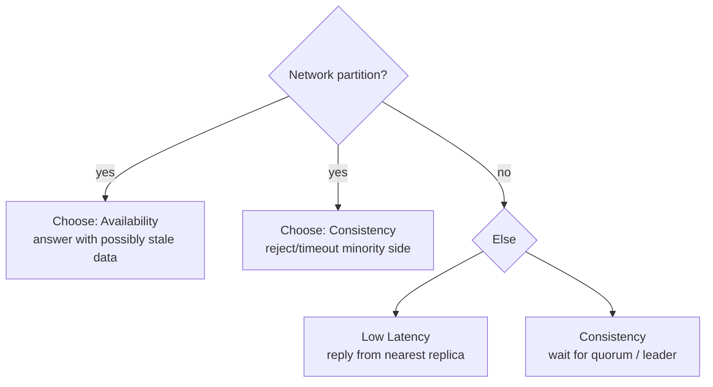

# CAP Theorem

> [!tldr] TL;DR
> CAP says that when a **network partition** happens, a replicated data store must choose between **Consistency** (every read sees the latest write, i.e. linearizability) and **Availability** (every request to a working node gets a non-error answer). Partitions can't be ruled out, so the real choice is **CP or AP during a partition**. **PACELC** adds the everyday case: **E**lse (no partition) you trade **L**atency against **C**onsistency. Most systems are tunable (quorums, read concerns), so ask "which guarantee, for which operation, at what latency?"

## The idea

The CAP theorem, conjectured by Eric Brewer (2000) and proved by Gilbert and Lynch (2002), says a distributed data store can't guarantee all three of:

- **Consistency (C)**: every read receives the most recent write or an error. This is **linearizability** (atomic consistency): each operation appears to take effect at a single instant between its request and its response.
- **Availability (A)**: every request received by a non-failing node gets a (non-error) response, without a guarantee that it contains the latest write.
- **Partition tolerance (P)**: the system keeps working even if the network drops or delays messages between nodes.

In practice networks do partition (switch failures, GC pauses, cross-region links), so P isn't optional. The choice boils down to what happens **during** a partition:

- **Favor consistency (CP)**: all nodes must agree, so the side that can't reach a quorum **refuses** requests (errors/timeouts) rather than return stale data.
- **Favor availability (AP)**: every node keeps accepting reads and writes, so nodes **won't see the same data** until the partition heals; conflicts must be resolved later.

The user's original note says CAP is "mostly about writes, and mostly in NoSQL". It applies to any replicated system (a Postgres primary with async replicas is effectively AP for reads from replicas), and to reads as much as writes, but it became famous through the NoSQL wave.

## PACELC

Daniel Abadi (2010/2012): **if Partition, choose A or C; Else, choose Latency or Consistency.** Even with a healthy network, strong consistency costs round trips to a leader or a quorum, often across data centers.

| System (default config) | P: A or C | E: L or C | Notes |
|---|---|---|---|
| Cassandra, ScyllaDB, Riak, DynamoDB (eventually consistent reads) | A | L | Tunable: `QUORUM` reads/writes move toward C |
| MongoDB (majority write concern, primary reads) | C | C | Secondary reads / `w:1` trade toward L |
| PostgreSQL / MySQL with async replicas | C (primary) | L if you read replicas | Sync replication = EC |
| Spanner, CockroachDB, YugabyteDB, FoundationDB | C | C | Pay latency for consensus (Paxos/Raft) |
| etcd, ZooKeeper, Consul | C | C | Coordination services; minority side unavailable |

## Consistency vs latency

To give consistent data a system must often wait for several nodes (a quorum or the leader), which adds latency. With N replicas, write quorum W and read quorum R, **R + W > N** guarantees a read overlaps the latest write (e.g. N=3, W=2, R=2). Lower W or R answers faster but may return stale data.

## Consistency models (weak → strong)

- **Eventual consistency**: if writes stop, replicas converge eventually. Reads may be stale for milliseconds to hours in the meantime.
- **Read-your-writes / monotonic reads / consistent prefix** (session guarantees): practical middle grounds; e.g. route a user's reads to the primary for a few seconds after their write.
- **Causal consistency**: if A causally precedes B (B was written after seeing A), everyone sees A before B. A compromise between eventual consistency and linearizability; MongoDB offers causally consistent sessions.
- **Linearizability**: behaves like a single copy with atomic operations. What CAP's C means.
- **Strict serializability**: linearizability + serializable transactions (Spanner).

## Conflict resolution (AP systems)

When nodes accept writes independently, they must reconcile:

- **Majority / quorum**: apply what most nodes have.
- **Timestamps, last-write-wins (LWW)**: keep the write with the latest timestamp. Simple, but silently drops concurrent writes and depends on clock sync.
- **Version vectors / vector clocks**: detect truly concurrent writes and keep siblings for the app to merge.
- **CRDTs**: data types (counters, sets, maps) that merge automatically and deterministically.

Anti-entropy mechanisms that repair divergence: **read repair** (fix stale replicas noticed during reads), **hinted handoff**, and background **anti-entropy** using **Merkle trees** to find differing ranges cheaply.

## Worked example

A shopping cart in a 3-node AP store (Dynamo-style). A partition splits node C from A and B. The user adds item X via A and removes item Y via C. After healing, the versions are concurrent: LWW would lose one change; a version vector keeps both and the app merges (union of adds, apply removes), which is what Amazon's Dynamo paper describes for carts.

A bank balance in a CP store: during the partition, the minority side refuses writes. Some users see errors, but no one can double-spend.

## Pitfalls

> [!warning] Common pitfalls
> - "Pick two of three" is misleading: you can't drop P in a distributed system, and when there's no partition you can have both C and A.
> - Confusing CAP consistency (linearizability) with ACID consistency (constraints). See [[Transactions & ACID]].
> - Calling a database "CP" or "AP" as a whole: guarantees vary per operation and configuration (MongoDB read preference, Cassandra consistency levels).
> - Relying on wall-clock timestamps for ordering across nodes (clock skew).

## Senior perspective

- Decide per use case: money, inventory and uniqueness need linearizable operations; feeds, counters, recommendations tolerate staleness.
- Latency is the everyday cost (PACELC), partitions are the rare one. Cross-region strong consistency means ~100 ms round trips per write.
- Ask in review: What happens to this request during a partition between regions? Can users read their own writes? What is the conflict resolution, and is data silently dropped?
- Jepsen reports are the best reality check on vendor claims.

## Interview questions

> [!question]- State the CAP theorem precisely.
> In an asynchronous network where partitions can occur, a replicated read/write register can't provide both linearizability and availability (every non-failed node responds) during a partition. So under partition you choose consistency (some requests fail) or availability (some reads are stale).

> [!question]- What does PACELC add?
> That without partitions there's still a trade-off between latency and consistency, because consistent operations need coordination round trips. Systems are classified like PA/EL (Cassandra) or PC/EC (Spanner).

> [!question]- Is MongoDB CP or AP?
> With default settings (majority writes, reads from the primary) it behaves CP: during a partition the side without a majority has no primary and rejects writes. Reading from secondaries or using `w:1` gives up consistency for availability/latency.

> [!question]- How do quorums give consistency in leaderless systems?
> With N replicas, writes wait for W acknowledgements and reads query R replicas; if R + W > N the read and write sets overlap, so a read sees at least one up-to-date copy (with version comparison and read repair). Sloppy quorums and concurrent writes can still cause anomalies.

> [!question]- How do AP systems resolve conflicting writes?
> Last-write-wins by timestamp, version vectors that surface siblings for application merge, or CRDTs that merge automatically. Anti-entropy with read repair and Merkle trees converges replicas.

## Related
- [[Databases Index]] · [[Database Round]]
- [[Replication & 2PC 3PC]] · [[Sharding & Partitioning]] · [[Clustering and Scaling]]
- [[NoSQL Database Types]] · [[Transactions & ACID]] · [[Isolation Levels & Read Phenomena]]

## Sources
- Gilbert & Lynch, *Brewer's Conjecture and the Feasibility of Consistent, Available, Partition-Tolerant Web Services* (2002): https://users.ece.cmu.edu/~adrian/731-sp04/readings/GL-cap.pdf
- Eric Brewer, *CAP Twelve Years Later: How the "Rules" Have Changed* (2012): https://www.infoq.com/articles/cap-twelve-years-later-how-the-rules-have-changed/
- Daniel Abadi, *Consistency Tradeoffs in Modern Distributed Database System Design* (IEEE Computer, 2012): https://www.cs.umd.edu/~abadi/papers/abadi-pacelc.pdf
- DeCandia et al., *Dynamo: Amazon's Highly Available Key-value Store* (2007): https://www.allthingsdistributed.com/files/amazon-dynamo-sosp2007.pdf
- Martin Kleppmann, *Designing Data-Intensive Applications*, ch. 5 and 9
- Jepsen analyses: https://jepsen.io/analyses
