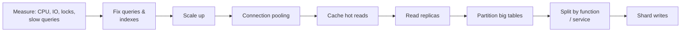

# Clustering and Scaling

<Note>
**TL;DR**

**Scale up** (bigger machine) first; it's simple and modern servers are huge. **Scale out** (more machines) when you must: read replicas for read load, caching, then partitioning/sharding for write load. A **cluster** is several servers that act as one system to provide **high availability** (failover), **load balancing** and more **capacity**. Redundancy comes from **replication** (copies across servers) and **RAID** (copies across disks). Every step out adds consistency and operational complexity.
</Note>

## Failover

The process of switching to a redundant or standby server/database when the primary fails. It can be **manual** or **automatic** (Patroni for Postgres, MySQL Group Replication / InnoDB Cluster, MongoDB replica set elections, managed Multi-AZ services).

Key concerns: **detection** (health checks, timeouts), **promotion** (pick the most up-to-date replica), **redirecting clients** (virtual IP, DNS, proxy, driver topology discovery) and avoiding **split brain** (two primaries), usually via a consensus store (etcd/Consul) or a majority vote plus **fencing**.

## Redundancy

Duplicating critical components or functions to increase reliability, storing the same data in more than one place. Two ways:

1. **Replication**: the same data stored on multiple database servers. Protects against a whole machine or zone failing. See [Replication & 2PC 3PC](/Software%20Engineering/Databases/Database%20Round/Replication%20%26%202PC%203PC).
2. **RAID (Redundant Array of Independent Disks)**: storage virtualization combining several disks into one logical unit for redundancy and/or performance. RAID 1 mirrors, RAID 10 stripes across mirrors (common for databases), RAID 5/6 use parity (slower writes). Protects against disk failure only, not server loss or mistakes.

Neither is a backup: see [Database Backup](/Software%20Engineering/Databases/Database%20Round/Database%20Backup).

## Scaling

Two ways:

1. **Vertical scaling (scaling up)**: add resources (CPU, RAM, faster disks) to the same instance. Simple, no application changes, keeps full ACID and joins. Limits: the biggest machine, cost curve, a single point of failure, and resizing may need a restart.
2. **Horizontal scaling (scaling out)**: run multiple instances and spread the load. Near-unlimited in theory, better fault tolerance, but brings distributed-systems problems (consistency, rebalancing, cross-node queries).

| | Vertical | Horizontal |
|---|---|---|
| Complexity | Low | High |
| Ceiling | Largest instance | Very high |
| Consistency | Easy | Trade-offs (CAP/PACELC) |
| Failure impact | Whole DB | Partial |
| Typical cost | Grows steeply at the top | Linear-ish, plus ops cost |

### When to scale, and in what order

Most slowness is missing indexes or bad queries; fix those before buying hardware. Sharding is last because it's hard to undo. See [Sharding & Partitioning](/Software%20Engineering/Databases/Database%20Round/Sharding%20%26%20Partitioning).

## Clustering

Using multiple servers or storage devices that work together but are **viewed** as a single system.

Clustering provides:

1. **Load balancing**: distribute load across machines to use resources well.
2. **High availability**: redundancy and failover.
3. **Fault tolerance**: keep working even if a component is down.
4. **Increased capacity**: handle higher volumes of work.

Types:

1. **Database clustering**: several database servers working as one (e.g. a replica set, Galera, Oracle RAC's shared-disk cluster).
2. **Load-balancing clustering**: incoming traffic spread across servers (e.g. reads balanced across replicas behind HAProxy or a driver).
3. **High-availability (failover) clustering**: if one server goes down, another takes over (active/passive).
4. **Computational clustering**: more compute power; the workload is divided among nodes for parallel computation (MPP warehouses, Spark, Citus distributing a query across workers).

Architectures: **shared-nothing** (each node has its own disk and data; most modern distributed DBs), **shared-disk** (nodes share storage; Oracle RAC, Aurora's storage layer), **shared-everything** (a single SMP machine).

## Pitfalls

<Warning>
**Common pitfalls**

- Adding read replicas without handling **replication lag**: users don't see what they just wrote.
- Failover that was never tested; clients caching the old primary's IP; split brain.
- Scaling out the app tier without a connection pooler, exhausting DB connections ([Connection Pooling](/Software%20Engineering/Databases/Database%20Round/Connection%20Pooling)).
- Sharding prematurely: cross-shard joins and transactions become application problems.
</Warning>

## Senior perspective

- Define availability targets (99.9% ≈ 43 min/month downtime; 99.99% ≈ 4.3 min) and design failover to meet them, including how long detection and DNS/driver switchover take.
- Prefer managed HA (Multi-AZ RDS/Aurora, Cloud SQL HA, Atlas replica sets) unless you have the team to run Patroni/Orchestrator.
- Separate workloads: OLTP primary, replicas for read-heavy endpoints, a warehouse for analytics.
- Plan capacity with headroom (e.g. CPU < 60% at peak) because failover doubles load on survivors.

## Interview questions

<Accordion title="Vertical vs horizontal scaling for a database?">
Vertical adds resources to one server: simple, keeps transactions and joins, but has a ceiling and is a single point of failure. Horizontal adds servers (replicas, shards): higher ceiling and resilience but introduces replication lag, distributed transactions and operational complexity.
</Accordion>

<Accordion title="How does automatic failover work and what can go wrong?">
Health checks detect the primary's failure, a coordinator (or majority vote) promotes the most up-to-date replica, and clients are redirected. Risks: false positives causing unnecessary failovers, split brain without fencing, data loss with async replication, and clients still pointing at the old primary.
</Accordion>

<Accordion title="What's the difference between replication and RAID?">
RAID provides redundancy across disks within one server; replication copies data to other servers (possibly other zones/regions). RAID survives a disk failure; replication survives a machine or site failure. Neither protects against logical errors.
</Accordion>

<Accordion title="Your read traffic grows 10x. What do you do?">
Check queries and indexes, add caching for hot reads, add read replicas with lag-aware routing (read-your-writes on the primary), and use a pooler. Writes aren't affected by replicas; if writes grow, consider partitioning or sharding.
</Accordion>

## Related
- [Databases Index](/Software%20Engineering/Databases/Databases%20Index) · [Database Round](/Software%20Engineering/Databases/Database%20Round/Database%20Round)
- [Replication & 2PC 3PC](/Software%20Engineering/Databases/Database%20Round/Replication%20%26%202PC%203PC) · [Sharding & Partitioning](/Software%20Engineering/Databases/Database%20Round/Sharding%20%26%20Partitioning) · [CAP Theorem](/Software%20Engineering/Databases/Database%20Round/CAP%20Theorem) · [Connection Pooling](/Software%20Engineering/Databases/Database%20Round/Connection%20Pooling) · [Database Backup](/Software%20Engineering/Databases/Database%20Round/Database%20Backup)

## Sources
- PostgreSQL docs, High Availability, Load Balancing, and Replication: https://www.postgresql.org/docs/current/high-availability.html
- Patroni docs: https://patroni.readthedocs.io/
- MongoDB docs, Replica Set Elections: https://www.mongodb.com/docs/manual/core/replica-set-elections/
- AWS, Amazon RDS Multi-AZ deployments: https://aws.amazon.com/rds/features/multi-az/
- Martin Kleppmann, *Designing Data-Intensive Applications*, ch. 1, 5, 6
