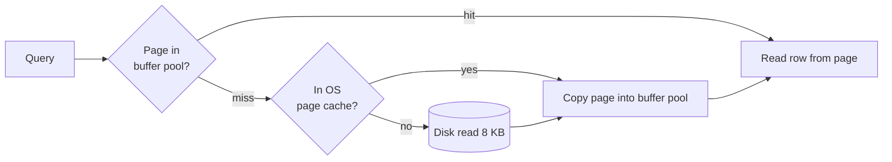

# Database Pages

> [!tldr] TL;DR
> Databases store and move data in fixed-size **pages** (Postgres 8 KB, InnoDB 16 KB). Every read pulls whole pages from disk into the **buffer pool**; every write modifies a page in memory, logs the change to the WAL, and flushes the page later. A Postgres heap page has a 24-byte header, an array of 4-byte **item pointers**, free space, and the tuples themselves growing from the end. The item-pointer indirection is what makes **HOT** updates possible. Smaller rows mean more rows per page, which means fewer IOs.

## The idea

Databases use fixed-size pages to store data: the data ends up as bytes in the page. This separates the **storage engine** (where everything is stored as pages) from the front end (SQL, formatting, API). It also makes caching, reading and writing simpler because everything is a page.

## Reading and writing through pages

![[Pages_in_DB.drawio.png]]

**Reading a row**

1. The DB works out which page the row lives in, and which file and offset hold that page.
2. It asks the OS to read that file at that offset for one page length (8 KB for Postgres).
3. The OS checks its **file system cache**. If the page isn't there, it issues the device read.
4. The page lands in the database's **buffer pool** (shared buffers), a dedicated memory area. Now the requested row, and every other row on the page, is available. This makes index range scans efficient: neighbouring keys are often on the same page.

**Writing a row**

1. The DB finds the page holding the row, pulls it into the buffer pool if needed, and modifies it **in memory** (the page is now "dirty").
2. It appends a journal entry of the change to the **write-ahead log** and flushes the log on commit.
3. The dirty page stays in memory and may absorb more writes before the checkpointer/background writer flushes it to disk. Inserts and deletes work the same way, with different bookkeeping.



## What goes in a page

### SQL Server page layout

![[Screenshot_2023-07-23_at_5.42.00_PM.png]]

### PostgreSQL page layout

![[Screenshot_2023-07-23_at_6.01.01_PM.png]]

![[Screenshot_2023-07-23_at_6.01.28_PM.png]]

| Part | Size | Content |
|---|---|---|
| **Page header** | 24 bytes | Metadata: LSN of last change, checksum, flags, pointers to the start/end of free space |
| **ItemIds (line pointers)** | 4 bytes each | An array of **pointers** to items, not the items themselves: `(offset, length)` of each tuple within the page |
| **Free space** | variable | Between the pointer array (growing forward) and the tuples (growing backward) |
| **Items (tuples)** | variable | The tuples themselves, packed from the end of the page toward the front, each with a ~23-byte tuple header (`xmin`, `xmax`, `ctid`, infomask, ...) |
| **Special space** | variable | Empty for heap pages. Used by **index** pages, e.g. B-tree pages store links to the left and right sibling pages here |

Because indexes and `ctid`s point to an **item number** rather than a byte offset, Postgres can move tuples around within a page (compaction) without touching indexes. That same indirection enables **Heap-Only Tuple (HOT)** updates: when an update doesn't change any indexed column and the new version fits on the **same page**, the old line pointer is redirected to the new tuple and **indexes keep pointing at the old item id**, so no index writes are needed.

To clarify the vocabulary:

- **Row**: what the user sees.
- **Tuple**: the physical instance of a row in a page. The "item" is the tuple.
- The same row can have many tuples at once, e.g. 10 tuples: 7 old versions still visible to older transactions (MVCC), 2 dead ones nobody needs (waiting for VACUUM), 1 current. See [[MVCC & Vacuum]].

## Page content depends on the storage model

What you store in the page is a design choice; the goal is that each page read gives the workload as much useful information as possible.

| Model | Page holds | Good for |
|---|---|---|
| **Row store** | Whole rows, all attributes one after another | OLTP: fetch/modify whole records |
| **Column store** | Values of one column for many rows | OLAP: scan and aggregate a few columns; compresses well |
| **Document store** | Compressed documents, like a row store | Fetching whole documents |
| **Graph store** | Nodes with their connectivity (adjacency) | Traversals: neighbours on the same page |

See [[Row Vs Column Oriented Databases]].

## Small vs large pages

- **Small pages** are faster to read and write, especially when close to the device block size, but the header metadata is a bigger fraction of each page, and more pages means more pointers and more index levels.
- **Large pages** reduce header overhead and page splits, and suit scans and compression, but a cold read or a write of one small row moves more bytes (read/write amplification) and more rows share one page lock/latch.

Defaults: PostgreSQL 8 KB, MySQL InnoDB 16 KB, SQL Server 8 KB, Oracle 8 KB (configurable per tablespace), MongoDB WiredTiger uses variable-size pages (default max 32 KB for leaf pages, 4 KB internal). Postgres's page size is a compile-time option (`--with-blocksize`); InnoDB's is set at instance creation (`innodb_page_size`).

## How pages are stored on disk

A simple design: one file per table (or collection) holding a fixed-size page array: page 0, page 1, page 2, ... To read something we need **file name, offset, length**, and this design gives all three:

- file: the table's file,
- offset: `page_number × page_size`,
- length: `page_size`.

So to read pages 2 through 9 (8 pages) of table `test` with 8 KB pages: read from the table's file at offset `2 × 8192 = 16384` for `8 × 8192 = 65536` bytes.

Postgres does exactly this, splitting each table into 1 GB **segment files** (`base/<db_oid>/<relfilenode>`, `.1`, `.2`, ...) plus a free space map (`_fsm`) and visibility map (`_vm`) fork.

```sql
SELECT pg_relation_filepath('orders');         -- e.g. base/16384/16402
SELECT pg_relation_size('orders') / 8192 AS pages;
-- inspect a page (needs the pageinspect extension)
CREATE EXTENSION pageinspect;
SELECT lp, lp_off, lp_len, t_xmin, t_xmax, t_ctid
FROM heap_page_items(get_raw_page('orders', 0));
```

## Pitfalls

> [!warning] Common pitfalls
> - **Wide rows**: a few big columns on a hot table mean few rows per page and more IO. Move rarely used large columns to a side table; Postgres **TOAST**s values over ~2 KB out of line automatically.
> - **Random primary keys** (UUIDv4) scatter inserts across all pages of a B-tree: poor cache locality and page splits, especially painful in clustered InnoDB tables. Prefer sequential or time-ordered keys (bigint identity, UUIDv7).
> - **Torn pages**: a crash mid-write can leave half a page on disk. Postgres writes a **full-page image** to WAL the first time a page is modified after a checkpoint (`full_page_writes`) to repair this; data checksums detect corruption.

## Senior perspective

- Estimate capacity in pages: rows per page ≈ 8192 / (row size + ~28 bytes overhead). A 200-byte row gives ~35 rows per page, so 10 million rows ≈ 285k pages ≈ 2.2 GB before indexes.
- Cache hit ratio (`blks_hit / (blks_hit + blks_read)` in `pg_stat_database`) above ~99% is typical for OLTP; if it drops, the working set no longer fits in memory.
- Page-level features to know: `fillfactor` (leave room for HOT updates), checksums (default **on** for new clusters since PG 18), full-page writes and WAL compression (`wal_compression`).

> [!info]+ 🆕 2025–2026
> - **PostgreSQL 18 (2025-09-25)**: `initdb` now enables **data checksums by default** (use `--no-data-checksums` to opt out; this matters for `pg_upgrade`, since old and new clusters must match). Asynchronous I/O (`io_method`) changes how pages are read ahead from disk.
> - **PostgreSQL 19 (beta)** planned online enabling/disabling of checksums, but the feature was **reverted** before Beta 4 (2026-09-24), so don't expect it in 19.0.

## Interview questions

> [!question]- Why do databases use fixed-size pages?
> Uniform addressing (file + page number × size), simple caching and eviction in the buffer pool, alignment with OS/device blocks, and a clean boundary between storage engine and the rest of the system.

> [!question]- Describe the layout of a PostgreSQL heap page.
> 24-byte header, then an array of 4-byte line pointers growing forward, free space in the middle, tuples growing backward from the end, and an optional special area (used by index pages). Line pointers give indirection so tuples can move within the page.

> [!question]- What is a HOT update and why does it matter?
> A heap-only tuple update: when no indexed column changes and the new version fits in the same page, Postgres links the old line pointer to the new tuple and skips inserting new index entries. It cuts write amplification and index bloat for update-heavy tables.

> [!question]- Row size went from 100 to 1000 bytes. What happens to query performance?
> Rows per page drop about tenfold, so scans read ~10x more pages, the cache holds fewer rows, and index-to-heap lookups touch more pages. Large values may be TOASTed, adding lookups when those columns are selected.

> [!question]- What is the buffer pool and how does it relate to the OS cache?
> The database's own cache of pages in shared memory, managed with its own eviction policy and dirty-page tracking. Postgres also goes through the OS page cache, so a page can be cached twice; that's why `shared_buffers` is kept moderate and `effective_cache_size` tells the planner about OS caching.

## Related
- [[Databases Index]] · [[Database Round]]
- [[Database Internals]] · [[MVCC & Vacuum]] · [[Database Indexes]] · [[Row Vs Column Oriented Databases]]
- [[Transactions & ACID]] (WAL and durability)

## Sources
- PostgreSQL docs, Database Page Layout: https://www.postgresql.org/docs/current/storage-page-layout.html
- PostgreSQL docs, Database File Layout: https://www.postgresql.org/docs/current/storage-file-layout.html
- PostgreSQL docs, Heap-Only Tuples: https://www.postgresql.org/docs/current/storage-hot.html
- PostgreSQL docs, pageinspect: https://www.postgresql.org/docs/current/pageinspect.html
- MySQL docs, `innodb_page_size`: https://dev.mysql.com/doc/refman/8.4/en/innodb-parameters.html#sysvar_innodb_page_size
- Microsoft docs, Pages and extents architecture guide: https://learn.microsoft.com/en-us/sql/relational-databases/pages-and-extents-architecture-guide
- MongoDB docs, WiredTiger storage engine: https://www.mongodb.com/docs/manual/core/wiredtiger/
- Hussein Nasser, "Database Pages: A deep dive" (Medium), and *Fundamentals of Database Engineering*
- PostgreSQL 18 release: https://www.postgresql.org/about/news/postgresql-18-released-3142/
