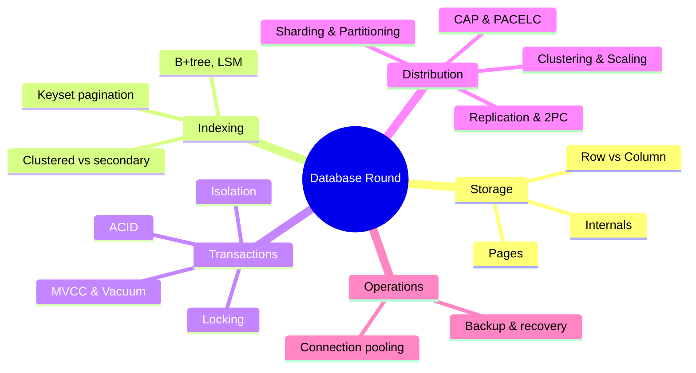

# Database Round

> [!tldr] Start here for database fundamentals
> Notes from Hussein Nasser's *Fundamentals of Database Engineering* style course, mixed with textbook summaries (Silberschatz *Database System Concepts*, Kleppmann *DDIA*). Order: how data sits on disk → indexes → transactions and concurrency → scaling and distribution → operations. Concept notes created during the 2026 restructure live in `Databases/Core Concepts/` and are linked here where they belong in the sequence.



## 1. Storage: how a database holds data (beginner)
1. [[Database Internals]]: heap, pages, IO, row ids, what happens when a query runs
2. [[Database Pages]]: page layout, buffer pool, small vs large pages
3. [[Row Vs Column Oriented Databases]]: OLTP vs OLAP storage

## 2. Indexing (beginner → intermediate)
4. [[Database Indexes]]: B-tree/B+tree, LSM trees, bloom filters, scan types, covering indexes
5. [[Primary vs Secondary Key]]: clustered (IOT) vs heap + secondary indexes
6. [[Keyset Pagination vs Offset]]: why `OFFSET` is slow and how to paginate with an index
- Deeper: [[SQL Indexes Deep Dive]] · [[Query Optimization & EXPLAIN]]

## 3. Transactions and concurrency (intermediate)
7. [[Transactions & ACID]]: the four guarantees, lifecycle, durability and WAL
8. [[Isolation Levels & Read Phenomena]]: dirty/non-repeatable/phantom reads, write skew, what Postgres/MySQL do
9. [[Locking & Concurrency Control]]: shared/exclusive locks, 2PL, deadlocks, optimistic vs pessimistic, Postgres lock modes
10. [[MVCC & Vacuum]]: row versions, dead tuples, VACUUM, bloat, wraparound

## 4. Scaling and distribution (intermediate → senior)
11. [[CAP Theorem]]: CAP, PACELC, consistency models
12. [[Clustering and Scaling]]: vertical vs horizontal, failover, redundancy, clusters
13. [[Replication & 2PC 3PC]]: leader/follower, sync vs async, lag, 2PC/3PC, sagas
14. [[Sharding & Partitioning]]: shard keys, consistent hashing, Postgres range partitioning

## 5. Operations (senior)
15. [[Connection Pooling]]: pool sizing, PgBouncer
16. [[Database Backup]]: RPO/RTO, PITR, pg_dump/pgBackRest, 3-2-1, restore testing
- Also: [[Database Migrations & Schema Evolution]] · [[PostgreSQL 17 to 18 - What's New]]

> [!example]- Suggested study path
> 1. Storage: Internals → Pages → Row vs Column
> 2. Indexes → Primary vs Secondary Key → Keyset Pagination → [[Query Optimization & EXPLAIN]]
> 3. Transactions & ACID → Isolation Levels → Locking → MVCC & Vacuum
> 4. CAP → Clustering and Scaling → Replication → Sharding
> 5. Connection Pooling → Database Backup → Migrations
> 6. Interview drill: answer every `Interview questions` block without opening it.

## Original syllabus (the user's plan, with where each topic lives now)

| Topic | Sub-topics (from the original outline) | Covered in |
|---|---|---|
| **ACID** | Intro to A/C/I/D, importance, practical examples, drawbacks | [[Transactions & ACID]] |
| **Transaction boundaries** | Definition, how to define them, impact on performance and concurrency, examples per DBMS | [[Transactions & ACID]] · [[Managing Transaction Processing]] |
| **Isolation levels** | Definition, RU/RC/RR/Serializable, pros and cons, impact on ACID | [[Isolation Levels & Read Phenomena]] |
| **How locks work** | Basic locking, shared vs exclusive, deadlocks (prevention, detection), optimistic vs pessimistic | [[Locking & Concurrency Control]] |
| **CAP theorem** | C/A/P, systems favouring each, the trade-off | [[CAP Theorem]] |
| **Distributed transactions** | Problems and solutions, role of ACID and CAP, intro to 2PC | [[Replication & 2PC 3PC]] |
| **2PC** | Protocol, coordinator and participants, vote and commit phases, pros and cons | [[Replication & 2PC 3PC]] |
| **SQL** | SELECT/INSERT/UPDATE/DELETE, joins, subqueries, indexes, procedures and functions, best practices and optimization | [[SQL ANSI]] · [[Query Optimization & EXPLAIN]] |
| **Database management** | DBMS overview, normalization/denormalization, performance tuning, security | [[Data Modeling & Normalization]] · [[Query Optimization & EXPLAIN]] |
| **Scaling** | Vertical vs horizontal, when to scale, strategies and trade-offs, impact on design | [[Clustering and Scaling]] · [[Sharding & Partitioning]] |
| **Cluster** | Definition, fail-over / load-balancing / distributed clusters, HA and scalability, examples | [[Clustering and Scaling]] |
| **Replication** | Concept, master-slave / multi-master / peer-to-peer, replication lag, strategies per DBMS | [[Replication & 2PC 3PC]] |
| **Procedures (backup, recovery, migration)** | Importance, full/incremental/differential, disaster recovery, migrations and their challenges | [[Database Backup]] · [[Database Migrations & Schema Evolution]] |
| **Bulk operations** | Bulk insert, bulk update, bulk delete, performance considerations | See below |

### Bulk operations (quick reference)

```sql
-- bulk insert: one statement, many rows (or COPY for large loads)
INSERT INTO products (id, name, price) VALUES (1,'A',10), (2,'B',12), (3,'C',9);
COPY products FROM '/data/products.csv' WITH (FORMAT csv, HEADER true);   -- psql: \copy for client-side files

-- bulk update from a set of values
UPDATE products p SET price = v.price
FROM (VALUES (1, 11.0), (2, 13.0)) AS v(id, price)
WHERE p.id = v.id;

-- bulk delete in batches to keep transactions short and replicas happy
DELETE FROM events WHERE id IN (
  SELECT id FROM events WHERE created_at < now() - interval '90 days' LIMIT 10000
);
```

Performance considerations: batch sizes of thousands (not one giant transaction), drop/recreate or defer secondary indexes for huge loads, use `COPY` over row-by-row inserts, prefer dropping partitions to mass deletes, `ANALYZE` afterwards, and watch replication lag and WAL volume.

## Archived originals
`Databases/_Archive/` holds the notes as they were before the restructure: `ACID Overview (original)`, `Overview - Locking & Distributed DB (original)`, `Overview 1 - Replication & Data Systems (original)`.

## Related
- [[Databases Index]] · [[Software Engineering]]
- [[SQL ANSI]] · [[MongoDB]]
