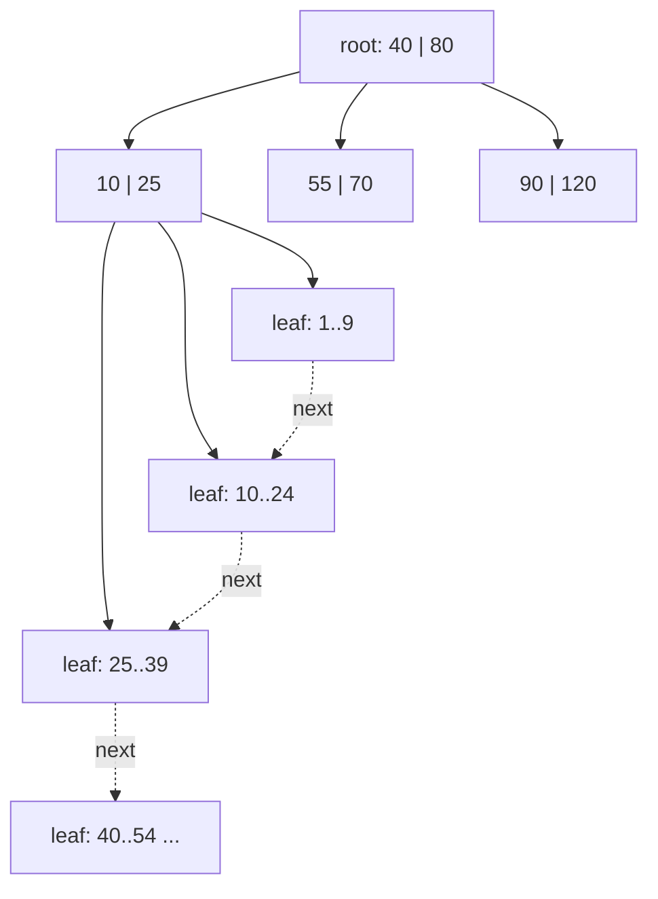

# Database Indexes

<Note>
**TL;DR**

An index is a separate, sorted data structure that maps key values to row locations so the database can find rows without scanning the whole heap. Most indexes are **B+trees** (balanced, sorted, logarithmic lookups and range scans); write-heavy stores use **LSM trees** (buffer writes in memory, flush sorted runs, compact later) with **bloom filters** to skip files. The planner chooses between **sequential**, **index**, **index-only** and **bitmap** scans. Indexes speed up reads and cost writes, space and memory, so index for your actual queries.
</Note>

For the SQL side (syntax, composite/partial/expression/covering indexes, index types in Postgres, when not to index) see [SQL Indexes Deep Dive](/Software%20Engineering/Databases/SQL%20ANSI/SQL%20Indexes%20Deep%20Dive). For clustered vs secondary indexes see [Primary vs Secondary Key](/Software%20Engineering/Databases/Database%20Round/Indexes/Primary%20vs%20Secondary%20Key).

## The idea

Indexes logically **sort** data to speed up lookups and searches. You create an index on one or more columns to keep a sorted structure for the database's own use.

When you create an index on a field, the DB builds another data structure containing the field value plus a **pointer** to the record it belongs to. Because this structure is sorted, binary-search-like lookups become possible. Every primary key and unique constraint gets a B-tree index automatically.

*Without an index, the table needs a **full table scan**.*

## B-tree and B+tree

A **B-tree** (Bayer tree, "balanced" tree) is a self-balancing sorted tree with a high fan-out: each node is a page holding many keys and child pointers, so even billions of keys need only 3–5 levels. It minimises disk IO for individual reads and writes.

Each B-tree node entry stores: the **key** (indexed value), the **tuple/row id** (TID/RID) or pointer to the row, and pointers to child nodes.


Most databases use a **B+tree**, not a plain B-tree:

- **Internal nodes store only keys** (routing information), so more keys fit per page and the tree is shallower.
- **All row pointers live in the leaves.**
- **Leaves are linked** to their neighbours (left/right), so a range scan finds the first key and then walks the leaf chain sequentially.




Costs: a lookup is O(log n) page reads (with the upper levels usually cached, often just 1–2 real IOs). Inserts may **split** pages; deletes may leave half-empty pages (Postgres B-trees do bottom-up deletion and deduplication since v13/v14 to limit bloat).

<Note>
**"B-tree or hash"**

The original note said indexes are either B-trees or hash tables. Those are the two classic ones, but real systems have more: Postgres offers B-tree, Hash, GiST, SP-GiST, GIN, BRIN (plus extension types like HNSW for vectors). Hash indexes support only equality. See [SQL Indexes Deep Dive](/Software%20Engineering/Databases/SQL%20ANSI/SQL%20Indexes%20Deep%20Dive).
</Note>

## LSM tree (log-structured merge tree)

A disk-based structure optimised for **write-heavy** workloads. Instead of updating pages in place like a B-tree, it **buffers** writes in memory and flushes them to disk as large **sequential** writes.

1. Writes go to a WAL (for durability) and an in-memory sorted structure, the **memtable**.
2. When the memtable is full it's flushed to disk as an immutable **SSTable** (Sorted String Table), a sorted file of key-value pairs.
3. Background **compaction** merges SSTables, consolidating overlapping keys and dropping deleted entries (tombstones).
4. A read checks the memtable, then SSTables from newest to oldest, which is why reads are slower than a B-tree's; **bloom filters** and sparse indexes skip SSTables that can't contain the key.

| | B+tree | LSM tree |
|---|---|---|
| Writes | In-place, random IO, page splits | Sequential, batched; very fast |
| Reads | One tree walk | May check several levels/files |
| Space | Some fragmentation | Temporary duplicates until compaction |
| Amplification | Write amp from page rewrites | Write amp from compaction; read amp from levels |
| Used by | Postgres, MySQL InnoDB, SQL Server, Oracle, MongoDB WiredTiger (default) | Cassandra, ScyllaDB, RocksDB (MyRocks, TiKV, CockroachDB's Pebble), LevelDB, HBase, Bigtable |

## Bloom filters

A **probabilistic** data structure that tests whether an element **might be** in a set. It can return **false positives** (says "maybe present" when it isn't) but **never false negatives** (if it says "not present", it definitely isn't). Cassandra keeps one per SSTable to avoid reading files that can't contain a partition key.

How it works:

- A bit array of m bits, all 0, and k hash functions.
- **Add**: hash the element with each function; set those k bit positions to 1.
- **Check**: hash the element; if **all** k bits are 1, return "probably in the set"; if **any** bit is 0, return "definitely not in the set".


False-positive rate ≈ (1 − e^(−kn/m))^k; about 10 bits per element with 7 hashes gives ~1%. Bloom filters can't delete elements (counting bloom filters can). Postgres ships a `bloom` index extension for multi-column equality filters.

## Scan types (PostgreSQL)

| Scan | What it does | When the planner picks it |
|---|---|---|
| **Sequential scan** | Read every heap page in order and filter | No usable index, small table, or a large fraction of rows match |
| **Index scan** | Walk the B-tree to matching entries, then fetch each row from the heap (index → heap → index → heap...) | Few matching rows; also returns rows in index order (helps `ORDER BY`) |
| **Index-only scan** | Answer entirely from the index; visit the heap only for pages not marked all-visible in the visibility map | All selected columns are in the index (key or `INCLUDE` columns) and the table is well vacuumed |
| **Bitmap index scan + bitmap heap scan** | The index scan collects matching TIDs `(page, offset)` into an in-memory bitmap; the heap scan then reads those pages **in physical order**, rechecking visibility and conditions | Moderate number of matches, or combining several indexes with `AND`/`OR` (BitmapAnd / BitmapOr) |

An index scan causes **random page access** (random IO); a bitmap scan turns that into sorted, mostly sequential IO. If the bitmap grows beyond `work_mem`, it becomes **lossy** (tracks whole pages) and every row on those pages must be rechecked.

```sql
EXPLAIN (ANALYZE, BUFFERS)
SELECT id, name FROM students WHERE grade BETWEEN 80 AND 85;
-- Bitmap Heap Scan on students  (actual rows=...)
--   Recheck Cond: ((grade >= 80) AND (grade <= 85))
--   ->  Bitmap Index Scan on students_grade_idx
```

## Index types by role

- **Clustered (index-organized table)**: rows are physically stored in index order. Creating a PK in InnoDB/SQL Server creates a clustered index. Postgres has no persistent clustered index; `CLUSTER` reorders once.
- **Non-clustered (secondary)**: a separate structure; leaves contain the PK (InnoDB) or a row locator/TID (Postgres, heap tables).
- **Unique**: guarantees uniqueness; creating a unique constraint creates a unique index.
- **Partitioned / global vs local**: on a partitioned table, a *local* index exists per partition; a *global* (non-partitioned) index is one object covering all partitions (Oracle). Postgres only has local indexes, which is why unique constraints must include the partition key.
- **Composite (multi-column)**: one index on two or more columns, e.g. `(grade, name)`. It's sorted by the first column, then the second, so it helps queries that filter on a **leftmost prefix**. A query on `grade` alone can use it; a query on `name` alone generally can't (PG 18's skip scan can sometimes, see below). It helps `AND` conditions; for `OR` across different columns the DB needs separate indexes (bitmap OR).
- **Bi-directional**: B-trees can be scanned in both directions. The default order is ascending; `DESC` or mixed orders (`(a ASC, b DESC)`) matter for multi-column sorts.
- **Expression-based**: index an expression, e.g. `CREATE INDEX ON users (lower(email));` makes case-insensitive lookups `WHERE lower(email) = ...` indexable.
- **Partial**: index only some rows, e.g. `WHERE deleted_at IS NULL`.

### Key vs non-key (included) columns

```sql
CREATE INDEX students_id_idx ON students (id) INCLUDE (name);
-- id   = key column: used for searching and ordering
-- name = non-key column: stored in the leaf only, so it can be returned
```

Non-key columns aren't searchable through the index but let the query be answered by an **index-only scan**:

- **Index scan**: the DB goes to the heap to fetch columns not in the index.
- **Index-only scan**: everything the query needs is in the index.

```sql
SELECT name FROM students WHERE id = 7;   -- index-only scan with the index above
```

## Pitfalls

<Warning>
**Common pitfalls**

- **Too many indexes**: every insert/update/delete must maintain all of them (and blocks HOT updates in Postgres). Drop unused ones (`pg_stat_user_indexes.idx_scan = 0`).
- **Wrong column order** in composite indexes: put equality-filtered columns first, range/sort columns after.
- **Non-sargable predicates**: `WHERE date(created_at) = ...`, `WHERE col + 1 = 5`, `LIKE '%abc'`, implicit casts: the index on the raw column can't be used.
- **Low-selectivity indexes** (a boolean column on its own) rarely help; use a partial index instead.
- **Random keys** (UUIDv4) scatter B-tree inserts, hurting cache locality.
- **Building an index on a live table** without `CONCURRENTLY` blocks writes for the whole build.
</Warning>

## Senior perspective

- Index for **queries**, not columns: collect the top queries (`pg_stat_statements`), look at their plans, and design composite/covering/partial indexes for them.
- Keep the hot part of indexes in memory; index size is often the real constraint.
- In LSM stores, tune compaction strategy (size-tiered vs leveled) to the read/write mix, and model tables around partition keys since secondary indexes are expensive.
- Review questions: Which query needs this index? What's its selectivity? What's the write cost? Is an existing index a prefix of this one (redundant)?

<Info>
**🆕 2025–2026**

- **PostgreSQL 18 (2025-09-25)** added **skip scan** for multicolumn B-tree indexes: a query that omits an `=` condition on the leading column(s) can still use the index by "skipping" through distinct leading values, which helps most when the leading column has few distinct values. It also improved using indexes for `OR` conditions and `IN` lists, added parallel builds for GIN indexes, and a `uuidv7()` function whose time-ordered values keep B-tree inserts local.
- **pgvector 0.8.x** (0.8.0 on 2024-10-30, 0.8.2 security fix on 2026-02-26) brings HNSW and IVFFlat vector indexes with iterative scans. See [Vector Databases & pgvector](/Software%20Engineering/Databases/Core%20Concepts/Vector%20Databases%20%26%20pgvector).
</Info>

## Interview questions

<Accordion title="Why do databases use B+trees rather than binary search trees or hash tables?">
High fan-out keeps the tree shallow, so few page reads per lookup; nodes map to disk pages; keys are sorted, supporting range queries and ordered output; linked leaves make range scans sequential. Hash tables only do equality and don't support ranges or ordering.
</Accordion>

<Accordion title="B-tree vs LSM tree: when would you pick each?">
B-trees for read-heavy or mixed OLTP with range queries and predictable read latency. LSM trees for write-heavy workloads (logs, time series, high ingest) where sequential writes and compaction are cheaper than random in-place updates, accepting higher read amplification.
</Accordion>

<Accordion title="What is a bloom filter and where is it used in databases?">
A bit array plus k hash functions that answers "definitely not present" or "maybe present". LSM engines (Cassandra, RocksDB) keep one per SSTable so reads skip files that can't contain the key.
</Accordion>

<Accordion title="Explain index scan vs index-only scan vs bitmap scan.">
Index scan: traverse the index, then fetch each matching row from the heap. Index-only scan: all needed columns are in the index and heap pages are all-visible, so no heap access. Bitmap scan: gather row locations from one or more indexes into a bitmap, then read heap pages in physical order; good for medium selectivity and combining indexes.
</Accordion>

<Accordion title="You have an index on (a, b). Which queries can use it?">
`WHERE a = ?`, `WHERE a = ? AND b = ?`, `WHERE a = ? AND b > ?`, `WHERE a > ?`, `ORDER BY a, b`. `WHERE b = ?` alone traditionally can't use it efficiently, though PostgreSQL 18's skip scan can if `a` has few distinct values.
</Accordion>

<Accordion title="What does INCLUDE do in CREATE INDEX?">
Adds non-key payload columns stored only in leaf entries. They aren't used for searching or uniqueness but let queries selecting them be satisfied by an index-only scan.
</Accordion>

## Related
- [Databases Index](/Software%20Engineering/Databases/Databases%20Index) · [Database Round](/Software%20Engineering/Databases/Database%20Round/Database%20Round)
- [Primary vs Secondary Key](/Software%20Engineering/Databases/Database%20Round/Indexes/Primary%20vs%20Secondary%20Key) · [SQL Indexes Deep Dive](/Software%20Engineering/Databases/SQL%20ANSI/SQL%20Indexes%20Deep%20Dive) · [Understanding Advanced SQL Features](/Software%20Engineering/Databases/SQL%20ANSI/Understanding%20Advanced%20SQL%20Features)
- [Database Internals](/Software%20Engineering/Databases/Database%20Round/Database%20Internals) · [Database Pages](/Software%20Engineering/Databases/Database%20Round/Database%20Pages) · [Query Optimization & EXPLAIN](/Software%20Engineering/Databases/Core%20Concepts/Query%20Optimization%20%26%20EXPLAIN) · [Keyset Pagination vs Offset](/Software%20Engineering/Databases/Database%20Round/Keyset%20Pagination%20vs%20Offset)
- MongoDB: [Unit 12 MongoDB Indexes](/Software%20Engineering/Databases/MongoDB/Unit%2012%20MongoDB%20Indexes) · Vectors: [Vector Databases & pgvector](/Software%20Engineering/Databases/Core%20Concepts/Vector%20Databases%20%26%20pgvector)

## Sources
- PostgreSQL docs, Index Types: https://www.postgresql.org/docs/current/indexes-types.html
- PostgreSQL docs, Index-Only Scans and Covering Indexes: https://www.postgresql.org/docs/current/indexes-index-only-scans.html
- PostgreSQL docs, B-Tree implementation: https://www.postgresql.org/docs/current/btree.html
- PostgreSQL 18 release: https://www.postgresql.org/about/news/postgresql-18-released-3142/
- O'Neil et al., *The Log-Structured Merge-Tree (LSM-Tree)* (1996): https://www.cs.umb.edu/~poneil/lsmtree.pdf
- Bloom, *Space/Time Trade-offs in Hash Coding with Allowable Errors* (1970); Cassandra docs, Bloom filters: https://cassandra.apache.org/doc/latest/cassandra/managing/operating/bloom_filters.html
- Markus Winand, *Use The Index, Luke*: https://use-the-index-luke.com/
- Hussein Nasser, *Fundamentals of Database Engineering*
