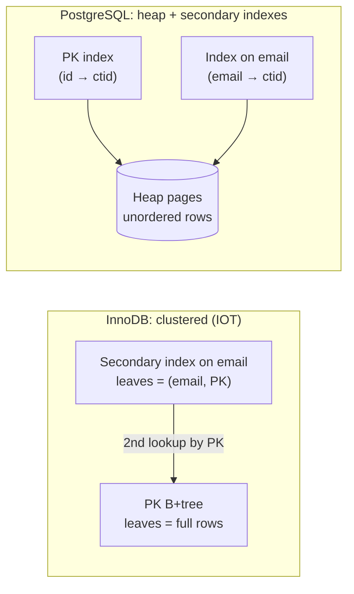

# Primary vs Secondary Key

<Note>
**TL;DR**

A **primary (clustered) index** decides the physical order of the table: rows are stored inside the index, sorted by the key (an **index-organized table**, as in MySQL InnoDB and SQL Server). A **secondary index** is a separate structure that points back to the rows; the table itself is an unordered **heap**. PostgreSQL has **only secondary indexes**: even the primary key's index points into the heap. Clustering makes range scans on the key almost sequential but makes the choice of key (and secondary lookups) matter much more.
</Note>

## The idea

**Clustering** (Index-Organized Table, IOT, clustered index) means organising the table around a key. When a table in InnoDB gets a primary key, the table **is** a B+tree keyed by it: leaf pages contain full rows in key order.

A **heap-organized table** has no index that orders it; rows go wherever there is free space (roughly insertion order, but no guarantee).

Example with a clustered PK: insert 1, then 8; they sit next to each other. Insert 2 and it must go **between** 1 and 8, in the correct leaf page (splitting the page if it's full). The payoff: a range query like `WHERE id BETWEEN 1 AND 100` reads rows that are physically together, often a single IO.



## Secondary indexes

A secondary index is a separate data structure: the table isn't ordered by it, but the index is. A query first searches the index to collect matching entries, then **jumps** to the table to fetch the rows.

| | InnoDB (clustered) | PostgreSQL (heap) |
|---|---|---|
| Primary key index | The table itself | A secondary B-tree like any other |
| Secondary index leaf holds | The **primary key value** | The **ctid** (page, item) |
| Secondary lookup | Two tree walks: secondary → PK tree | Index walk → heap page |
| Row moves (update) | PK stays, secondaries unaffected unless their columns change | New tuple = new ctid; all indexes get new entries unless HOT |
| Range scan on PK | Sequential in leaves | Random heap reads unless table was `CLUSTER`ed recently |
| Wide PK cost | Copied into **every** secondary index | Only in its own index |

## Can you create a clustered index in Postgres?

Not a maintained one. `CLUSTER table USING index` rewrites the table once in index order (with an ACCESS EXCLUSIVE lock), but new rows aren't kept in order. Alternatives: BRIN indexes for naturally ordered data (timestamps), partitioning, covering indexes (`INCLUDE`) and index-only scans. SQL Server has both clustered tables and heaps; Oracle has heap tables by default and IOTs on request.

## Worked example: why PK choice matters in InnoDB

```sql
-- sequential key: inserts append to the right-most leaf
CREATE TABLE orders_a (id BIGINT AUTO_INCREMENT PRIMARY KEY, ...);

-- random key: every insert lands in a random leaf → page splits, poor cache use
CREATE TABLE orders_b (id BINARY(16) PRIMARY KEY /* UUIDv4 */, ...);
```

With millions of rows, `orders_b` inserts touch pages all over the tree, most not in the buffer pool, and leave pages half full after splits. Time-ordered IDs (UUIDv7, ULID, Snowflake IDs) keep the benefits of UUIDs (global uniqueness, no coordination) with append-like locality.

## Pitfalls

<Warning>
**Common pitfalls**

- **Wide or random clustered keys** in InnoDB bloat every secondary index and fragment the table.
- **Updating the primary key** in a clustered table physically moves the row and updates every secondary index. Keep PKs immutable.
- Assuming Postgres returns rows in PK order without `ORDER BY`. It doesn't; nothing is guaranteed without `ORDER BY` in any database.
- In InnoDB, forgetting a PK: it uses the first `NOT NULL UNIQUE` index or a hidden 6-byte row id you can't use.
</Warning>

## Senior perspective

- For InnoDB choose a short, immutable, monotonically increasing PK. For Postgres the PK type matters less for the heap but still affects index size and locality.
- Covering indexes blur the difference: in Postgres an index with `INCLUDE` columns can answer queries like a clustered index would, as long as the visibility map is up to date.
- Review question: "What's the access pattern: range scans by key, or point lookups by several attributes?" That decides whether clustering helps.

<Info>
**🆕 2025–2026**

- **PostgreSQL 18 (2025-09-25)** ships `uuidv7()`, generating timestamp-ordered UUIDs that index much better than random `gen_random_uuid()` (v4) values.
- **MySQL 8.0 reached end of life on 2026-04-30**; InnoDB behaviour described here is the same in the current LTS lines 8.4 and 9.7 (released 2026-04-21).
</Info>

## Interview questions

<Accordion title="What is a clustered index?">
An index whose leaf level stores the table rows themselves, so the table is physically ordered by the index key. There can be only one per table. InnoDB and SQL Server tables are clustered by the primary key.
</Accordion>

<Accordion title="How does a secondary index lookup work in InnoDB vs Postgres?">
InnoDB: find the PK value in the secondary index, then search the clustered PK tree for the row (two traversals). Postgres: find the ctid in the index and read that heap page directly, then check tuple visibility.
</Accordion>

<Accordion title="Why are random UUID primary keys bad for InnoDB?">
Inserts go to random leaf pages of the clustered index, causing page splits, fragmentation, poor buffer-pool hit rates and heavy random IO. Every secondary index also stores the 16-byte PK. Use sequential or time-ordered IDs.
</Accordion>

<Accordion title="Does PostgreSQL have clustered indexes?">
No persistent ones. All indexes are secondary and point to heap tuples. `CLUSTER` reorders the table once but doesn't maintain the order.
</Accordion>

## Related
- [Databases Index](/Software%20Engineering/Databases/Databases%20Index) · [Database Round](/Software%20Engineering/Databases/Database%20Round/Database%20Round)
- [Database Indexes](/Software%20Engineering/Databases/Database%20Round/Indexes/Database%20Indexes) · [SQL Indexes Deep Dive](/Software%20Engineering/Databases/SQL%20ANSI/SQL%20Indexes%20Deep%20Dive) · [Database Internals](/Software%20Engineering/Databases/Database%20Round/Database%20Internals) · [Database Pages](/Software%20Engineering/Databases/Database%20Round/Database%20Pages)
- [Introduction to SQL](/Software%20Engineering/Databases/SQL%20ANSI/Introduction%20to%20SQL) (key types: super, candidate, primary, alternate, foreign)
- [Data Modeling & Normalization](/Software%20Engineering/Databases/Core%20Concepts/Data%20Modeling%20%26%20Normalization)

## Sources
- MySQL docs, Clustered and Secondary Indexes: https://dev.mysql.com/doc/refman/8.4/en/innodb-index-types.html
- PostgreSQL docs, CLUSTER: https://www.postgresql.org/docs/current/sql-cluster.html
- Microsoft docs, Clustered and nonclustered indexes: https://learn.microsoft.com/en-us/sql/relational-databases/indexes/clustered-and-nonclustered-indexes-described
- PostgreSQL docs, UUID functions (`uuidv7`): https://www.postgresql.org/docs/18/functions-uuid.html
- MySQL end of life dates: https://endoflife.date/mysql
- Hussein Nasser, *Fundamentals of Database Engineering*
