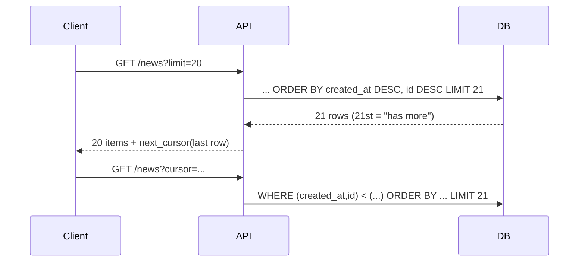

# Keyset Pagination vs Offset

> [!tldr] TL;DR
> `OFFSET n` makes the database **read and throw away n rows** on every page, so deep pages get slower and slower, and concurrent inserts/deletes cause **duplicated or skipped** rows. **Keyset (seek/cursor) pagination** remembers the last row's sort key and asks for rows *after* it: `WHERE (created_at, id) < ($1, $2) ORDER BY created_at DESC, id DESC LIMIT 20`. With a matching index, every page costs the same. Trade-off: no "jump to page 57".

## The problem with OFFSET

```sql
SELECT title FROM news
ORDER BY id DESC
OFFSET 100 LIMIT 10;
```

The database physically fetches the first **110** rows and discards 100. At `OFFSET 1000000` it walks a million index entries (or sorts a million rows) to return ten. Cost grows linearly with the page number.

Second problem: **unstable pages**. If a new row is inserted while a user moves from page 1 to page 2, everything shifts by one and the user sees the last item of page 1 again (duplicate). A delete shifts the other way and a row is skipped.

(Also note: without `ORDER BY`, pages have no defined order at all.)

## Keyset pagination

Send the last key the user saw, and continue from there:

```sql
-- first page
SELECT id, title FROM news ORDER BY id DESC LIMIT 10;

-- next page: client sends the last id it received, e.g. 10099993
SELECT id, title FROM news
WHERE id < 10099993
ORDER BY id DESC
LIMIT 10;
```

With an index on `id`, the DB seeks straight to 10099993 in the B-tree and reads the next 10 entries. Page 1 and page 100,000 cost the same.

### Sorting by a non-unique column

Sort keys must be **unique** or you'll skip/duplicate rows that share a value. Add a tie-breaker (usually the PK) and compare as a **row value**:

```sql
CREATE INDEX news_created_id_idx ON news (created_at DESC, id DESC);

SELECT id, title, created_at FROM news
WHERE (created_at, id) < ($1, $2)          -- last row of previous page
ORDER BY created_at DESC, id DESC
LIMIT 20;
```

Row-value comparison `(a, b) < (x, y)` means `a < x OR (a = x AND b < y)`, and Postgres can use the composite index for it. (MySQL supports the syntax too, but check the plan; older versions didn't use indexes well for it.)

Mixed directions (`created_at DESC, id ASC`) can't use a single row comparison; expand the `OR` manually or keep directions consistent.

### API shape

Return an opaque **cursor** instead of page numbers:

```json
{
  "items": [ ... ],
  "next_cursor": "eyJjcmVhdGVkX2F0IjoiMjAyNi0wOS0yN1QxMDowMDowMFoiLCJpZCI6NDIxfQ"
}
```

The cursor is base64 of `{"created_at": "...", "id": 421}` (sign it or validate it server-side). This is the style of the GitHub, Stripe and Slack APIs and of GraphQL Relay connections.



Fetching `limit + 1` rows tells you whether there's a next page without a `COUNT(*)`.

## Comparison

| | OFFSET/LIMIT | Keyset |
|---|---|---|
| Cost of page N | O(N + page size) | O(page size) with an index |
| Stable under inserts/deletes | No (dupes/skips) | Yes |
| Jump to arbitrary page | Yes | No (only next/prev) |
| Total page count | Needs `COUNT(*)` | Usually not provided |
| Needs | Nothing special | Unique, indexed sort key; client keeps cursor |
| Good for | Small admin tables, few pages | Feeds, infinite scroll, APIs, exports, batch jobs |

## Also useful for batch jobs

Keyset iteration is the right way to walk a big table in chunks (backfills, exports):

```sql
-- repeat until no rows returned
UPDATE orders SET status_v2 = status
WHERE id IN (
  SELECT id FROM orders WHERE id > $last_id ORDER BY id LIMIT 5000
)
RETURNING id;   -- remember max(id) as the next $last_id
```

## Pitfalls

> [!warning] Common pitfalls
> - Paginating on a **non-unique** column without a tie-breaker.
> - Index columns/directions not matching `ORDER BY`, so the DB sorts everything anyway. Check with `EXPLAIN`.
> - Filters that change between requests (the cursor must be tied to the same filter/sort).
> - Using `OFFSET` for "deep" exports or background jobs: quadratic total work.
> - Server-side cursors (`DECLARE CURSOR`) held open across HTTP requests: they pin a connection and a snapshot. Keyset pagination is stateless.

## Senior perspective

- Default to cursor pagination in public APIs; offer offset only where "page 3 of 12" UX is required and data is small, and cap the maximum offset.
- If users need "jump to page", consider approximate counts (`pg_class.reltuples`) and search-engine style limits (Google stops at a few hundred results).
- Same idea in MongoDB: `find({_id: {$lt: lastId}}).sort({_id: -1}).limit(20)` instead of `.skip()` ([[Unit 09 MongoDB CRUD Operations Modifying Query Results]]).
- Frontend side: infinite scroll with cursors pairs with list virtualization.

## Interview questions

> [!question]- Why is OFFSET slow for deep pages?
> The database must produce and discard all the skipped rows (walking the index or sorting), so the cost grows linearly with the offset even though only a few rows are returned.

> [!question]- How does keyset pagination work and what does it need?
> The client passes the sort key of the last row seen; the query filters `WHERE key < last_key ORDER BY key DESC LIMIT n`. It needs a unique (or tie-broken) sort key and an index matching the ORDER BY.

> [!question]- What are the downsides of keyset pagination?
> No random page access or easy total page count, cursors are tied to a specific sort and filter, and multi-column sorts with mixed directions complicate the predicate.

> [!question]- How would you paginate a feed sorted by `created_at` where timestamps can collide?
> Sort by `(created_at DESC, id DESC)`, index both, and use a row comparison `(created_at, id) < ($ts, $id)` with the last row's values as the cursor.

## Related
- [[Databases Index]] · [[Database Round]]
- [[Database Indexes]] · [[Query Optimization & EXPLAIN]] · [[Using Cursors]] · [[Sorting Data]]
- Frontend: [[Virtualization & Large Lists]]

## Sources
- Markus Winand, *Use The Index, Luke*: Paging Through Results (seek method): https://use-the-index-luke.com/sql/partial-results/fetch-next-page
- Markus Winand, "We need tool support for keyset pagination" / No-Offset: https://use-the-index-luke.com/no-offset
- PostgreSQL docs, Row constructor comparison: https://www.postgresql.org/docs/current/functions-comparisons.html#ROW-WISE-COMPARISON
- PostgreSQL docs, LIMIT and OFFSET: https://www.postgresql.org/docs/current/queries-limit.html
- Hussein Nasser, *Fundamentals of Database Engineering*
