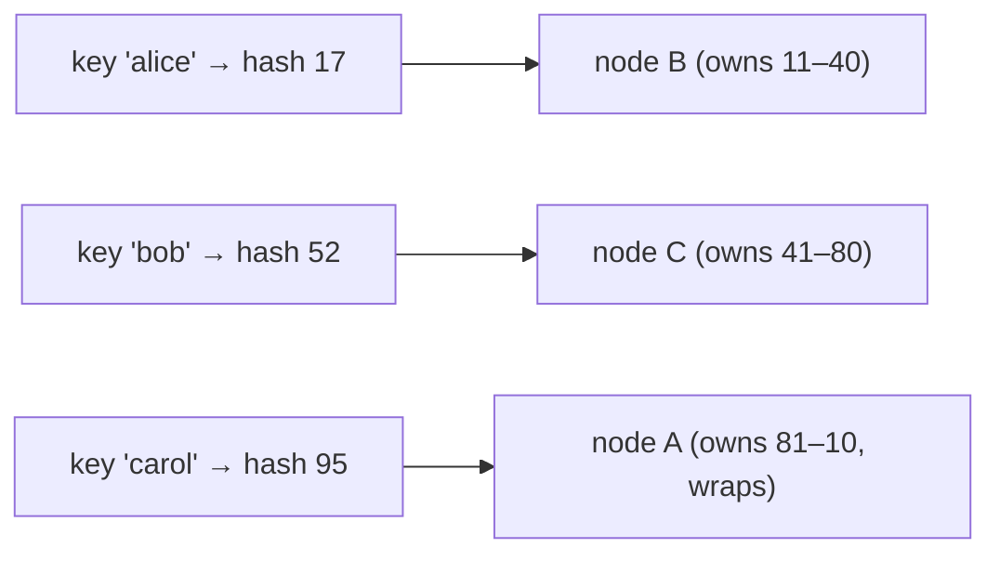

# Sharding & Partitioning

> [!tldr] TL;DR
> **Partitioning** splits one big table into smaller tables **inside the same database**; the DB routes queries to the right partitions (partition pruning) and the client doesn't notice. **Sharding** splits data across **multiple database servers** by a **shard key**; each shard is an independent database and something (the app, a proxy, or a distributed DB) must route queries. Partition early and cheaply; shard late and reluctantly, because cross-shard queries, transactions and rebalancing get hard.

*Sharding works at the database (server) level. Partitioning works at the table level.*

## Sharding (a horizontal scaling strategy)

Sharding segments data into partitions spread across multiple servers. You split a table **by rows** into multiple databases on multiple servers, based on a **shard key**.

![[Screenshot_2023-07-28_at_3.12.57_PM.png]]

Vocabulary:

- **Logical shard**: the chunk of data stored together (e.g. customers 0–999).
- **Physical shard**: the database node that stores one or more logical shards.
- **Shard key**: the column(s) that decide which shard a row goes to.
- It's a **shared-nothing** architecture: each node is independent and doesn't know about the others' data.

Benefits: storing a large database across multiple machines, and **parallel processing** of shards to get past single-server bottlenecks.

### Sharding methods

1. **Range-based (dynamic)**: split by ranges of the key (A–F, G–M...; dates). Range queries are efficient, but hot spots form (all new rows go to the "latest" shard).
2. **Hashed**: `shard = hash(key) mod N` (or a hash ring). Even distribution; range queries hit all shards.
3. **Directory-based**: a **lookup table** maps key → shard. Flexible (move a tenant anywhere) but the directory is an extra dependency and must be highly available.
4. **Geo-based**: split by location (e.g. `city` or `region` as shard key), keeping data near users and satisfying data residency rules.

### Consistent hashing

With `hash(key) mod N`, adding one server remaps almost every key. **Consistent hashing** places both servers and keys on a **hash ring**; each key belongs to the next server clockwise. Adding or removing a server only moves the keys in one arc (about 1/N of them). **Virtual nodes** (many ring positions per server) smooth out the distribution. It works for any key type, including strings. Cassandra, DynamoDB and many caches use this ring.



### Pros and cons

Pros:

1. **Scale** writes and storage beyond one machine.
2. **Security / isolation**: users or tenants can be restricted to certain shards.
3. **Smaller, optimal indexes** per shard that fit in memory.

Cons:

![[Screenshot_2023-07-28_at_7.11.22_PM.png]]

- Complex client/routing logic; cross-shard **joins** and **transactions** are hard (2PC or sagas, see [[Replication & 2PC 3PC]]).
- **Rebalancing/resharding** when shards grow unevenly.
- Schema changes and backups multiply by N.
- Hot shards if the key is skewed (celebrity users, one huge tenant).

> [!warning] The last thing you want to do is shard your database
> Ask the questions first: Have we fixed queries and indexes? Scaled up? Added caching and read replicas? Partitioned big tables? Split by function? Only shard when a single primary truly can't handle the write volume, data size or connections.

## Partitioning

Breaking one large table into multiple tables **in the same database**, letting the DB decide which partition to hit based on the `WHERE` clause.

Benefits: smaller files and indexes (more fit in memory), faster queries through **partition pruning**, and cheap data retention (drop a whole partition instead of deleting rows).

The partition key column should be `NOT NULL` (or have a default/NULL-accepting partition).

### Partitioning ways

- **Horizontal partitioning**: split **rows** into partitions (by range, list or hash).
- **Vertical partitioning**: split **columns** into separate tables, e.g. move a large blob or rarely used column to its own table, possibly in a tablespace on slower, cheaper storage.

### Partitioning types

1. **List**: discrete values (order status, city, zip code, country). Downside: if the value changes (status moves from `pending` to `shipped`), the row must **move** between partitions.
2. **Range**: dates, ids.
3. **Hash**: hash of a key, to spread rows evenly when there's no natural range.

### Horizontal partitioning vs sharding

![[Screenshot_2023-07-28_at_3.18.38_PM.png]]

| | Partitioning | Sharding |
|---|---|---|
| Where | One database server | Many servers |
| Client awareness | None: queries the parent table | Needs routing (app, proxy, or distributed DB) |
| Table names | Partitions are separate tables (`g0035`, ...) under a parent | Same table name on every shard |
| Transactions/joins | Normal | Cross-shard is hard |
| Solves | Big tables, retention, index size | Write throughput, total size, connection limits |

![[Screenshot_2023-07-27_at_11.23.15_PM.png]]

![[Screenshot_2023-07-27_at_11.23.24_PM.png]]

## Worked example: range partitioning in Postgres

```sql
-- the unpartitioned table, 10 million rows
CREATE TABLE grades_org (
  id serial NOT NULL,
  g  integer NOT NULL
);
INSERT INTO grades_org (g)
SELECT floor(random() * 100) FROM generate_series(0, 10000000);
CREATE INDEX grades_org_index ON grades_org (g);

EXPLAIN ANALYZE SELECT count(*) FROM grades_org WHERE g BETWEEN 35 AND 40;

-- make sure partition pruning is on (it is by default)
SET enable_partition_pruning = on;

-- the partitioned parent: declare how to partition
CREATE TABLE grades_parts (
  id serial  NOT NULL,
  g  integer NOT NULL
) PARTITION BY RANGE (g);

-- create the partitions and attach them (upper bounds are exclusive)
CREATE TABLE g0035  (LIKE grades_parts INCLUDING INDEXES);
CREATE TABLE g3560  (LIKE grades_parts INCLUDING INDEXES);
CREATE TABLE g6080  (LIKE grades_parts INCLUDING INDEXES);
CREATE TABLE g80100 (LIKE grades_parts INCLUDING INDEXES);

ALTER TABLE grades_parts ATTACH PARTITION g0035  FOR VALUES FROM (0)  TO (35);
ALTER TABLE grades_parts ATTACH PARTITION g3560  FOR VALUES FROM (35) TO (60);
ALTER TABLE grades_parts ATTACH PARTITION g6080  FOR VALUES FROM (60) TO (80);
ALTER TABLE grades_parts ATTACH PARTITION g80100 FOR VALUES FROM (80) TO (100);
-- shorter alternative: CREATE TABLE g0035 PARTITION OF grades_parts FOR VALUES FROM (0) TO (35);

-- copy the data; the DB routes each row to its partition
INSERT INTO grades_parts SELECT * FROM grades_org;

-- verify
SELECT count(*) FROM grades_parts;
SELECT max(g) FROM grades_parts;

-- one statement creates the index on every partition (Postgres 11+;
-- before that you had to create it on each partition yourself)
CREATE INDEX grades_parts_idx ON grades_parts (g);

EXPLAIN ANALYZE SELECT count(*) FROM grades_parts WHERE g = 30;   -- only g0035 is scanned
EXPLAIN ANALYZE SELECT max(g) FROM grades_parts;

-- compare sizes
SELECT pg_relation_size(oid), relname
FROM pg_class ORDER BY pg_relation_size(oid) DESC;
```

More on Postgres partitioning (list/hash, default partitions, detach concurrently, pg_partman, retention): [[SQL Table Partitioning]].

## Sharding in practice

| Approach | Examples |
|---|---|
| Application-level sharding | App computes shard from tenant id; one connection pool per shard |
| Proxy / middleware | Vitess (MySQL), PgDog / PgCat (Postgres), ProxySQL |
| Distributed SQL extension | **Citus** (Postgres): distributed and reference tables, co-location by tenant |
| Natively distributed DBs | MongoDB sharded clusters, Cassandra, CockroachDB, YugabyteDB, TiDB, Spanner, DynamoDB |

```sql
-- Citus: shard the orders table by tenant, co-locate with customers
SELECT create_distributed_table('customers', 'tenant_id');
SELECT create_distributed_table('orders', 'tenant_id', colocate_with => 'customers');
```

## Pitfalls

> [!warning] Common pitfalls
> - **Bad shard key**: low cardinality, skewed (hot shards), or not present in most queries (every query fans out to all shards).
> - Queries without the partition key scan **every** partition.
> - Too many partitions (thousands) slow planning and increase lock overhead.
> - Unique constraints across partitions/shards: in Postgres a unique/PK constraint on a partitioned table must include the partition key.
> - Resharding with `mod N` hashing moves almost everything; plan logical shards ≫ physical shards from day one.

## Senior perspective

- Choose the shard key from the access patterns: for SaaS, `tenant_id` keeps each tenant's data and transactions on one shard. Watch for the one giant tenant.
- Keep **logical shards** (e.g. 4096 buckets) mapped to **physical** nodes via a directory so rebalancing moves buckets, not rows.
- Partitioning by time plus dropping old partitions is the cheapest big win for event/log tables.
- Review questions: Which queries don't include the shard key? How do we reshard? What's the plan for the biggest tenant? How do cross-shard reports run (usually: a warehouse)?

> [!info]+ 🆕 2025–2026
> - **PostgreSQL 17 (2024-09-26)** allows identity columns and exclusion constraints on partitioned tables.
> - **PostgreSQL 19** had `ALTER TABLE ... MERGE PARTITIONS` / `SPLIT PARTITIONS` in Beta 1 (2026-06-04), but they were **reverted** before Beta 4 (2026-09-24), so they won't be in 19.0.

## Interview questions

> [!question]- Partitioning vs sharding?
> Partitioning splits a table into smaller tables within one database server, transparently to clients, mainly for manageability and pruning. Sharding distributes data across multiple servers by a shard key to scale writes and storage, requiring routing and making cross-shard operations hard.

> [!question]- How do you choose a shard key?
> High cardinality, even distribution, present in the most frequent queries, and aligned with transaction boundaries (e.g. tenant id). Avoid monotonically increasing keys with range sharding (hot last shard) and skewed keys.

> [!question]- What is consistent hashing and why is it useful?
> Keys and nodes are hashed onto a ring; a key belongs to the next node clockwise. Adding/removing a node only remaps keys in one segment (~1/N) instead of nearly all keys as with `mod N`. Virtual nodes balance load.

> [!question]- When would you not shard?
> When the problem can be solved by query/index tuning, vertical scaling, caching, read replicas, partitioning or splitting services. Sharding adds permanent complexity to every feature.

> [!question]- How does partition pruning work?
> The planner (and executor, for parameters known at run time) compares the query's conditions on the partition key with each partition's bounds and skips partitions that can't contain matching rows.

## Related
- [[Databases Index]] · [[Database Round]]
- [[SQL Table Partitioning]] · [[Clustering and Scaling]] · [[Replication & 2PC 3PC]] · [[CAP Theorem]]
- [[NoSQL Database Types]] · [[Database Indexes]]

## Sources
- PostgreSQL docs, Table Partitioning: https://www.postgresql.org/docs/current/ddl-partitioning.html
- Citus docs, Distributed tables: https://docs.citusdata.com/en/stable/develop/api_udf.html
- Vitess docs, Sharding: https://vitess.io/docs/reference/features/sharding/
- MongoDB docs, Sharding: https://www.mongodb.com/docs/manual/sharding/
- Karger et al., *Consistent Hashing and Random Trees* (1997): https://www.cs.princeton.edu/courses/archive/fall09/cos518/papers/chash.pdf
- PostgreSQL 17 release: https://www.postgresql.org/about/news/postgresql-17-released-2936/ · PostgreSQL 19 Beta 4: https://www.postgresql.org/about/news/postgresql-19-beta-4-released-3386/
- Martin Kleppmann, *Designing Data-Intensive Applications*, ch. 6 (Partitioning)
