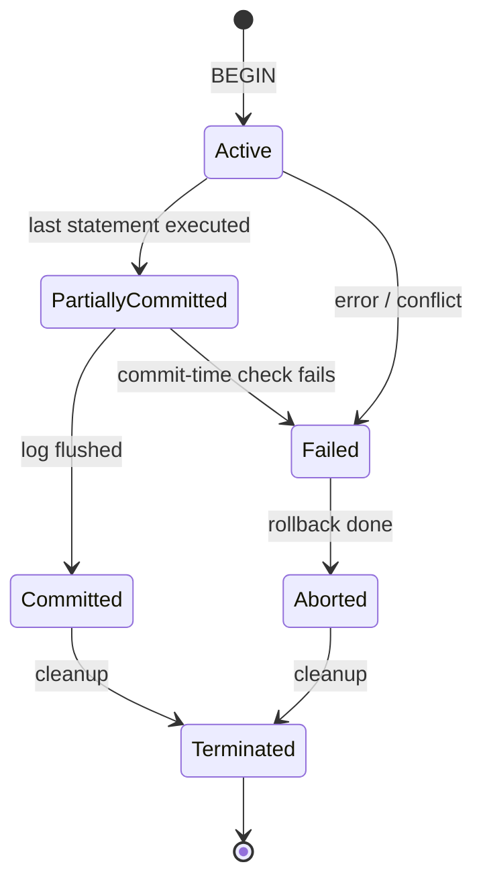

# Transactions & ACID

> [!tldr] TL;DR
> A **transaction** is a group of operations the database treats as one indivisible unit: it either commits completely or has no effect. **ACID** names the four guarantees: **A**tomicity (all or nothing), **C**onsistency (constraints hold before and after), **I**solation (concurrent transactions don't see each other's half-done work), **D**urability (committed data survives a crash). Atomicity and durability are built on a **write-ahead log**; isolation is built on **locks** and/or **MVCC**.

This note merges the original *ACID Overview* (a summary of Silberschatz, Korth & Sudarshan, *Database System Concepts*, ch. 17 "Transactions") with the Hussein Nasser course notes. Deeper topics now have their own notes:

| Topic | Note |
|---|---|
| Read phenomena and isolation levels | [[Isolation Levels & Read Phenomena]] |
| Locks, 2PL, deadlocks, Postgres lock modes | [[Locking & Concurrency Control]] |
| MVCC, dead tuples, VACUUM, bloat, buffer pool vs cache | [[MVCC & Vacuum]] |
| Distributed transactions, 2PC/3PC, sagas | [[Replication & 2PC 3PC]] |
| SQL syntax: `BEGIN`, `COMMIT`, `ROLLBACK`, `SAVEPOINT` | [[Managing Transaction Processing]] |

## The idea

A **transaction** is a single, indivisible logical unit made of several operations that looks like one instruction to the user.

The classic example is a bank transfer:

```sql
BEGIN;
UPDATE accounts SET balance = balance - 100 WHERE id = 1;  -- debit
UPDATE accounts SET balance = balance + 100 WHERE id = 2;  -- credit
COMMIT;
```

If the server dies between the two `UPDATE`s, a database without transactions would have destroyed 100 units of money. With a transaction, either both updates are visible or neither is.

> [!note] Always bound your writes
> An `UPDATE` or `DELETE` without a `WHERE` clause touches every row. Inside a transaction you can still `ROLLBACK`, outside one (autocommit) you cannot.

### Transaction boundaries

The boundaries are where a transaction **begins** (`BEGIN` / `START TRANSACTION`) and where it **ends** (`COMMIT` or `ROLLBACK`). Without an explicit `BEGIN`, most databases run in **autocommit** mode: every statement is its own transaction.

Boundaries matter for performance: a transaction holds locks and keeps old row versions alive until it ends. Keep them **short**, and never wait for user input or a slow HTTP call inside one.

## ACID, property by property

### Atomicity: all or nothing

If any statement fails, or the client disconnects, or the server crashes before `COMMIT`, every change of that transaction is undone.

How it's implemented: the database logs changes before applying them (**write-ahead log**, WAL). On crash recovery it **redoes** committed work and **undoes** (or, in MVCC engines like Postgres, simply ignores) uncommitted work.

### Consistency: valid state to valid state

A transaction moves the database from one state that satisfies all integrity rules to another. There are two different "consistencies" people mean:

1. **Consistency in data** (a single instance): defined by you through constraints: primary keys, foreign keys (referential integrity), `CHECK`, `UNIQUE`, `NOT NULL`, triggers. Atomicity and isolation both help keep data consistent.
2. **Consistency in reads** (the system as a whole): after you write X, do you read X back? With replicas or caches, not always: you are **eventually consistent**.

> [!example] Eventual consistency in one sentence
> Whenever your data lives in two places (primary + replica, DB + cache), a read can return the old value for a while. Example: you update the primary, then read from a follower that hasn't replayed the change yet. Both relational and NoSQL systems have this as soon as they scale out. See [[CAP Theorem]] and [[Replication & 2PC 3PC]].

The "C" in ACID is not the "C" in CAP. ACID-C is about constraints; CAP-C is **linearizability** (every read sees the latest write).

### Isolation: concurrent transactions don't interfere

The textbook definition: even though transactions run concurrently, each transaction T sees the others as if they ran entirely **before** or entirely **after** T. The strongest form is **serializability**.

Weaker isolation levels allow **read phenomena**: dirty reads, non-repeatable reads, phantom reads, lost updates, write skew. The four SQL levels (Read Uncommitted, Read Committed, Repeatable Read, Serializable) and what Postgres/MySQL really do are in [[Isolation Levels & Read Phenomena]].

Two implementation families:

| Approach | How | Used by |
|---|---|---|
| **Pessimistic** | Take row/page/table **locks** before touching data; others wait | `SELECT ... FOR UPDATE`, 2PL, SQL Server default |
| **Optimistic** | No locks; track what you read/wrote and **abort** at commit if someone else conflicted | Postgres `SERIALIZABLE` (SSI), version columns in apps |
| **MVCC** | Keep multiple row versions; readers read a snapshot and never block writers | Postgres, MySQL InnoDB, Oracle |

Details: [[Locking & Concurrency Control]], [[MVCC & Vacuum]].

### Durability: committed means safe

Once `COMMIT` returns, the change survives power loss. Durability means the data reached **non-volatile storage** (SSD/disk), not just RAM.

Techniques:

- **WAL (write-ahead log)**: before changing data pages, append a compact description of the change to a sequential log and flush it. The table pages can be written later (checkpoint). Sequential appends are much cheaper than random page writes. Postgres, MySQL (redo log), SQLite (WAL mode).
- **Append-only file (AOF)**: similar idea, log every write command. Redis.
- **Asynchronous snapshots**: keep data in memory and dump it to disk in the background. Redis RDB. Fast, but you can lose the writes since the last snapshot.

> [!warning] The OS cache can lie
> A normal `write()` usually lands in the **OS page cache**, which batches writes for fewer IOs. If power fails before the OS flushes it, the data is gone even though the write "succeeded". Databases call **`fsync`** to force the data (and file metadata) to the device. `fdatasync` is similar but skips metadata that isn't needed to read the data back (like modification time), so it is a bit cheaper. fsync is slow, which is why databases **group commit**: many transactions share one flush.
>
> In Postgres, `synchronous_commit = off` trades durability of the last few hundred milliseconds of commits for speed; `fsync = off` risks corruption and should never be used in production.

```mermaid
sequenceDiagram
  participant C as Client
  participant DB as Database
  participant W as WAL (disk)
  participant P as Data pages (buffer pool)
  C->>DB: UPDATE ... ; COMMIT
  DB->>P: modify page in memory (dirty)
  DB->>W: append WAL record + fsync
  W-->>DB: flushed
  DB-->>C: COMMIT OK
  Note over P: dirty page written to disk later at a checkpoint
  Note over W: after a crash: replay WAL from last checkpoint
```

## Transaction lifecycle and states

From *Database System Concepts*: a transaction moves through these states.



| State | Meaning |
|---|---|
| **Active** | Executing statements. |
| **Partially committed** | The final statement ran; the DB is still making the result durable. A failure here (e.g. deferred constraint violation, serialization failure, disk error) still leads to rollback. |
| **Committed** | Changes are durable and visible (according to isolation rules). |
| **Failed** | An error occurred; the work can't be saved. In Postgres, every further statement errors with "current transaction is aborted" until you `ROLLBACK`. |
| **Aborted** | Rolled back; the DB is as if the transaction never ran. The app may retry it. |
| **Terminated** | Committed or aborted and cleanup finished. |

The lifecycle step by step:

1. **Begin**: the DBMS receives `BEGIN` / `START TRANSACTION` (or the first statement in autocommit mode).
2. **Reads and writes**.
3. **Intermediate states**: active, possibly failed or partially committed.
4. **Commit or rollback**: if all checks pass, commit; otherwise roll back.
5. **Post-transaction cleanup** (below).
6. **Terminated**.

### Post-transaction cleanup

- **Undo/redo log handling**: undo information lets an aborted transaction be reversed; redo information lets a committed one be replayed after a crash. Once no one needs them (after a checkpoint, after old snapshots end), the log space is recycled.
- **Release locks** held by the transaction.
- **Old row versions**: in MVCC databases, versions made obsolete by the transaction become garbage once no snapshot can see them; Postgres's `VACUUM` reclaims them ([[MVCC & Vacuum]]).
- **Free memory** used by the transaction.
- **Truncate/recycle the transaction log** when entries are no longer needed.
- **Update the transaction's status** in the transaction manager (in Postgres, the commit log `pg_xact`).

## Implementing atomicity and durability (the textbook view)

A **recovery manager** keeps the database consistent across failures:

- **Write-ahead logging rule**: the log record describing a change must reach stable storage before the changed page does.
- **Checkpoints** bound how much log must be replayed after a crash.
- **Undo** (roll back uncommitted changes) and **redo** (reapply committed changes). The ARIES algorithm is the classic design used by most disk-based engines.
- **Schedules and serializability**: a schedule is the interleaving of operations from concurrent transactions. It is **conflict serializable** if it can be reordered, by swapping non-conflicting operations, into some serial order. That is the textbook correctness criterion that locking protocols (2PL) and optimistic schemes guarantee.

## Worked examples

**Savepoints** let you undo part of a transaction:

```sql
BEGIN;
INSERT INTO customers (id, name) VALUES (10, 'Toys Emporium');
SAVEPOINT before_order;
INSERT INTO orders (id, customer_id) VALUES (20100, 10);
-- something went wrong with the order only
ROLLBACK TO SAVEPOINT before_order;
COMMIT;  -- the customer is kept, the order is not
```

**DDL is transactional in Postgres** (not in MySQL or Oracle, which implicitly commit before DDL):

```sql
BEGIN;
ALTER TABLE orders ADD COLUMN note text;
DROP TABLE old_audit;
ROLLBACK;  -- both changes undone in PostgreSQL
```

**Retry loop** for serialization failures (application side, pseudocode):

```python
for attempt in range(5):
    try:
        with conn.transaction(isolation="serializable"):
            transfer(conn, from_id, to_id, amount)
        break
    except SerializationFailure:   # SQLSTATE 40001
        sleep(backoff(attempt))
```

## Trade-offs and pitfalls

> [!warning] Common pitfalls
> - **Long transactions**: hold locks, block `VACUUM` from cleaning dead rows (bloat), and pin WAL. Watch `pg_stat_activity` for `idle in transaction` sessions; set `idle_in_transaction_session_timeout`.
> - **Doing I/O inside a transaction** (HTTP calls, sending emails). If the call hangs, the transaction and its locks hang with it. If the transaction rolls back, the email was still sent. Use an **outbox table** instead.
> - **Assuming the default isolation prevents lost updates.** Read Committed does not. Use `SELECT ... FOR UPDATE`, an atomic `UPDATE ... SET x = x + 1`, or optimistic version checks.
> - **Ignoring errors inside a transaction**: in Postgres the whole transaction is poisoned after an error; you must roll back (or use a savepoint).
> - **Drawbacks of ACID in general**: coordination costs throughput and latency, strong isolation increases aborts or waiting, and ACID across multiple machines needs expensive protocols like 2PC. That's why many distributed stores relax guarantees (BASE: basically available, soft state, eventually consistent).

## Senior perspective

- **Pick isolation per use case**, not globally. Most OLTP runs at Read Committed; money movement and invariants spanning rows (e.g. "at least one doctor on call") need `SERIALIZABLE` or explicit locking. See [[Isolation Levels & Read Phenomena]].
- **Design for retries**: serialization failures (`40001`) and deadlocks (`40P01`) are normal under load. Make transactions idempotent and retry them with backoff.
- **Keep transactions small and short**; batch big backfills into chunks of a few thousand rows so each commit is quick and replicas keep up.
- **Durability knobs are business decisions**: `synchronous_commit`, synchronous replicas, and `fsync`-honest storage determine what "committed" means in a disaster. Know your RPO ([[Database Backup]]).
- **Across services, you usually can't have ACID**. Use sagas with compensating actions, the transactional outbox, and idempotency keys instead of distributed 2PC. See [[Replication & 2PC 3PC]].
- Review questions: What happens if this transaction runs twice? What if it fails halfway? What locks does it take and for how long? What does a concurrent run of the same code see?

## Interview questions

> [!question]- Explain ACID with one example per letter.
> Atomicity: a transfer debits and credits both or neither. Consistency: a foreign key stops an order referencing a missing customer. Isolation: two concurrent transfers don't see each other's half-done balances. Durability: after `COMMIT` returns, a power cut doesn't lose the transfer, because the WAL was fsynced.

> [!question]- How does a database guarantee atomicity and durability after a crash?
> Write-ahead logging. Every change is first described in a sequential log that is flushed on commit. After a crash, recovery replays the log from the last checkpoint: committed changes are redone, uncommitted ones are undone (or, in Postgres, their row versions are simply treated as invisible because their transaction never committed).

> [!question]- What's the difference between consistency in ACID and in CAP?
> ACID consistency means integrity constraints hold at transaction boundaries. CAP consistency means linearizability in a replicated system: every read returns the most recent write. A single-node database can be ACID-consistent while a replicated setup reading from async followers is not CAP-consistent.

> [!question]- Why are long-running transactions dangerous in PostgreSQL?
> They hold locks, and their snapshot prevents `VACUUM` from removing dead tuples created after it started, which causes table and index bloat and eventually transaction ID wraparound pressure. They also retain WAL and replication slots may lag.

> [!question]- What is `fsync` and why does the database need it?
> A system call that forces a file's buffered data from the OS page cache to the storage device. Without it, a "successful" write may only be in RAM and lost on power failure. Databases fsync the WAL on commit (often grouping many commits per flush).

> [!question]- Which transaction states exist and what happens in "partially committed"?
> Active, partially committed, committed, failed, aborted, terminated. Partially committed means the last statement ran but the commit isn't durable yet; a failure at that point (disk error, deferred constraint, serialization check) still causes an abort.

> [!question]- Can you roll back a `CREATE TABLE`?
> In PostgreSQL and SQL Server, yes, DDL is transactional. In MySQL and Oracle, DDL causes an implicit commit, so no.

## Related
- [[Databases Index]] · [[Database Round]]
- [[Isolation Levels & Read Phenomena]] · [[Locking & Concurrency Control]] · [[MVCC & Vacuum]]
- [[Managing Transaction Processing]] (SQL syntax chapter) · [[Replication & 2PC 3PC]] · [[CAP Theorem]]
- [[Database Internals]] · [[Database Pages]] · [[Database Backup]]
- MongoDB transactions: [[Unit 10 MongoDB CRUD Operations in Node.js]]
- Original note: `_Archive/ACID Overview (original)`

## Sources
- Silberschatz, Korth, Sudarshan, *Database System Concepts*, 7th ed., ch. 17 (Transactions) and ch. 19 (Recovery System): https://www.db-book.com/
- PostgreSQL docs, Transactions tutorial: https://www.postgresql.org/docs/current/tutorial-transactions.html
- PostgreSQL docs, Reliability and the Write-Ahead Log: https://www.postgresql.org/docs/current/wal.html
- PostgreSQL docs, `synchronous_commit`: https://www.postgresql.org/docs/current/runtime-config-wal.html
- Linux man page, fsync(2): https://man7.org/linux/man-pages/man2/fsync.2.html
- Hussein Nasser, *Fundamentals of Database Engineering* (Udemy course)
- Martin Kleppmann, *Designing Data-Intensive Applications*, ch. 7 (Transactions)
