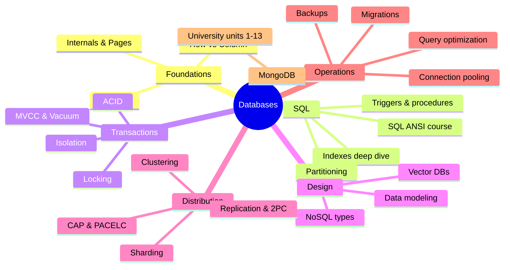

# Databases Index

<Note>
**Start here**

The entry point to every database note: fundamentals (how storage, indexes and transactions work), the SQL course, MongoDB, and senior topics (distribution, operations, modeling, performance, vectors). Each topic note has worked examples, a 🆕 2025–2026 box where something changed, and interview questions at the end. Originals replaced during the September 2026 restructure are kept in `Databases/_Archive`.
</Note>

## 🧭 Quick links
- 🆕 [PostgreSQL 17 to 18 - What's New](/Software%20Engineering/Databases/Core%20Concepts/PostgreSQL%2017%20to%2018%20-%20What's%20New): Postgres 17/18/19 and the wider 2025–2026 database timeline
- 📚 Sub-indexes: [Database Round](/Software%20Engineering/Databases/Database%20Round/Database%20Round) (fundamentals course) · [SQL ANSI](/Software%20Engineering/Databases/SQL%20ANSI/SQL%20ANSI) (SQL course) · [MongoDB](/Software%20Engineering/Databases/MongoDB/MongoDB) (MongoDB University)
- 🎯 Interview mode: [Transactions & ACID](/Software%20Engineering/Databases/Database%20Round/Transactions%20%26%20ACID) → [Isolation Levels & Read Phenomena](/Software%20Engineering/Databases/Core%20Concepts/Isolation%20Levels%20%26%20Read%20Phenomena) → [Database Indexes](/Software%20Engineering/Databases/Database%20Round/Indexes/Database%20Indexes) → [CAP Theorem](/Software%20Engineering/Databases/Database%20Round/CAP%20Theorem) → [Replication & 2PC 3PC](/Software%20Engineering/Databases/Database%20Round/Replication%20%26%202PC%203PC) → [Sharding & Partitioning](/Software%20Engineering/Databases/Database%20Round/Sharding%20%26%20Partitioning) → [Query Optimization & EXPLAIN](/Software%20Engineering/Databases/Core%20Concepts/Query%20Optimization%20%26%20EXPLAIN)

## 1. Beginner: SQL and the relational model
- Course: [SQL ANSI](/Software%20Engineering/Databases/SQL%20ANSI/SQL%20ANSI), in lesson order
  - Basics: [Introduction to SQL](/Software%20Engineering/Databases/SQL%20ANSI/Introduction%20to%20SQL) · [Retrieving Information](/Software%20Engineering/Databases/SQL%20ANSI/Retrieving%20Information) · [Sorting Data](/Software%20Engineering/Databases/SQL%20ANSI/Sorting%20Data) · [Filtering Data](/Software%20Engineering/Databases/SQL%20ANSI/Filtering%20Data) · [Advanced Filtering Data](/Software%20Engineering/Databases/SQL%20ANSI/Advanced%20Filtering%20Data) · [Using Wildcard Filtering](/Software%20Engineering/Databases/SQL%20ANSI/Using%20Wildcard%20Filtering)
  - Calculating: [Creating Calculated Fields](/Software%20Engineering/Databases/SQL%20ANSI/Creating%20Calculated%20Fields) · [Using Data Manipulation Functions](/Software%20Engineering/Databases/SQL%20ANSI/Using%20Data%20Manipulation%20Functions) · [Summarizing Data](/Software%20Engineering/Databases/SQL%20ANSI/Summarizing%20Data) · [Grouping Data](/Software%20Engineering/Databases/SQL%20ANSI/Grouping%20Data)
  - Combining: [Working with Subqueries](/Software%20Engineering/Databases/SQL%20ANSI/Working%20with%20Subqueries) · [Joining Tables](/Software%20Engineering/Databases/SQL%20ANSI/Joining%20Tables) · [Creating Advanced Joins](/Software%20Engineering/Databases/SQL%20ANSI/Creating%20Advanced%20Joins) · [Combining Queries](/Software%20Engineering/Databases/SQL%20ANSI/Combining%20Queries)
  - Changing data and schema: [Inserting Data](/Software%20Engineering/Databases/SQL%20ANSI/Inserting%20Data) · [Updating and Deleting Data](/Software%20Engineering/Databases/SQL%20ANSI/Updating%20and%20Deleting%20Data) · [Creating and Manipulating Tables](/Software%20Engineering/Databases/SQL%20ANSI/Creating%20and%20Manipulating%20Tables) · [Using Views](/Software%20Engineering/Databases/SQL%20ANSI/Using%20Views)
  - Advanced: [Working with Stored Procedures](/Software%20Engineering/Databases/SQL%20ANSI/Working%20with%20Stored%20Procedures) · [Managing Transaction Processing](/Software%20Engineering/Databases/SQL%20ANSI/Managing%20Transaction%20Processing) · [Using Cursors](/Software%20Engineering/Databases/SQL%20ANSI/Using%20Cursors) · [Understanding Advanced SQL Features](/Software%20Engineering/Databases/SQL%20ANSI/Understanding%20Advanced%20SQL%20Features)
- Modeling: [Data Modeling & Normalization](/Software%20Engineering/Databases/Core%20Concepts/Data%20Modeling%20%26%20Normalization)

## 2. Beginner → intermediate: how databases work
| Storage | Indexing | Transactions |
|---|---|---|
| [Database Internals](/Software%20Engineering/Databases/Database%20Round/Database%20Internals) | [Database Indexes](/Software%20Engineering/Databases/Database%20Round/Indexes/Database%20Indexes) | [Transactions & ACID](/Software%20Engineering/Databases/Database%20Round/Transactions%20%26%20ACID) |
| [Database Pages](/Software%20Engineering/Databases/Database%20Round/Database%20Pages) | [Primary vs Secondary Key](/Software%20Engineering/Databases/Database%20Round/Indexes/Primary%20vs%20Secondary%20Key) | [Isolation Levels & Read Phenomena](/Software%20Engineering/Databases/Core%20Concepts/Isolation%20Levels%20%26%20Read%20Phenomena) |
| [Row Vs Column Oriented Databases](/Software%20Engineering/Databases/Database%20Round/Row%20Vs%20Column%20Oriented%20Databases) | [SQL Indexes Deep Dive](/Software%20Engineering/Databases/SQL%20ANSI/SQL%20Indexes%20Deep%20Dive) | [Locking & Concurrency Control](/Software%20Engineering/Databases/Core%20Concepts/Locking%20%26%20Concurrency%20Control) |
| | [Keyset Pagination vs Offset](/Software%20Engineering/Databases/Database%20Round/Keyset%20Pagination%20vs%20Offset) | [MVCC & Vacuum](/Software%20Engineering/Databases/Core%20Concepts/MVCC%20%26%20Vacuum) |

PostgreSQL extras from the SQL course: [SQL Trigger Functions](/Software%20Engineering/Databases/SQL%20ANSI/SQL%20Trigger%20Functions) · [SQL Table Partitioning](/Software%20Engineering/Databases/SQL%20ANSI/SQL%20Table%20Partitioning)

## 3. Intermediate: beyond relational
- [NoSQL Database Types](/Software%20Engineering/Databases/Core%20Concepts/NoSQL%20Database%20Types): key-value, document, wide-column, graph, time-series, search, columnar, NewSQL
- [MongoDB](/Software%20Engineering/Databases/MongoDB/MongoDB) course: [Unit 01 Start Here - Intro to MongoDB](/Software%20Engineering/Databases/MongoDB/Unit%2001%20Start%20Here%20-%20Intro%20to%20MongoDB) · [Unit 02 Getting Started with MongoDB Atlas](/Software%20Engineering/Databases/MongoDB/Unit%2002%20Getting%20Started%20with%20MongoDB%20Atlas) · [Unit 03 MongoDB and the Document Model](/Software%20Engineering/Databases/MongoDB/Unit%2003%20MongoDB%20and%20the%20Document%20Model) · [Unit 04 MongoDB Data Modeling Intro](/Software%20Engineering/Databases/MongoDB/Unit%2004%20MongoDB%20Data%20Modeling%20Intro) · [Unit 05 Connecting to a MongoDB Database](/Software%20Engineering/Databases/MongoDB/Unit%2005%20Connecting%20to%20a%20MongoDB%20Database) · [Unit 06 Connecting to MongoDB in Node.js](/Software%20Engineering/Databases/MongoDB/Unit%2006%20Connecting%20to%20MongoDB%20in%20Node.js) · [Unit 07 MongoDB CRUD Operations Insert and Find Documents](/Software%20Engineering/Databases/MongoDB/Unit%2007%20MongoDB%20CRUD%20Operations%20Insert%20and%20Find%20Documents) · [Unit 08 MongoDB CRUD Operations Replace and Delete Documents](/Software%20Engineering/Databases/MongoDB/Unit%2008%20MongoDB%20CRUD%20Operations%20Replace%20and%20Delete%20Documents) · [Unit 09 MongoDB CRUD Operations Modifying Query Results](/Software%20Engineering/Databases/MongoDB/Unit%2009%20MongoDB%20CRUD%20Operations%20Modifying%20Query%20Results) · [Unit 10 MongoDB CRUD Operations in Node.js](/Software%20Engineering/Databases/MongoDB/Unit%2010%20MongoDB%20CRUD%20Operations%20in%20Node.js) · [Unit 11 MongoDB Aggregation](/Software%20Engineering/Databases/MongoDB/Unit%2011%20MongoDB%20Aggregation) · [Unit 12 MongoDB Indexes](/Software%20Engineering/Databases/MongoDB/Unit%2012%20MongoDB%20Indexes) · [Unit 13 MongoDB Atlas Search](/Software%20Engineering/Databases/MongoDB/Unit%2013%20MongoDB%20Atlas%20Search)
- [Vector Databases & pgvector](/Software%20Engineering/Databases/Core%20Concepts/Vector%20Databases%20%26%20pgvector): embeddings, HNSW/IVFFlat, RAG (see also [AI & ML Index](/Software%20Engineering/AI%20%26%20ML/AI%20%26%20ML%20Index))

## 4. Senior: distribution, performance, operations
| Distribution | Performance | Operations |
|---|---|---|
| [CAP Theorem](/Software%20Engineering/Databases/Database%20Round/CAP%20Theorem) | [Query Optimization & EXPLAIN](/Software%20Engineering/Databases/Core%20Concepts/Query%20Optimization%20%26%20EXPLAIN) | [Connection Pooling](/Software%20Engineering/Databases/Database%20Round/Connection%20Pooling) |
| [Clustering and Scaling](/Software%20Engineering/Databases/Database%20Round/Clustering%20and%20Scaling) | [Keyset Pagination vs Offset](/Software%20Engineering/Databases/Database%20Round/Keyset%20Pagination%20vs%20Offset) | [Database Backup](/Software%20Engineering/Databases/Database%20Round/Database%20Backup) |
| [Replication & 2PC 3PC](/Software%20Engineering/Databases/Database%20Round/Replication%20%26%202PC%203PC) | [MVCC & Vacuum](/Software%20Engineering/Databases/Core%20Concepts/MVCC%20%26%20Vacuum) | [Database Migrations & Schema Evolution](/Software%20Engineering/Databases/Core%20Concepts/Database%20Migrations%20%26%20Schema%20Evolution) |
| [Sharding & Partitioning](/Software%20Engineering/Databases/Database%20Round/Sharding%20%26%20Partitioning) | [SQL Indexes Deep Dive](/Software%20Engineering/Databases/SQL%20ANSI/SQL%20Indexes%20Deep%20Dive) | [PostgreSQL 17 to 18 - What's New](/Software%20Engineering/Databases/Core%20Concepts/PostgreSQL%2017%20to%2018%20-%20What's%20New) |

## Suggested study paths
<Info>
**🔁 Beginner to senior (full path)**

1. [SQL ANSI](/Software%20Engineering/Databases/SQL%20ANSI/SQL%20ANSI) lessons 1–22 in order, then [Data Modeling & Normalization](/Software%20Engineering/Databases/Core%20Concepts/Data%20Modeling%20%26%20Normalization)
2. [Database Internals](/Software%20Engineering/Databases/Database%20Round/Database%20Internals) → [Database Pages](/Software%20Engineering/Databases/Database%20Round/Database%20Pages) → [Database Indexes](/Software%20Engineering/Databases/Database%20Round/Indexes/Database%20Indexes) → [Primary vs Secondary Key](/Software%20Engineering/Databases/Database%20Round/Indexes/Primary%20vs%20Secondary%20Key) → [SQL Indexes Deep Dive](/Software%20Engineering/Databases/SQL%20ANSI/SQL%20Indexes%20Deep%20Dive)
3. [Transactions & ACID](/Software%20Engineering/Databases/Database%20Round/Transactions%20%26%20ACID) → [Isolation Levels & Read Phenomena](/Software%20Engineering/Databases/Core%20Concepts/Isolation%20Levels%20%26%20Read%20Phenomena) → [Locking & Concurrency Control](/Software%20Engineering/Databases/Core%20Concepts/Locking%20%26%20Concurrency%20Control) → [MVCC & Vacuum](/Software%20Engineering/Databases/Core%20Concepts/MVCC%20%26%20Vacuum)
4. [Query Optimization & EXPLAIN](/Software%20Engineering/Databases/Core%20Concepts/Query%20Optimization%20%26%20EXPLAIN) → [Keyset Pagination vs Offset](/Software%20Engineering/Databases/Database%20Round/Keyset%20Pagination%20vs%20Offset) → [Connection Pooling](/Software%20Engineering/Databases/Database%20Round/Connection%20Pooling)
5. [NoSQL Database Types](/Software%20Engineering/Databases/Core%20Concepts/NoSQL%20Database%20Types) → [MongoDB](/Software%20Engineering/Databases/MongoDB/MongoDB) units → [Row Vs Column Oriented Databases](/Software%20Engineering/Databases/Database%20Round/Row%20Vs%20Column%20Oriented%20Databases) → [Vector Databases & pgvector](/Software%20Engineering/Databases/Core%20Concepts/Vector%20Databases%20%26%20pgvector)
6. [CAP Theorem](/Software%20Engineering/Databases/Database%20Round/CAP%20Theorem) → [Clustering and Scaling](/Software%20Engineering/Databases/Database%20Round/Clustering%20and%20Scaling) → [Replication & 2PC 3PC](/Software%20Engineering/Databases/Database%20Round/Replication%20%26%202PC%203PC) → [Sharding & Partitioning](/Software%20Engineering/Databases/Database%20Round/Sharding%20%26%20Partitioning)
7. [Database Backup](/Software%20Engineering/Databases/Database%20Round/Database%20Backup) → [Database Migrations & Schema Evolution](/Software%20Engineering/Databases/Core%20Concepts/Database%20Migrations%20%26%20Schema%20Evolution) → [PostgreSQL 17 to 18 - What's New](/Software%20Engineering/Databases/Core%20Concepts/PostgreSQL%2017%20to%2018%20-%20What's%20New)
</Info>

<Info>
**⚡ Catch up on 2025–2026 only**

[PostgreSQL 17 to 18 - What's New](/Software%20Engineering/Databases/Core%20Concepts/PostgreSQL%2017%20to%2018%20-%20What's%20New) → [MVCC & Vacuum](/Software%20Engineering/Databases/Core%20Concepts/MVCC%20%26%20Vacuum) → [Database Indexes](/Software%20Engineering/Databases/Database%20Round/Indexes/Database%20Indexes) → [Database Backup](/Software%20Engineering/Databases/Database%20Round/Database%20Backup) → [Connection Pooling](/Software%20Engineering/Databases/Database%20Round/Connection%20Pooling) → [Vector Databases & pgvector](/Software%20Engineering/Databases/Core%20Concepts/Vector%20Databases%20%26%20pgvector) → [NoSQL Database Types](/Software%20Engineering/Databases/Core%20Concepts/NoSQL%20Database%20Types) → [MongoDB](/Software%20Engineering/Databases/MongoDB/MongoDB) → [Unit 02 Getting Started with MongoDB Atlas](/Software%20Engineering/Databases/MongoDB/Unit%2002%20Getting%20Started%20with%20MongoDB%20Atlas)
</Info>

<Info>
**🎯 One week before a backend / system design interview**

Day 1 ACID + isolation + locking. Day 2 indexes + EXPLAIN + pagination. Day 3 modeling + SQL vs NoSQL. Day 4 CAP + replication + 2PC/sagas. Day 5 sharding + scaling + pooling. Day 6 backups + migrations. Day 7 answer every interview question block cold. Pair with [System Design Interview Framework](/Software%20Engineering/System%20Design/System%20Design%20Interview%20Framework).
</Info>

## 🆕 2025–2026 in this area
- **PostgreSQL 18** (2025-09-25): async I/O, `uuidv7()`, virtual generated columns, `OLD`/`NEW` in `RETURNING`, skip scan, temporal constraints, OAuth, MD5 deprecated, checksums on by default, stats kept by `pg_upgrade` → [PostgreSQL 17 to 18 - What's New](/Software%20Engineering/Databases/Core%20Concepts/PostgreSQL%2017%20to%2018%20-%20What's%20New), [Database Indexes](/Software%20Engineering/Databases/Database%20Round/Indexes/Database%20Indexes), [Database Internals](/Software%20Engineering/Databases/Database%20Round/Database%20Internals), [MVCC & Vacuum](/Software%20Engineering/Databases/Core%20Concepts/MVCC%20%26%20Vacuum)
- **PostgreSQL 19** in beta (Beta 1 2026-06-04, Beta 4 2026-09-24; GA expected ~October 2026): `REPACK CONCURRENTLY`, `WAIT FOR`, parallel autovacuum, `pg_plan_advice`; SQL/PGQ and MERGE/SPLIT PARTITIONS reverted → [PostgreSQL 17 to 18 - What's New](/Software%20Engineering/Databases/Core%20Concepts/PostgreSQL%2017%20to%2018%20-%20What's%20New), [MVCC & Vacuum](/Software%20Engineering/Databases/Core%20Concepts/MVCC%20%26%20Vacuum), [SQL Table Partitioning](/Software%20Engineering/Databases/SQL%20ANSI/SQL%20Table%20Partitioning)
- **PostgreSQL 13 EOL** (2025-11-13); PG 14 EOL 2026-11-12 → [PostgreSQL 17 to 18 - What's New](/Software%20Engineering/Databases/Core%20Concepts/PostgreSQL%2017%20to%2018%20-%20What's%20New)
- **MySQL 8.0 EOL** (2026-04-30); MySQL 9.7 LTS (2026-04-21) → [Database Migrations & Schema Evolution](/Software%20Engineering/Databases/Core%20Concepts/Database%20Migrations%20%26%20Schema%20Evolution)
- **pgvector** 0.8.1 (PG 18 support, 2025-09-04), 0.8.2 (CVE-2026-3172 fix, 2026-02-26) → [Vector Databases & pgvector](/Software%20Engineering/Databases/Core%20Concepts/Vector%20Databases%20%26%20pgvector)
- **PgBouncer 1.25** (2025-11-09) and CVE-2025-12819 fix in 1.25.1 (2025-12-03) → [Connection Pooling](/Software%20Engineering/Databases/Database%20Round/Connection%20Pooling)
- **pgBackRest** archived (2026-04-27) and revived with sponsors (2026-05-18) → [Database Backup](/Software%20Engineering/Databases/Database%20Round/Database%20Backup)
- **Redis 8 AGPLv3** (2025-05-01), **Valkey 9.0** (2025-10-21), **DuckDB 1.4 LTS** (2025-09) and **1.5** (2026-03-09) → [NoSQL Database Types](/Software%20Engineering/Databases/Core%20Concepts/NoSQL%20Database%20Types)
- **Databricks/Neon** (2025-05-14) and **Snowflake/Crunchy Data** (2025-06-02) acquisitions → [Row Vs Column Oriented Databases](/Software%20Engineering/Databases/Database%20Round/Row%20Vs%20Column%20Oriented%20Databases), [PostgreSQL 17 to 18 - What's New](/Software%20Engineering/Databases/Core%20Concepts/PostgreSQL%2017%20to%2018%20-%20What's%20New)
- **MongoDB 8.2** (2025-09-16), **8.3** (2026-05), Voyage AI acquisition (2025-02-24), Atlas Flex replacing Serverless/M2/M5 (unsupported from 2026-01-22), Device Sync EOL (2025-09-30), Node driver 7.0 (2025-11-06) → [MongoDB](/Software%20Engineering/Databases/MongoDB/MongoDB), [Unit 02 Getting Started with MongoDB Atlas](/Software%20Engineering/Databases/MongoDB/Unit%2002%20Getting%20Started%20with%20MongoDB%20Atlas), [Unit 06 Connecting to MongoDB in Node.js](/Software%20Engineering/Databases/MongoDB/Unit%2006%20Connecting%20to%20MongoDB%20in%20Node.js), [Unit 13 MongoDB Atlas Search](/Software%20Engineering/Databases/MongoDB/Unit%2013%20MongoDB%20Atlas%20Search)

## Related
- [Software Engineering](/Software%20Engineering/Software%20Engineering), the vault root
- [System Design Interview Framework](/Software%20Engineering/System%20Design/System%20Design%20Interview%20Framework) · [AI & ML Index](/Software%20Engineering/AI%20%26%20ML/AI%20%26%20ML%20Index)
- Frontend data topics: [Networking - HTTP, Caching & Real-time](/Software%20Engineering/Frontend/03%20Browser%20%26%20Web%20Platform/Networking%20-%20HTTP%2C%20Caching%20%26%20Real-time) · [Authentication & Token Storage](/Software%20Engineering/Frontend/11%20Security/Authentication%20%26%20Token%20Storage)
- `_Archive` holds: `ACID Overview (original)`, `Overview - Locking & Distributed DB (original)`, `Overview 1 - Replication & Data Systems (original)`, `MongoDB (original)` (contains Atlas course credentials: keep private)
