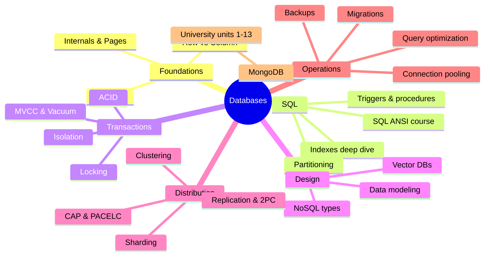

# Databases Index

> [!tldr] Start here
> The entry point to every database note: fundamentals (how storage, indexes and transactions work), the SQL course, MongoDB, and senior topics (distribution, operations, modeling, performance, vectors). Each topic note has worked examples, a 🆕 2025–2026 box where something changed, and interview questions at the end. Originals replaced during the September 2026 restructure are kept in `Databases/_Archive`.

## 🧭 Quick links
- 🆕 [[PostgreSQL 17 to 18 - What's New]]: Postgres 17/18/19 and the wider 2025–2026 database timeline
- 📚 Sub-indexes: [[Database Round]] (fundamentals course) · [[SQL ANSI]] (SQL course) · [[MongoDB]] (MongoDB University)
- 🎯 Interview mode: [[Transactions & ACID]] → [[Isolation Levels & Read Phenomena]] → [[Database Indexes]] → [[CAP Theorem]] → [[Replication & 2PC 3PC]] → [[Sharding & Partitioning]] → [[Query Optimization & EXPLAIN]]

## 1. Beginner: SQL and the relational model
- Course: [[SQL ANSI]], in lesson order
  - Basics: [[Introduction to SQL]] · [[Retrieving Information]] · [[Sorting Data]] · [[Filtering Data]] · [[Advanced Filtering Data]] · [[Using Wildcard Filtering]]
  - Calculating: [[Creating Calculated Fields]] · [[Using Data Manipulation Functions]] · [[Summarizing Data]] · [[Grouping Data]]
  - Combining: [[Working with Subqueries]] · [[Joining Tables]] · [[Creating Advanced Joins]] · [[Combining Queries]]
  - Changing data and schema: [[Inserting Data]] · [[Updating and Deleting Data]] · [[Creating and Manipulating Tables]] · [[Using Views]]
  - Advanced: [[Working with Stored Procedures]] · [[Managing Transaction Processing]] · [[Using Cursors]] · [[Understanding Advanced SQL Features]]
- Modeling: [[Data Modeling & Normalization]]

## 2. Beginner → intermediate: how databases work
| Storage | Indexing | Transactions |
|---|---|---|
| [[Database Internals]] | [[Database Indexes]] | [[Transactions & ACID]] |
| [[Database Pages]] | [[Primary vs Secondary Key]] | [[Isolation Levels & Read Phenomena]] |
| [[Row Vs Column Oriented Databases]] | [[SQL Indexes Deep Dive]] | [[Locking & Concurrency Control]] |
| | [[Keyset Pagination vs Offset]] | [[MVCC & Vacuum]] |

PostgreSQL extras from the SQL course: [[SQL Trigger Functions]] · [[SQL Table Partitioning]]

## 3. Intermediate: beyond relational
- [[NoSQL Database Types]]: key-value, document, wide-column, graph, time-series, search, columnar, NewSQL
- [[MongoDB]] course: [[Unit 01 Start Here - Intro to MongoDB]] · [[Unit 02 Getting Started with MongoDB Atlas]] · [[Unit 03 MongoDB and the Document Model]] · [[Unit 04 MongoDB Data Modeling Intro]] · [[Unit 05 Connecting to a MongoDB Database]] · [[Unit 06 Connecting to MongoDB in Node.js]] · [[Unit 07 MongoDB CRUD Operations Insert and Find Documents]] · [[Unit 08 MongoDB CRUD Operations Replace and Delete Documents]] · [[Unit 09 MongoDB CRUD Operations Modifying Query Results]] · [[Unit 10 MongoDB CRUD Operations in Node.js]] · [[Unit 11 MongoDB Aggregation]] · [[Unit 12 MongoDB Indexes]] · [[Unit 13 MongoDB Atlas Search]]
- [[Vector Databases & pgvector]]: embeddings, HNSW/IVFFlat, RAG (see also [[AI & ML Index]])

## 4. Senior: distribution, performance, operations
| Distribution | Performance | Operations |
|---|---|---|
| [[CAP Theorem]] | [[Query Optimization & EXPLAIN]] | [[Connection Pooling]] |
| [[Clustering and Scaling]] | [[Keyset Pagination vs Offset]] | [[Database Backup]] |
| [[Replication & 2PC 3PC]] | [[MVCC & Vacuum]] | [[Database Migrations & Schema Evolution]] |
| [[Sharding & Partitioning]] | [[SQL Indexes Deep Dive]] | [[PostgreSQL 17 to 18 - What's New]] |

## Suggested study paths
> [!example]- 🔁 Beginner to senior (full path)
> 1. [[SQL ANSI]] lessons 1–22 in order, then [[Data Modeling & Normalization]]
> 2. [[Database Internals]] → [[Database Pages]] → [[Database Indexes]] → [[Primary vs Secondary Key]] → [[SQL Indexes Deep Dive]]
> 3. [[Transactions & ACID]] → [[Isolation Levels & Read Phenomena]] → [[Locking & Concurrency Control]] → [[MVCC & Vacuum]]
> 4. [[Query Optimization & EXPLAIN]] → [[Keyset Pagination vs Offset]] → [[Connection Pooling]]
> 5. [[NoSQL Database Types]] → [[MongoDB]] units → [[Row Vs Column Oriented Databases]] → [[Vector Databases & pgvector]]
> 6. [[CAP Theorem]] → [[Clustering and Scaling]] → [[Replication & 2PC 3PC]] → [[Sharding & Partitioning]]
> 7. [[Database Backup]] → [[Database Migrations & Schema Evolution]] → [[PostgreSQL 17 to 18 - What's New]]

> [!example]- ⚡ Catch up on 2025–2026 only
> [[PostgreSQL 17 to 18 - What's New]] → [[MVCC & Vacuum]] → [[Database Indexes]] → [[Database Backup]] → [[Connection Pooling]] → [[Vector Databases & pgvector]] → [[NoSQL Database Types]] → [[MongoDB]] → [[Unit 02 Getting Started with MongoDB Atlas]]

> [!example]- 🎯 One week before a backend / system design interview
> Day 1 ACID + isolation + locking. Day 2 indexes + EXPLAIN + pagination. Day 3 modeling + SQL vs NoSQL. Day 4 CAP + replication + 2PC/sagas. Day 5 sharding + scaling + pooling. Day 6 backups + migrations. Day 7 answer every interview question block cold. Pair with [[System Design Interview Framework]].

## 🆕 2025–2026 in this area
- **PostgreSQL 18** (2025-09-25): async I/O, `uuidv7()`, virtual generated columns, `OLD`/`NEW` in `RETURNING`, skip scan, temporal constraints, OAuth, MD5 deprecated, checksums on by default, stats kept by `pg_upgrade` → [[PostgreSQL 17 to 18 - What's New]], [[Database Indexes]], [[Database Internals]], [[MVCC & Vacuum]]
- **PostgreSQL 19** in beta (Beta 1 2026-06-04, Beta 4 2026-09-24; GA expected ~October 2026): `REPACK CONCURRENTLY`, `WAIT FOR`, parallel autovacuum, `pg_plan_advice`; SQL/PGQ and MERGE/SPLIT PARTITIONS reverted → [[PostgreSQL 17 to 18 - What's New]], [[MVCC & Vacuum]], [[SQL Table Partitioning]]
- **PostgreSQL 13 EOL** (2025-11-13); PG 14 EOL 2026-11-12 → [[PostgreSQL 17 to 18 - What's New]]
- **MySQL 8.0 EOL** (2026-04-30); MySQL 9.7 LTS (2026-04-21) → [[Database Migrations & Schema Evolution]]
- **pgvector** 0.8.1 (PG 18 support, 2025-09-04), 0.8.2 (CVE-2026-3172 fix, 2026-02-26) → [[Vector Databases & pgvector]]
- **PgBouncer 1.25** (2025-11-09) and CVE-2025-12819 fix in 1.25.1 (2025-12-03) → [[Connection Pooling]]
- **pgBackRest** archived (2026-04-27) and revived with sponsors (2026-05-18) → [[Database Backup]]
- **Redis 8 AGPLv3** (2025-05-01), **Valkey 9.0** (2025-10-21), **DuckDB 1.4 LTS** (2025-09) and **1.5** (2026-03-09) → [[NoSQL Database Types]]
- **Databricks/Neon** (2025-05-14) and **Snowflake/Crunchy Data** (2025-06-02) acquisitions → [[Row Vs Column Oriented Databases]], [[PostgreSQL 17 to 18 - What's New]]
- **MongoDB 8.2** (2025-09-16), **8.3** (2026-05), Voyage AI acquisition (2025-02-24), Atlas Flex replacing Serverless/M2/M5 (unsupported from 2026-01-22), Device Sync EOL (2025-09-30), Node driver 7.0 (2025-11-06) → [[MongoDB]], [[Unit 02 Getting Started with MongoDB Atlas]], [[Unit 06 Connecting to MongoDB in Node.js]], [[Unit 13 MongoDB Atlas Search]]

## Related
- [[Software Engineering]], the vault root
- [[System Design Interview Framework]] · [[AI & ML Index]]
- Frontend data topics: [[Networking - HTTP, Caching & Real-time]] · [[Authentication & Token Storage]]
- `_Archive` holds: `ACID Overview (original)`, `Overview - Locking & Distributed DB (original)`, `Overview 1 - Replication & Data Systems (original)`, `MongoDB (original)` (contains Atlas course credentials: keep private)
