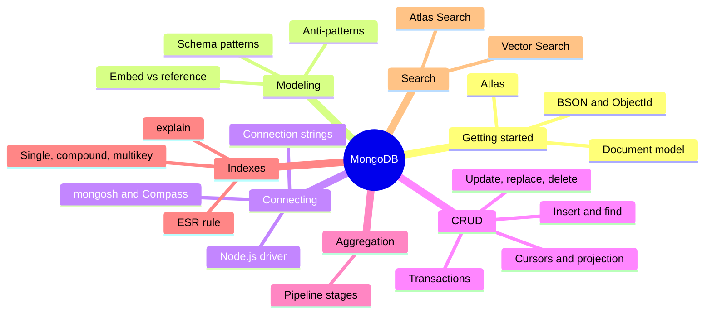

# MongoDB

> [!tldr] TL;DR
> Notes from the MongoDB University learning path **"Introduction to MongoDB"** (13 units), tidied into course notes with examples, a senior perspective and interview questions in each unit. Read them in order: Atlas and the document model first, then data modeling, connecting, CRUD, aggregation, indexes and Atlas Search. The original index note (with the lab cluster credentials) is kept in `_Archive/MongoDB (original).md`.

## 🧭 Quick links
- Course: [MongoDB University, Introduction to MongoDB](https://learn.mongodb.com/)
- Lab environment: the course ran in an **Instruqt** in-browser lab (terminal + editor). See [[Unit 01 Start Here - Intro to MongoDB]].
- Cluster used in the labs: an Atlas cluster named `myAtlasClusterEDU` with a `readWriteAnyDatabase` user. Credentials are kept only in the archived original note; never paste them into new notes.

## The 13 units

### Getting started (beginner)
1. [[Unit 01 Start Here - Intro to MongoDB]]: what MongoDB is, the learning path, `mongosh` basics
2. [[Unit 02 Getting Started with MongoDB Atlas]]: Atlas, clusters and tiers, Atlas CLI
3. [[Unit 03 MongoDB and the Document Model]]: documents, collections, BSON, `_id`, flexible schema

### Modeling (beginner → intermediate)
4. [[Unit 04 MongoDB Data Modeling Intro]]: relationships, embedding vs referencing, schema patterns and anti-patterns

### Connecting
5. [[Unit 05 Connecting to a MongoDB Database]]: connection strings, `mongosh`, Compass, drivers, troubleshooting
6. [[Unit 06 Connecting to MongoDB in Node.js]]: the Node.js driver, one `MongoClient` per process, pooling

### CRUD (intermediate)
7. [[Unit 07 MongoDB CRUD Operations Insert and Find Documents]]: `insertOne/Many`, `find`, comparison, logical and array operators
8. [[Unit 08 MongoDB CRUD Operations Replace and Delete Documents]]: `replaceOne`, `updateOne/Many`, upsert, `findAndModify`, deletes
9. [[Unit 09 MongoDB CRUD Operations Modifying Query Results]]: cursors, `sort`, `limit`, projection, `countDocuments`
10. [[Unit 10 MongoDB CRUD Operations in Node.js]]: BSON in Node.js, CRUD from the driver, multi-document transactions

### Aggregation (intermediate → senior)
11. [[Unit 11 MongoDB Aggregation]]: pipelines, `$match`, `$group`, `$lookup`, memory limits

### Indexes (intermediate → senior)
12. [[Unit 12 MongoDB Indexes]]: single-field, compound, multikey, ESR rule, `explain()`, hidden indexes

### Search (senior)
13. [[Unit 13 MongoDB Atlas Search]]: search indexes, analyzers, `$search`, `compound`, facets, Vector Search and hybrid search

## Suggested study path
> [!example]- 🔁 Full course, in order
> Units 01 → 13. Do the labs in `mongosh` against a free Atlas cluster (M0) or a local `mongod` / Docker container. After Unit 04, read [[Data Modeling & Normalization]]; after Unit 12, read [[Database Indexes]] and [[Query Optimization & EXPLAIN]].

> [!example]- 🎯 Interview prep (MongoDB-focused backend role)
> [[Unit 03 MongoDB and the Document Model]] → [[Unit 04 MongoDB Data Modeling Intro]] (patterns and anti-patterns) → [[Unit 12 MongoDB Indexes]] (ESR) → [[Unit 11 MongoDB Aggregation]] → [[Unit 10 MongoDB CRUD Operations in Node.js]] (transactions, write concern) → [[NoSQL Database Types]] → [[CAP Theorem]] → [[Sharding & Partitioning]]

> [!example]- ⚡ Catch up on 2025–2026 only
> Read the 🆕 callouts in the units listed below.

## 🆕 2025–2026 in MongoDB
- **2024-10-02** MongoDB 8.0 GA, MongoDB claims ~36% faster reads vs 7.0: [[Unit 01 Start Here - Intro to MongoDB]]
- **2025-02** Atlas Flex clusters replace Serverless instances and M2/M5 shared tiers; support for those ended **2026-01-22**: [[Unit 02 Getting Started with MongoDB Atlas]]
- **2025-02-24** MongoDB announces the acquisition of Voyage AI (embeddings and rerankers): [[Unit 13 MongoDB Atlas Search]]
- **2025-07-31** MongoDB 6.0 end of life: [[Unit 01 Start Here - Intro to MongoDB]]
- **2025-09-16** MongoDB 8.2, first minor release also shipped for Community and Enterprise Server; Search and Vector Search for self-managed in public preview; `$scoreFusion`: [[Unit 13 MongoDB Atlas Search]], [[Unit 01 Start Here - Intro to MongoDB]]
- **2025-09-30** Atlas Device Sync / Device SDKs and Atlas Data API + HTTPS Endpoints reach end of life: [[Unit 02 Getting Started with MongoDB Atlas]]
- **2025-11-06** Node.js driver 7.0 (Node.js 20.19+ required): [[Unit 06 Connecting to MongoDB in Node.js]], [[Unit 10 MongoDB CRUD Operations in Node.js]]
- **2026-05** MongoDB 8.3: `$scoreFusion` GA, cost-based plan selection by default, new expressions: [[Unit 11 MongoDB Aggregation]], [[Unit 12 MongoDB Indexes]], [[Unit 13 MongoDB Atlas Search]]

## Related
- [[Databases Index]], the Databases domain home
- [[NoSQL Database Types]] · [[Data Modeling & Normalization]] · [[Vector Databases & pgvector]]
- [[Software Engineering]], the vault root
- `_Archive/MongoDB (original).md`: the original index note, unchanged (contains lab credentials)

## Sources
- [MongoDB University](https://learn.mongodb.com/)
- [MongoDB Manual](https://www.mongodb.com/docs/manual/)
- [MongoDB Software Lifecycle Schedules](https://www.mongodb.com/legal/support-policy/lifecycles)
