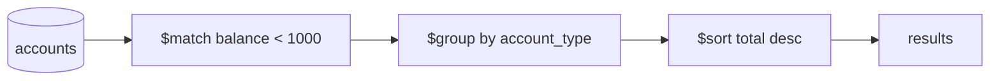

# Unit 11 MongoDB Aggregation

> [!tldr] TL;DR
> **Aggregation** analyzes and summarizes data. An **aggregation pipeline** is an array of **stages** run in order, each transforming the stream of documents: filter (`$match`), reshape (`$project`, `$set`), group (`$group`), sort, limit, unwind arrays, join (`$lookup`), and write results (`$out`, `$merge`). Put `$match` and `$sort` early so they can use indexes. Each stage can use up to **100 MB** of RAM before it must spill to disk (`allowDiskUse`, on by default since 6.0).

> Course: MongoDB University, Unit 11 · Prev: [[Unit 10 MongoDB CRUD Operations in Node.js]] · Next: [[Unit 12 MongoDB Indexes]]

## Terms
- **Aggregation**: analysis and summary of data.
- **Stage**: a single operation performed on the data.
- **Aggregation pipeline**: a series of stages completed one at a time, in order. Data can be filtered, sorted, grouped and transformed along the way.

```js
db.collection.aggregate([
  { $stage1: { ... } },
  { $stage2: { ... } }
])
```

`aggregate()` can do everything `find()` can and much more (grouping, joins, computed fields).



## Common stages
| Stage | What it does | `find()` equivalent |
|---|---|---|
| `$match` | filters documents by conditions | the filter |
| `$project` | selects, excludes or computes fields | projection |
| `$set` / `$addFields` | adds or overwrites fields, keeps the rest | none |
| `$group` | groups by a key (`_id`) and computes accumulators (`$sum`, `$avg`, `$min`, `$max`, `$push`, `$count`) | none |
| `$sort` | sorts ascending (1) or descending (-1) | `.sort()` |
| `$limit` | passes only the first n documents on | `.limit()` |
| `$skip` | skips n documents | `.skip()` |
| `$unwind` | outputs one document per array element | none |
| `$lookup` | left outer join with another collection, adds matches as an array field | none |
| `$count` | counts documents reaching the stage | `countDocuments` |
| `$out` / `$merge` | writes results to a collection (must be last) | none |
| `$facet` | runs several sub-pipelines on the same input | none |

## Examples
### $set with an expression
Field paths are referenced with `$fieldName` inside expressions:

```js
db.users.aggregate([
  {
    $set: {
      defaultUsername: { $concat: ["$first_name", "$last_name"] }
    }
  }
])
```

### $match + $group (course example)
```js
const pipeline = [
  // Stage 1: match the accounts with a balance less than $1,000
  { $match: { balance: { $lt: 1000 } } },
  // Stage 2: calculate average and total balance for each account type
  {
    $group: {
      _id: "$account_type",
      total_balance: { $sum: "$balance" },
      avg_balance: { $avg: "$balance" },
    },
  },
];

// Node.js
const result = await accountsCollection.aggregate(pipeline).toArray();
```

### $sort, $project and $limit
```js
db.zips.aggregate([
  { $match: { state: "CA" } },
  { $sort: { pop: -1 } },
  { $limit: 3 },
  { $project: { _id: 0, city: 1, pop: 1 } }
])
```

### $unwind + $group: count tags
```js
db.posts.aggregate([
  { $unwind: "$tags" },
  { $group: { _id: "$tags", count: { $sum: 1 } } },
  { $sort: { count: -1 } }
])
```

### $lookup: join orders with customers
```js
db.orders.aggregate([
  { $match: { status: "paid" } },
  {
    $lookup: {
      from: "customers",
      localField: "customer_id",
      foreignField: "_id",
      as: "customer"
    }
  },
  { $unwind: "$customer" },
  { $project: { total: 1, "customer.name": 1 } }
])
```

### $out / $merge: materialize results
```js
db.sightings.aggregate([
  { $group: { _id: "$species", count: { $sum: 1 } } },
  { $merge: { into: "species_counts", whenMatched: "replace" } }  // $out replaces the whole collection
])
```

## Common pitfalls
- `$match` after `$group` or `$project` can't use indexes on the original fields; put it first.
- `$unwind` on big arrays multiplies documents and memory.
- `$lookup` without an index on `foreignField` does a scan of the foreign collection per input document.
- `$group` on a high-cardinality key holds all groups in memory.

> [!info]+ 🆕 2025–2026
> **MongoDB 8.3 (May 2026)** adds aggregation expressions: `arrayIndexAs` and the `$$IDX` variable in `$map`/`$filter`/`$reduce` (access the element's index), `$serializeEJSON`/`$deserializeEJSON`, `$createObjectId`, `$hash`/`$hexHash` (MD5, SHA-256, XXH64) and `$subtype`. `$scoreFusion` (hybrid search ranking) is GA; see [[Unit 13 MongoDB Atlas Search]]. ([8.3 release notes](https://www.mongodb.com/docs/manual/release-notes/8.3/))

## Senior perspective
- **Memory**: each stage is limited to **100 MB** of RAM. Since MongoDB 6.0 the `allowDiskUseByDefault` parameter is `true`, so blocking stages (`$sort`, `$group`) spill to disk instead of failing, but spilling is slow. Watch for `usedDisk: true` in explain output.
- **Output size**: results are returned through a cursor, but each document must still fit in 16 MB; `$push`-ing a large group into one array can exceed it.
- **Optimizer**: MongoDB reorders and coalesces some stages (e.g. moves `$match` before `$project`, merges `$sort` + `$limit` into a top-k sort). Check `explain()` to see what really runs.
- **`$lookup` cost**: it's a nested-loop join. Fine for small, indexed lookups; for hot paths, prefer embedding or extended references ([[Unit 04 MongoDB Data Modeling Intro]]). In sharded clusters, `$lookup` into a sharded collection is supported since 5.1 but costs scatter-gather.
- **Analytics isolation**: run heavy pipelines on analytics secondaries (Atlas analytics nodes, `readPreference=secondary`) or precompute with `$merge` (on-demand materialized views) so they don't hurt OLTP traffic.
- Pipelines are data (arrays), so build them in code but never splice untrusted objects into them.

## Interview questions
> [!question]- What is an aggregation pipeline?
> An ordered list of stages; each receives the documents output by the previous stage, transforms them (filter, reshape, group, join, sort) and passes them on. The final stage's output is the result or is written to a collection.

> [!question]- How do you make an aggregation fast?
> Filter early with `$match` and sort early with `$sort` on indexed fields so the first stages use indexes; project away unneeded fields; avoid large `$unwind`s; index `$lookup` foreign fields; check `explain("executionStats")`.

> [!question]- What's the memory limit of a pipeline stage and what is allowDiskUse?
> 100 MB per stage. `allowDiskUse` lets blocking stages write temporary files to disk instead of erroring; since MongoDB 6.0 it's enabled by default via `allowDiskUseByDefault`.

> [!question]- How does $lookup work and what does it cost?
> It's a left outer join: for each input document it finds matching documents in another collection and adds them as an array. It's effectively a nested loop, so it needs an index on the foreign field and gets expensive with many input docs or across shards.

> [!question]- Difference between $out and $merge?
> `$out` replaces the target collection entirely with the results. `$merge` inserts/updates/merges into an existing collection with configurable matching behaviour, enabling incremental materialized views.

## Related
- [[MongoDB]] · [[Databases Index]]
- [[Query Optimization & EXPLAIN]] · [[Database Indexes]] · [[Data Modeling & Normalization]]

## Sources
- [MongoDB Manual: Aggregation Pipeline](https://www.mongodb.com/docs/manual/core/aggregation-pipeline/)
- [Aggregation Pipeline Limits](https://www.mongodb.com/docs/manual/core/aggregation-pipeline-limits/)
- [Aggregation Pipeline Optimization](https://www.mongodb.com/docs/manual/core/aggregation-pipeline-optimization/)
- [$lookup](https://www.mongodb.com/docs/manual/reference/operator/aggregation/lookup/)
- [MongoDB 8.3 release notes](https://www.mongodb.com/docs/manual/release-notes/8.3/)
- [MongoDB University: MongoDB Aggregation](https://learn.mongodb.com/)
