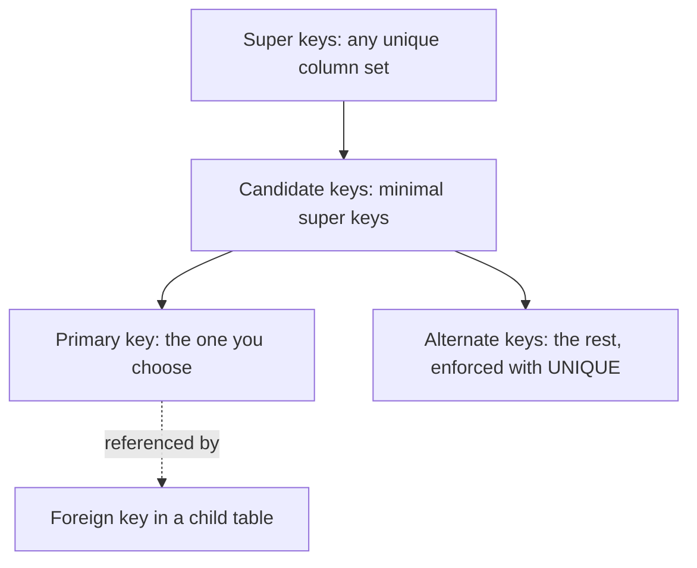

# Introduction to SQL

> [!tldr] TL;DR
> A relational database stores data in **tables** (rows and typed columns) described by a **schema**. **Keys** identify rows: a *super key* is any column set that is unique, a *candidate key* is a minimal super key, the *primary key* is the candidate you pick, the rest are *alternate keys*, and a *foreign key* points at another table's key. SQL is the declarative language you use to ask for data: you say *what* you want, the database decides *how*.

> Course: SQL in 10 Minutes, Lesson 1 · Prev: [[SQL ANSI]] · Next: [[Retrieving Information]]

## Core vocabulary

| Term | Meaning |
|---|---|
| **Database** | A container (usually a file or set of files) that stores organized data. The software that manages it is the DBMS (PostgreSQL, MySQL, SQL Server, Oracle, SQLite). |
| **Table** | A structured list of data of one specific kind (customers, orders). |
| **Schema** | Information about the database and table layout and properties. In PostgreSQL/SQL Server a *schema* is also a namespace inside a database (`public.orders`). |
| **Column** | A single field in a table. Every table has one or more columns. |
| **Datatype** | The kind of data a column allows (`INTEGER`, `VARCHAR(50)`, `DATE`...). It restricts what can be stored and how it's sorted and compared. |
| **Row** | One record in a table. |
| **SQL** | Structured Query Language. Standardised by ANSI/ISO (SQL-92, SQL:1999, ... SQL:2023); every DBMS adds its own dialect on top. |

## SQL keys

1. Primary key
2. Unique key
3. Candidate key
4. Alternate key
5. Composite key
6. Super key
7. Foreign key

### Primary key
A column (or set of columns) whose values uniquely identify every row in a table.

Rules:
1. No two rows can have the same primary key value.
2. Every row must have a value in the primary key column(s), so no `NULL`s.
3. Primary key values should never be modified or updated.
4. Primary key values should never be reused. If a row is deleted, its key should not be given to a new row.

> [!note] Composite primary keys
> With a primary key made of several columns, the individual columns need not be unique; only the combination must be.

### Super key
A single column or a group of columns that can uniquely identify rows (tuples) in a table.

![[Screen_Shot_2022-06-28_at_11.05.13_PM.png]]

If the *Id* attribute is unique for every employee, *Id* is a super key. So are *(Id, Name)*, *(Id, Email)* and *(Id, Name, Email)*: they still identify each row because they contain *Id*, even though the extra attributes are unnecessary.

### Candidate key
A **minimal** super key: it uniquely identifies rows and contains no unnecessary attributes. Candidate keys must be unique and non-null, and every table has at least one. In the example, both `Id` and `Email` could be candidate keys.

### Foreign key
A column (or columns) in one table whose values must match a key (usually the primary key) in another, *parent* table. It enforces **referential integrity**: an order can't point at a customer that doesn't exist.

### Composite key
A candidate key or primary key made of more than one attribute, e.g. `(order_num, order_item)` in `OrderItems`.

### Unique key
A `UNIQUE` constraint guarantees no duplicate values, like a primary key, but a table can have many of them and they can accept `NULL`.

> [!warning] How many NULLs can a unique column hold?
> The original note said "only once". That's **SQL Server** behaviour. In the SQL standard, PostgreSQL, MySQL, SQLite and Oracle (for single-column keys), `NULL` is not equal to `NULL`, so a `UNIQUE` column can hold **many** `NULL`s. PostgreSQL 15+ lets you choose with `UNIQUE NULLS NOT DISTINCT`.

### Alternate key
Candidate keys that were **not** chosen as the primary key. They are usually enforced with `UNIQUE` (and `NOT NULL` if they must always be present).

## Comparison of the keys

- Keys identify rows; they can be one column or a group of columns.
- **Super key**: any unique column set; may contain redundant attributes.
- **Candidate key**: a minimal super key. All candidate keys are super keys, not the other way round.
- **Primary key**: the candidate key chosen to identify rows. Unique, non-null, one per table.
- **Alternate key**: the candidate keys that were not chosen.
- **Composite key**: a candidate key with more than one attribute.
- **Foreign key**: references a key in a parent table; may be non-unique and (unless declared `NOT NULL`) nullable.



## A tiny schema you can run

```sql
CREATE TABLE customers (
  cust_id    BIGINT GENERATED ALWAYS AS IDENTITY PRIMARY KEY, -- surrogate primary key
  email      TEXT NOT NULL UNIQUE,                            -- alternate (candidate) key
  cust_name  TEXT NOT NULL
);

CREATE TABLE orders (
  order_num  BIGINT GENERATED ALWAYS AS IDENTITY PRIMARY KEY,
  cust_id    BIGINT NOT NULL REFERENCES customers (cust_id),  -- foreign key
  order_date DATE   NOT NULL DEFAULT CURRENT_DATE
);

CREATE TABLE order_items (
  order_num  BIGINT  NOT NULL REFERENCES orders (order_num),
  order_item INTEGER NOT NULL,
  prod_id    TEXT    NOT NULL,
  quantity   INTEGER NOT NULL CHECK (quantity > 0),
  PRIMARY KEY (order_num, order_item)                          -- composite key
);
```

## Beyond the book / Senior perspective

- **Surrogate vs natural keys.** A natural key (email, ISBN) has business meaning and can change; a surrogate key (identity, UUID) never does. Most teams use a surrogate primary key plus `UNIQUE` constraints on the natural keys. See [[Primary vs Secondary Key]].
- **Key type matters for performance.** Random UUIDv4 primary keys scatter inserts across the B-tree. Sequential IDs or time-ordered UUIDv7 keep inserts at the "right edge" of the index. See [[SQL Indexes Deep Dive]].
- **Declare foreign keys**, and index the referencing column yourself: PostgreSQL does not create an index on the FK column automatically (MySQL/InnoDB does).
- **SQL is declarative.** The optimizer picks join order and access paths. Reading plans is a core senior skill: [[Query Optimization & EXPLAIN]].
- Keys and normal forms go together: [[Data Modeling & Normalization]].

## Interview questions

> [!question]- What's the difference between a super key, a candidate key and a primary key?
> A super key is any set of columns that uniquely identifies a row. A candidate key is a minimal super key (remove any column and it stops being unique). The primary key is the candidate key you pick as the row's main identifier; the others become alternate keys.

> [!question]- Primary key vs unique constraint?
> Both enforce uniqueness. A table has one primary key, which is implicitly `NOT NULL` and is the default FK target; it can have many unique constraints, which allow `NULL`s (and in most DBMSs several of them).

> [!question]- Natural or surrogate primary key?
> Surrogate keys (identity/UUID) are stable, compact and meaningless, so they never need updating. Natural keys can change and cascade updates through foreign keys. Common practice: surrogate PK plus `UNIQUE` on the natural key.

> [!question]- Does a foreign key create an index?
> Not in PostgreSQL or SQL Server: you should add one on the referencing column, or deletes on the parent and joins will scan the child table. MySQL InnoDB requires and auto-creates one.

## Related
- [[SQL ANSI]] · [[Databases Index]]
- [[Primary vs Secondary Key]] · [[Data Modeling & Normalization]] · [[Understanding Advanced SQL Features]] (constraints)
- Next lesson: [[Retrieving Information]]

## Sources
- Ben Forta, *Sams Teach Yourself SQL in 10 Minutes a Day*, 5th ed., Lesson 1 ([O'Reilly](https://learning.oreilly.com/library/view/sams-teach-yourself/9780135182925/))
- [PostgreSQL docs: Constraints](https://www.postgresql.org/docs/current/ddl-constraints.html)
- [PostgreSQL 15 release notes: UNIQUE NULLS NOT DISTINCT](https://www.postgresql.org/docs/15/release-15.html)
- [MySQL docs: FOREIGN KEY constraints](https://dev.mysql.com/doc/refman/8.4/en/create-table-foreign-keys.html)
