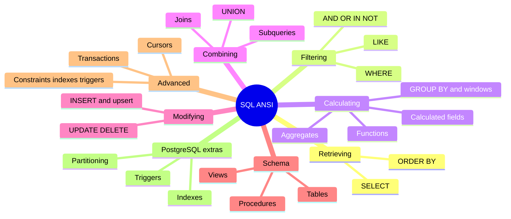

# SQL ANSI

> [!tldr] Start here
> A course through Ben Forta's *Sams Teach Yourself SQL in 10 Minutes a Day* (5th ed.), one note per lesson in book order, plus three PostgreSQL deep dives (triggers, indexes, partitioning). Every lesson keeps the book's examples and adds a "Beyond the book / Senior perspective" section with modern practice (window functions, CTEs, upserts, sargable queries, safe migrations) and interview questions. Part of [[Databases Index]].

## The course, in book order

### Part 1: Retrieving data (beginner)
1. [[Introduction to SQL]]: tables, rows, columns, datatypes, and every kind of key
2. [[Retrieving Information]]: `SELECT`, `DISTINCT`, `LIMIT` / `FETCH FIRST`
3. [[Sorting Data]]: `ORDER BY`, sort direction, `NULLS FIRST/LAST`, collations

### Part 2: Filtering (beginner)
4. [[Filtering Data]]: `WHERE`, operators, `BETWEEN`, `IS NULL` and the `= NULL` trap
5. [[Advanced Filtering Data]]: `AND`/`OR` precedence, `IN`, `NOT`, three-valued logic, `NOT IN` + NULL, SQL injection
6. [[Using Wildcard Filtering]]: `LIKE`, `%`, `_`, leading wildcards, `pg_trgm`

### Part 3: Calculating and summarizing (beginner → intermediate)
7. [[Creating Calculated Fields]]: concatenation, aliases, arithmetic, `CASE`, `COALESCE`
8. [[Using Data Manipulation Functions]]: text, date and numeric functions, sargability
9. [[Summarizing Data]]: `COUNT`, `SUM`, `AVG`, `MIN`, `MAX`, `FILTER`, NULL behaviour
10. [[Grouping Data]]: `GROUP BY`, `HAVING`, `ROLLUP`, **window functions**

### Part 4: Combining data (intermediate)
11. [[Working with Subqueries]]: `IN`/`EXISTS` subqueries, correlated subqueries, CTEs, `LATERAL`
12. [[Joining Tables]]: inner joins, Cartesian products, join algorithms
13. [[Creating Advanced Joins]]: aliases, self/natural/outer joins, anti-joins, `FULL OUTER JOIN` support
14. [[Combining Queries]]: `UNION`, `UNION ALL`, `INTERSECT`, `EXCEPT`

### Part 5: Modifying data (intermediate)
15. [[Inserting Data]]: `INSERT`, `INSERT SELECT`, upserts (`ON CONFLICT`, `MERGE`), `RETURNING`
16. [[Updating and Deleting Data]]: `UPDATE`, `DELETE`, `TRUNCATE` per DBMS, safe data fixes

### Part 6: Schema and database objects (intermediate → senior)
17. [[Creating and Manipulating Tables]]: `CREATE`/`ALTER`/`DROP TABLE`, identity vs UUIDv7, generated columns, lock-safe migrations
18. [[Using Views]]: views, updatable views, `WITH CHECK OPTION`, materialized views
19. [[Working with Stored Procedures]]: T-SQL and PostgreSQL procedures vs functions

### Part 7: Transactions and advanced features (senior)
20. [[Managing Transaction Processing]]: `COMMIT`, `ROLLBACK`, savepoints, autocommit, transactional DDL
21. [[Using Cursors]]: `DECLARE`/`FETCH`, `WITH HOLD`, server-side cursors in drivers
22. [[Understanding Advanced SQL Features]]: constraints, indexes, triggers, recursive CTEs

### PostgreSQL extras (senior)
- [[SQL Trigger Functions]]: trigger functions, `BEFORE`/`AFTER`, `NEW`/`OLD`/`TG_OP`, transition tables, a full audit trigger
- [[SQL Indexes Deep Dive]]: B-tree/hash/GIN/GiST/BRIN, composite and covering indexes, partial and expression indexes, selectivity, `CONCURRENTLY`, unused indexes, PostgreSQL 18 skip scan
- [[SQL Table Partitioning]]: RANGE/LIST/HASH, pruning, attach/detach, retention, pg_partman, partitioning vs sharding

## Suggested study paths

> [!example]- 🔁 First time through (beginner → senior)
> 1. Lessons 1–10 in order: you can now read and summarize any single table.
> 2. Lessons 11–14: combine tables. Practise until joins and `NOT EXISTS` feel natural.
> 3. Lessons 15–19: write data and design tables.
> 4. Lessons 20–22 plus [[Transactions & ACID]] and [[Isolation Levels & Read Phenomena]].
> 5. The PostgreSQL extras, then [[Query Optimization & EXPLAIN]] and [[Data Modeling & Normalization]].

> [!example]- 🎯 Interview crash course
> [[Advanced Filtering Data]] (NULL logic, NOT IN trap) → [[Grouping Data]] (window functions, top-N per group) → [[Creating Advanced Joins]] (ON vs WHERE, anti-joins) → [[Working with Subqueries]] (CTEs, LATERAL) → [[Inserting Data]] (upserts) → [[Managing Transaction Processing]] → [[SQL Indexes Deep Dive]] → [[Query Optimization & EXPLAIN]]

> [!example]- ⚡ Performance-focused
> [[Filtering Data]] (sargable predicates) → [[Using Wildcard Filtering]] (leading wildcards, pg_trgm) → [[SQL Indexes Deep Dive]] → [[Database Indexes]] → [[Query Optimization & EXPLAIN]] → [[SQL Table Partitioning]] → [[Retrieving Information]] (keyset pagination)

## 🆕 2025–2026 in this area
- PostgreSQL 18 (2025-09-25): B-tree skip scan, better `OR` index use, parallel GIN builds, `uuidv7()`: [[SQL Indexes Deep Dive]]
- PostgreSQL 18: virtual generated columns (now the default kind), `uuidv7()`, temporal `WITHOUT OVERLAPS` constraints: [[Creating and Manipulating Tables]]
- PostgreSQL 18: `RETURNING` can reference `OLD` and `NEW` in `INSERT`/`UPDATE`/`DELETE`/`MERGE`: [[Inserting Data]], [[Updating and Deleting Data]]
- PostgreSQL 19 beta (GA expected ~October 2026): `INSERT ... ON CONFLICT DO SELECT ... RETURNING` listed in the release notes: [[Inserting Data]]
- PostgreSQL 19 Beta 4 (2026-09-24): `MERGE`/`SPLIT PARTITIONS` reverted from v19: [[SQL Table Partitioning]]
- MySQL 8.0 end of life (2026-04-30); current LTS lines 8.4 and 9.7: [[Creating and Manipulating Tables]]

## Related
- [[Databases Index]] · [[Database Round]] · [[Software Engineering]]
- Core concepts: [[Transactions & ACID]] · [[Isolation Levels & Read Phenomena]] · [[Query Optimization & EXPLAIN]] · [[Data Modeling & Normalization]]
- Internals: [[Database Indexes]] · [[Primary vs Secondary Key]] · [[Sharding & Partitioning]]

## Sources
- Ben Forta, *Sams Teach Yourself SQL in 10 Minutes a Day*, 5th ed., Pearson/Sams, 2019 ([O'Reilly](https://learning.oreilly.com/library/view/sams-teach-yourself/9780135182925/))
- [PostgreSQL documentation](https://www.postgresql.org/docs/current/)
- [Use The Index, Luke](https://use-the-index-luke.com/)
