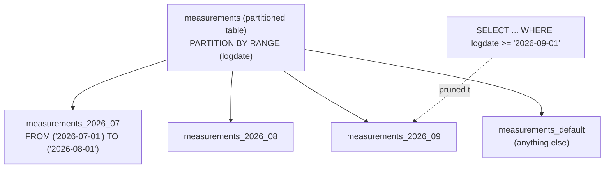

# SQL Table Partitioning

> [!tldr] TL;DR
> Partitioning splits one big logical table into smaller physical tables (partitions) by a **partition key**, inside **one** database. PostgreSQL's declarative partitioning supports `RANGE`, `LIST` and `HASH`. The big wins are **partition pruning** (queries that filter on the key skip irrelevant partitions) and **cheap retention** (drop or detach a whole partition instead of deleting millions of rows). The costs: the key must be in every primary key/unique constraint, queries without the key touch every partition, and too many partitions slow planning. Partitioning is not sharding; sharding spreads data across servers.

> PostgreSQL extra, after the course. Prev extra: [[SQL Indexes Deep Dive]] · Back to [[SQL ANSI]]

## Why partition a table?

Partitioning splits one large table into smaller ones, which brings:

- **Smaller units are faster** to scan, vacuum, index and cache. Queries on recent data touch only the recent partition, whose indexes fit in memory.
- **Efficient bulk deletes:** drop a whole partition (a metadata operation) instead of `DELETE`-ing row by row (no bloat, no vacuum debt, no WAL flood).
- **Pruning as a crude index:** PostgreSQL skips partitions that can't match. For example, if a table is partitioned by date, a query for last week may not need a date index at all; a sequential scan of one small partition is enough.
- **Tiered storage:** rarely used partitions can be moved to cheaper storage (tablespaces) or archived.
- **Maintenance per partition:** `VACUUM`, `REINDEX`, `ANALYZE` and bulk loads per partition; load a new partition then attach it.

When **not** to partition: tables under tens of GB that are well indexed, or workloads whose queries don't filter on any single natural key. Partitioning adds complexity; it's a tool for very large tables with a clear access pattern (usually time).

## PostgreSQL declarative partitioning (PG 10+)

The parent table holds no data; rows are routed to partitions by the partition key.



### RANGE partitioning (time series)

```sql
CREATE TABLE measurements (
  id        BIGINT GENERATED ALWAYS AS IDENTITY,   -- identity on partitioned tables: PG 17+
  city_id   INT         NOT NULL,
  logdate   DATE        NOT NULL,
  peaktemp  INT,
  unitsales INT,
  PRIMARY KEY (id, logdate)                        -- must include the partition key
) PARTITION BY RANGE (logdate);

CREATE TABLE measurements_2026_07 PARTITION OF measurements
  FOR VALUES FROM ('2026-07-01') TO ('2026-08-01');   -- lower bound inclusive, upper exclusive
CREATE TABLE measurements_2026_08 PARTITION OF measurements
  FOR VALUES FROM ('2026-08-01') TO ('2026-09-01');
CREATE TABLE measurements_2026_09 PARTITION OF measurements
  FOR VALUES FROM ('2026-09-01') TO ('2026-10-01');

-- Catch rows that match no partition (otherwise the INSERT fails)
CREATE TABLE measurements_default PARTITION OF measurements DEFAULT;

-- Indexes created on the parent are created on every partition (and future ones)
CREATE INDEX ON measurements (city_id, logdate);

INSERT INTO measurements (city_id, logdate, peaktemp, unitsales)
VALUES (1, '2026-09-15', 31, 120);    -- routed to measurements_2026_09
```

### LIST partitioning (categories, tenants, regions)

```sql
CREATE TABLE orders_by_region (
  order_id   BIGINT NOT NULL,
  region     TEXT   NOT NULL,
  order_date DATE   NOT NULL,
  total      NUMERIC(12,2),
  PRIMARY KEY (order_id, region)
) PARTITION BY LIST (region);

CREATE TABLE orders_eu   PARTITION OF orders_by_region FOR VALUES IN ('DE', 'FR', 'NL');
CREATE TABLE orders_us   PARTITION OF orders_by_region FOR VALUES IN ('US');
CREATE TABLE orders_rest PARTITION OF orders_by_region DEFAULT;
```

### HASH partitioning (spread evenly, no natural range)

```sql
CREATE TABLE sessions (
  session_id UUID NOT NULL,
  user_id    BIGINT NOT NULL,
  data       JSONB,
  PRIMARY KEY (session_id, user_id)
) PARTITION BY HASH (user_id);

CREATE TABLE sessions_p0 PARTITION OF sessions FOR VALUES WITH (MODULUS 4, REMAINDER 0);
CREATE TABLE sessions_p1 PARTITION OF sessions FOR VALUES WITH (MODULUS 4, REMAINDER 1);
CREATE TABLE sessions_p2 PARTITION OF sessions FOR VALUES WITH (MODULUS 4, REMAINDER 2);
CREATE TABLE sessions_p3 PARTITION OF sessions FOR VALUES WITH (MODULUS 4, REMAINDER 3);
```

Hash partitions spread writes and vacuum work but give pruning only for equality on the key, and can't be dropped for retention. Changing the modulus later means rewriting data.

### Sub-partitioning

A partition can itself be partitioned (`... PARTITION OF measurements FOR VALUES ... PARTITION BY LIST (city_id)`). Use sparingly; the partition count multiplies.

| Strategy | Key examples | Pruning works for | Retention by drop |
|---|---|---|---|
| RANGE | timestamps, IDs | `=`, `<`, `>`, `BETWEEN` on the key | Yes, ideal |
| LIST | region, tenant, status | `=`, `IN` | Yes, per value |
| HASH | user_id, device_id | `=` only | No |

## Attach and detach partitions

```sql
-- Load next month's data into a standalone table, then attach it
CREATE TABLE measurements_2026_10 (LIKE measurements INCLUDING DEFAULTS INCLUDING CONSTRAINTS);
ALTER TABLE measurements_2026_10
  ADD CONSTRAINT m_2026_10_chk CHECK (logdate >= '2026-10-01' AND logdate < '2026-11-01');
-- ... bulk load ...
ALTER TABLE measurements ATTACH PARTITION measurements_2026_10
  FOR VALUES FROM ('2026-10-01') TO ('2026-11-01');
```

The matching `CHECK` constraint lets PostgreSQL skip the validation scan during `ATTACH`. `ATTACH PARTITION` takes only a `SHARE UPDATE EXCLUSIVE` lock on the parent (PG 12+), so reads and writes continue. If a `DEFAULT` partition exists, PostgreSQL must scan it to make sure it holds no rows for the new range; keep the default partition small or empty.

```sql
-- Remove old data from the partitioned table without blocking queries (PG 14+)
ALTER TABLE measurements DETACH PARTITION measurements_2026_07 CONCURRENTLY;
-- now archive it (pg_dump, move to cheap storage) or simply:
DROP TABLE measurements_2026_07;
```

`DETACH ... CONCURRENTLY` can't run inside a transaction block and can't be used when a default partition exists. Without `CONCURRENTLY`, detach takes an `ACCESS EXCLUSIVE` lock on the parent.

## Partition pruning

```sql
EXPLAIN SELECT count(*) FROM measurements
WHERE logdate >= '2026-09-01' AND logdate < '2026-10-01';
-- Aggregate
--   ->  Seq Scan on measurements_2026_09 measurements   <- only one partition
--         Filter: ...
```

- **Plan-time pruning** when the key is compared with constants.
- **Execution-time pruning** (PG 11+) when values come from parameters (prepared statements) or subqueries/joins; `EXPLAIN` shows `Subplans Removed: N`.
- Controlled by `enable_partition_pruning` (default `on`). Leave it on.
- Pruning needs the **partition key in the `WHERE`**, compared in a way the planner understands. `WHERE date_trunc('day', logdate) = ...` or casting the key defeats it.

## Indexes, keys and constraints on partitioned tables

- An index created on the parent is a **partitioned index**: one physical index per partition, created automatically for new partitions. PostgreSQL has no global (cross-partition) indexes.
- Therefore **primary keys and unique constraints must include all partition key columns**: each partition can only check uniqueness within itself. `PRIMARY KEY (id)` alone on a table partitioned by `logdate` is rejected; use `PRIMARY KEY (id, logdate)`.
- A truly global unique `id` then relies on the sequence/identity (or UUIDs) rather than a constraint, or on a separate lookup table.
- Foreign keys **referencing** a partitioned table are supported since PG 12.
- Build big indexes without blocking: `CREATE INDEX ... ON ONLY parent` (creates an invalid parent index), then `CREATE INDEX CONCURRENTLY` on each partition, then `ALTER INDEX parent_idx ATTACH PARTITION child_idx`.

## Time-series retention and pg_partman

A typical pattern: partition by day or month, create future partitions ahead of time, and drop partitions older than the retention period. That turns "delete 500M rows" into `DROP TABLE` in milliseconds.

Doing this by hand is error-prone (forget to create next month's partition and inserts start going to the default partition, or failing). **pg_partman** automates it:

```sql
CREATE EXTENSION pg_partman;  -- installs into its own schema by convention
SELECT partman.create_parent(
  p_parent_table => 'public.measurements',
  p_control      => 'logdate',
  p_interval     => '1 month',
  p_premake      => 3                -- keep 3 future partitions ready
);
UPDATE partman.part_config
SET retention = '12 months', retention_keep_table = false
WHERE parent_table = 'public.measurements';
-- run partman.run_maintenance_proc() on a schedule (pg_cron or its background worker)
```

(Function arguments differ between pg_partman major versions; check the docs for your version.) TimescaleDB offers automatic time partitioning ("hypertables") as an alternative.

## Pitfalls

- **Too many partitions.** Thousands of partitions increase planning time, memory and lock overhead (each partition touched is locked). Hourly partitions for years of data is a common mistake; aim for partitions of a few GB to tens of GB.
- **Queries without the partition key** scan **every** partition (and every partition's index), often slower than one big table.
- **Cross-partition uniqueness** can't be enforced unless the key is part of the constraint.
- **Updating the partition key** moves the row to another partition (supported since PG 11, internally a delete + insert), which is slower and can conflict with concurrent updates.
- **Default partition traps:** rows silently piling up in the default partition, and slow `ATTACH` because the default must be scanned.
- **Hot partition:** with range-by-time, all writes hit the newest partition; fine for most, but it doesn't spread write load (hash does).
- **ORM and tooling** support varies; migrations must create partitions ahead of time.

## MySQL partitioning, briefly

MySQL (InnoDB) supports `RANGE`, `LIST`, `HASH`, `KEY` and `COLUMNS` variants:

```sql
CREATE TABLE logs (
  id        BIGINT NOT NULL AUTO_INCREMENT,
  created   DATE   NOT NULL,
  msg       TEXT,
  PRIMARY KEY (id, created)
)
PARTITION BY RANGE COLUMNS (created) (
  PARTITION p2026_08 VALUES LESS THAN ('2026-09-01'),
  PARTITION p2026_09 VALUES LESS THAN ('2026-10-01'),
  PARTITION pmax     VALUES LESS THAN (MAXVALUE)
);

ALTER TABLE logs DROP PARTITION p2026_08;                        -- fast retention
ALTER TABLE logs REORGANIZE PARTITION pmax INTO (
  PARTITION p2026_10 VALUES LESS THAN ('2026-11-01'),
  PARTITION pmax     VALUES LESS THAN (MAXVALUE));
```

Same rule: every unique key must include all partitioning columns. Partitioned InnoDB tables don't support foreign keys.

## Partitioning vs sharding

| | Partitioning | Sharding |
|---|---|---|
| Where | One database server, one logical table | Many servers, each with a subset of rows |
| Goal | Manageability, pruning, retention | Scale writes and storage beyond one machine |
| Transparency | Fully transparent to SQL | Routing by shard key; cross-shard joins/transactions are hard |
| Tools | PostgreSQL/MySQL built in | Citus, Vitess, application-level routing, distributed SQL |

*Partitioning works at the table level; sharding works at the database level.* Sharding strategies (range, hash, consistent hashing), and a worked Postgres range-partition example, are in [[Sharding & Partitioning]].

> [!info]+ 🆕 2025–2026
> - **PostgreSQL 17 (released 2024-09-26)** allowed **identity columns** and **exclusion constraints** on partitioned tables (exclusion constraints must compare the partition key columns with equality). Before 17, `GENERATED ... AS IDENTITY` on a partitioned parent wasn't possible.
> - **PostgreSQL 19 is in beta** (Beta 1 on 2026-06-04, Beta 4 on 2026-09-24; GA expected around October 2026). Beta 1 included `ALTER TABLE ... MERGE PARTITIONS` and `ALTER TABLE ... SPLIT PARTITION(S)`, but the **Beta 4 announcement lists them as reverted from v19**, so don't expect them in the 19.0 release. The v19 release notes do list `COPY TO` working directly on partitioned tables.

## Interview questions

> [!question]- What is partition pruning?
> The planner (or executor, for parameters) excludes partitions whose bounds can't match the query's condition on the partition key, so only relevant partitions are scanned. It requires filtering on the key in a form the planner can evaluate.

> [!question]- Why must the primary key include the partition key in PostgreSQL?
> Indexes are per partition (no global indexes), so uniqueness can only be enforced within a partition. Including the key guarantees that equal key values land in the same partition.

> [!question]- How do you implement data retention on a 2 TB events table?
> Range-partition by time (day/month), pre-create future partitions, and drop or `DETACH ... CONCURRENTLY` partitions older than the retention window (automate with pg_partman). Much cheaper than batched `DELETE`s.

> [!question]- Partitioning vs sharding?
> Partitioning splits a table into pieces on one server, transparently to SQL; sharding distributes rows across multiple servers to scale beyond one machine, with routing and cross-shard complexity.

> [!question]- When would partitioning make performance worse?
> When most queries don't filter on the partition key (every partition is scanned), when there are too many partitions (planning and locking overhead), or when the table was small enough to begin with.

> [!question]- RANGE vs LIST vs HASH?
> RANGE for ordered values like time (retention by drop, range pruning); LIST for discrete categories like region/tenant; HASH to spread rows evenly when there's no natural grouping (equality pruning only, no drop-based retention).

## Related
- [[SQL ANSI]] · [[Databases Index]]
- [[Sharding & Partitioning]] (sharding, consistent hashing, worked range example) · [[SQL Indexes Deep Dive]] · [[Query Optimization & EXPLAIN]] · [[Updating and Deleting Data]] (big deletes) · [[Combining Queries]]

## Sources
- [PostgreSQL docs: Table partitioning](https://www.postgresql.org/docs/current/ddl-partitioning.html)
- [PostgreSQL docs: ALTER TABLE (ATTACH/DETACH PARTITION ... CONCURRENTLY)](https://www.postgresql.org/docs/current/sql-altertable.html)
- [PostgreSQL 17 release notes (identity and exclusion constraints on partitioned tables)](https://www.postgresql.org/docs/17/release-17.html)
- [PostgreSQL 19 Beta 4 released (reverted MERGE/SPLIT PARTITIONS)](https://www.postgresql.org/about/news/postgresql-19-beta-4-released-3386/)
- [PostgreSQL 19 release notes (draft)](https://www.postgresql.org/docs/19/release-19.html)
- [pg_partman on GitHub](https://github.com/pgpartman/pg_partman)
- [MySQL docs: Partitioning](https://dev.mysql.com/doc/refman/8.4/en/partitioning.html)
