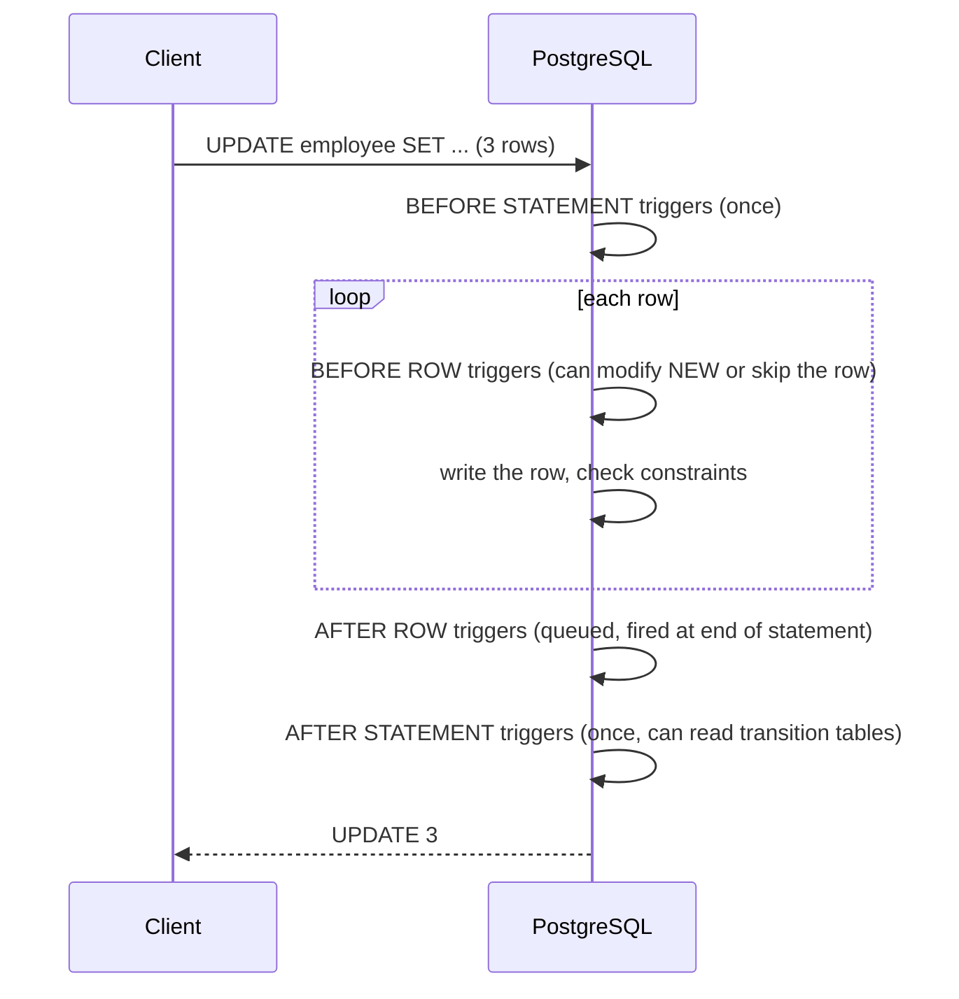

# SQL Trigger Functions

<Note>
**TL;DR**

In PostgreSQL a trigger has two parts: a **trigger function** (`CREATE FUNCTION ... RETURNS trigger LANGUAGE plpgsql`) and a **trigger** that binds it to a table and event (`CREATE TRIGGER ... EXECUTE FUNCTION`). Triggers fire `BEFORE`, `AFTER` or `INSTEAD OF` an `INSERT`/`UPDATE`/`DELETE`/`TRUNCATE`, once per **row** or per **statement**, and see `NEW`, `OLD` and `TG_OP`. Great for audit trails and invariants; dangerous as hidden business logic, and slow on bulk loads.
</Note>

> PostgreSQL extra, after the course. Book intro to triggers: [Understanding Advanced SQL Features](/Software%20Engineering/Databases/SQL%20ANSI/Understanding%20Advanced%20SQL%20Features) · Next extra: [SQL Indexes Deep Dive](/Software%20Engineering/Databases/SQL%20ANSI/SQL%20Indexes%20Deep%20Dive)

## What a trigger is

A trigger is code the database runs automatically when a specific change happens to a specific table (or view). The book's general introduction (what triggers can see, before/after, typical uses, "constraints are faster than triggers") is in [Understanding Advanced SQL Features](/Software%20Engineering/Databases/SQL%20ANSI/Understanding%20Advanced%20SQL%20Features); this note is the PostgreSQL deep dive.

PostgreSQL specifics compared with the SQL standard:
- The trigger's action must be a **function** returning type `trigger`, written in PL/pgSQL, PL/Python, PL/Perl, C, etc. (the standard allows inline SQL statements).
- PostgreSQL can fire triggers on **`TRUNCATE`** (statement-level only).
- Views can have `INSTEAD OF` row triggers and statement-level `BEFORE`/`AFTER` triggers.
- Since PostgreSQL 11 the keyword is `EXECUTE FUNCTION`; `EXECUTE PROCEDURE` still works but is deprecated.



## Types of triggers

| | Row-level (`FOR EACH ROW`) | Statement-level (`FOR EACH STATEMENT`, the default) |
|---|---|---|
| Fires | once **per affected row** (an `UPDATE` of 100 rows fires 100 times) | once **per statement**, even if 0 rows are affected |
| Sees | `NEW` / `OLD` for the row | transition tables (`REFERENCING NEW TABLE AS ...`) in `AFTER` triggers |
| Typical use | validation, defaults, per-row audit | summary maintenance, bulk audit, notifications |

| Timing | Row-level behaviour |
|---|---|
| `BEFORE` | Can **modify** `NEW` (return the changed row) or **skip** the operation for this row (return `NULL`). Runs before constraints are checked. |
| `AFTER` | Sees the final row; the return value is ignored. Use for side effects (audit, other tables). Raising an error still rolls back the statement. |
| `INSTEAD OF` | Only on views, row-level; replaces the operation (makes complex views writable). |

Access to data inside the function:
1. `INSERT`: `NEW` only (`OLD` is NULL).
2. `UPDATE`: both `NEW` and `OLD`.
3. `DELETE`: `OLD` only.

## What triggers are used for

(The original note listed uses twice; merged here.)

1. **Auditing / history:** log who changed what and when to an audit table.
2. **Data consistency and normalization:** e.g. uppercase state codes, trim whitespace, set `updated_at`.
3. **Validation that constraints can't express:** cross-row or cross-table rules, e.g. a customer's credit limit; raise an exception to reject the change.
4. **Automatic population / derived data:** maintain counters, summary tables or search columns.
5. **Cross-table actions:** when a customer is created, create their default account rows.
6. **Notifications:** `pg_notify()` to wake up listeners or feed a queue.

Keep in mind that constraints are faster and more visible than triggers; reach for a trigger only when a constraint (or generated column, or foreign key action) can't do the job.

## `CREATE TRIGGER` syntax

```sql
CREATE [ OR REPLACE ] [ CONSTRAINT ] TRIGGER name
    { BEFORE | AFTER | INSTEAD OF } { event [ OR ... ] }
    ON table_name
    [ FROM referenced_table_name ]
    [ NOT DEFERRABLE | [ DEFERRABLE ] [ INITIALLY IMMEDIATE | INITIALLY DEFERRED ] ]
    [ REFERENCING { { OLD | NEW } TABLE [ AS ] transition_relation_name } [ ... ] ]
    [ FOR [ EACH ] { ROW | STATEMENT } ]
    [ WHEN ( condition ) ]
    EXECUTE { FUNCTION | PROCEDURE } function_name ( arguments )

-- where event can be one of:
    INSERT
    UPDATE [ OF column_name [, ... ] ]
    DELETE
    TRUNCATE
```

(The original copy had collapsed keywords like `INSTEADOF`, `CREATETABLE`, `FOREACHROW`; this is the correct spelling.)

| Parameter | Meaning |
|---|---|
| `name` | Trigger name, unique per table. `OR REPLACE` exists since PostgreSQL 14. |
| `BEFORE` / `AFTER` / `INSTEAD OF` | When the function runs relative to the event. |
| `event` | `INSERT`, `UPDATE [OF cols]`, `DELETE`, `TRUNCATE`; combine with `OR`. `UPDATE OF col` fires only if that column is in the `SET` list. |
| `table_name` | The table, view or foreign table. |
| `FROM referenced_table_name` | Only for constraint triggers (used internally for foreign keys). |
| `DEFERRABLE ...` | Only for constraint triggers: whether they can fire at commit instead of end of statement. |
| `REFERENCING ... TABLE AS` | Names transition tables of old/new rows, for `AFTER` triggers. |
| `FOR EACH ROW` / `FOR EACH STATEMENT` | Row-level or statement-level (default statement). |
| `WHEN (condition)` | Boolean filter checked before calling the function (row triggers can use `OLD`/`NEW` here); cheaper than checking inside. |
| `function_name(arguments)` | A function with no declared arguments returning `trigger`; the optional literal arguments arrive in `TG_ARGV[]`. |

To create a trigger you need the `TRIGGER` privilege on the table and `EXECUTE` on the function.

## Special variables in PL/pgSQL trigger functions

| Variable | Contains |
|---|---|
| `NEW` / `OLD` | the new / old row (row-level) |
| `TG_OP` | `'INSERT'`, `'UPDATE'`, `'DELETE'` or `'TRUNCATE'` |
| `TG_WHEN` | `'BEFORE'`, `'AFTER'`, `'INSTEAD OF'` |
| `TG_LEVEL` | `'ROW'` or `'STATEMENT'` |
| `TG_TABLE_NAME`, `TG_TABLE_SCHEMA` | the table that fired it |
| `TG_NAME` | the trigger's name |
| `TG_ARGV[]`, `TG_NARGS` | arguments from `CREATE TRIGGER` |

What to return:
- `BEFORE` row trigger: `NEW` (possibly modified) to proceed, `OLD` for deletes, or `NULL` to silently skip this row.
- `AFTER` row trigger and all statement triggers: return value ignored; `RETURN NULL` by convention.

## Example 1: a complete, runnable audit trigger

The original note's `Employee` / `Employee_Audit` example, corrected (it had collapsed keywords, a trailing comma in `CREATE TABLE`, and stored the time as `VARCHAR`). Generalized to audit inserts, updates and deletes.

```sql
CREATE TABLE employee (
  employee_id  INT GENERATED ALWAYS AS IDENTITY PRIMARY KEY,
  last_name    VARCHAR(20) NOT NULL,
  first_name   VARCHAR(20) NOT NULL,
  title        VARCHAR(30),
  reports_to   INT REFERENCES employee (employee_id),
  birth_date   DATE,
  hire_date    DATE,
  city         VARCHAR(40),
  country      VARCHAR(40),
  email        VARCHAR(60),
  updated_at   TIMESTAMPTZ NOT NULL DEFAULT now()
);

CREATE TABLE employee_audit (
  audit_id     BIGINT GENERATED ALWAYS AS IDENTITY PRIMARY KEY,
  employee_id  INT         NOT NULL,
  operation    TEXT        NOT NULL,              -- INSERT / UPDATE / DELETE
  changed_by   TEXT        NOT NULL DEFAULT current_user,
  changed_at   TIMESTAMPTZ NOT NULL DEFAULT now(),
  old_row      JSONB,
  new_row      JSONB
);

-- 1) the trigger function
CREATE OR REPLACE FUNCTION employee_audit_fn()
RETURNS trigger
LANGUAGE plpgsql
AS $$
BEGIN
  IF TG_OP = 'INSERT' THEN
    INSERT INTO employee_audit (employee_id, operation, new_row)
    VALUES (NEW.employee_id, TG_OP, to_jsonb(NEW));
  ELSIF TG_OP = 'UPDATE' THEN
    INSERT INTO employee_audit (employee_id, operation, old_row, new_row)
    VALUES (NEW.employee_id, TG_OP, to_jsonb(OLD), to_jsonb(NEW));
  ELSIF TG_OP = 'DELETE' THEN
    INSERT INTO employee_audit (employee_id, operation, old_row)
    VALUES (OLD.employee_id, TG_OP, to_jsonb(OLD));
  END IF;
  RETURN NULL;   -- AFTER trigger: return value is ignored
END;
$$;

-- 2) bind it to the table
CREATE TRIGGER employee_audit_trg
AFTER INSERT OR UPDATE OR DELETE ON employee
FOR EACH ROW
EXECUTE FUNCTION employee_audit_fn();

-- try it
INSERT INTO employee (last_name, first_name, title) VALUES ('Adams', 'Andrew', 'General Manager');
UPDATE employee SET title = 'CEO' WHERE last_name = 'Adams';
DELETE FROM employee WHERE last_name = 'Adams';

SELECT operation, changed_by, old_row->>'title' AS old_title, new_row->>'title' AS new_title
FROM employee_audit ORDER BY audit_id;
--  operation | changed_by |   old_title     |    new_title
--  INSERT    | postgres   |                 | General Manager
--  UPDATE    | postgres   | General Manager | CEO
--  DELETE    | postgres   | CEO             |
```

The audit rows are written in the **same transaction** as the change: if the change rolls back, so does its audit record.

## Example 2: a `BEFORE` trigger that modifies the row

```sql
CREATE OR REPLACE FUNCTION set_updated_at()
RETURNS trigger
LANGUAGE plpgsql
AS $$
BEGIN
  NEW.updated_at := now();
  RETURN NEW;          -- the modified row is what gets written
END;
$$;

CREATE TRIGGER employee_set_updated_at
BEFORE UPDATE ON employee
FOR EACH ROW
WHEN (OLD IS DISTINCT FROM NEW)      -- skip no-op updates
EXECUTE FUNCTION set_updated_at();
```

One generic function can serve every table that has an `updated_at` column.

## Example 3: validation (reject the change)

The original note's `verify_user_for_update` trigger called a function that wasn't shown. A complete version: block updates to terminated employees unless you're an admin role.

```sql
CREATE OR REPLACE FUNCTION employee_verify_user_priv()
RETURNS trigger
LANGUAGE plpgsql
AS $$
BEGIN
  IF OLD.title = 'Terminated' AND NOT pg_has_role(current_user, 'hr_admin', 'MEMBER') THEN
    RAISE EXCEPTION 'only hr_admin may modify terminated employee %', OLD.employee_id
      USING ERRCODE = 'insufficient_privilege';
  END IF;
  RETURN NEW;
END;
$$;

CREATE TRIGGER verify_user_for_update
BEFORE UPDATE ON employee
FOR EACH ROW
EXECUTE FUNCTION employee_verify_user_priv();
```

(This assumes a role named `hr_admin` exists.)

## Example 4: statement-level trigger with transition tables

Row triggers on a 1-million-row `UPDATE` run a million times. A statement-level `AFTER` trigger with transition tables (PostgreSQL 10+) runs **once** and sees all changed rows as tables:

```sql
CREATE OR REPLACE FUNCTION employee_bulk_audit_fn()
RETURNS trigger
LANGUAGE plpgsql
AS $$
BEGIN
  INSERT INTO employee_audit (employee_id, operation, old_row, new_row)
  SELECT n.employee_id, TG_OP, to_jsonb(o), to_jsonb(n)
  FROM new_rows n
  JOIN old_rows o USING (employee_id);
  RETURN NULL;
END;
$$;

CREATE TRIGGER employee_bulk_audit_trg
AFTER UPDATE ON employee
REFERENCING OLD TABLE AS old_rows NEW TABLE AS new_rows
FOR EACH STATEMENT
EXECUTE FUNCTION employee_bulk_audit_fn();
```

(You'd use this **instead of** the row-level audit trigger for updates, not in addition.)

## Example 5: DELETE trigger

```sql
CREATE TRIGGER employee_delete_trigger
AFTER DELETE ON employee
FOR EACH ROW
EXECUTE FUNCTION employee_audit_fn();
```

## Managing triggers

```sql
-- Drop
DROP TRIGGER IF EXISTS employee_audit_trg ON employee;

-- Temporarily disable (e.g. during a data migration; needs table owner rights)
ALTER TABLE employee DISABLE TRIGGER employee_audit_trg;
ALTER TABLE employee ENABLE TRIGGER employee_audit_trg;

-- List triggers on a table (user-defined only)
SELECT tgname, tgenabled
FROM pg_trigger
WHERE tgrelid = 'employee'::regclass
  AND NOT tgisinternal;

-- Or via the standard information schema
SELECT trigger_name, event_manipulation, action_timing, action_orientation
FROM information_schema.triggers
WHERE event_object_table = 'employee';
```

In psql, `\d employee` also lists the table's triggers. `SELECT * FROM pg_trigger;` without the `tgisinternal` filter also shows the internal triggers PostgreSQL uses to enforce foreign keys.

Triggers belong to their table: dropping the table drops its triggers. The function is a separate object and survives.

## Important points

1. You need the `TRIGGER` privilege on the table and `EXECUTE` on the function.
2. Trigger metadata lives in the `pg_trigger` catalog.
3. **Firing order:** multiple triggers for the same event and timing on the same table fire in **alphabetical order by name**. Prefix names (`a10_...`, `a20_...`) if order matters.
4. In a `BEFORE` row trigger, returning `NULL` silently skips the row, and later triggers don't run for it. A common bug is forgetting `RETURN NEW`.
5. Statement-level triggers fire even when zero rows are affected.
6. `COPY FROM` **does** fire `INSERT` triggers. `TRUNCATE` does not fire `DELETE` triggers; only a `TRUNCATE` trigger catches it.

## Pitfalls

- **Hidden logic.** A developer running `UPDATE` doesn't see that three other tables change. Document triggers, name them clearly, and keep them small.
- **Recursion.** A trigger that updates its own table (or two tables whose triggers update each other) can loop. Use `BEFORE` triggers that modify `NEW` instead of issuing `UPDATE`s, guard with `WHEN` or `pg_trigger_depth()`.
- **Performance on bulk loads.** Row triggers multiply the cost of large `INSERT`/`UPDATE`/`COPY`. Consider statement-level triggers with transition tables, or disable triggers during controlled migrations.
- **Replication:** by default, triggers don't fire on logical replication subscribers (they run as `session_replication_role = replica`) unless marked `ENABLE REPLICA` / `ENABLE ALWAYS`.
- **Order dependence and side effects** outside the database (sending email from a trigger) break on rollback. Write to an outbox table instead and let a worker send.
- **Security:** a `SECURITY DEFINER` trigger function runs with its owner's rights; pin `search_path`.

## Beyond the book / Senior perspective

- **Auditing alternatives:** logical decoding / CDC (Debezium) captures every change without triggers; `pgaudit` logs statements; temporal tables (SQL Server `SYSTEM_VERSIONING`, MariaDB) keep history natively.
- **Constraints first, triggers second, app code third** for invariants that must hold for every writer. For logic that's really business workflow, prefer the application.
- **Event triggers** (`CREATE EVENT TRIGGER`) fire on DDL (`ddl_command_start`, `sql_drop`), useful for blocking or logging schema changes.
- MySQL triggers use inline bodies (`CREATE TRIGGER t BEFORE INSERT ON x FOR EACH ROW SET NEW.col = ...`), are row-level only, and can't fire on views. SQL Server triggers are statement-level with `inserted`/`deleted` pseudo-tables.

## Interview questions

<Accordion title="BEFORE vs AFTER trigger?">
`BEFORE` runs before the row is written and can change `NEW` or skip the row; good for validation and defaults. `AFTER` runs once the row is written (constraints checked), sees the final values, and is used for side effects like audit logs.
</Accordion>

<Accordion title="Row-level vs statement-level trigger?">
Row-level fires once per affected row with `NEW`/`OLD`. Statement-level fires once per statement (even for zero rows); in PostgreSQL it can read all changed rows through transition tables.
</Accordion>

<Accordion title="How do you write a trigger in PostgreSQL?">
Create a function `RETURNS trigger` (e.g. in PL/pgSQL, using `NEW`, `OLD`, `TG_OP`), then `CREATE TRIGGER name {BEFORE|AFTER} event ON table FOR EACH ROW EXECUTE FUNCTION fn();`.
</Accordion>

<Accordion title="In what order do multiple triggers fire in PostgreSQL?">
`BEFORE` statement, then per row `BEFORE` row triggers, the write, `AFTER` row triggers (at end of statement), then `AFTER` statement. Within the same kind, alphabetical by trigger name.
</Accordion>

<Accordion title="What are the downsides of triggers?">
Hidden behaviour, harder debugging and testing, possible recursion, slower bulk operations, and coupling business logic to the database. Use them sparingly and document them.
</Accordion>

<Accordion title="How would you keep an audit trail of every change to a table?">
An `AFTER INSERT OR UPDATE OR DELETE` trigger writing `OLD`/`NEW` as JSONB with user and timestamp to an audit table (same transaction), or CDC via logical decoding for high-volume tables.
</Accordion>

## Related
- [SQL ANSI](/Software%20Engineering/Databases/SQL%20ANSI/SQL%20ANSI) · [Databases Index](/Software%20Engineering/Databases/Databases%20Index)
- [Understanding Advanced SQL Features](/Software%20Engineering/Databases/SQL%20ANSI/Understanding%20Advanced%20SQL%20Features) (book intro to triggers) · [Working with Stored Procedures](/Software%20Engineering/Databases/SQL%20ANSI/Working%20with%20Stored%20Procedures) · [Using Views](/Software%20Engineering/Databases/SQL%20ANSI/Using%20Views) (INSTEAD OF) · [Managing Transaction Processing](/Software%20Engineering/Databases/SQL%20ANSI/Managing%20Transaction%20Processing)

## Sources
- [PostgreSQL docs: CREATE TRIGGER](https://www.postgresql.org/docs/current/sql-createtrigger.html)
- [PostgreSQL docs: Overview of trigger behavior](https://www.postgresql.org/docs/current/trigger-definition.html)
- [PostgreSQL docs: PL/pgSQL trigger functions](https://www.postgresql.org/docs/current/plpgsql-trigger.html)
- [PostgreSQL docs: pg_trigger catalog](https://www.postgresql.org/docs/current/catalog-pg-trigger.html)
- [PostgreSQL docs: Event triggers](https://www.postgresql.org/docs/current/event-triggers.html)
- [MySQL docs: Using triggers](https://dev.mysql.com/doc/refman/8.4/en/triggers.html)
