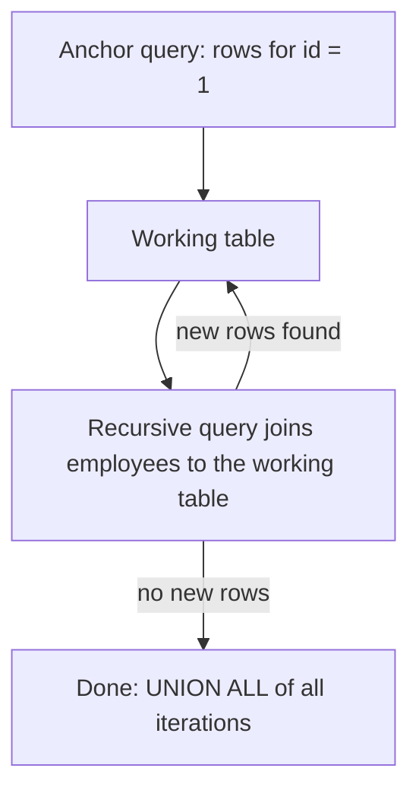

# Understanding Advanced SQL Features

<Note>
**TL;DR**

The book's last lesson covers three tools that make the database protect and speed up your data: **constraints** (primary key, foreign key, unique, check) enforce integrity, **indexes** speed up searching and sorting at the cost of slower writes, and **triggers** run code automatically on data changes. Prefer constraints over triggers. This note adds the modern SQL features the book leaves out: **CTEs and recursive CTEs**, with pointers to window functions and `LATERAL`.
</Note>

> Course: SQL in 10 Minutes, Lesson 22 · Prev: [Using Cursors](/Software%20Engineering/Databases/SQL%20ANSI/Using%20Cursors) · Next: [SQL Trigger Functions](/Software%20Engineering/Databases/SQL%20ANSI/SQL%20Trigger%20Functions) (PostgreSQL extras)

Topics: *constraints, indexes, and triggers* (plus modern extras).

## Understanding constraints

**Constraints:** rules that govern how data is inserted or changed. The DBMS enforces them for every client, which is far more reliable than enforcing them in application code.

Constraints can be defined in `CREATE TABLE` or added later with `ALTER TABLE ... ADD CONSTRAINT`. Give them names; error messages and later `DROP CONSTRAINT` will use them.

### Primary keys

A **primary key** is a special constraint ensuring that values in a column (or set of columns) are unique and never change: the column(s) that uniquely identify each row.

Rules:
1. No two rows may have the same primary key value.
2. Every row must have a primary key value (no `NULL`s).
3. The primary key column should never be modified. (Most DBMSs allow it; don't.)
4. Primary key values should never be reused. If a row is deleted, its key must not go to a new row.

#### Example 1: inline in `CREATE TABLE`

```sql
CREATE TABLE Vendors
(
    vend_id        CHAR(10)    NOT NULL PRIMARY KEY,
    vend_name      CHAR(50)    NOT NULL,
    vend_address   CHAR(50)    NULL,
    vend_city      CHAR(50)    NULL,
    vend_state     CHAR(5)     NULL,
    vend_zip       CHAR(10)    NULL,
    vend_country   CHAR(50)    NULL
);
```

**Analysis:** the `PRIMARY KEY` keyword makes `vend_id` the primary key.

#### Example 2: with `ALTER TABLE ... ADD CONSTRAINT`

```sql
ALTER TABLE Vendors
ADD CONSTRAINT vendors_pk PRIMARY KEY (vend_id);
```

**Analysis:** the same key, defined with `CONSTRAINT` syntax, usable in both `CREATE TABLE` and `ALTER TABLE`.

<Warning>
**Correction: name the constraint**

The original `ADD CONSTRAINT PRIMARY KEY (vend_id)` omits the constraint name. After `CONSTRAINT` the standard (and SQL Server, Oracle, DB2) requires a name. PostgreSQL and MySQL accept an unnamed `ALTER TABLE Vendors ADD PRIMARY KEY (vend_id);` (no `CONSTRAINT` keyword) and generate a name. Naming it yourself (`vendors_pk`) is best practice everywhere.
</Warning>

<Note>
**Keys in SQLite**

SQLite can't add keys with `ALTER TABLE`; define them in the initial `CREATE TABLE`.
</Note>

### Foreign keys

A foreign key is a column whose values **must exist in a primary key (or unique key) of another table**. Foreign keys are central to referential integrity.

Example: `Orders` has one row per order; customer data is in `Customers`. Each order is tied to a customer by customer ID, which is the primary key of `Customers`. The order number is the primary key of `Orders`.

The customer ID in `Orders` isn't unique (a customer can have many orders), but the only **valid** values are IDs that exist in `Customers`. That's what a foreign key enforces.

#### Example 3

```sql
CREATE TABLE Orders
(
    order_num    INTEGER    NOT NULL PRIMARY KEY,
    order_date   DATETIME   NOT NULL,
    cust_id      CHAR(10)   NOT NULL REFERENCES Customers(cust_id)
);
```

**Analysis:** `REFERENCES` says any value in `cust_id` must exist in `Customers.cust_id`.

#### Example 4

```sql
ALTER TABLE Orders
ADD CONSTRAINT orders_customers_fk
FOREIGN KEY (cust_id) REFERENCES Customers (cust_id);
```

**Analysis:** the same thing with `CONSTRAINT` syntax (again, with a name).

<Note>
**Referential actions**

Foreign keys also prevent deleting a customer who still has orders. You can change that with actions:
- `ON DELETE CASCADE`: deleting the parent deletes related child rows. (The book calls this *cascading delete*.)
- `ON DELETE SET NULL` / `SET DEFAULT`: clear the reference.
- `ON DELETE RESTRICT` / `NO ACTION` (default): refuse.

Cascades are convenient but can delete far more than expected. Use them for true ownership (order → order items), not for loose references.
</Note>

### Unique constraints

Unique constraints ensure all values in a column (or set of columns) are unique. Like primary keys, with these **differences**:
1. A table can have many unique constraints, but only one primary key.
2. Unique constraint columns can contain `NULL`s.
3. Unique constraint columns can be modified or updated.
4. Unique constraint values can be reused.
5. The book says unique constraints can't be used to define foreign keys. **Corrected:** in the SQL standard, PostgreSQL, MySQL, SQL Server and Oracle, a foreign key may reference any `UNIQUE` (or primary key) column set.

Syntax: `UNIQUE` in the column definition, or a separate `CONSTRAINT`:

```sql
ALTER TABLE Customers ADD CONSTRAINT customers_email_uq UNIQUE (cust_email);
```

### Check constraints

Check constraints ensure data meets criteria you specify. Common uses:
1. **Minimum or maximum values**, e.g. preventing an order of 0 items (0 is a valid number, just not a valid quantity).
2. **Ranges**, e.g. a ship date on or after today and no more than a year ahead.
3. **Allowed values only**, e.g. only `M` or `F` in a gender field.

#### Example 5

```sql
CREATE TABLE OrderItems
(
    order_num     INTEGER    NOT NULL,
    order_item    INTEGER    NOT NULL,
    prod_id       CHAR(10)   NOT NULL,
    quantity      INTEGER    NOT NULL CHECK (quantity > 0),
    item_price    MONEY      NOT NULL      -- MONEY is SQL Server/PostgreSQL; prefer DECIMAL(8,2)
);
```

**Analysis:** every inserted or updated row is checked to ensure `quantity` is greater than 0.

Allowed values, as a named table-level constraint:

```sql
ALTER TABLE Customers
ADD CONSTRAINT customers_gender_ck CHECK (gender IN ('M', 'F'));
```

<Note>
**CHECK and NULL**

A `CHECK` rejects rows only when the condition is **FALSE**. `NULL IN ('M','F')` is UNKNOWN, so `NULL` passes. Add `NOT NULL` if the value is required. (MySQL ignored `CHECK` constraints entirely until **8.0.16**.)
</Note>

## Understanding indexes

Indexes sort data logically to speed up searching and sorting. Think of the index at the back of a book.

To find every occurrence of the word *datatype* in a book, you could read every line of every page. That works, but it's not practical. Scanning a few pages is fine; scanning a whole book isn't, and the time grows with the amount of text.

That's why books have indexes: an alphabetical list of words with the pages they appear on. You look up *datatype*, then go straight to those pages.

What makes an index work? It's **sorted**. The difficulty in finding words in a book isn't the amount of content, it's that the content isn't sorted by word. If it were sorted like a dictionary, no index would be needed (which is why dictionaries don't have one).

Database indexes work the same way. The book says primary key data is always sorted, so retrieving rows by primary key is always fast. More precisely: the DBMS automatically creates an **index** on the primary key, which makes key lookups fast. Whether the table itself is stored in key order depends on the engine (MySQL InnoDB and SQL Server clustered indexes do; PostgreSQL tables are unordered heaps).

Searching other columns is usually not as efficient. To find all customers in a specific state, the DBMS must read every row (a *full table scan*), just like reading every page of the book.

The solution is an index on one or more columns: the DBMS keeps a sorted structure of those values for itself, searches it to find matching locations, and then retrieves just those rows.

<Warning>
**Indexing trade-offs**

1. Indexes speed up reads but **slow down** inserts, updates and deletes, because every index must be updated too.
2. Index data can take a lot of storage.
3. Not all data benefits. Columns with few distinct values (like State) help less than columns with many (like last name), unless you query for a rare value.
4. Indexes are used for filtering **and** sorting. If you often sort by a column, it may be worth indexing.
5. Multi-column indexes (State + City) help only when queries use the **leading** column(s): State, or State and City. A query on City alone generally can't use it (PostgreSQL 18's skip scan can in some cases). This is the *leftmost-prefix rule*.
</Warning>

### Example 6

Indexes are created with `CREATE INDEX` (syntax varies a lot between DBMSs):

```sql
CREATE INDEX prod_name_ind
ON Products (prod_name);
```

**Analysis:** every index needs a unique name, here `prod_name_ind`. `ON` names the table, and the indexed column(s) go in parentheses.

<Tip>
**Go deeper**

Index types (B-tree, hash, GIN, GiST, BRIN), composite and covering indexes, partial and expression indexes, selectivity, the blocking-factor maths and how to find unused indexes: [SQL Indexes Deep Dive](/Software%20Engineering/Databases/SQL%20ANSI/SQL%20Indexes%20Deep%20Dive). Internals (B+trees, LSM trees, scan types): [Database Indexes](/Software%20Engineering/Databases/Database%20Round/Indexes/Database%20Indexes).
</Tip>

## Understanding triggers

Triggers are special stored procedures that run automatically when specific database activity occurs, typically `INSERT`, `UPDATE` and `DELETE` (or any combination) on a specific table.

Unlike stored procedures (stored SQL you call explicitly), triggers are **tied to tables**. A trigger on `INSERT` into `Orders` runs only when a row is inserted into `Orders`. A trigger on `INSERT` and `UPDATE` on `Customers` runs only for those operations on that table.

Inside a trigger, your code can access:
1. all new data in `INSERT` operations;
2. all new and old data in `UPDATE` operations;
3. deleted data in `DELETE` operations.

Triggers can run **before** or **after** the operation.

Common uses:
1. **Consistency**, e.g. converting all state names to uppercase on `INSERT` or `UPDATE`.
2. **Actions on other tables**, e.g. writing an audit row to a log table whenever a row is updated or deleted.
3. **Extra validation** and rolling back if needed, e.g. blocking an order that would exceed a customer's credit limit.
4. **Computed values or timestamps**, e.g. setting `updated_at`.

### Example 7 (Oracle syntax)

```sql
-- Oracle PL/SQL, as printed in the book
CREATE TRIGGER customer_state
AFTER INSERT OR UPDATE
FOR EACH ROW
BEGIN
UPDATE Customers
SET cust_state = Upper(cust_state)
WHERE Customers.cust_id = :OLD.cust_id
END;
```

**Analysis:** intended to convert `cust_state` in `Customers` to uppercase on every `INSERT` and `UPDATE`. The `:OLD`/`:NEW` bind-variable style is **Oracle** syntax.

<Warning>
**This example won't run as-is**

It's missing `ON Customers` and a `;` after the `UPDATE`, and in Oracle an `AFTER ... FOR EACH ROW` trigger that updates its own table raises "ORA-04091: table is mutating". (For an `INSERT`, `:OLD` is also all `NULL`.) The idiomatic version modifies the incoming row in a **BEFORE** trigger:
```sql
-- Oracle
CREATE OR REPLACE TRIGGER customer_state
BEFORE INSERT OR UPDATE ON Customers
FOR EACH ROW
BEGIN
  :NEW.cust_state := UPPER(:NEW.cust_state);
END;
```
For the PostgreSQL version (trigger function + `CREATE TRIGGER ... EXECUTE FUNCTION`), an audit-log example, `TG_OP`, transition tables and pitfalls, see [SQL Trigger Functions](/Software%20Engineering/Databases/SQL%20ANSI/SQL%20Trigger%20Functions).
</Warning>

<Note>
**Constraints are faster than triggers**

As a rule, constraints are processed faster than triggers (and are declarative, visible and can't be forgotten), so use constraints whenever possible. For "uppercase state", a `CHECK (cust_state = UPPER(cust_state))` plus fixing the data in the app, or a generated column, is often cleaner than a trigger.
</Note>

## Beyond the book: modern SQL features

The book stops at SQL:1999-era features. These are the ones a senior engineer uses weekly.

### CTEs (`WITH`)

Name intermediate results and read the query top-down. Covered in [Working with Subqueries](/Software%20Engineering/Databases/SQL%20ANSI/Working%20with%20Subqueries).

### Recursive CTEs

Query hierarchies and graphs (org charts, category trees, bill of materials, "all replies in a thread"):

```sql
CREATE TABLE employees (
  id         INT PRIMARY KEY,
  name       TEXT NOT NULL,
  manager_id INT REFERENCES employees (id)
);

-- Everyone under manager 1, with their depth and path
WITH RECURSIVE reports AS (
  -- anchor: the starting row(s)
  SELECT id, name, manager_id, 1 AS depth, ARRAY[id] AS path
  FROM employees
  WHERE id = 1

  UNION ALL

  -- recursive step: join the table to the rows found so far
  SELECT e.id, e.name, e.manager_id, r.depth + 1, r.path || e.id
  FROM employees e
  JOIN reports r ON e.manager_id = r.id
  WHERE NOT e.id = ANY (r.path)        -- cycle guard
)
SELECT * FROM reports ORDER BY depth, name;
```



Supported by PostgreSQL, SQL Server (without the `RECURSIVE` keyword), Oracle 11gR2+, MySQL 8.0+, SQLite 3.8.3+. PostgreSQL 14+ also has `SEARCH DEPTH/BREADTH FIRST` and `CYCLE` clauses instead of hand-written path arrays. Always guard against cycles and runaway recursion.

### Window functions

Ranking, running totals, "previous row", top-N per group, without collapsing rows: full section with examples in [Grouping Data](/Software%20Engineering/Databases/SQL%20ANSI/Grouping%20Data).

### `LATERAL` / `APPLY`

A subquery per outer row that can return several rows (e.g. last 3 orders per customer): [Working with Subqueries](/Software%20Engineering/Databases/SQL%20ANSI/Working%20with%20Subqueries).

### Upserts, `MERGE`, `RETURNING`

[Inserting Data](/Software%20Engineering/Databases/SQL%20ANSI/Inserting%20Data).

### Other constraint types worth knowing

- **Exclusion constraints** (PostgreSQL): "no two bookings for the same room may overlap": `EXCLUDE USING gist (room_id WITH =, during WITH &&)`. PostgreSQL 18 adds `PRIMARY KEY (room_id, during WITHOUT OVERLAPS)` as the standard temporal form ([Creating and Manipulating Tables](/Software%20Engineering/Databases/SQL%20ANSI/Creating%20and%20Manipulating%20Tables)).
- **Deferrable constraints**: `DEFERRABLE INITIALLY DEFERRED` checks at `COMMIT` instead of per statement, useful for circular references or swapping unique values.
- **`NOT VALID` then `VALIDATE`**: add a constraint to a big table without a long lock ([Creating and Manipulating Tables](/Software%20Engineering/Databases/SQL%20ANSI/Creating%20and%20Manipulating%20Tables)).

## Senior perspective

- **Push integrity into the database.** App-level validation races under concurrency ("check email is free, then insert" lets two users take the same email). Only a `UNIQUE` constraint is airtight.
- **Every FK column needs an index** in PostgreSQL, or parent deletes/updates scan the child table.
- **Triggers are hidden control flow.** They surprise developers, slow bulk loads and complicate debugging. Use them for auditing and invariants that must hold for every writer; document them.
- **Recursive queries need limits**: depth caps, cycle detection and indexes on the join column (`manager_id`).

## Interview questions

<Accordion title="What types of constraints are there?">
`NOT NULL`, `PRIMARY KEY`, `UNIQUE`, `FOREIGN KEY`, `CHECK`, plus `DEFAULT` (a column property) and, in PostgreSQL, `EXCLUDE`.
</Accordion>

<Accordion title="Can a foreign key reference a column that isn't the primary key?">
Yes, any column set with a `UNIQUE` (or primary key) constraint.
</Accordion>

<Accordion title="Why prefer constraints over triggers?">
They're declarative, faster, visible in the schema, and the optimizer can use them. Triggers are procedural, run per row, and hide logic.
</Accordion>

<Accordion title="What does ON DELETE CASCADE do and what's the risk?">
Deleting a parent row automatically deletes referencing child rows. The risk is deleting much more data than intended in one statement, and long lock times on big cascades.
</Accordion>

<Accordion title="Write a query to get an employee's whole management chain / all subordinates.">
A recursive CTE: an anchor selecting the start employee, `UNION ALL` a recursive part joining `employees` to the CTE on `manager_id` (or `id` for the upward chain), with a depth limit or cycle guard.
</Accordion>

<Accordion title="Why does a CHECK constraint let NULL through?">
`CHECK` rejects only FALSE; a comparison with `NULL` is UNKNOWN. Combine with `NOT NULL` when a value is required.
</Accordion>

## Related
- [SQL ANSI](/Software%20Engineering/Databases/SQL%20ANSI/SQL%20ANSI) · [Databases Index](/Software%20Engineering/Databases/Databases%20Index)
- [SQL Indexes Deep Dive](/Software%20Engineering/Databases/SQL%20ANSI/SQL%20Indexes%20Deep%20Dive) · [Database Indexes](/Software%20Engineering/Databases/Database%20Round/Indexes/Database%20Indexes) · [SQL Trigger Functions](/Software%20Engineering/Databases/SQL%20ANSI/SQL%20Trigger%20Functions) · [Working with Stored Procedures](/Software%20Engineering/Databases/SQL%20ANSI/Working%20with%20Stored%20Procedures)
- [Grouping Data](/Software%20Engineering/Databases/SQL%20ANSI/Grouping%20Data) (window functions) · [Working with Subqueries](/Software%20Engineering/Databases/SQL%20ANSI/Working%20with%20Subqueries) (CTEs, LATERAL) · [Inserting Data](/Software%20Engineering/Databases/SQL%20ANSI/Inserting%20Data) (upsert, MERGE, RETURNING)
- [Data Modeling & Normalization](/Software%20Engineering/Databases/Core%20Concepts/Data%20Modeling%20%26%20Normalization) · [Primary vs Secondary Key](/Software%20Engineering/Databases/Database%20Round/Indexes/Primary%20vs%20Secondary%20Key)

## Sources
- Ben Forta, *Sams Teach Yourself SQL in 10 Minutes a Day*, 5th ed., Lesson 22 ([O'Reilly](https://learning.oreilly.com/library/view/sams-teach-yourself/9780135182925/))
- [PostgreSQL docs: Constraints](https://www.postgresql.org/docs/current/ddl-constraints.html)
- [PostgreSQL docs: WITH queries (recursive CTEs, SEARCH, CYCLE)](https://www.postgresql.org/docs/current/queries-with.html)
- [MySQL docs: CHECK constraints (8.0.16+)](https://dev.mysql.com/doc/refman/8.4/en/create-table-check-constraints.html)
- [Oracle docs: CREATE TRIGGER](https://docs.oracle.com/en/database/oracle/oracle-database/19/lnpls/CREATE-TRIGGER-statement.html)
- [Use The Index, Luke](https://use-the-index-luke.com/)
