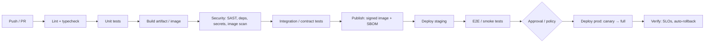
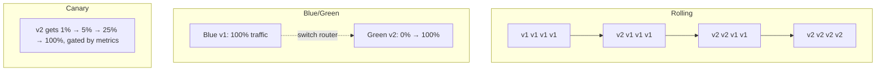

# CI-CD Pipelines

<Note>
**TL;DR**

**Continuous Integration** merges small changes into the main branch often, each verified by an automated build and tests. **Continuous Delivery** keeps every green build deployable; **Continuous Deployment** ships it to production automatically. A good pipeline is fast (cache everything), secure (least-privilege tokens, pinned actions, OIDC instead of long-lived secrets), and ends in a **low-risk deployment strategy** (rolling, blue/green, canary, feature flags). Measure it with the **DORA metrics**.
</Note>

## 1. CI vs Continuous Delivery vs Continuous Deployment

| | What is automated | Human step |
|---|---|---|
| Continuous Integration | Build + test on every push/PR; merge to trunk daily | Deploying |
| Continuous Delivery | Everything up to a production-ready artifact and deploy to staging | Clicking "deploy to prod" |
| Continuous Deployment | Also the production deploy | None (guarded by tests, canaries, flags) |

## 2. Pipeline stages



Principles:
- **Build once, deploy many**: the same artifact (image digest) moves through environments; only config differs.
- **Fail fast**: cheapest checks first; parallelise; target < 10 minutes for PR feedback.
- **Everything as code**: pipeline definitions live in the repo and are reviewed.
- **Hermetic and reproducible**: pinned tool versions, lockfiles, no reliance on runner state.
- **Trunk-based**: see [Git Essentials & Workflows](/Software%20Engineering/DevOps/Git%20Essentials%20%26%20Workflows).

## 3. GitHub Actions example

```yaml
# .github/workflows/ci.yml
name: ci
on:
  pull_request:
  push:
    branches: [main]

permissions:            # least privilege by default for GITHUB_TOKEN
  contents: read

concurrency:            # cancel superseded runs on the same branch
  group: ${{ github.workflow }}-${{ github.ref }}
  cancel-in-progress: true

jobs:
  test:
    runs-on: ubuntu-latest
    strategy:
      matrix:
        node: [22, 24]
    steps:
      - uses: actions/checkout@<full-commit-sha>  # v5, pinned by SHA
      - uses: actions/setup-node@<full-commit-sha>
        with:
          node-version: ${{ matrix.node }}
          cache: npm                               # dependency cache keyed on lockfile
      - run: npm ci
      - run: npm run lint && npm run typecheck
      - run: npm test -- --coverage

  image:
    needs: test
    if: github.ref == 'refs/heads/main'
    runs-on: ubuntu-latest
    permissions:
      contents: read
      packages: write
      id-token: write        # OIDC token for keyless signing / cloud auth
      attestations: write
    steps:
      - uses: actions/checkout@<sha>
      - uses: docker/setup-buildx-action@<sha>
      - uses: docker/login-action@<sha>
        with:
          registry: ghcr.io
          username: ${{ github.actor }}
          password: ${{ secrets.GITHUB_TOKEN }}
      - uses: docker/build-push-action@<sha>
        with:
          push: true
          tags: ghcr.io/${{ github.repository }}:${{ github.sha }}
          cache-from: type=gha
          cache-to: type=gha,mode=max
          sbom: true
          provenance: mode=max

  deploy-staging:
    needs: image
    runs-on: ubuntu-latest
    environment: staging          # environment secrets, protection rules, deployment history
    steps:
      - run: echo "bump image tag in config repo → GitOps syncs"   # see GitOps note

  deploy-prod:
    needs: deploy-staging
    runs-on: ubuntu-latest
    environment:
      name: production            # required reviewers / wait timer configured in repo settings
      url: https://shop.example.com
    steps:
      - run: ./scripts/promote.sh ${{ github.sha }}
```

Key concepts: **workflows** (YAML files) → **jobs** (run on a runner, in parallel unless `needs`) → **steps** (shell commands or reusable **actions**). **Reusable workflows** (`workflow_call`) and **composite actions** remove duplication across repos. **Environments** add protection rules and scoped secrets. **OIDC** (`id-token: write`) lets a job assume a cloud role (AWS/GCP/Azure) without storing static keys.

## 4. Caching

| What | How |
|---|---|
| Package manager downloads | `setup-node`/`setup-python` `cache:` or `actions/cache` keyed on the lockfile hash |
| Docker layers | BuildKit `cache-to/cache-from` (`type=gha`, `type=registry`) |
| Build outputs / test results | Turborepo/Nx remote cache, Bazel remote cache, Gradle build cache |
| Only run what changed | Path filters, affected-graph in monorepos ([Monorepos](/Software%20Engineering/Frontend/14%20Tooling/Monorepos)) |

Cache keys must include everything that affects the output (lockfile, OS, tool version), otherwise you get "passes in CI, fails in prod".

## 5. Deployment strategies



| Strategy | How | Pros | Cons |
|---|---|---|---|
| **Recreate** | Stop all v1, start v2 | Simple | Downtime |
| **Rolling** | Replace instances gradually (K8s default) | No extra capacity, no downtime | v1 and v2 run side by side; slow rollback |
| **Blue/green** | Full v2 environment, switch traffic at once | Instant rollback (switch back), test prod-like env | 2× capacity, DB schema must work for both |
| **Canary** | Small % of traffic to v2, increase if metrics healthy | Limits blast radius, real-user validation | Needs good metrics, traffic splitting (Gateway API, mesh, Argo Rollouts, Flagger) |
| **Shadow / mirroring** | Copy traffic to v2, discard responses | Zero user risk | Side effects must be disabled |
| **Feature flags** | Deploy code dark, release by toggling per user/segment | Decouples deploy from release, instant kill switch, A/B tests | Flag debt, combinatorial testing; needs cleanup discipline |

**Database changes** need the **expand/contract** (parallel change) pattern: add new columns/tables first (compatible with old code), deploy code that writes both, backfill, switch reads, then remove old structures in a later release. This makes every strategy above rollback-safe.

Feature flag tooling: LaunchDarkly, Unleash, Flagsmith, GrowthBook, cloud-native options, and the vendor-neutral **OpenFeature** CNCF standard SDK.

## 6. DORA metrics

DORA (DevOps Research and Assessment, now at Google Cloud) found that speed and stability go together: top performers are better at both.

| Group | Metric | Definition |
|---|---|---|
| Throughput | **Change lead time** | Commit → running in production |
| Throughput | **Deployment frequency** | How often you deploy to production |
| Throughput | **Failed deployment recovery time** | Time to recover from a deployment that needed immediate intervention |
| Instability | **Change fail rate** | % of deployments needing immediate intervention (rollback, hotfix) |
| Instability | **Deployment rework rate** | % of deployments that are unplanned, caused by a production incident |

Use them to improve a team's own system over time, not to rank teams (Goodhart's law). Pair them with [SLOs](/Software%20Engineering/DevOps/Site%20Reliability%20Engineering%20%26%20Incident%20Management) and developer experience measures (e.g. SPACE).

<Info>
**🆕 2025–2026**

- **2025-03-14/15: `tj-actions/changed-files` compromise** (CVE-2025-30066). Attackers repointed the action's version tags to a malicious commit that dumped runner secrets into build logs; 23,000+ repos used it. CISA issued an alert on 2025-03-18. Lesson: **pin third-party actions to full commit SHAs**, minimise `GITHUB_TOKEN` permissions, avoid `pull_request_target` with untrusted code.
- **2025-08-15**: GitHub Actions policies can **enforce SHA pinning** and **block specific actions** (prefix with `!`) at enterprise/org/repo level.
- **2025-09-25**: **GitHub Copilot coding agent GA**: an AI agent that takes an issue, works in an ephemeral environment **powered by GitHub Actions**, and opens a draft PR for review. AI agents in CI now need the same guardrails as humans: branch protection, required reviews, scoped tokens, and firewalled runners. GitHub Copilot CLI went GA on 2026-02-25.
- **2026-01-01**: GitHub-hosted runner prices cut by up to 39% (e.g. Linux 2-core $0.008 → $0.006/min). A planned **$0.002/min fee for self-hosted runners** in private repos (announced for 2026-03-01) was **postponed** after community backlash so GitHub could "re-evaluate" (no new date as of 2026-09).
- **DORA**: the **2025 report** was renamed *State of AI-assisted Software Development*; it found AI adoption still correlates with higher delivery instability. The metrics guide (updated **2026-01-05**) now defines **five** metrics, adding **deployment rework rate** and renaming MTTR to **failed deployment recovery time**.
</Info>

## Pitfalls

<Warning>
**Common pitfalls**

- Flaky tests that everyone re-runs: they erode trust; quarantine and fix them with an owner.
- `permissions: write-all` and long-lived cloud keys in secrets. Use OIDC and least privilege.
- `pull_request_target` + checking out the PR's code = running untrusted code with secrets.
- Rebuilding the image per environment ("works in staging" means nothing).
- Deploying on Friday is not the problem; not being able to roll back in minutes is.
- Manual steps hidden in a wiki page instead of the pipeline.
</Warning>

## Senior perspective

- Optimise for **lead time and recovery**, not just tests passing: small batches, fast pipelines, automated rollback on SLO burn.
- Treat the pipeline as production infrastructure: it holds the keys to prod. Harden runners (ephemeral, isolated), pin dependencies, sign artifacts, generate provenance (SLSA).
- Separate **deploy** (technical) from **release** (business decision) with flags.
- Review questions: How long from merge to prod? How do we roll back, and have we tested it? What can a compromised dependency in CI reach?

## Interview questions

<Accordion title="Continuous delivery vs continuous deployment?">
Delivery: every change is automatically built, tested and made ready to release; production deploy is a manual decision. Deployment: passing changes go to production automatically.
</Accordion>

<Accordion title="Blue/green vs canary?">
Blue/green runs a full parallel environment and switches all traffic at once, with instant switch-back. Canary sends a small percentage of real traffic to the new version and increases it while metrics stay healthy, limiting blast radius. Canary needs traffic splitting and good observability.
</Accordion>

<Accordion title="How do you deploy a DB schema change with zero downtime?">
Expand/contract: make additive, backward-compatible changes first, deploy code that works with both schemas, migrate/backfill data, switch reads, then remove old columns in a later release. Never couple a destructive migration to the same deploy as the code change.
</Accordion>

<Accordion title="Name the DORA metrics.">
Change lead time, deployment frequency, failed deployment recovery time (throughput); change fail rate and deployment rework rate (instability). Historically "the four keys", with MTTR; rework rate was added in 2025.
</Accordion>

<Accordion title="How do you secure a GitHub Actions pipeline?">
Pin actions to commit SHAs (enforceable by policy since Aug 2025), minimal `permissions`, OIDC for cloud credentials, environment protection rules for prod, no untrusted code with secrets (`pull_request_target`), ephemeral runners, secret scanning, dependency review, signed artifacts.
</Accordion>

<Accordion title="What are feature flags and their risks?">
Runtime toggles that decouple deploy from release, enabling gradual rollouts, kill switches and experiments. Risks: flag debt, untested combinations, config becoming a hidden deploy path. Mitigate with ownership, expiry dates and audits.
</Accordion>

## Related
- [DevOps Index](/Software%20Engineering/DevOps/DevOps%20Index) · [Git Essentials & Workflows](/Software%20Engineering/DevOps/Git%20Essentials%20%26%20Workflows) · [GitOps - Argo CD & Flux](/Software%20Engineering/DevOps/GitOps%20-%20Argo%20CD%20%26%20Flux) · [Dockerfile Best Practices & Image Security](/Software%20Engineering/DevOps/Docker/Dockerfile%20Best%20Practices%20%26%20Image%20Security)
- [Infrastructure as Code](/Software%20Engineering/DevOps/Infrastructure%20as%20Code) · [Site Reliability Engineering & Incident Management](/Software%20Engineering/DevOps/Site%20Reliability%20Engineering%20%26%20Incident%20Management) · [Platform Engineering & Internal Developer Platforms](/Software%20Engineering/DevOps/Platform%20Engineering%20%26%20Internal%20Developer%20Platforms)
- [Supply Chain Security](/Software%20Engineering/Frontend/11%20Security/Supply%20Chain%20Security) · [Frontend Testing](/Software%20Engineering/Frontend/13%20Testing/Frontend%20Testing) · [Monorepos](/Software%20Engineering/Frontend/14%20Tooling/Monorepos)
- Tools: [Jenkins - Pipelines as Code](/Software%20Engineering/DevOps/Delivery%20Platform/Jenkins%20-%20Pipelines%20as%20Code) · [Argo CD in Practice](/Software%20Engineering/DevOps/Delivery%20Platform/Argo%20CD%20in%20Practice) · [Kubernetes Delivery Platform - End to End](/Software%20Engineering/DevOps/Delivery%20Platform/Kubernetes%20Delivery%20Platform%20-%20End%20to%20End)

## Sources
- [GitHub Docs: Understanding GitHub Actions](https://docs.github.com/en/actions/get-started/understand-github-actions)
- [GitHub Docs: Security hardening for GitHub Actions](https://docs.github.com/en/actions/security-for-github-actions/security-guides/security-hardening-for-github-actions)
- [GitHub Changelog: Actions policy supports blocking and SHA pinning (2025-08-15)](https://github.blog/changelog/2025-08-15-github-actions-policy-now-supports-blocking-and-sha-pinning-actions/)
- [CISA alert: tj-actions/changed-files compromise (2025-03-18)](https://www.cisa.gov/news-events/alerts/2025/03/18/supply-chain-compromise-third-party-tj-actionschanged-files-cve-2025-30066-and-reviewdogaction)
- [GitHub Changelog: Copilot coding agent GA (2025-09-25)](https://github.blog/changelog/2025-09-25-copilot-coding-agent-is-now-generally-available/)
- [GitHub Changelog: Reduced pricing for GitHub-hosted runners (2026-01-01)](https://github.blog/changelog/2026-01-01-reduced-pricing-for-github-hosted-runners-usage/)
- [DORA: Software delivery performance metrics](https://dora.dev/guides/dora-metrics/) · [DORA 2025 report](https://dora.dev/dora-report-2025/)
- [Martin Fowler: Continuous Integration](https://martinfowler.com/articles/continuousIntegration.html) · [Parallel Change](https://martinfowler.com/bliki/ParallelChange.html)
- Jez Humble & David Farley, *Continuous Delivery* (2010); Forsgren, Humble, Kim, *Accelerate* (2018)
- [OpenFeature](https://openfeature.dev/)
