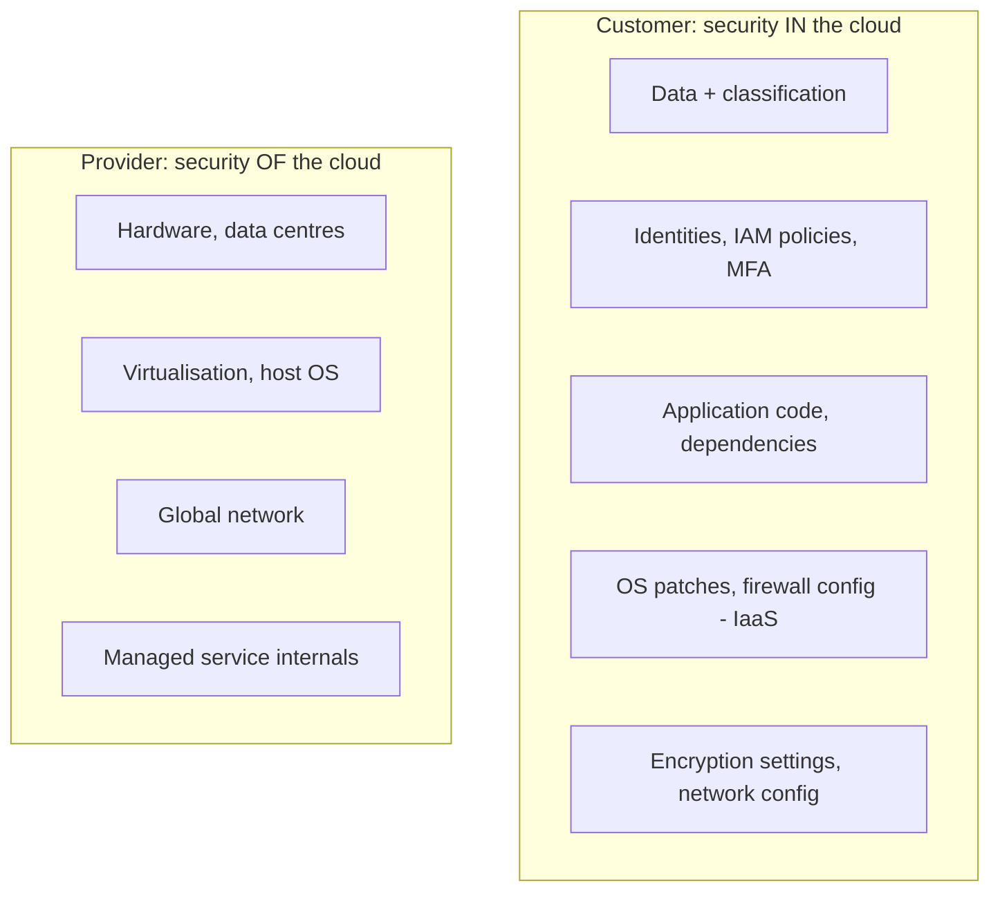

# Cloud Fundamentals

<Note>
**TL;DR**

Cloud computing rents compute, storage, networking and managed services on demand, billed by usage. Service models go from **IaaS** (you manage the OS) through **PaaS** and **serverless** (you manage code) to **SaaS** (you manage data and users). Providers are organised in **regions** made of isolated **availability zones**; design for zone failure by default and region failure when the business needs it. Security follows the **shared responsibility model**, and cost is an engineering concern (**FinOps**).
</Note>

## 1. Service models

```mermaid
flowchart LR
  subgraph You manage less →
    OnPrem[On-prem: everything] --> IaaS[IaaS: OS, runtime, app, data]
    IaaS --> CaaS[Containers/K8s: images, manifests]
    CaaS --> PaaS[PaaS: app + data]
    PaaS --> FaaS[Serverless/FaaS: functions + data]
    FaaS --> SaaS[SaaS: data + users]
  end
```

| Model | You manage | Provider manages | Examples |
|---|---|---|---|
| **IaaS** | OS, patches, runtime, app | Hardware, virtualisation, network | EC2, Compute Engine, Azure VMs |
| **CaaS / managed K8s** | Containers, manifests, (often) node config | Control plane, hardware | EKS, GKE, AKS, ECS |
| **PaaS** | App code + config | OS, runtime, scaling | Elastic Beanstalk, App Engine, Azure App Service, Heroku, Render |
| **Serverless** | Functions/containers + config | Everything else, scale to zero | Lambda, Cloud Run, Cloud Functions, Azure Functions |
| **SaaS** | Data, users, settings | The entire application | Gmail, Salesforce, GitHub |

Deeper comparison of compute choices: [Containers vs VMs vs Serverless](/Software%20Engineering/DevOps/Containers%20vs%20VMs%20vs%20Serverless).

## 2. Global infrastructure

- **Region**: a geographic area (e.g. `eu-west-1`, `europe-west1`, `westeurope`) with its own isolated control plane for most services.
- **Availability Zone (AZ)**: one or more data centres with independent power, cooling and networking, connected with low-latency links. Typically 3+ per region.
- **Edge locations / PoPs**: CDN and DNS (CloudFront, Cloud CDN, Azure Front Door, Cloudflare).

| Design level | Survives | Cost/complexity |
|---|---|---|
| Single AZ | Instance failure | Low |
| **Multi-AZ** (default for prod) | Data-centre failure | Moderate: load balancer across AZs, replicated DB |
| Multi-region active/passive | Region failure (minutes to hours RTO) | High: data replication, DNS failover |
| Multi-region active/active | Region failure with near-zero RTO | Very high: conflict resolution, global data design |

Also note **global services** that have a home region (e.g. parts of AWS IAM, Route 53 control plane in us-east-1): a regional outage can affect them.

## 3. Core service equivalents

| Category | AWS | Google Cloud | Azure |
|---|---|---|---|
| VMs | EC2 | Compute Engine | Virtual Machines |
| Managed Kubernetes | EKS | GKE | AKS |
| Containers without K8s | ECS / Fargate, App Runner | Cloud Run | Container Apps |
| Functions | Lambda | Cloud Run functions | Azure Functions |
| Object storage | S3 | Cloud Storage | Blob Storage |
| Block storage | EBS | Persistent Disk / Hyperdisk | Managed Disks |
| Relational DB | RDS, Aurora | Cloud SQL, AlloyDB, Spanner | Azure SQL, Database for PostgreSQL |
| NoSQL key-value/document | DynamoDB | Firestore, Bigtable | Cosmos DB |
| Cache | ElastiCache / MemoryDB | Memorystore | Azure Cache for Redis / Managed Redis |
| Queue | SQS | Pub/Sub, Cloud Tasks | Queue Storage, Service Bus |
| Pub/sub & streaming | SNS, Kinesis, MSK | Pub/Sub, Managed Kafka | Event Grid, Event Hubs |
| Data warehouse | Redshift | BigQuery | Synapse / Fabric |
| Networking | VPC, ELB/ALB/NLB, Route 53 | VPC, Cloud Load Balancing, Cloud DNS | VNet, Load Balancer/App Gateway, Azure DNS |
| CDN | CloudFront | Cloud CDN | Front Door |
| Identity & access | IAM, IAM Identity Center | Cloud IAM | Entra ID + Azure RBAC |
| Secrets / keys | Secrets Manager, KMS | Secret Manager, Cloud KMS | Key Vault |
| Monitoring | CloudWatch, X-Ray | Cloud Monitoring/Logging/Trace | Azure Monitor, App Insights |
| IaC (native) | CloudFormation, CDK | Infrastructure Manager | ARM / Bicep |
| AI platform | Bedrock, SageMaker | Vertex AI | Azure AI Foundry |

## 4. Networking basics

- **VPC/VNet**: your private network with CIDR ranges, split into **public subnets** (route to an internet gateway) and **private subnets** (outbound via NAT gateway).
- **Security groups** (stateful, per instance/ENI) and network ACLs (stateless, per subnet).
- **Load balancers**: L7 (HTTP, path routing, TLS) vs L4 (TCP/UDP, static IPs).
- **Private endpoints** to reach managed services without the internet.
- Plan CIDRs so VPCs can be peered later without overlap.

## 5. Identity and the shared responsibility model



The line moves with the service model: with IaaS you patch the OS; with Lambda or S3 you do not, but **you always own data, identities and configuration**. Most cloud breaches are misconfigurations: public buckets, over-privileged IAM, leaked long-lived keys.

IAM essentials: least privilege; roles over users; short-lived credentials (SSO, OIDC federation from CI); MFA; separate accounts/projects per environment under an organisation with guardrail policies (SCPs, org policies); audit logs (CloudTrail, Cloud Audit Logs, Activity Log) sent to a separate security account.

## 6. Cost basics and FinOps

Pricing levers:

| Lever | Typical saving | Trade-off |
|---|---|---|
| On-demand | Baseline | Most flexible |
| Savings Plans / Reserved / Committed use | ~30–70% | 1–3 year commitment |
| Spot / Preemptible | Up to ~90% | Can be reclaimed with short notice |
| Rightsizing | Varies | Needs utilisation data |
| Autoscaling / scale to zero | Varies | Cold starts, complexity |
| Storage tiers / lifecycle rules | Large for cold data | Retrieval cost/latency |
| ARM instances (Graviton, Axion, Cobalt) | ~20% price-performance | Multi-arch images |

Hidden costs: **data transfer** (egress to internet, cross-AZ, cross-region), NAT gateway processing, logs and metrics ingestion, idle resources, unattached volumes and snapshots, managed service minimums.

**FinOps** is the practice of making engineering teams accountable for cloud spend. The FinOps Foundation framework runs in three phases: **Inform** (visibility, allocation via tags/labels, showback/chargeback), **Optimize** (rates and usage), **Operate** (governance, continuous improvement). Unit economics (cost per order, per active user) matter more than the total bill. The **FOCUS** spec standardises billing data across providers.

```bash
# Example guardrails
aws budgets create-budget ...                 # budget alerts per account/team
infracost breakdown --path .                  # cost diff on Terraform PRs
```

<Info>
**🆕 2025–2026**

- **2025-10-19/20: AWS us-east-1 outage (~14.5 h)**. A race condition in DynamoDB's automated DNS management left the regional DynamoDB endpoint with an empty DNS record; the failure cascaded to EC2 launches, Network Load Balancers, Lambda, ECS/EKS/Fargate, STS/IAM sign-in and many customer apps worldwide. Lessons: know your **hidden dependencies on one region and on control planes**, prefer static stability (keep serving with what is already running), and test regional failover. See [Site Reliability Engineering & Incident Management](/Software%20Engineering/DevOps/Site%20Reliability%20Engineering%20%26%20Incident%20Management).
- **2025-11-18: Cloudflare global outage (~6 h)**: a database permission change doubled a Bot Management feature file, exceeding a hard limit in the proxy and crashing it. Config and data pushes need the same staged rollout as code.
- **FinOps Framework 2026 updates** (March–April 2026) refined **Scopes** and brought data centres and AI/agentic use cases into FinOps practice, reflecting that AI/GPU spend is now a major cost line.
</Info>

## Pitfalls

<Warning>
**Common pitfalls**

- Everything in one account/project: no blast-radius isolation, messy billing.
- Long-lived access keys on laptops and in CI. Use SSO and OIDC.
- Multi-AZ app, single-AZ database (or single NAT gateway).
- Ignoring egress and cross-AZ traffic in architecture decisions.
- "Lift and shift" VMs and expecting cloud-native savings.
- Assuming "multi-cloud" gives resilience for free: it usually doubles complexity; multi-region within one provider is often the better first step.
</Warning>

## Senior perspective

- Start with a **landing zone**: organisation, accounts per environment/team, SSO, guardrail policies, centralised logging, network topology, tagging standards, all as code ([Infrastructure as Code](/Software%20Engineering/DevOps/Infrastructure%20as%20Code)).
- Choose managed services by default; run it yourself only with a clear reason (cost at scale, missing features, portability).
- Decide explicit **RTO/RPO** per system with the business; they drive multi-AZ vs multi-region and backup strategy.
- Architecture reviews should include a cost estimate and the top 3 cost drivers.
- Vendor lock-in is a trade-off, not a sin: use proprietary services where they bring leverage; keep data export paths and abstractions at the boundaries that matter.

## Interview questions

<Accordion title="IaaS vs PaaS vs SaaS vs serverless?">
IaaS: rent VMs, you manage OS and up. PaaS: deploy code, platform manages OS/runtime/scaling. Serverless: functions or containers that scale automatically (to zero) and bill per use. SaaS: use finished software. Each step trades control for less operational work.
</Accordion>

<Accordion title="Region vs availability zone?">
A region is a geographic area; AZs are isolated failure domains (separate power/network) inside a region with low latency between them. Multi-AZ protects against data-centre failure; multi-region against regional failure.
</Accordion>

<Accordion title="Explain the shared responsibility model.">
The provider secures the cloud (hardware, facilities, virtualisation, managed service internals); the customer secures what they put in it (data, identities, configuration, application, and OS for IaaS). The boundary moves with the service model.
</Accordion>

<Accordion title="How would you reduce a cloud bill by 30%?">
Get visibility first (tags, cost per service/team), remove idle resources, rightsize, use commitments for steady baseline and spot for tolerant workloads, autoscale and schedule non-prod shutdowns, move cold data to cheaper tiers, reduce egress/cross-AZ traffic and log volume, adopt ARM instances.
</Accordion>

<Accordion title="What did the October 2025 AWS outage teach?">
That a regional failure in a foundational service (DynamoDB DNS) cascades through dependent services and control planes. Teams need to map hidden dependencies, design for static stability, avoid depending on control-plane operations (launching instances) during recovery, and have tested multi-region plans for critical systems.
</Accordion>

## Related
- [DevOps Index](/Software%20Engineering/DevOps/DevOps%20Index) · [Containers vs VMs vs Serverless](/Software%20Engineering/DevOps/Containers%20vs%20VMs%20vs%20Serverless) · [Infrastructure as Code](/Software%20Engineering/DevOps/Infrastructure%20as%20Code) · [Observability - Logs, Metrics & Traces](/Software%20Engineering/DevOps/Observability%20-%20Logs%2C%20Metrics%20%26%20Traces)
- [Site Reliability Engineering & Incident Management](/Software%20Engineering/DevOps/Site%20Reliability%20Engineering%20%26%20Incident%20Management) · [Microservices Architecture](/Software%20Engineering/DevOps/Microservices%20Architecture) · [Networking - HTTP, Caching & Real-time](/Software%20Engineering/Frontend/03%20Browser%20%26%20Web%20Platform/Networking%20-%20HTTP%2C%20Caching%20%26%20Real-time)

## Sources
- [NIST SP 800-145: The NIST Definition of Cloud Computing](https://csrc.nist.gov/pubs/sp/800/145/final)
- [AWS: Shared Responsibility Model](https://aws.amazon.com/compliance/shared-responsibility-model/)
- [AWS: Regions and Availability Zones](https://aws.amazon.com/about-aws/global-infrastructure/regions_az/)
- [Google Cloud: Compare AWS and Azure services to Google Cloud](https://cloud.google.com/docs/get-started/aws-azure-gcp-service-comparison)
- [AWS Well-Architected Framework](https://docs.aws.amazon.com/wellarchitected/latest/framework/welcome.html)
- [AWS: Summary of the DynamoDB service disruption in us-east-1 (Oct 2025)](https://aws.amazon.com/message/101925/)
- [Cloudflare blog: 18 November 2025 outage](https://blog.cloudflare.com/18-november-2025-outage/)
- [FinOps Foundation: FinOps Framework](https://www.finops.org/framework/) · [FOCUS spec](https://focus.finops.org/)
