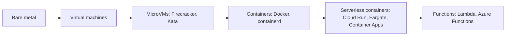

# Containers vs VMs vs Serverless

> [!tldr] TL;DR
> **VMs** virtualise hardware and run a full guest OS: strongest isolation, slowest to start. **Containers** are isolated processes sharing the host kernel: lightweight, portable, start in milliseconds to seconds. **Serverless** (functions or serverless containers) hides servers entirely, scales to zero and bills per request or per second, at the cost of limits, cold starts and less control. **MicroVMs** (Firecracker, Kata) blur the line: VM isolation with near-container speed, and they power most serverless platforms.

## The spectrum



```text
Virtual machines                    Containers
+------+ +------+ +------+          +-----+ +-----+ +-----+
| App  | | App  | | App  |          | App | | App | | App |
| Libs | | Libs | | Libs |          |Libs | |Libs | |Libs |
|GuestOS||GuestOS||GuestOS|         +-----+ +-----+ +-----+
+------+ +------+ +------+          | Container runtime    |
|      Hypervisor        |          |  Host OS (shared kernel)
|   Host OS / hardware   |          |      Hardware        |
```

## Comparison

| | VMs | Containers | Serverless (FaaS / serverless containers) |
|---|---|---|---|
| Isolation | Hardware-level (hypervisor) | Kernel namespaces/cgroups (shared kernel) | Provider-managed, usually microVMs per tenant |
| Startup | Tens of seconds to minutes | Milliseconds to seconds | ms to seconds; **cold starts** after idle |
| Density | Low (GB per VM) | High (MB per container) | N/A (provider's problem) |
| Unit you ship | VM image (AMI) | OCI image | Zip/function or OCI image |
| Scaling | Autoscaling groups (minutes) | Orchestrator (seconds) | Automatic, per request, **to zero** |
| Billing | Per second/hour while running | Per node (K8s) or per task (Fargate) | Per request + duration (GB-s) or per vCPU-s |
| Limits | Few | Few | Max duration (Lambda: 15 min), memory, payload, concurrency |
| Ops burden | Highest: OS patching | Medium: images, orchestrator | Lowest |
| State | Local disk OK | Ephemeral; volumes | Stateless; external storage only |
| Portability | Hypervisor-specific images | Very high (OCI) | Low for FaaS (vendor APIs); high for serverless containers |

## When to choose what

- **VMs**: legacy or stateful software that expects a full OS, special kernels/drivers, licensing tied to hosts, strong isolation for untrusted tenants, databases you self-manage.
- **Containers on Kubernetes**: many services, steady traffic, need for fine control (networking, sidecars, GPUs), multi-cloud portability, a platform team to run it.
- **Serverless containers (Cloud Run, Fargate, Container Apps)**: containerised web apps and APIs without cluster ops; a great default for small teams.
- **Functions (Lambda, Azure Functions)**: event glue (S3 upload → thumbnail, queue consumers, cron, webhooks), spiky or low traffic, fast prototyping.

### Cost intuition

Serverless is cheapest at **low or spiky** utilisation (you pay nothing idle). At **high sustained** load, per-request pricing often exceeds reserved VMs or well-packed Kubernetes nodes. Model it: requests/month × duration × memory vs node-hours at realistic utilisation. Include people cost: running Kubernetes well needs engineers.

### Cold starts

A new function instance must start a microVM/sandbox, load the runtime and your code, and run init. Mitigations: smaller bundles, lighter runtimes (Go, Rust, or Node over JVM, or JVM with SnapStart/GraalVM native), provisioned concurrency / min instances, keeping heavy init lazy.

## Isolation deep dive

- Container escapes are kernel bugs or misconfigurations (privileged containers, host mounts, Docker socket). Hardening: non-root, user namespaces, seccomp, AppArmor/SELinux, dropped capabilities, read-only rootfs.
- **Sandboxed runtimes** for untrusted code: **gVisor** (user-space kernel), **Kata Containers** (each Pod in a lightweight VM), **Firecracker** microVMs (Lambda, Fargate). Kubernetes selects them via `RuntimeClass`.
- **WebAssembly** (Wasm/WASI) is an emerging, even lighter sandbox for edge functions (Cloudflare Workers-style isolates, Fermyon/SpinKube).

> [!info]+ 🆕 2025–2026
> - **Kubernetes v1.36 (2026-04-22)** made **User Namespaces GA**: root inside a container maps to an unprivileged user on the host, closing a big part of the isolation gap between containers and VMs.
> - **Kubernetes v1.37 (2026-08-26)** brought **HPA scale-to-zero to beta, enabled by default**, so plain Kubernetes workloads can idle at zero replicas like serverless (wake-up needs an external/object metric such as queue depth).
> - The rise of AI coding agents made **sandboxed execution** (microVMs, gVisor, per-agent containers) a mainstream DevOps concern in 2025–2026: agents run untrusted, generated code and need strong isolation plus network egress controls.

## Pitfalls

> [!warning] Common pitfalls
> - Treating containers as lightweight VMs (SSH inside, multiple daemons, state on local disk).
> - Lambda for long-running or constant high-throughput jobs: timeouts and a big bill.
> - Ignoring connection limits: thousands of function instances each opening DB connections (use RDS Proxy, connection poolers, HTTP-based data APIs).
> - Kubernetes for a single small app: operational cost exceeds benefit.
> - Forgetting that serverless still has servers: regional outages and quota limits still apply.

## Senior perspective

- Choose the **highest level of abstraction that meets your constraints**; drop down only for concrete needs (latency, cost at scale, control, compliance).
- Mixed estates are normal: Kubernetes for core services, serverless for glue and spiky jobs, managed databases instead of VMs.
- Portability comes from OCI images + standard protocols (HTTP, OpenTelemetry), not from avoiding every managed service.
- Evaluate by total cost of ownership, time to production, and on-call load, not by list price per vCPU.

## Interview questions

> [!question]- Why do containers start faster than VMs?
> A container is just a process with namespaces and cgroups on an already running kernel; there is no guest OS to boot. A VM must boot a full OS on virtual hardware.

> [!question]- Is a container as secure as a VM?
> Not by default: containers share the host kernel, so a kernel exploit or misconfiguration can escape. VMs have a smaller shared surface (the hypervisor). Hardening, user namespaces and sandboxed runtimes (gVisor, Kata, Firecracker) narrow the gap.

> [!question]- What is a cold start and how do you reduce it?
> The latency of creating a new function/container instance (sandbox + runtime + init code) when no warm instance is available. Reduce with smaller packages, faster runtimes, lazy init, snapshotting (SnapStart), and provisioned concurrency / minimum instances.

> [!question]- When is serverless more expensive than containers?
> At high, steady utilisation: per-invocation and per-GB-second pricing adds up, while reserved nodes packed with containers amortise well. Serverless wins for idle-heavy or spiky workloads and when ops time is expensive.

> [!question]- What is a microVM?
> A minimal virtual machine (e.g. Firecracker) with a tiny device model that boots in ~100 ms with small memory overhead, giving VM-level isolation at near-container density. AWS Lambda and Fargate use Firecracker.

## Related
- [[DevOps Index]] · [[Docker Basics]] · [[Kubernetes]] · [[Cloud Fundamentals]] · [[Microservices Architecture]] · [[Linux & Shell Essentials]]

## Sources
- [Docker docs: What is a container?](https://docs.docker.com/get-started/docker-concepts/the-basics/what-is-a-container/)
- [Firecracker](https://firecracker-microvm.github.io/) · [Agache et al., *Firecracker: Lightweight Virtualization for Serverless Applications* (NSDI 2020)](https://www.usenix.org/conference/nsdi20/presentation/agache)
- [gVisor docs](https://gvisor.dev/docs/) · [Kata Containers](https://katacontainers.io/)
- [AWS Lambda quotas](https://docs.aws.amazon.com/lambda/latest/dg/gettingstarted-limits.html)
- [Kubernetes docs: User namespaces](https://kubernetes.io/docs/concepts/workloads/pods/user-namespaces/) · [Kubernetes v1.36 release](https://kubernetes.io/blog/2026/04/22/kubernetes-v1-36-release/)
- [Kubernetes blog: HPA scale to zero beta (2026-09-02)](https://kubernetes.io/blog/2026/09/02/kubernetes-v1-37-hpa-scale-to-zero-beta/)
